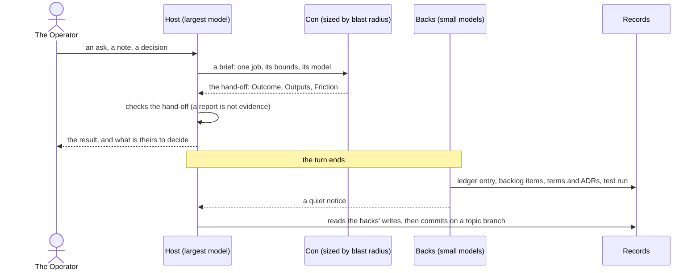
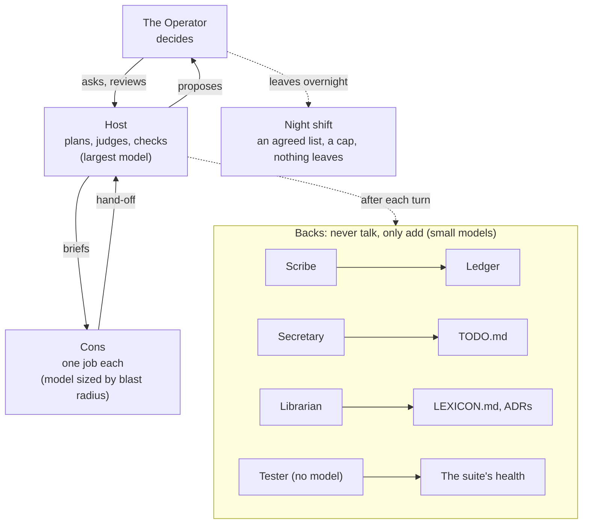
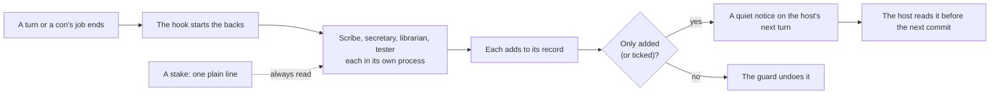
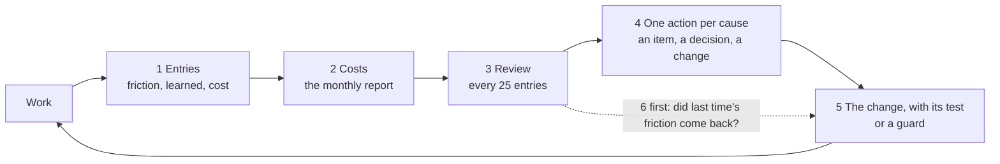

# How work gets done here

The way of working of devcontainer-features: how a piece of work travels from a note to a merged change,
who does what, and how the way of working improves itself. This file says *what happens and
why*; the repository's own contributing guide says *how*: setup, the commands, the conventions.
The words are defined in [LEXICON.md](LEXICON.md). What is open is in [TODO.md](TODO.md).

## The happy path

One unit of work, from the Operator's ask to a commit. The backs work after the turn, never in it.

1. **Start.** In the devhost, the briefing arrives on its own at session start (`devhost-briefing`
   on a workstation): the ledger entries since the last review, what the backs left pending, the
   open backlog items and decisions, the month's agent spend.
2. **Three modes with the host.** *Ideate*: talk a direction out and break it down. *Discuss*:
   ask, decide, hear a recommendation. *Work*: the host does the slice, the document or the change.
3. **What happens without a turn being spent.** The scribe records each unit of work in
   `docs/ledger/`, the secretary turns the open items into `TODO.md`, the librarian keeps
   `LEXICON.md` and the ADRs, the tester runs the suite. Anyone may leave a stake when something
   might be missed. What a back changed arrives as a quiet notice, and the host checks their
   writes before each commit.
4. **Working the backlog.** The host takes items and delegates them. Judgment sits at the top on
   the largest model: the host and the inters, whose decisions spread to everything below. The
   doing is cut into the smallest jobs for the smallest models: cons and backs. The model for each
   tier is measured by the cost report and adjusted at the ledger review.
5. **The loop.** Entries and costs, then the ledger review, then the backlog, then the change with
   its test, then the next sessions show whether it paid off.

## Who does what

- **The Operator** owns the repository: brings notes, asks for work, reviews and decides; a
  decision is theirs unless they delegate it. Items marked for the Operator in `TODO.md` are not
  for a session to resolve.
- **The host** is the Claude Code session an engineer talks to. It does the work on the strongest
  model available, because others inherit what it shapes. It proposes where a decision is the
  Operator's, briefs cons, and reads what the backs wrote before each commit.
- **Cons** are subagents an inter briefs for one job: a search across the tree, a port of a
  mechanism, a draft. Each brief names the job, what is out of bounds, the model (sized by blast
  radius) and the isolation (a worktree when the job changes shared tooling); each con replies
  once in the hand-off shape (Outcome, Outputs, Friction, For the repository, Decisions needed),
  and its job gets its own ledger entry.
- **Backs** never talk to anyone. After each inter turn and each con's job they read what was
  done and keep one record each: the **scribe** the ledger, the **secretary** `TODO.md`, the
  **librarian** `LEXICON.md` and the ADRs, and the **tester** (no model) the suite's health. They
  only add (the secretary also ticks); a guard undoes any other change. They run inside the
  devhost only, on small models, and report through quiet notices.
- **The night shift** is a host session the Operator leaves open on an agreed list of backlog
  items and a cap in dollars: one commit per item with the checks green, nothing pushed, deployed,
  sent or decided, a morning report so the Operator keeps or reverts each commit (`/night-shift`).

## Backs: chores without turns

Upkeep runs in the background, not in the conversation. A hook at the end of each inter turn,
and when a con finishes, starts the backs; each runs as its own headless process on its own
model, never makes the inter wait and never interrupts an engineer. What one changed reaches the
inter as a **quiet notice** on its next turn; the inter reads the change before its next commit,
fixes what is wrong, and mentions a notice only when asked, when something was wrong, or when
the Operator must act.

Because the backs read every session, nobody does their chores by hand. A request for a to-do,
a settled term, a decision: say it, the inter acknowledges it in one line, and it is picked up.
When something might be missed, anyone leaves a **stake**: one plain line of its own,
`Stake for the secretary: the new module needs a to-do.` Stakes are always read and handled as
explicit requests.

On a workstation there are no backs; the inter does their chores at close, by hand, in the same
shapes (`/close-session`).

## The improvement loop

The way of working grows from what real work shows it lacks, never ahead of it:

1. **Entries.** The scribe records each unit of work with its friction (what was missing, wrong
   or had to be worked out, tagged), what was learned, what the Operator decided, and its
   measured cost.
2. **Costs.** Every agent run is costed at list price: host sessions and cons from their
   transcripts, backs from their metrics lines; a monthly report per engineer sets them side by
   side by model. The briefing shows the month's spend at every session start.
3. **Review.** Every 25 entries (the setting; the entry rate in the cost report shows whether that is too often or too rarely; the briefing says when) a review reads the cost report
   first, checks whether the last review's friction came back, groups the new friction by cause,
   and turns each group into exactly one action (`/ledger-review`).
4. **The backlog.** Each action is a `TODO.md` item with an owner and the friction it should make
   go away, a decision for the Operator with a recommendation, a change made now, or no action
   with a reason. A model that turns out oversized for its work moves down a tier the same way.
5. **The change, with its test.** A fix to the tooling comes with the test that would have caught
   it; a rule broken in a way a script can catch becomes a guard in `devhost-verify`; a new
   mechanism is trialled once before this file describes it.
6. **Iterate.** The next review starts by checking those actions against the entries since.

## Rules of thumb

- One way to do each action: its task in `Taskfile.yml`, for engineers and agents alike.
- The Operator decides; sessions advise. A permission counts only when the Operator grants it in
  their own settings.
- Records that only grow (the ledger, the lexicon, the ADRs) are corrected by adding, never by
  editing.
- Paths and ids, never content: nothing committed holds real data, credentials, identifiers or a
  forbidden word; the guards refuse what they can catch.
- No new ceremony: a step that needs a new meeting is the wrong step.
- Pictures tell a thousand words: balance visuals and paragraphs. Where a flow, a structure, a
  state or a trend is the point, draw it (Mermaid in documents, ASCII in the terminal) and keep
  the prose for the why. A picture never replaces the words it summarises.
