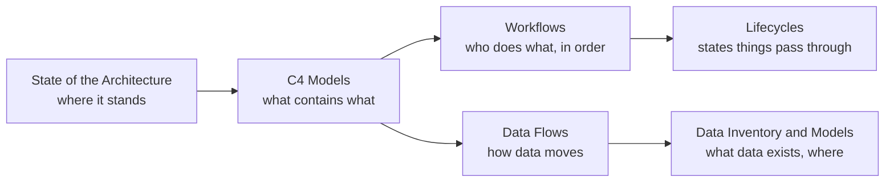

# Architecture

Six standing documents. Git (Mermaid plus text) is the reviewed source; Whiteboard boards are
generated from it later (decided by the Operator, 2026-11-19).

| Document | Purpose | File | Update it when... |
|---|---|---|---|
| State of the Architecture | Where the architecture stands today: built, local, proposed, gaps | [state-of-the-architecture.md](state-of-the-architecture.md) | a Feature is added, released or removed; a proposal is decided, built or declined; a gap is found or closed |
| C4 Models | Context and container views, as Mermaid of ontology ids | [c4-context.md](../model/c4-context.md), [c4-container.md](../model/c4-container.md) | a person, system or container appears, goes or changes its relations (they stay in `docs/model/`; the ontology guard checks them there) |
| Workflows | The main flows as sequence and flow diagrams | [workflows.md](workflows.md) | a step, a role or a check in a flow changes (`PROCESS.md`, a skill, a CI workflow) |
| Lifecycles | State diagrams of the things that live through states | [lifecycles.md](lifecycles.md) | a state or a transition is added or removed (a Feature version, a proposal, an ADR, a lease, the container) |
| Data Flows | How data moves between host, container, volumes, stores and services | [data-flows.md](data-flows.md) | a mount, a volume, a store, a secret path or a service call changes |
| Data Inventory and Models | Each piece of data: where it lives, its storage tier, its shape | [data-inventory.md](data-inventory.md) | data is added, moved between tiers or changes shape |

## The rule

- A proposal names which of the six it changes and carries the delta (the diagram or table row
  that would change).
- The documents are updated in the pull request that builds the change, not before and not after.
- Where a node is a thing in `docs/model/ontology.toml`, its Mermaid id is the ontology id;
  anything outside the model starts `external-` ([docs/model/README.md](../model/README.md)).
