# Data flows

How data moves between the workstation, the container, the shared folder, GitHub and the
registry. Diagrams first. First version, written 2026-11-19; Mermaid and text here are the
reviewed source, Whiteboard boards are generated from them later.

Node ids are ontology ids (`docs/model/ontology.toml`); `external-` marks what is outside the
model. Paths and ids only, never content. `%USERPROFILE%` and `%LOCALAPPDATA%` are placeholders.
Where a fact is not read from a file it says "to verify".

## Trust boundaries

Five zones. Every arrow that crosses a dotted frame is a place where data leaves one owner's
hands.

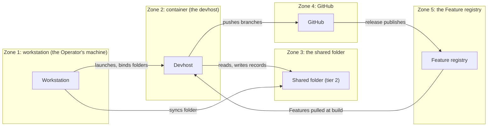

- One person (the Operator) owns zones 1 to 3. GitHub and the registry are public.
- Sources: `docs/model/c4-context.md`, `src/cloud-folder/NOTES.md`, `.github/workflows/release.yaml`.

## 1. Workstation to launcher to container

The launcher is the `devcontainer-cli` Feature's host tasks. It reads `.devcontainer/.env` and
the environment, passes `DCF_HOST_*` variables and adds bind mounts. The container never
reads the host on its own.

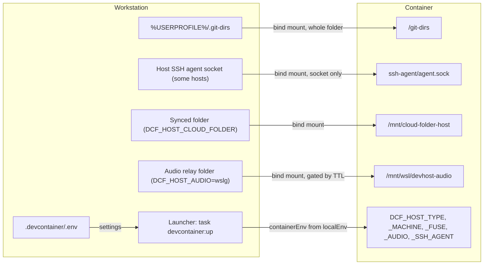

- The whole `.git-dirs` folder is mounted: every container sees every git dir there (ADR 0020, accepted by the Operator 2026-10-21). The git wrapper maps the checkout's `.git` pointer onto `/git-dirs`.
- The agent socket is mounted only on hosts that have a unix socket; Windows engines get none (`src/ssh-agent/NOTES.md`). No keys cross.
- `HOST_MOUNTS=false` removes the launcher's own mounts (`src/devcontainer-cli/NOTES.md`).
- Sources: `.devcontainer/devcontainer.json`, `docs/adr/0020-*.md`, `src/devcontainer-cli/NOTES.md`, `src/audio/NOTES.md`.

## 2. Feature state into named volumes

Each Feature that holds state declares one named volume and a `*_DIR` variable. `dcf-persist`
hands it to the remote user. A repo may replace a volume with a bind mount on the same target.

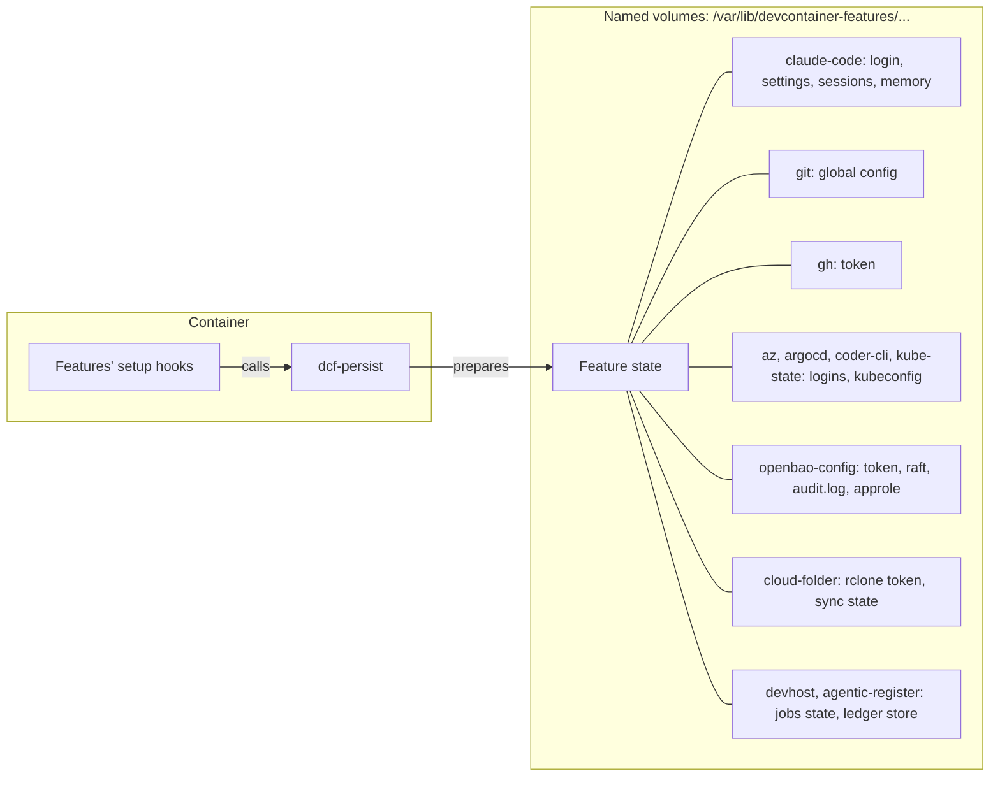

- Volumes survive a rebuild and are deleted by an engine storage reset or a move to another engine. They are tier 4, rebuildable only (ADR 0045).
- Two exceptions are named: openbao server storage (ADR 0048, bounded loss) and Claude Code memory (ADR 0049: belongs in tier 3, not yet mirrored; backlog item named there).
- `go-task`, `kubeconform`, `kustomize`, `dsc`, `velero`, `devcontainer-cli`, `common` hold no data of their own.
- Sources: `src/common/NOTES.md`, every `src/*/NOTES.md` data table, `docs/adr/0045-*.md`, `docs/adr/0049-*.md`.

## 3. Records

The scribe, secretary and librarian are backs. They run after a turn, inside the devhost only.
With `DEVHOST_RECORDS_DIR` and `DEVHOST_LEDGER_REGISTER` set (as in this repository's
`.devcontainer/devcontainer.json`) the records leave git.

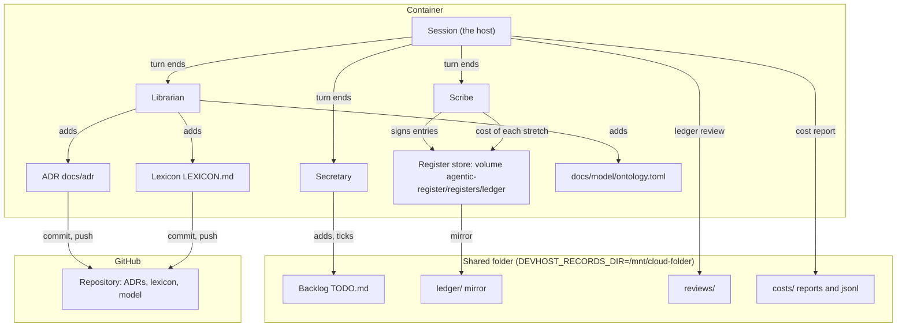

- Unset, everything works as before: Markdown ledger in `docs/ledger/`, `TODO.md` at the root, in git.
- The live ledger store stays in the volume (fast). `devhost-ledger mirror` copies to the shared folder only when that folder exists, and `devhost-setup` restores a fresh volume from it at every create.
- Each ledger entry is signed with the scribe's own key, fetched from OpenBao into tmpfs (see flow 4).
- Backlog outside the repository has no `backlog_ids` check in `devhost-verify`.
- Sources: `local-features/devhost/NOTES.md` ("Records outside git"), `docs/ledger/README.md`, `docs/adr/0054-*.md`, `docs/adr/0043-*.md`.

### 3a. A facilitator conversation

The facilitator Feature (0.2.0): a message from a person or a participant becomes a signed entry in the
conversation's register, a route entry by the facilitator, and a delivery over SLIM; everything on
loopback, in one container. A person talks from their own Claude Code or Copilot session through the
same MCP server (since 0.2.0 there is no terminal chat) and reads what came in with `mail`, from the
record; nothing is delivered to a person over SLIM.

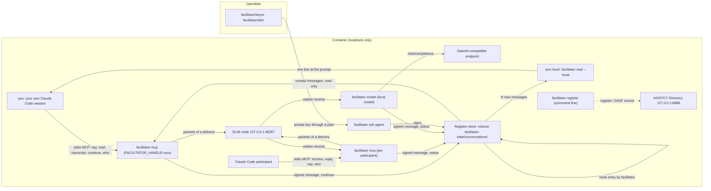

- The record is the truth: a delivery that SLIM cannot make (the participant is not attached) waits in the record and is found by `receive`.
- Keys fall back to mode-600 files in the volume when OpenBao is not ready (0.1.0 exception).
- One shared MCP entry: who attaches comes from `FACILITATOR_HANDLE` and `FACILITATOR_TOKEN` in the CLI's environment; whether it is a person or an agent comes from the roster.
- Sources: `src/facilitator/NOTES.md`, `docs/proposals/facilitator-agent.md` sections 4 and 5.

### 3b. A conversation across nodes (facilitator 0.4.0, slice N3)

Every node one of a conversation's members is on holds a whole replica; each write is pushed to the other member
nodes until delivered. The hub's SLIM node routes between spokes; its application holds no copy unless one of its
participants is a member. Each receiving node runs lock two before anything reaches its register. In a shared
conversation every member is named `handle.node` (ruling H5), so two nodes' agents of one handle can both be members.

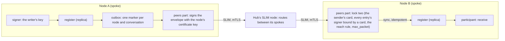

### 3c. An HTTP client reaches a node (facilitator 0.5.0, slice N4)

A CLI that cannot start `facilitator mcp` here (Claude Code, Copilot CLI) calls the node's MCP tools over Streamable
HTTP with a static bearer token a person made. The `http` part answers; the application treats the client as an
ordinary participant of the level `http.<home domain>` maps to (public unless mesh.yml says private), and the node
signs for it. OAuth for cloud AIs is 3f.

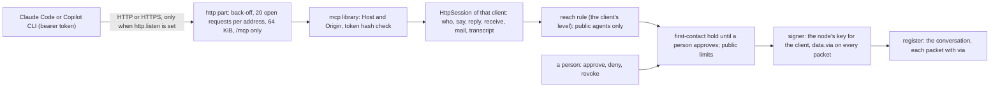

- Nothing opens until `facilitator.http.listen` is set; beyond loopback TLS (or `behind_proxy`) is required. The token
  is shown once and kept as a SHA-256 in `http/clients.json`; every enrolment, approval, denial and revocation is a line
  of a hash-chained `http/audit.jsonl`.
- Sources: `src/facilitator/NOTES.md` ("MCP over HTTP for CLIs"), `docs/proposals/facilitator-node.md` section 11, ADR-0070.

## 4. Secrets

OpenBao keeps every secret the collection creates. `ssh-agent` only uses keys. The design is
`docs/reference-architectures/secrets-with-openbao.md`; parts are planned, not built. Read the
"What exists today" table there before relying on a row.

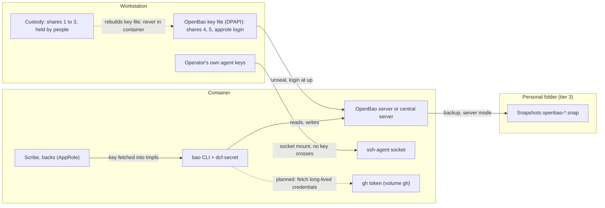

- Unseal shares and the recovery key are custody, outside every tier (ADR 0049). They are never in the container.
- The key file is DPAPI-protected, Windows only, one file per server, not in the checkout, git or the shared folder. On a domain-joined machine the domain backup key also opens it (`src/devcontainer-cli/NOTES.md`).
- Snapshots go to the path in `DEST`; the ruling (the backlog item `openbao-backup-destination`, done 2026-11-10) puts them in the personal folder (tier 3), never the shared folder. A snapshot holds the whole server store: secret.
- Today `gh` and `az` still keep their own logins in their own volumes; they move to OpenBao later.
- The SSH certificate authority key never leaves OpenBao (`src/openbao/NOTES.md`, openbao 1.6.0, unreleased at the time of writing: to verify).
- Sources: `docs/reference-architectures/secrets-with-openbao.md`, `src/openbao/NOTES.md`, `src/ssh-agent/NOTES.md`, `src/gh/NOTES.md`, `docs/adr/0048-*.md`, `docs/adr/0049-*.md`.

## 5. The cloud folder

The `cloud-folder` Feature gives one fixed path, `/mnt/cloud-folder`, for documents that must
never go in git. Three modes fill it.

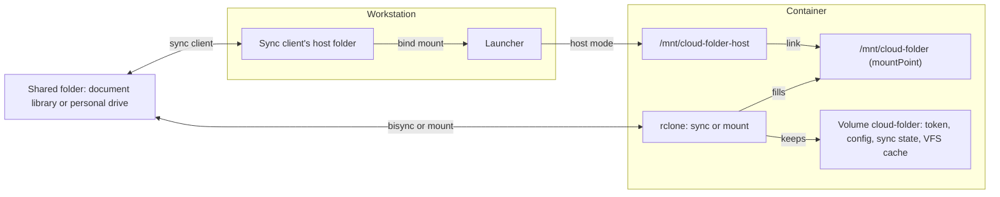

- Host mode needs no sign-in in the container. Sync and mount modes keep an rclone token in the volume (secret, tier 4).
- Mount mode needs FUSE, granted per machine only with `DCF_HOST_FUSE=1` (ADR 0031).
- When nothing is mounted the mount point is absent, so the status fails and no one writes into a bare folder.
- Sources: `src/cloud-folder/NOTES.md`, `docs/adr/0031-*.md`.

## 6. Code to GitHub, release to the registry

The host (the session) commits, pushes and opens pull requests. The host merges its own green, ready
pull requests (ADR 0085). The Operator starts the release; an agent never does.

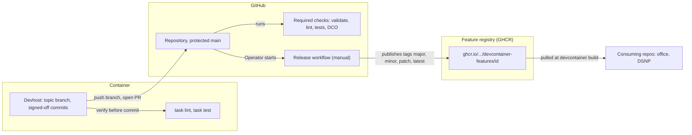

- Commits carry the bot identity and a co-author trailer at an unclaimable address (ADR 0002, `CLAUDE.md`). No ledger or backlog content is pushed when the records are outside git.
- Pre-commit runs `devhost-verify`: no secrets, no names from the redact list.
- The release job has `contents: read` and `packages: write` only; READMEs are not generated there.
- Sources: `CLAUDE.md`, `.github/workflows/release.yaml`, `docs/adr/0040-*.md`, `docs/model/c4-context.md`.

The facilitator's node bundle and the node image (slice N2 of
[facilitator-node](../proposals/facilitator-node.md)) add a release asset and a second image to this flow:

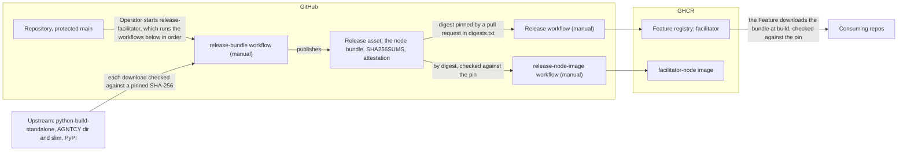

The bundle carries no secret and no state; it is public data. Until a bundle is pinned, the Feature builds it
from its own source at image build, with the same upstream pins.

## 7. The component registry

Built in slices 1 to 3 (component-registry 1.2.0, claude-code 1.12.0, cloud-folder 1.4.0): sources `git`, `path`, `http` (one `.layer` file, or from 2.2.0 an archive with optional `sha256` and `path`; auth settings only), `git` with `path` (a folder of a repository), `cloud-folder` and, from component-registry 1.5.0, `db` (`sqlite`, `postgres`),
the view in the Feature's volume, the hand-over to the CLI's skills folder through the adapter's
`skills` verb. The registry does not write layers (`/registry-remember` and `writable` were removed in component-registry 2.0.0).

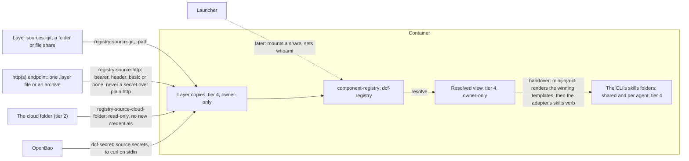

- Who you are (`COMPONENT_REGISTRY_WHOAMI`) comes from `.env` or the launcher, never a committed file.
- An `http` source's secret goes to curl on standard input only, and is refused over plain `http://` unless the source says `allow-insecure: true`; with a secret redirects are not followed. No manifest or signature is required: review is the endpoint owner's.
- A `db` source's password goes to `psql` in its own environment only (never an argument or a log), the database is opened read-only, and one bad row or an empty result fails the fetch so `resolve` keeps the last good copy.
- A layer copy and the view are as sensitive as their most sensitive layer (a person's own layer may hold health facts): owner-only, never committed. `explain` prints to the terminal only.
- The CLI's skills folder (Claude Code: `$CLAUDE_CONFIG_DIR/skills`, the claude-code volume) gets owner-only copies, each marked owned by the registry; never the repository's `.claude/skills`.
- Agent definitions (release 2, component-registry 1.6.0): the view's `agents/<name>/` (a model and skill names) is read by the participant component at the agent's start; the model reaches the CLI adapter only as the environment variable `AGENT_MODEL` of that call, never written elsewhere. An agent definition carries no permission, identity, lease or folder.
- A layer pointed at a public or community source carries a namespace (component-registry 1.7.0, ADR-0073): its components reach the view and the CLI's skills folder only under its prefix (`skills/<ns>--<name>/`), and it cannot change, lock or refer to the Operator's own components; trust in that source stops at its namespace.
- Each who-you-are path keeps its own view (`paths/<path>`, component-registry 1.8.0), and each hand-over is recorded (`handovers.tsv`: CLI, agent, folder, path; no content). In Claude Code (claude-code 1.14.0) the skills every agent's view has alike stay in `$CLAUDE_CONFIG_DIR/skills`; the rest of an agent's view goes to `$CLAUDE_CONFIG_DIR/registry-agents/<agent>/registry/.claude/skills`, which only that agent's sessions read (`--add-dir`), so one agent's personal facts never reach another agent's skills (ADR-0074).
- Vendor templates (component-registry 1.11.0, ADR-0077, built): a layer's `templates/<vendor>/<file>.j2` travels with its layer copy into the view; at each hand-over `minijinja-cli` (pinned, checksummed, in the image) renders the winning ones from the view into a temporary owner-only folder in the state volume, the adapter copies the result, and the folder is removed. A template reads only the context the registry gives (no environment, no file outside its layers' templates) and writes only into that folder; a namespaced layer's template writes only inside its namespace's skill folders. Claude Code's base template reproduces the 1.10.0 files byte for byte. From component-registry 2.1.0 and copilot 0.3.0 the same holds for Copilot CLI: its base template gives the view's skills, which its adapter places in `$COPILOT_HOME/skills` (what every agent shares) and each agent's own folder under `$COPILOT_HOME/registry-agents/`, read only by that agent's sessions (`--add-dir`); before 0.3.0 a Copilot agent got no registry skills.
- The registry does not write layers: edit the layer (`/registry-remember` and `writable` were removed in 2.0.0).
- In this repository (slice 4) two `path` layers feed the resolve: the devhost Feature's folder in the image (`/usr/local/share/devhost/registry`) and the committed `.devcontainer/registry/repo`; both public, both `required`, so a missing one leaves the last view and never hands over half a skill.

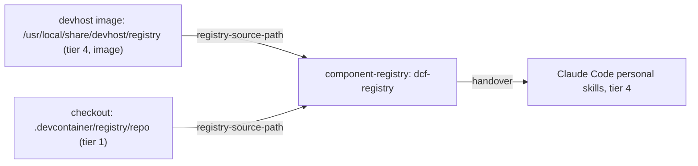

- Sources: `src/component-registry/NOTES.md`, `src/claude-code/NOTES.md`, `docs/proposals/component-registry.md`, `docs/adr/0063-*.md`, `docs/adr/0064-*.md`, `docs/adr/0074-*.md`, `docs/adr/0077-*.md`.

Trust boundary added in 0.4.0: **the intranet** between facilitator nodes. Only the hub's SLIM listener (mutual TLS,
one CA bundle per level), its join endpoint (while a join token is live) and, with `directory.peering`, its Directory's
libp2p and OCI ports cross it; the Directory's API and gateway never do. A spoke opens nothing.

Trust boundary added in 0.5.0: **the HTTP edge** of a node. Only when `facilitator.http.listen` is set does the node
open one port, for the MCP endpoint: beyond loopback behind TLS (its own certificate, or a reverse proxy that ends it).
What crosses it is a bearer token in the `Authorization` header (never a query string) and MCP calls; what it answers
to a failed authentication carries no detail.

## Gaps seen while drawing

- Claude Code memory sits in a tier 4 volume though it cannot be rebuilt (ADR 0049 names the move to tier 3; whether it has shipped: to verify).
- OpenBao snapshot files were seen in the shared folder although the 2026-11-10 ruling puts them in the personal folder; the older open item `amend-openbao-local-storage` still says the shared folder. One of the two needs closing.
- `/git-dirs` shows every git dir to every container (accepted, ADR 0020).

### 3d. A public node joins, and is cut off (facilitator 0.6.0, slice N5a)

```
 public node P            issuer I (node.public)                          a person on I
   node request  --key (TLS, I's bundle)-->  join request (pending)  --> node requests, node approve  (signed `audit` entry)
   node collect  <-- certificate 1 h, bundle, mesh secret, I's card (public agents only)
   P hellos I over the public SLIM listener (its own CA bundle); I shows P its card alone; copy addressed: only the
   conversations P is a member of, in which every message is addressed to P or written by it
   node revoke P:  no renewal -> P's certificate expires within 1 h; lock two refuses P now; the mesh secret rotates and is
                   handed to the remaining nodes (`secret` envelope, old secret), who restart their peers part
```

Peers (no hub): each node is the issuer of its own domain; `node invite` / `node peer --token` exchange the CA bundles and the
secret; `hello` and `card` envelopes exchange cards; replication is as in a hub mesh, node to node.

### 3e. The hub's certificates, by tier (facilitator 0.7.0)

```
 spoke: key + request (a file, SLIM reads it)  --join endpoint (TLS, the bundle's hash from the token)-->  hub
 hub signs the request, deciding the SANs itself, with, in order:
   1. OpenBao PKI (sign/<role>)             the CA key never leaves OpenBao
   2. an ssh-agent (SSH2_AGENT_SIGN_REQUEST) the hub builds the TBSCertificate, the agent signs the bytes (ed25519), no key file
   3. the built-in issuing CA (a file)       a root signed it once; export-root takes the root key off the volume
 -> a 24 h certificate; the trust bundle (issuing CA + root) is what the spoke already holds
```

A new trust boundary on Kubernetes: the pod's two published ports (SLIM and the join endpoint) are all that leave it; with the
ssh-agent overlay the agent's socket is a memory volume shared by two containers of the one pod and reachable by nothing else.

### 3f. A cloud AI reaches a node with an OAuth token (facilitator 0.8.0, slice N5b)

```
 cloud AI --Bearer <JWT>--> node gate (http.url, TLS here or at a proxy)
   1. iss in http.issuers?  alg in the entry's list (never none or HS*)?  signature by a key of the issuer's JWKS?
        JWKS: fetched from the issuer (https, no redirects, 5 s, 256 KiB), kept 1 h, re-read once a minute for an unknown kid;
              unreadable -> 503, closed, the log says why
   2. exp, aud = <http.url>/mcp (RFC 8707), scope facilitator:participate
   3. (issuer, subject) -> a client of the node: unknown = enrolled (http/clients.json: issuer, subject, client_id label, no secret),
        its first message held until a person approves
   4. the HttpSession of that client: the node signs for it; data.via = {http, oauth, client, issuer, subject}
 the token is read, never stored, never forwarded; the node's log keeps a reason, not a token
```

A new data flow out of the node: it fetches an issuer's discovery document and JWKS (HTTPS, only the addresses in
`facilitator.yml`). `check` fetches nothing; `facilitator http issuers` fetches on request.
