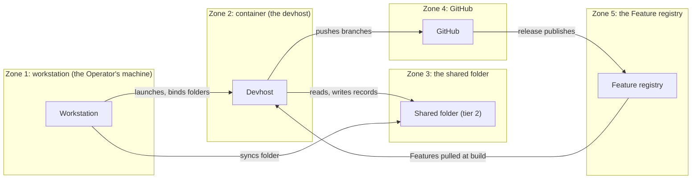
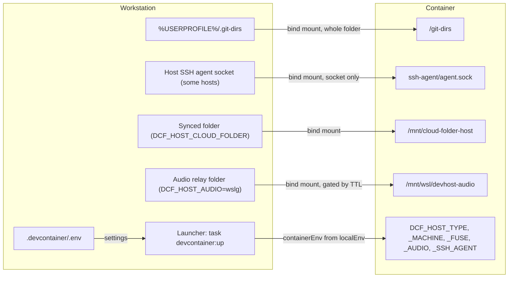
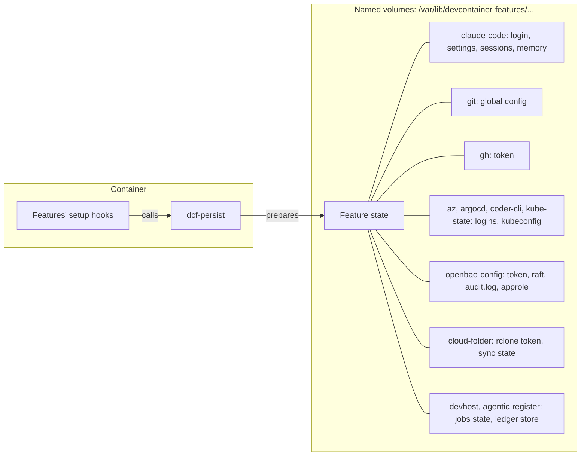
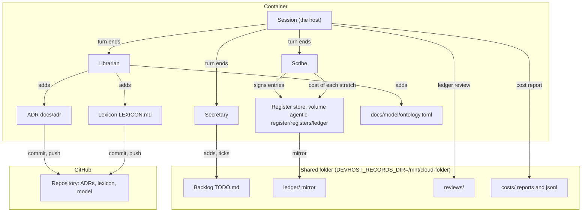
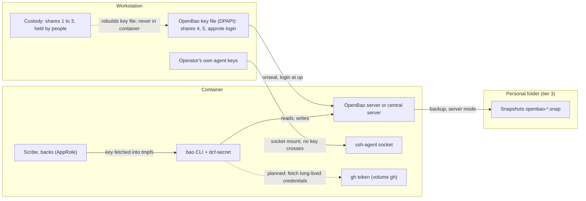
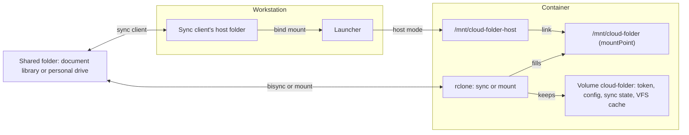
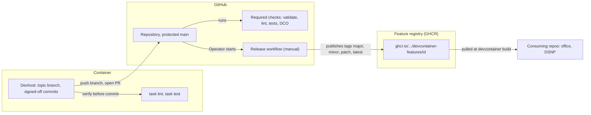
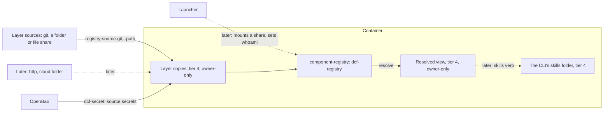

# Data flows

How data moves between the workstation, the container, the shared folder, GitHub and the
registry. Diagrams first. First version, written 2026-11-19; Mermaid and text here are the
reviewed source, Whiteboard boards are generated from them later.

Node ids are ontology ids (`docs/model/ontology.toml`); `external-` marks what is outside the
model. Paths and ids only, never content. `%USERPROFILE%` and `%LOCALAPPDATA%` are placeholders.
Where a fact is not read from a file it says "to verify".

## Trust boundaries

Five zones. Every arrow that crosses a dotted frame is a place where data leaves one owner's
hands.

- One person (the Operator) owns zones 1 to 3. GitHub and the registry are public.
- Sources: `docs/model/c4-context.md`, `src/cloud-folder/NOTES.md`, `.github/workflows/release.yaml`.

## 1. Workstation to launcher to container

The launcher is the `devcontainer-cli` Feature's host tasks. It reads `.devcontainer/.env` and
the environment, passes `DCF_HOST_*` variables and adds bind mounts. The container never
reads the host on its own.

- The whole `.git-dirs` folder is mounted: every container sees every git dir there (ADR 0020, accepted by the Operator 2026-10-21). The git wrapper maps the checkout's `.git` pointer onto `/git-dirs`.
- The agent socket is mounted only on hosts that have a unix socket; Windows engines get none (`src/ssh-agent/NOTES.md`). No keys cross.
- `HOST_MOUNTS=false` removes the launcher's own mounts (`src/devcontainer-cli/NOTES.md`).
- Sources: `.devcontainer/devcontainer.json`, `docs/adr/0020-*.md`, `src/devcontainer-cli/NOTES.md`, `src/audio/NOTES.md`.

## 2. Feature state into named volumes

Each Feature that holds state declares one named volume and a `*_DIR` variable. `dcf-persist`
hands it to the remote user. A repo may replace a volume with a bind mount on the same target.

- Volumes survive a rebuild and are deleted by an engine storage reset or a move to another engine. They are tier 4, rebuildable only (ADR 0045).
- Two exceptions are named: openbao server storage (ADR 0048, bounded loss) and Claude Code memory (ADR 0049: belongs in tier 3, not yet mirrored; backlog item named there).
- `go-task`, `kubeconform`, `kustomize`, `dsc`, `velero`, `devcontainer-cli`, `common` hold no data of their own.
- Sources: `src/common/NOTES.md`, every `src/*/NOTES.md` data table, `docs/adr/0045-*.md`, `docs/adr/0049-*.md`.

## 3. Records

The scribe, secretary and librarian are backs. They run after a turn, inside the devhost only.
With `DEVHOST_RECORDS_DIR` and `DEVHOST_LEDGER_REGISTER` set (as in this repository's
`.devcontainer/devcontainer.json`) the records leave git.

- Unset, everything works as before: Markdown ledger in `docs/ledger/`, `TODO.md` at the root, in git.
- The live ledger store stays in the volume (fast). `devhost-ledger mirror` copies to the shared folder only when that folder exists, and `devhost-setup` restores a fresh volume from it at every create.
- Each ledger entry is signed with the scribe's own key, fetched from OpenBao into tmpfs (see flow 4).
- Backlog outside the repository has no `backlog_ids` check in `devhost-verify`.
- Sources: `local-features/devhost/NOTES.md` ("Records outside git"), `docs/ledger/README.md`, `docs/adr/0054-*.md`, `docs/adr/0043-*.md`.

## 4. Secrets

OpenBao keeps every secret the collection creates. `ssh-agent` only uses keys. The design is
`docs/reference-architectures/secrets-with-openbao.md`; parts are planned, not built. Read the
"What exists today" table there before relying on a row.

- Unseal shares and the recovery key are custody, outside every tier (ADR 0049). They are never in the container.
- The key file is DPAPI-protected, Windows only, one file per server, not in the checkout, git or the shared folder. On a domain-joined machine the domain backup key also opens it (`src/devcontainer-cli/NOTES.md`).
- Snapshots go to the path in `DEST`; the ruling (the backlog item `openbao-backup-destination`, done 2026-11-10) puts them in the personal folder (tier 3), never the shared folder. A snapshot holds the whole server store: secret.
- Today `gh` and `az` still keep their own logins in their own volumes; they move to OpenBao later.
- The SSH certificate authority key never leaves OpenBao (`src/openbao/NOTES.md`, openbao 1.6.0, unreleased at the time of writing: to verify).
- Sources: `docs/reference-architectures/secrets-with-openbao.md`, `src/openbao/NOTES.md`, `src/ssh-agent/NOTES.md`, `src/gh/NOTES.md`, `docs/adr/0048-*.md`, `docs/adr/0049-*.md`.

## 5. The cloud folder

The `cloud-folder` Feature gives one fixed path, `/mnt/cloud-folder`, for documents that must
never go in git. Three modes fill it.

- Host mode needs no sign-in in the container. Sync and mount modes keep an rclone token in the volume (secret, tier 4).
- Mount mode needs FUSE, granted per machine only with `DCF_HOST_FUSE=1` (ADR 0031).
- When nothing is mounted the mount point is absent, so the status fails and no one writes into a bare folder.
- Sources: `src/cloud-folder/NOTES.md`, `docs/adr/0031-*.md`.

## 6. Code to GitHub, release to the registry

The host (the session) commits, pushes and opens pull requests. The Operator reviews and merges
(ADR 0040). The Operator starts the release; an agent never does.

- Commits carry the bot identity and a co-author trailer at an unclaimable address (ADR 0002, `CLAUDE.md`). No ledger or backlog content is pushed when the records are outside git.
- Pre-commit runs `devhost-verify`: no secrets, no names from the redact list.
- The release job has `contents: read` and `packages: write` only; READMEs are not generated there.
- Sources: `CLAUDE.md`, `.github/workflows/release.yaml`, `docs/adr/0040-*.md`, `docs/model/c4-context.md`.

## 7. The component registry

Built in slice 1 (component-registry 1.0.0): sources `git` and `path`, the view in the Feature's
volume. Later: the `http` and `cloud-folder` sources (slice 3) and the hand-over to the CLI's
skills folder (slice 2), drawn dashed.

- Who you are (`COMPONENT_REGISTRY_WHOAMI`) comes from `.env` or the launcher, never a committed file.
- A layer copy and the view are as sensitive as their most sensitive layer (a person's own layer may hold health facts): owner-only, never committed. `explain` prints to the terminal only.
- Sources: `src/component-registry/NOTES.md`, `docs/proposals/component-registry.md`, `docs/adr/0063-*.md`.

## Gaps seen while drawing

- Claude Code memory sits in a tier 4 volume though it cannot be rebuilt (ADR 0049 names the move to tier 3; whether it has shipped: to verify).
- OpenBao snapshot files were seen in the shared folder although the 2026-11-10 ruling puts them in the personal folder; the older open item `amend-openbao-local-storage` still says the shared folder. One of the two needs closing.
- `/git-dirs` shows every git dir to every container (accepted, ADR 0020).
