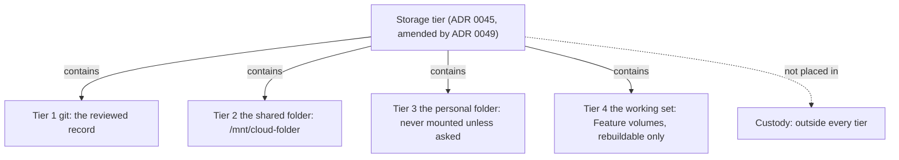
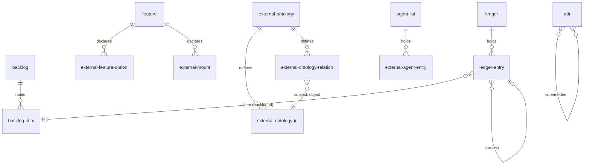
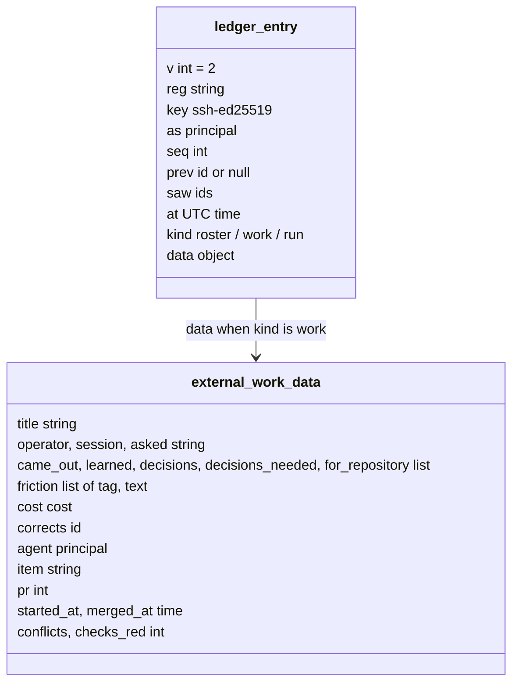
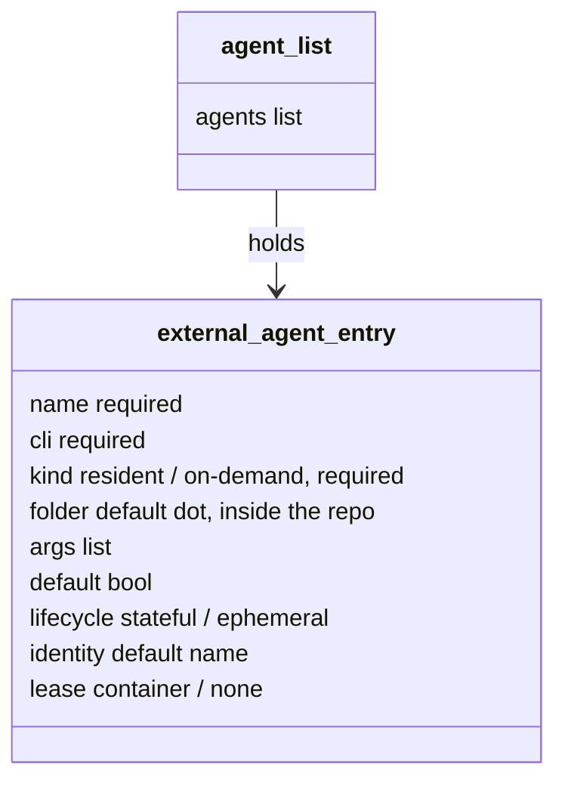
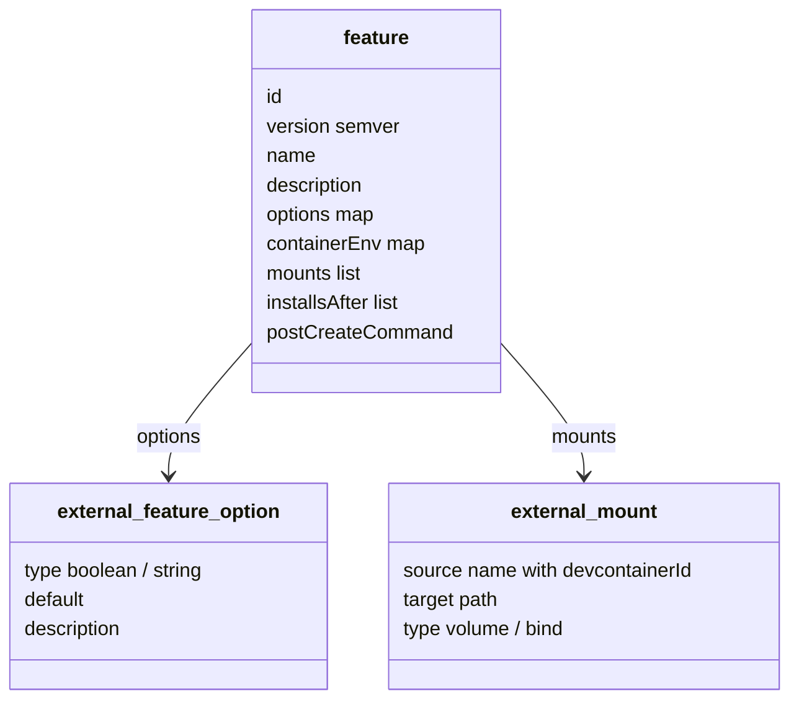
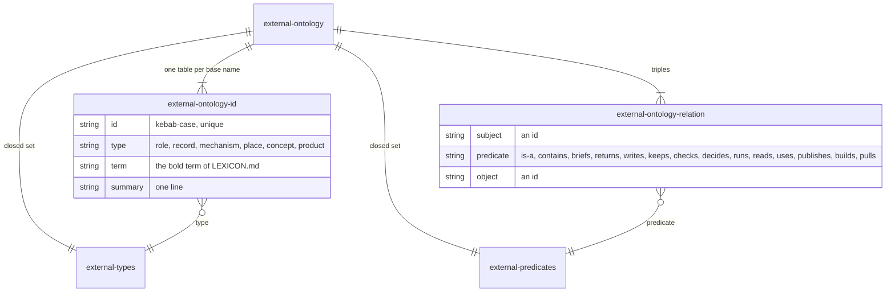
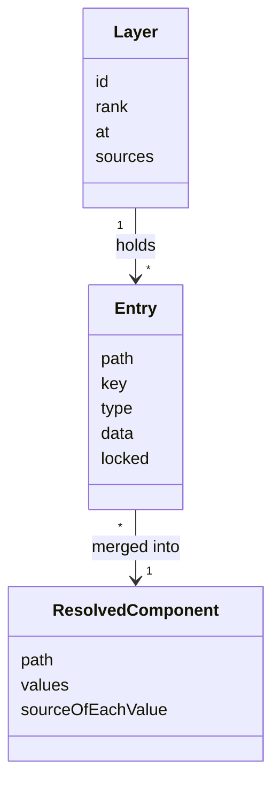

# Data inventory and models

Part one says what data exists, where, and how sensitive it is. Part two draws the shape of the
main records. First version, written 2026-11-19; Mermaid and text here are the reviewed source.

Node ids are ontology ids (`docs/model/ontology.toml`); `external-` marks what is outside the
model. The term model itself is in [`docs/model/`](../model/README.md): this page does not repeat it.
Paths and ids only, never content. `%USERPROFILE%` and `%LOCALAPPDATA%` are placeholders.

## Part one: the inventory

### The four tiers



The rule: **if losing a machine would lose something, it is in the wrong tier.** Exceptions are
named in the rows ("bounded loss", "to verify").

### How to read the columns

| Column | Values |
|---|---|
| tier | 1 git, 2 the shared folder, 3 the personal folder, 4 the working set, custody, none |
| sensitivity | public (anyone may read), internal (the Operator's organisation), secret (a credential or key), personal (about a person). My classification from the source's wording; the sources do not carry this column, so each is "to verify" with the Operator. |
| survives rebuild | a container rebuild; for a volume, yes. A machine loss follows the tier. |

### The data

| What | Path or volume | Owner | Tier | Sensitivity | Survives rebuild | Source |
|---|---|---|---|---|---|---|
| Code, Features, docs, ADRs, lexicon, ontology | the repository (`src/`, `docs/`, `LEXICON.md`) | git (the Operator reviews) | 1 | public | yes | `CLAUDE.md`, `README.md` |
| The checkout's git dir | `%USERPROFILE%/.git-dirs/<repo>`, mounted whole at `/git-dirs` | git Feature | 1 | internal | yes | `src/git/NOTES.md`, `docs/adr/0020-*.md` |
| Global git config (identity, credential helper) | volume `git-config-${devcontainerId}` at `/var/lib/devcontainer-features/git` | git Feature | 4 | personal | yes | `src/git/NOTES.md`, `src/git/devcontainer-feature.json` |
| Claude Code login, settings, session history, adapter's session list | volume at `CLAUDE_CONFIG_DIR` (`/var/lib/devcontainer-features/claude-code`) | claude-code Feature | 4 | secret (login), personal (sessions) | yes | `src/claude-code/NOTES.md` |
| Claude Code memory | `.../claude-code/projects/*/memory/` in the same volume | the Operator, claude-code Feature | 4, belongs in 3 | personal | yes | `docs/adr/0049-*.md` (mirror to tier 3 is a backlog item; whether done: to verify) |
| `gh` login (token, settings) | volume at `GH_CONFIG_DIR` (`/var/lib/devcontainer-features/gh`) | gh Feature | 4 | secret | yes | `src/gh/NOTES.md` |
| Azure CLI login state | volume at `AZURE_CONFIG_DIR` (`/var/lib/devcontainer-features/az`) | az Feature | 4 | secret | yes | `src/az/NOTES.md` |
| Argo CD login session | volume at `ARGOCD_CONFIG_DIR` | argocd Feature | 4 | secret | yes | `src/argocd/NOTES.md` |
| Coder login (`session`, `url`) | volume at `CODER_CONFIG_DIR` | coder-cli Feature | 4 | secret | yes | `src/coder-cli/NOTES.md` |
| Kubeconfig (cluster credentials) | volume `/var/lib/devcontainer-features/kube-state` (`KUBECONFIG`) | kube-state Feature | 4 | secret | yes | `src/kube-state/NOTES.md` |
| OpenBao login token | `token` in volume `openbao-config-${devcontainerId}` (`BAO_CONFIG_PATH`) | openbao Feature | 4 | secret | yes | `src/openbao/NOTES.md` |
| OpenBao server storage (server mode): every secret, policy, role | `raft/` in the same volume | openbao Feature | 4, bounded-loss exception | secret | yes | `src/openbao/NOTES.md`, `docs/adr/0048-*.md` |
| OpenBao audit log (server mode) | `audit.log` in the same volume | openbao Feature | 4 | internal (content: to verify) | yes | `src/openbao/NOTES.md` |
| OpenBao AppRole secret ids (server mode) | `approle/<role>/`, mode 600, same volume | openbao Feature | 4 | secret | yes | `src/openbao/NOTES.md` |
| OpenBao snapshots | `DEST`: the personal folder (ruled 2026-11-10; the shared folder is ruled out) | openbao Feature, the Operator | 3 | secret (the whole store) | yes | the backlog item `openbao-backup-destination`, done 2026-11-10; `docs/reference-architectures/secrets-with-openbao.md`. Finding: `openbao-*.snap` files were seen in the shared folder, and the older open item `amend-openbao-local-storage` (2026-11-06) still says the shared folder |
| Unseal shares 1 to 3 and the recovery key | held by people; printed once by `task openbao:init` | the Operator | custody | secret | not applicable | `src/openbao/NOTES.md`, `docs/adr/0049-*.md` |
| OpenBao key file: unseal shares 4, 5 and the Operator's AppRole login | `%LOCALAPPDATA%\devcontainer-features-keys\openbao\<repo>-<cluster id>.keyfile`, DPAPI-protected | devcontainer-cli launcher | 3-like (workstation local; not roamed, not in the shared folder); tier name: to verify | secret | yes (not in the container) | `src/devcontainer-cli/NOTES.md` |
| ssh-agent private keys (opt-in key mode only) | volume `ssh-agent-key-${devcontainerId}` at `/var/lib/devcontainer-features/ssh-agent-key` | ssh-agent Feature | 4 | secret | yes | `src/ssh-agent/NOTES.md`, `src/ssh-agent/devcontainer-feature.json` |
| ssh-agent socket | `/var/lib/devcontainer-features/ssh-agent/agent.sock`, a mount of the host agent | launcher | none (a pipe to the host) | secret in use, nothing stored | no (re-mounted at start) | `src/ssh-agent/NOTES.md` |
| The shared documents, the register mirror, reviews, cost reports | `/mnt/cloud-folder` (host mount `/mnt/cloud-folder-host`) | cloud-folder Feature; the Operator | 2 | internal | yes | `src/cloud-folder/NOTES.md`, `docs/ledger/README.md` |
| The backlog | `/mnt/cloud-folder/TODO.md` (`DEVHOST_RECORDS_DIR`); `TODO.md` at the root when unset | secretary back, host | 2 (1 when unset) | internal | yes | `local-features/devhost/NOTES.md`, `docs/ledger/README.md` |
| The ledger, live store | volume agentic-register, `/var/lib/devcontainer-features/agentic-register/registers/ledger` | scribe back (signs) | 4, mirrored to 2 | internal | yes | `docs/ledger/README.md`, `local-features/devhost/NOTES.md` |
| The ledger mirror | `/mnt/cloud-folder/ledger` | agentic-register Feature | 2 | internal | yes | `docs/ledger/README.md` |
| Ledger reviews | `/mnt/cloud-folder/reviews/YYYY-MM-DD.md` | host (`/ledger-review`) | 2 | internal | yes | `docs/ledger/README.md` |
| Cost reports and cost store | `/mnt/cloud-folder/costs/costs-YYYY-MM-<engineer>.md` and `.jsonl` | `devhost-report` | 2 | internal (ids and numbers only) | yes | `docs/ledger/README.md`, `local-features/devhost/NOTES.md` |
| Cost history to the cut-over (cold storage) | `/mnt/cloud-folder/costs/archive/` | host, once | 2 | internal | yes | `docs/ledger/README.md` |
| Backs' state: offsets, locks, job logs, pending notes, `runs.jsonl` | volume `devhost-state-${devcontainerId}` at `DEVHOST_STATE` | devhost Feature | 4 | internal (job.log content: to verify) | yes | `local-features/devhost/NOTES.md` ("State") |
| rclone token and config, sync state, logs, VFS cache | volume at `/var/lib/devcontainer-features/cloud-folder` | cloud-folder Feature | 4 | secret (token) | yes | `src/cloud-folder/NOTES.md` |
| Agent list | `.devcontainer/agents.yml` | participant component (claude-code `participants: true`, or the deprecated agents Feature), the repo | 1 | public | yes | `src/agents/NOTES.md`, `src/claude-code/NOTES.md`, `.devcontainer/agents.yml` |
| Agent leases and start markers | `/var/lib/devcontainer-features/agents`, not a volume | participant component | 4 | internal | no, by design | `src/agents/NOTES.md` |
| The participant component itself | `/usr/local/lib/dcf-participant` (`COMPONENT_VERSION`, `installed-by`), `/usr/local/bin/agents` a symlink into it | the first Feature that installs it (newer copy wins) | 4 (image) | public | no (rebuilt) | `components/participant/install-participant.sh` |
| Launcher settings per machine | `.devcontainer/.env` on the workstation (git-ignored, `.gitignore`) | the Operator | 3-like (a workstation file) | internal | not applicable | `.devcontainer/devcontainer.json`, `src/devcontainer-cli/NOTES.md` |
| Audio relay folder (microphone socket, only while the gate is on) | `/mnt/wsl/devhost-audio` | launcher, audio gate | none | personal (live audio, stored nowhere) | no | `src/audio/NOTES.md`, `docs/adr/0058-*.md` |
| Audio ALSA default | `/etc/asound.conf` in the image | audio Feature | 4 (image) | public | no (rebuilt) | `src/audio/NOTES.md` |
| PHI-check exceptions (synthetic fixtures only) | a file named by the `exceptions` option | phi-check Feature, the repo | 1 | internal | yes | `src/phi-check/NOTES.md` |
| Registry layer list | `.devcontainer/registry.yml` (option `registryFile`, `COMPONENT_REGISTRY_FILE`) | component-registry Feature, the repo | 1 | public | yes | `src/component-registry/NOTES.md` |
| Who-you-are path (`COMPONENT_REGISTRY_WHOAMI`) | `.env` (git-ignored) or the launcher (later), per person | the person | none (a setting) | internal | not applicable (set again) | `src/component-registry/NOTES.md`, `docs/adr/0063-*.md` |
| A registry layer's `.reg` files and skill files | its source: a git repository, a folder or file share (later: http, the cloud folder) | the layer's owner | the owner's choice | internal; a person's own layer is personal | follows its source | `docs/proposals/component-registry.md` |
| Registry layer copies, the resolved view, `resolve.lock` | volume `component-registry-state-${devcontainerId}` at `/var/lib/devcontainer-features/component-registry`, owner-only | component-registry Feature | 4 | as its most sensitive layer (may be personal) | yes (refetched, rebuilt) | `src/component-registry/NOTES.md` |
| `explain` output | the terminal only | component-registry Feature | none | as the resolved view | not kept | `src/component-registry/NOTES.md` |
| Registry source secrets | OpenBao, read with `dcf-secret` | the layer's owner or the person | OpenBao's | secret | yes | `src/component-registry/NOTES.md` |
| Later (slice 2): resolved skills in the CLI | the CLI's skills folder (Claude: the claude-code volume) | the CLI adapter | 4 | as the resolved view | rebuilt | `docs/proposals/component-registry.md` |
| Facilitator conversations: one register-engine register (`conversation` type) per conversation, every message signed | volume `facilitator-state-${devcontainerId}` at `/var/lib/devcontainer-features/facilitator` (`conversations/`) | facilitator Feature | 4 (working data, D12; a tier-2 mirror is a later item) | personal (what people and models said) | yes | `src/facilitator/NOTES.md` |
| Facilitator identity keys (each participant, each human, `facilitator`) | OpenBao `facilitator/keys/<handle>`; the 0.1.0 fallback `keys/<handle>` (mode 600) in the same volume | facilitator Feature | none (OpenBao); 4 for the fallback (ADR-0048 exception) | secret | yes | `src/facilitator/NOTES.md` ("Keys") |
| Facilitator participant tokens | `tokens/<handle>` (mode 600) in the same volume, made again at every container start | facilitator Feature | 4 (ADR-0048 exception, ADR-0061) | secret (worthless outside the container) | yes, replaced at start | `src/facilitator/NOTES.md` |
| SLIM's basic-auth password and app secret | OpenBao `facilitator/slim`; fallback `secrets/slim.json` (mode 600) | facilitator Feature | none (OpenBao); 4 for the fallback | secret | yes | `src/facilitator/NOTES.md` |
| AGNTCY Directory data (OASF records, SQLite, OCI store, `node.key`) | `dir/` in the same volume | facilitator Feature (dirctl daemon) | 4 | internal | yes | `src/facilitator/NOTES.md` |
| Participant list keys `attachment`, `description`, `skills`; facilitator settings | `.devcontainer/participants.yml` (alias `agents.yml`), `.devcontainer/facilitator.yml` | the repo | 1 | public | yes | `src/facilitator/NOTES.md` |
| Copilot login (`copilot login`), settings, sessions and the facilitator MCP entry (`mcp-config.json`, no token in it) | volume `copilot-home-${devcontainerId}` at `COPILOT_HOME` (`/var/lib/devcontainer-features/copilot`), owner-only; a repo may bind-mount a host folder | copilot Feature (the CLI writes it) | 4 | secret (the login file) | no | `src/copilot/NOTES.md` |
| A Copilot token in `COPILOT_GITHUB_TOKEN`, `GH_TOKEN` or `GITHUB_TOKEN` | the environment of the process that starts copilot; the Feature stores none (NFR-13) | the harness or the engineer | not stored | secret | not applicable | `src/copilot/NOTES.md` |
| Journal pieces, night-shift reports, iteration papers | `docs/journal/`, `docs/night-shift/`, `docs/iterations/` | host, journalist | 1 | public (name guard applies) | yes | `docs/journal/README.md`, `local-features/devhost/NOTES.md` |

### Features that hold nothing

`common`, `devcontainer-cli` (binaries only), `dsc`, `go-task`, `kubeconform`, `kustomize`,
`velero`: their NOTES say "Nothing of its own". Source: the data table in each `src/<id>/NOTES.md`.
`audio` stores no audio.

### What the inventory shows

- **Secrets sit in tier 4 volumes.** Logins for `gh`, `az`, `argocd`, `coder-cli`, `kube-state` and `cloud-folder` are rebuildable by logging in again, so tier 4 fits. They are not in OpenBao yet (planned, `docs/reference-architectures/secrets-with-openbao.md`).
- **One store is not rebuildable and is in tier 4:** OpenBao server storage (named exception, ADR 0048) and Claude Code memory (ADR 0049).
- **OpenBao snapshots belong in the personal folder (tier 3)**, by the 2026-11-10 ruling; snapshot files seen in the shared folder, and the older open item `amend-openbao-local-storage`, do not match it yet.
- **Two workstation files are in no tier of the model** (the key file and `.devcontainer/.env`). ADR 0045's tier 3 says the personal folder is "never mounted in the devhost unless asked"; whether a DPAPI key file under `%LOCALAPPDATA%` is tier 3: to verify.

## Part two: the models

The term model (what each word means, how words relate) is in
[`docs/model/ontology.toml`](../model/ontology.toml), explained in
[`docs/model/README.md`](../model/README.md). Below are the shapes of the records.

### The records and how they connect



### Ledger entry (`ledger-entry`)

One signed, canonical-JSON line of an agentic-register register. The body's `kind` is `work` (a
unit of work), `run` (a cost) or `roster` (who may write). Source: `local-features/agentic-register/SPEC.md` ("The body", "Kinds").



| Field | Meaning | Source |
|---|---|---|
| `id` (derived) | SHA-256 of the body; names the entry | SPEC "The entry" |
| `as`, `key` | principal and its public key; the signature must match `key` | SPEC "The body" |
| `prev`, `seq`, `saw` | the chain of one key, and other entries seen | SPEC "The body" |
| `item` | a backlog id | SPEC, `work` fields |
| `corrects` | an entry this one replaces; never an edit | SPEC; `docs/ledger/README.md` |

The body is at most 65536 bytes; money is integer `usd_micro` (SPEC). Names and content never go in an entry (name guard).

### Backlog item (`backlog-item`)

A Markdown line in `TODO.md`. Source: the header of `/mnt/cloud-folder/TODO.md`.

```text
- [ ] **<backlog-id> <Title>** (<owner>). <What and why>. Added YYYY-MM-DD.
- [x] ... Done YYYY-MM-DD.
```

| Part | Rule |
|---|---|
| `backlog-id` | two to four kebab-case words; unique in the file; never reused or renamed |
| owner | host, the Operator, or engineers |
| section | `## Now`, `## Next`, `## Decisions for the Operator` |
| state | `[ ]` open, `[x]` done; a done item stays |

The secretary adds and ticks; it never rewords, removes or reorders. The agentic-register spec also
defines a backlog register type (`add`, `edit`, `tick`, `reopen`, `move`, `note`); whether this
repository uses it: to verify (SPEC "backlog" section; the ledger README names `TODO.md`).

### ADR (`adr`)

A Markdown file `docs/adr/NNNN-<slug>.md`. Source: `docs/adr/0000-template.md`, `docs/adr/README.md`.

| Part | Content |
|---|---|
| header table | Status (proposed, accepted, amended by, superseded), Date, Deciders |
| Context | the situation and its sources |
| Decision | in full sentences, present tense |
| Options considered | each option, with why it lost |
| Consequences | easier, harder, to do |
| Change log | one row per revision |

An ADR is rewritten or superseded only by the host; the librarian adds.

### Agents list entry (`agent-list`)

One item of `agents:` in `.devcontainer/agents.yml`. Source: `src/agents/NOTES.md`, `.devcontainer/agents.yml`.



| Rule | Source |
|---|---|
| `name`, `cli`, `kind` are required; `folder` defaults to `.` | `src/agents/NOTES.md` |
| `ephemeral` with `resident` is refused | `src/agents/NOTES.md` |
| a stateful agent's lease is `container`; an ephemeral agent's is `none` | `src/agents/NOTES.md` |
| two stateful agents may not share an `identity` | `src/agents/NOTES.md` |

### Feature manifest (`feature`): `src/<id>/devcontainer-feature.json`

The fields this repository's Features use. Source: `src/git/devcontainer-feature.json`,
`src/ssh-agent/devcontainer-feature.json`, `src/claude-code/devcontainer-feature.json`.



| Field | Example (read) | Meaning |
|---|---|---|
| `id`, `version` | `git`, bumped with each change | the unit the registry publishes |
| `options` | `installTaskfile`, `worktreeAware`, `gitCredentialHelper`, `mode`, `keyMode` | what a consumer sets |
| `containerEnv` | `GIT_CONFIG_GLOBAL`, `CLAUDE_CONFIG_DIR` | where the Feature's state is |
| `mounts` | `git-config-${devcontainerId}` to `/var/lib/devcontainer-features/git` | the named volume of its state (tier 4) |
| `installsAfter` | other Feature ids | order; only a published Feature can be named |

A Feature may not use `${localEnv}` in its own `mounts` (the CLI substitutes only `${devcontainerId}`): host paths are the repo's mounts or the launcher's (ADR 0020).

### The ontology (`ontology`): `docs/model/ontology.toml`

Source: `docs/model/ontology.toml` (header), `docs/model/README.md` (rules).



Three more views are derived from it: `themes/*.toml` (labels, `id = "label"`), the C4 Markdown
files (Mermaid whose node ids are ids), and `LEXICON.md` (prose). `devhost-verify` guard `model`
keeps them in agreement.

### The component registry: layer, entry, resolved component

Source: `src/component-registry/NOTES.md` (component-registry 1.0.0), `docs/proposals/component-registry.md` sections 3.2 and 3.3.



On disk the resolved component is `skills/<name>/` (`SKILL.md` and its files) and
`meta/skills/<name>/`: `values/<key>`, `keys.tsv` (key, type, summary) and `provenance.tsv` (state,
key, type, layer, rank, version, `source:file:line`, data, why: `sourceOfEachValue`).
