# Lifecycles

State diagrams of what exists. A state marked "(proposed)" is not built. Part of the [six](README.md).

## A Feature version

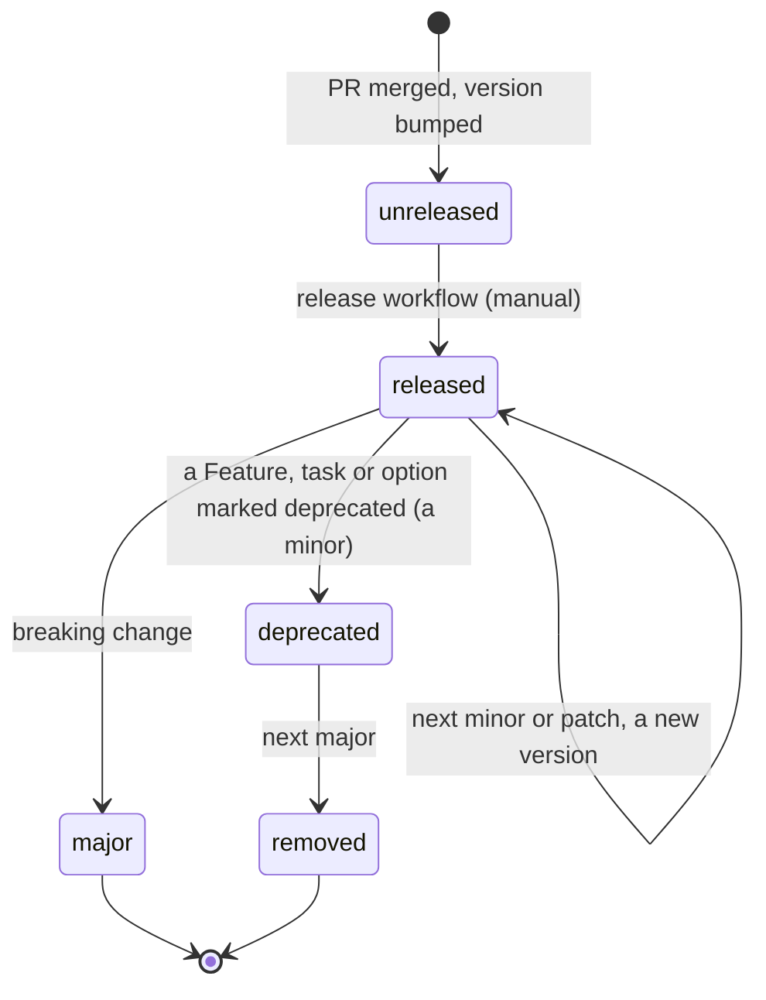

Registry tags per release: major, major.minor, full version, latest. Deprecation goes in a minor
(one line from `version` and `check`, NOTES, a "Deprecated" CHANGELOG heading, behaviour unchanged)
and removal in the next major: CONTRIBUTING.md, "Deprecating a Feature or an option" (decision
D21, ADR-0061). Examples: `openbao` 1.6.0 is unreleased; `agents` 2.2.0 is deprecated in favour of
`claude-code` `participants: true` and retired in 3.0.0.

## A proposal

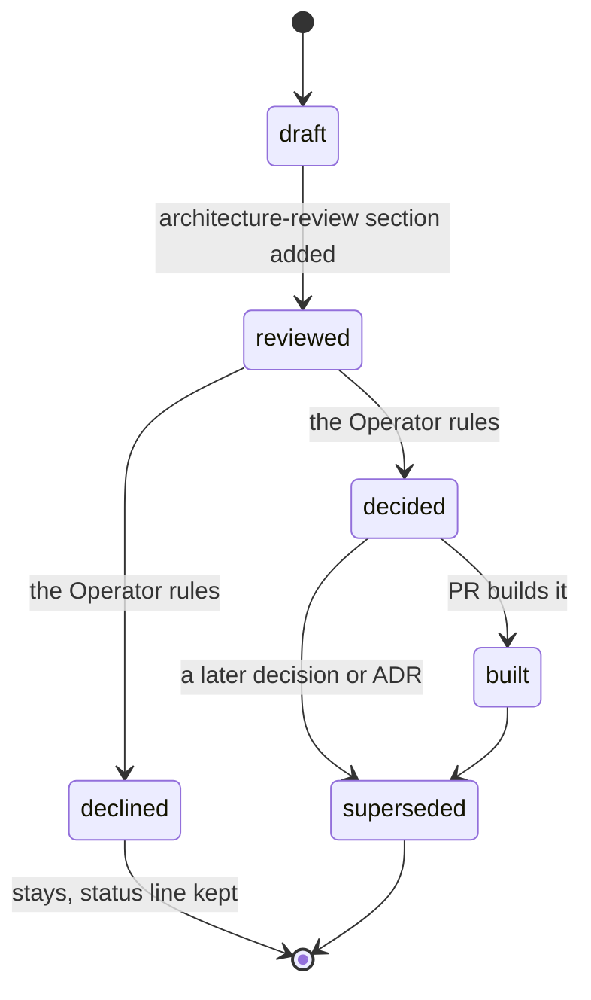

The proposals README uses the words draft, proposed, decided or accepted, declined and
superseded. "Built" is not a status word there: a proposal records "build not started" or
"slice 1 built" in its status line.

## An ADR

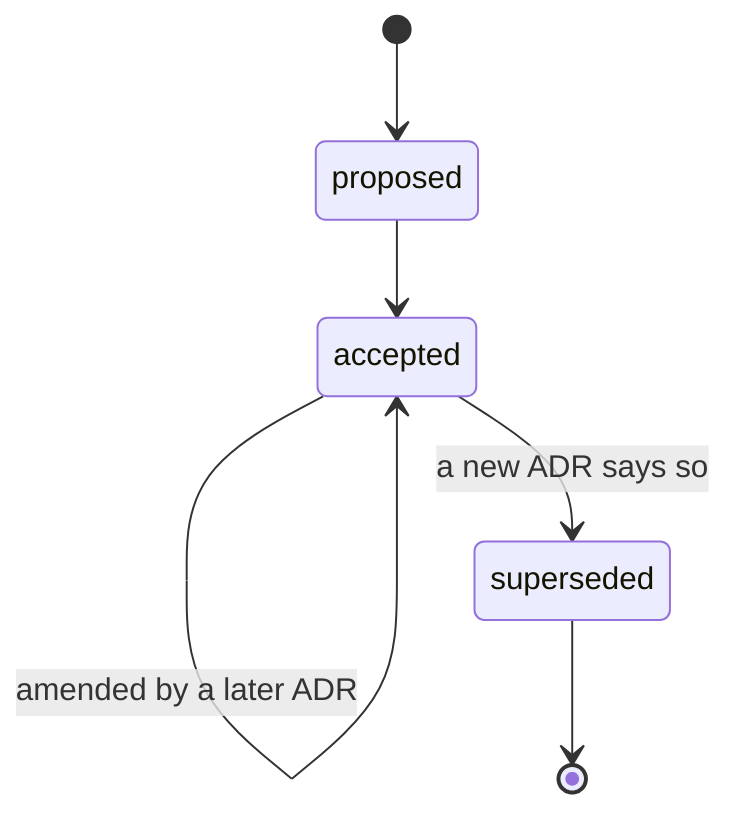

Template: `docs/adr/0000-template.md`. An ADR is corrected by adding, never by editing; a
superseded status names the ADR that replaces it. Counts on 2026-11-19 (status lines of `docs/adr/0*.md`): 53 accepted, 2 proposed, 5 superseded (the template aside).

## A backlog item

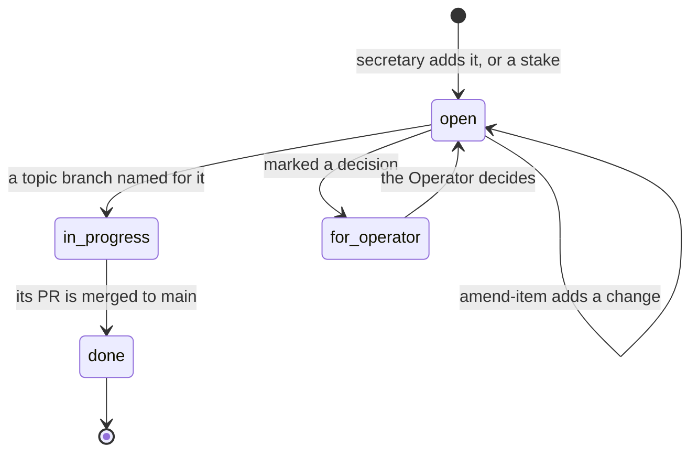

The secretary adds and ticks; only the host rewords or removes. "Done" is a merged pull request
(decided 2026-10-21, [LEXICON.md](../../LEXICON.md)).

## The devhost container

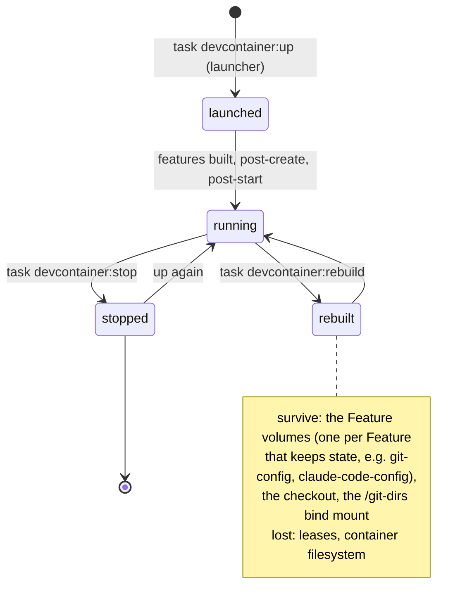

Volumes are tier 4 of [ADR 0045](../adr/0045-four-storage-tiers-govern-where-data-lives-and-a-machine-loss-must-lose-nothing.md):
kept by a rebuild, not by an engine reset. After a rebuild, list what the new container lost
(logins) before working ([windows-workstation-devhost](../reference-architectures/windows-workstation-devhost.md)).
Start and stop are idempotent ([ADR 0018](../adr/0018-start-and-stop-are-idempotent-prerequisites-and-rebuild-continues-after-a-failed-stop.md)).

## An agent session and its lease

From `src/agents/NOTES.md` (agents 2.x, built; from 2.2.0 the code is the `participant` component, `components/participant`, which claude-code installs with `participants: true`) and [agents-v2](../proposals/agents-v2.md).
The lease belongs to a stateful agent only; an ephemeral one has none.

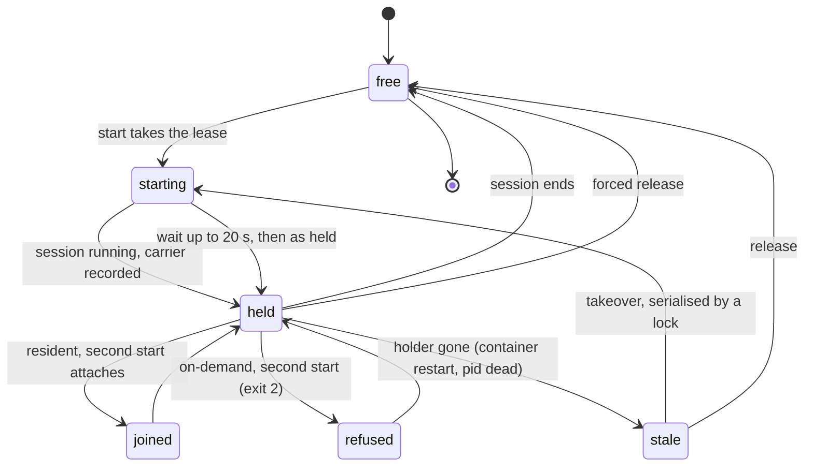

The lease lives at `/var/lib/devcontainer-features/agents/leases/<name>/holder`, not on a
volume, so a rebuild frees every lease. When liveness cannot be told, the lease is never taken
over by guess. A forced release is `task agents:release` with `--force`. Per-agent Linux users and a broader boundary are (proposed): [agent-linux-user](../proposals/agent-linux-user.md).

## A facilitator delivery (an A2A task)

From `src/facilitator/NOTES.md` (facilitator 0.2.0). One task per participant a message is routed to,
in the message's `route` entry; the states are A2A's, written as `status` entries by the assignee. A
message routed to a person makes no task: it stays unread until the person's `mail` hands it over.
Since 0.2.0 a person's own message is held like any other (option A).

```mermaid
stateDiagram-v2
  [*] --> held_by_guard: hop limit, budget or pause (no task; a notice)
  held_by_guard --> submitted: a person's continue tool call routes it again (the only reset)
  [*] --> submitted: route entry (the assignee attached, or a notice that it waits)
  submitted --> working: the assignee's receive takes it
  working --> completed: the assignee replies, or takes its next turn
  completed --> [*]
```

The infrastructure (the Directory, the SLIM node, the ssh-agent) is started by `facilitator infra up`
(post-start when `autostart`), idempotently, and never restarted on a crash; participants are never
started by the Feature.

## A ledger review cycle

```mermaid
stateDiagram-v2
  [*] --> collecting
  collecting --> due: 75 entries since the last review
  due --> reading: briefing says so; cost report first
  reading --> checking: did last review's friction come back
  checking --> grouping: group new friction by cause
  grouping --> acting: one action per group
  acting --> collecting: item, decision, change or no action with reason
```

The setting is `DEVHOST_REVIEW_EVERY` (75, [ADR 0021](../adr/0021-the-ledger-review-runs-every-75-entries.md);
25 if unset). Run with `/ledger-review`.

## A registry layer copy

From `src/component-registry/NOTES.md` (component-registry 1.0.0, slice 1 of the
[component registry](../proposals/component-registry.md)). One per source of a layer, in the
Feature's volume.

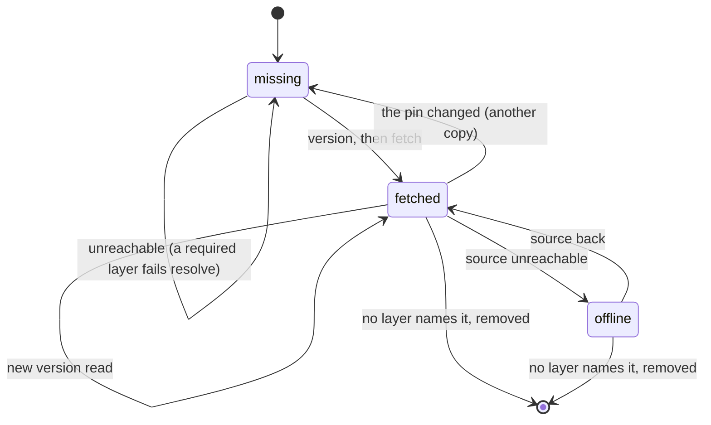

## A resolved view

```mermaid
stateDiagram-v2
  [*] --> stale
  stale --> resolving: dcf-registry resolve (one at a time, a lock)
  resolving --> current: new view swapped in by one rename
  resolving --> stale: a required layer never fetched; the old view stays
  current --> stale: a layer or who-you-are changed
```

Nothing marks a view stale by itself: since slice 2 (component-registry 1.1.0; slice 3, 1.2.0, adds the `http` and `cloud-folder` sources) the participant
component's start sequence runs `resolve` at every agent's start, and `/registry-refresh` runs it mid-session; `task component-registry:resolve` runs
it by hand.

A layer's namespace (component-registry 1.7.0) changes no state here: a namespaced layer's copy
and its components live and go exactly as any other layer's; dropping the layer from the list
removes its copy and, at the next resolve, its prefixed skills from the view and the CLI's skills
folder.

## A skill moving into the registry

From slice 4 of the [component registry](../proposals/component-registry.md) (`architecture-review`,
devhost 1.16.0). A committed skill passes through these states; this repository's
`architecture-review` is in `both`, and the last transition is the Operator's to make.

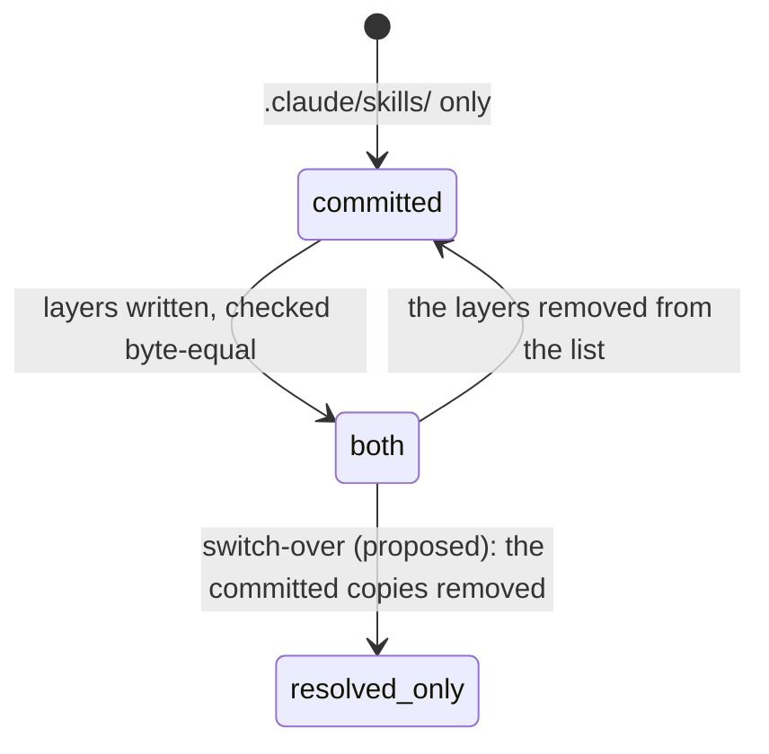

## A resolved skill in the CLI's skills folder

From `src/claude-code/NOTES.md` (claude-code 1.12.0, the adapter's `skills` verb, ADR-0064). One per
resolved skill, in the CLI's own skills folder. From claude-code 1.14.0 (ADR-0074) the same
life runs in two places: the personal folder while every agent's view has the skill alike, the
agent's own folder (read through `--add-dir`) while the views disagree; at a hand-over a skill moves
from one to the other (added where it is needed first, removed where it is not after), and an
agent forgotten (`dcf-registry forget`) or whose folder is gone loses its own folder.

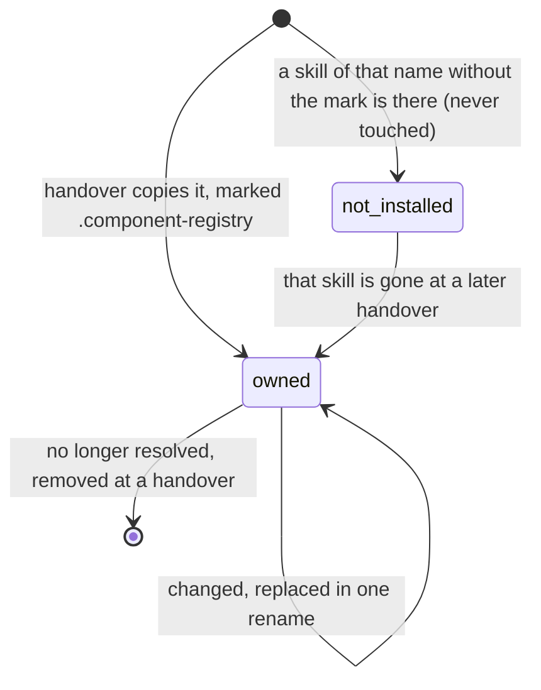

## An HTTP client of a node (facilitator 0.5.0, slice N4)

A person's acts move a client between states; an agent's job cannot (`http token`, `approve`, `deny`, `revoke` refuse
there). At level public a client's first message waits in `Enrolled`; mapped private there is no approval and the
client is `Approved` at once for this purpose.

```mermaid
stateDiagram-v2
  [*] --> Enrolled: http token (shown once; only the hash is kept; at most 20 wait)
  Enrolled --> Approved: approve (the held messages under 7 days are delivered)
  Enrolled --> Denied: deny (the token no longer works; held messages are not delivered)
  Approved --> Approved: calls within the approval ttl (30 d at public)
  Approved --> Enrolled: the approval expires (the next message is held again)
  Approved --> Revoked: revoke (at once)
  Enrolled --> Revoked: revoke
  Denied --> [*]
  Revoked --> [*]
```

## A node in a hub's domain (facilitator 0.4.0)

The public path (a join request a person approves) is slice N5a: see the node's lifecycle below.

```mermaid
stateDiagram-v2
  [*] --> Invited: node invite (a join token, 15 min)
  Invited --> Expired: unused for 15 minutes
  Invited --> Member: node join (token used once; certificate issued, roster entry)
  Member --> Member: certificate renewed at half life (24 h)
  Member --> Lapsed: OpenBao sealed past the certificate's life
  Lapsed --> Member: unsealed by hand, renewed
  Member --> Revoked: node revoke (no renewal; lock two refuses it; its card kept for its history)
  Revoked --> [*]
  Expired --> [*]
```

## A public node across nodes (facilitator 0.6.0, slice N5a)

`requested` (a key sent in a window a person opened) -> `approved` (a person; certificate 1 h) | `denied` -> `collected` ->
`renewing` (at half life, while the issuer allows) -> `revoked` (no renewal, lock two refuses it, the mesh secret rotates) ->
`expired` (within the hour: no handshake). Each transition is a signed entry of the `audit` register.

## A hub's CA (facilitator 0.7.0, hub-on-kubernetes)

Built-in: `none` -> `made` (a root signs the issuing CA once; the first start of the hub) -> `issuing` -> (`export-root`: the
root key leaves the volume, still `issuing`) -> `migrated` (`node issuer migrate`: the same issuing CA lives in OpenBao, its key
gone from the volume) | `replaced` (a new CA: every node joins again). ssh-agent: `none` -> `made` (the agent signs a
self-signed root once) -> `issuing` <-> `agent away` (issuing and renewing stop; issued certificates stay valid; back when the
agent answers and holds the key) -> `replaced` (the fingerprint changed: a new CA, every node joins again).

## An OAuth client (facilitator 0.8.0, slice N5b)

`unknown` -> `enrolled` (the first valid token of an issuer's subject; no secret kept) -> `approved` (a person, first contact;
lasts `approval_ttl`, 30 days at public) -> `enrolled` again when the approval expires (its next first message is held) ->
`revoked` | `denied` (a person; the client stays refused, a new token of the same subject does not undo it). The token itself
lives only as long as its issuer says (`exp`); the node never extends or stores it.

