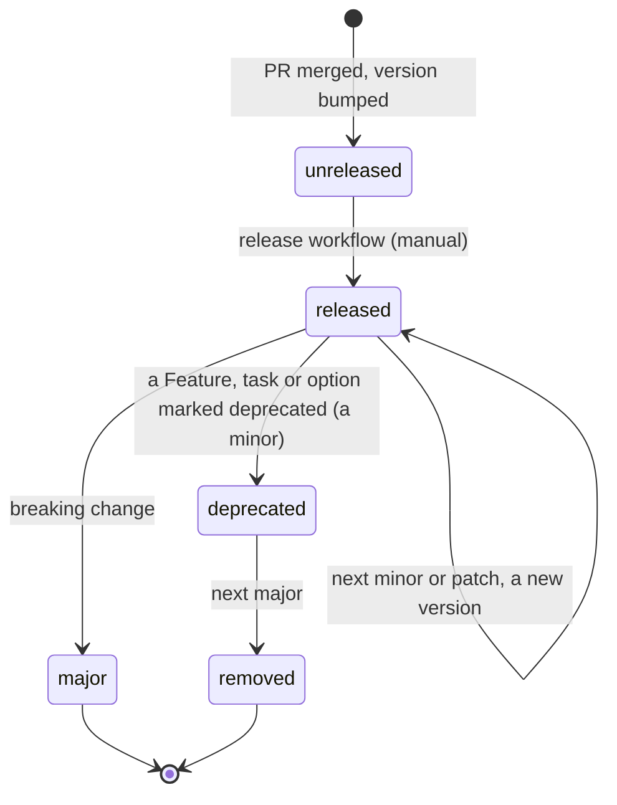
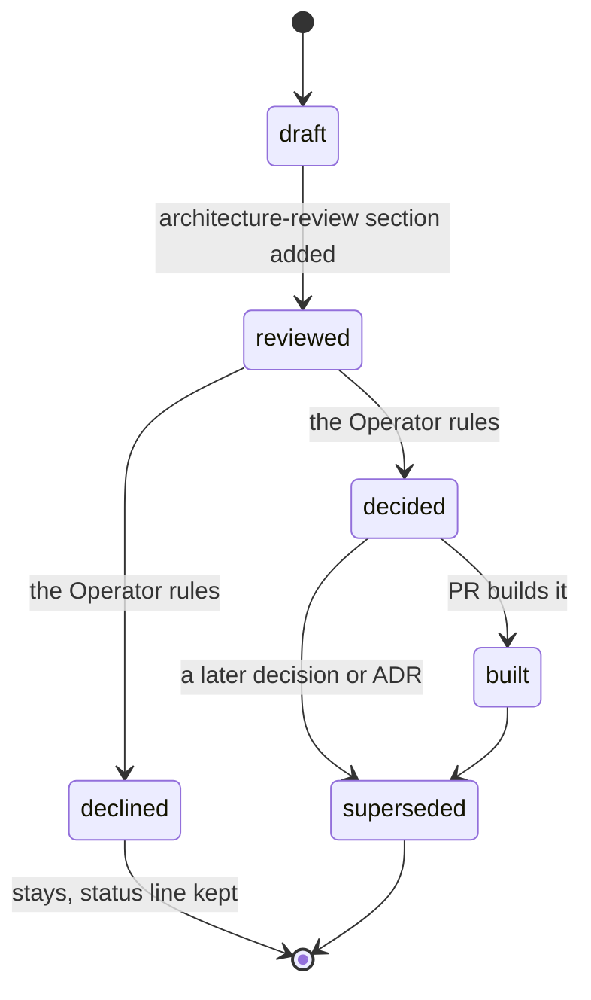
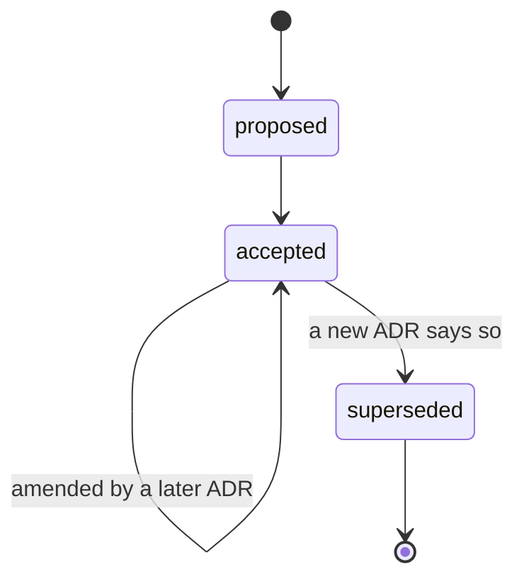
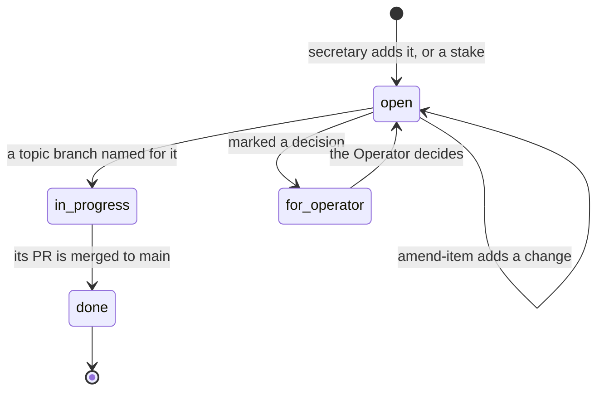
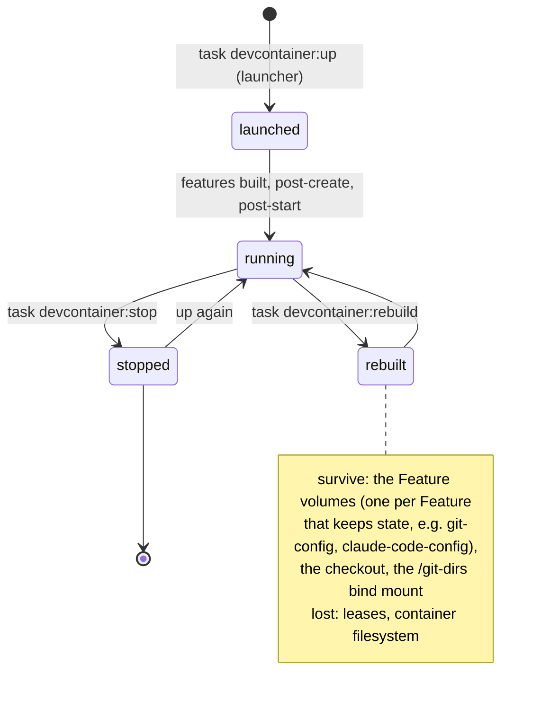
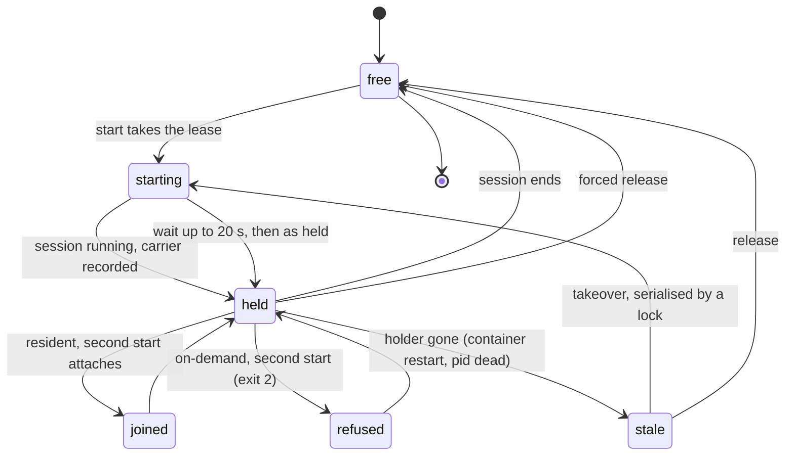

# Lifecycles

State diagrams of what exists. A state marked "(proposed)" is not built. Part of the [six](README.md).

## A Feature version

Registry tags per release: major, major.minor, full version, latest. Deprecation goes in a minor
(one line from `version` and `check`, NOTES, a "Deprecated" CHANGELOG heading, behaviour unchanged)
and removal in the next major: CONTRIBUTING.md, "Deprecating a Feature or an option" (decision
D21, ADR-0061). Examples: `openbao` 1.6.0 is unreleased; `agents` 2.2.0 is deprecated in favour of
`claude-code` `participants: true` and retired in 3.0.0.

## A proposal

The proposals README uses the words draft, proposed, decided or accepted, declined and
superseded. "Built" is not a status word there: a proposal records "build not started" or
"slice 1 built" in its status line.

## An ADR

Template: `docs/adr/0000-template.md`. An ADR is corrected by adding, never by editing; a
superseded status names the ADR that replaces it. Counts on 2026-11-19 (status lines of `docs/adr/0*.md`): 53 accepted, 2 proposed, 5 superseded (the template aside).

## A backlog item

The secretary adds and ticks; only the host rewords or removes. "Done" is a merged pull request
(decided 2026-10-21, [LEXICON.md](../../LEXICON.md)).

## The devhost container

Volumes are tier 4 of [ADR 0045](../adr/0045-four-storage-tiers-govern-where-data-lives-and-a-machine-loss-must-lose-nothing.md):
kept by a rebuild, not by an engine reset. After a rebuild, list what the new container lost
(logins) before working ([windows-workstation-devhost](../reference-architectures/windows-workstation-devhost.md)).
Start and stop are idempotent ([ADR 0018](../adr/0018-start-and-stop-are-idempotent-prerequisites-and-rebuild-continues-after-a-failed-stop.md)).

## An agent session and its lease

From `src/agents/NOTES.md` (agents 2.x, built; from 2.2.0 the code is the `participant` component, `components/participant`, which claude-code installs with `participants: true`) and [agents-v2](../proposals/agents-v2.md).
The lease belongs to a stateful agent only; an ephemeral one has none.

The lease lives at `/var/lib/devcontainer-features/agents/leases/<name>/holder`, not on a
volume, so a rebuild frees every lease. When liveness cannot be told, the lease is never taken
over by guess. A forced release is `task agents:release` with `--force`. Per-agent Linux users and a broader boundary are (proposed): [agent-linux-user](../proposals/agent-linux-user.md).

## A facilitator delivery (an A2A task)

From `src/facilitator/NOTES.md` (facilitator 0.1.0). One task per participant a message is routed to,
in the message's `route` entry; the states are A2A's, written as `status` entries by the assignee.

```mermaid
stateDiagram-v2
  [*] --> held_by_guard: hop limit, budget or pause (no task; a notice)
  held_by_guard --> submitted: a human's /continue routes it again
  [*] --> submitted: route entry (the assignee attached, or a notice that it waits)
  submitted --> working: the assignee's receive takes it
  working --> completed: the assignee replies, or takes its next turn
  completed --> [*]
```

The infrastructure (the Directory, the SLIM node, the ssh-agent) is started by `facilitator infra up`
(post-start when `autostart`), idempotently, and never restarted on a crash; participants are never
started by the Feature.

## A ledger review cycle

```mermaid
stateDiagram-v2
  [*] --> collecting
  collecting --> due: 75 entries since the last review
  due --> reading: briefing says so; cost report first
  reading --> checking: did last review's friction come back
  checking --> grouping: group new friction by cause
  grouping --> acting: one action per group
  acting --> collecting: item, decision, change or no action with reason
```

The setting is `DEVHOST_REVIEW_EVERY` (75, [ADR 0021](../adr/0021-the-ledger-review-runs-every-75-entries.md);
25 if unset). Run with `/ledger-review`.
