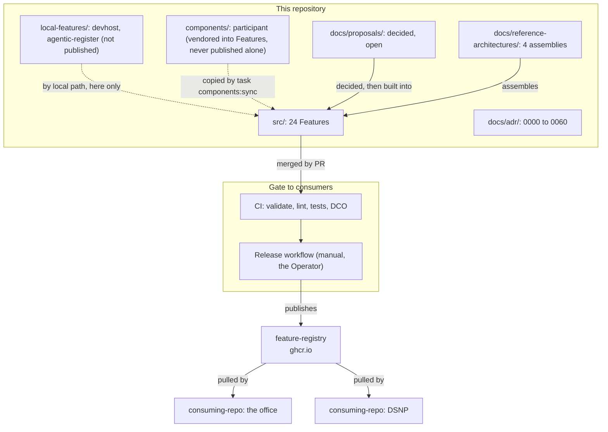

# State of the Architecture

As of 2026-11-20. Read from the files named in each table; this page links out and does not
restate them. Part of the [six](README.md).

## Built: the Features in `src/`

Version is the one in each `devcontainer-feature.json`. Whether a version is published is the
registry's fact, not the tree's: only `openbao` 1.6.0 is stated unreleased (its changelog and the
commit that added it); every other row is "to verify against the registry".

| Group | Feature (version) |
|---|---|
| Host and devcontainer | `devcontainer-cli` (1.22.1), `common` (1.0.4), `cloud-folder` (1.3.3), `audio` (1.1.0) |
| Git and identity | `git` (1.4.6), `gh` (1.1.0), `ssh-agent` (1.5.0), `openbao` (1.6.0, unreleased) |
| Agents | `agents` (2.2.0, deprecated: use `claude-code` `participants: true`), `claude-code` (1.10.0), `component-registry` (1.0.0, unreleased: the core of [the component registry](../proposals/component-registry.md), slice 1), `phi-check` (1.0.3), `go-task` (1.2.2), `coder-cli` (1.1.5), `dsc` (1.1.5) |
| Cloud and Kubernetes | `az` (1.1.3), `kustomize` (1.0.5), `kubeconform` (1.0.5), `argocd` (1.1.5), `velero` (1.0.6), `kube-state` (1.0.4) |

## Shared components: `components/`

Multi-file code several Features carry, with its own `COMPONENT_VERSION` and tests, vendored
into each by `task components:sync` and checked by `task components:check` (part of lint); no
`devcontainer-feature.json`, so the release and test workflows, which enumerate `src/`, never
see it ([ADR-0061](../adr/0061-the-facilitator-is-built-on-agntcy-first-with-the-mcp-split-in-two-and-the-agents-feature-moves-into-a-shared-participant-component.md)).

| Component (version) | Carried by | Role |
|---|---|---|
| `participant` (1.0.0) | `claude-code` (`participants: true`), `agents` (deprecated) | The agent list, kinds, lease, session names, adapter verbs, `agents up` and the launcher's verbs, with the `agents:` tasks; installed once into `/usr/local/lib/dcf-participant` ([CHANGELOG](../../components/participant/CHANGELOG.md)) |

## Local and unpublished: `local-features/`

| Feature (version) | Role |
|---|---|
| `devhost` (1.15.0) | The way of working's tooling in the container; local only ([ADR 0025](../adr/0025-the-devhost-feature-is-local-only-and-lives-outside-src.md)) |
| `agentic-register` (0.14.5) | The register, vendored unchanged from AOF; this repository's ledger runs on it ([ADR 0043](../adr/0043-the-aof-planting-keeps-four-local-rules-and-moves-the-ledger-onto-the-register-with-a-mirror-outside-git.md)) |

## Reference architectures

[Index](../reference-architectures/README.md). They combine: this repository's devhost is the
Windows workstation one with the agentic one on top.

| Architecture | Features |
|---|---|
| [Windows workstation devhost](../reference-architectures/windows-workstation-devhost.md) | `devcontainer-cli`, `git`, `ssh-agent`, `gh`, `go-task`, `common`, `cloud-folder`, `claude-code` |
| [Agentic devhost](../reference-architectures/agentic-devhost.md) | `agents`, `claude-code`, `git`, `gh`, `phi-check`, `go-task`, local `devhost`, `agentic-register` |
| [Secrets with OpenBao](../reference-architectures/secrets-with-openbao.md) | `openbao`, `ssh-agent`, `gh`, `az` |
| [Kubernetes toolbox](../reference-architectures/kubernetes-toolbox.md) | `kustomize`, `kubeconform`, `argocd`, `velero`, `kube-state` |

## Proposals

Status as [docs/proposals/README.md](../proposals/README.md) stated it before 2026-11-19, and what the
tree shows. The README rows were brought in line with the tree on 2026-11-19; the proposals' own
status lines were not (see Gaps).

| Proposal | Proposals README said | Tree shows |
|---|---|---|
| [Agents](../proposals/agents.md), [Agents version 2](../proposals/agents-v2.md), [Session names](../proposals/session-names.md) | decided or proposed; "build not started" | `agents` 2.1.3 with a lease and `session-name` in [NOTES](../../src/agents/NOTES.md); ADRs 0036, 0041 accepted; from 2.2.0 the code is the `participant` component, `agents` deprecated (ADR-0061) |
| [Cloud folder](../proposals/cloud-folder.md) | decided; build not started | `cloud-folder` 1.3.3 exists |
| [Host profile](../proposals/host-profile.md) | decided; build not started | built: `HOST_TYPE`, `HOST_TYPE_PRIORITY` and `DCF_HOST_*` in `devcontainer-cli` 1.22.1 ([NOTES](../../src/devcontainer-cli/NOTES.md)) |
| [Task aliases](../proposals/task-aliases.md) | draft; build not started | `taskAliases` (team file) in `go-task` 1.2.2 ([NOTES](../../src/go-task/NOTES.md)) |
| [Secrets master split](../proposals/secrets-master-split.md), [OpenBao key file](../proposals/openbao-key-file.md) | decided or proposed; build not started | `openbao` 1.6.0 (unreleased) with server mode and `unlock: keyfile`, the key file in `devcontainer-cli` 1.22.1, `ssh-agent` 1.5.0; ADRs 0048, 0056 |
| [Least privilege for agents, ending in one agent Linux user](../proposals/agent-linux-user.md) | accepted 2026-11-08; build not started | not built |
| [Personalization](../proposals/personalization.md) | open | superseded by the component registry (ADR-0063) |
| [Component registry](../proposals/component-registry.md) | accepted 2026-11-19 | slice 1 built: `component-registry` 1.0.0 (resolve, explain, the `.reg` grammar and match rule, `git` and `path` sources; skills only). Later: the adapter step (slice 2), `http` and `cloud-folder` sources (slice 3), first real use (slice 4) |
| [Secrets distribution (phase 2)](../proposals/secrets-distribution.md) | research notes, not designed | not built |
| Decided and closed: [King Arthur theme](../proposals/king-arthur-theme.md) (superseded), [Journalist back](../proposals/journalist-back.md), [Feature principles](../proposals/feature-principles.md), [Agent principles](../proposals/agent-principles.md), [Iteration package](../proposals/iteration-package.md) | decided or superseded | in the ADRs and [docs/principles/](../principles/) |

## Known gaps

| Gap | Where it shows |
|---|---|
| Proposal status lines lag the tree | the README rows are current (2026-11-19), but the status lines inside agents-v2, cloud-folder, host-profile and session-names still say nothing is built |
| Reference architecture partly lags `openbao` | [secrets-with-openbao](../reference-architectures/secrets-with-openbao.md): "What exists today" is current (2026-11-19); later sections still say "planned" for built parts |
| A new Feature has three hard-coded places in `test/_global` | CONTRIBUTING.md step 9 calls it a known manual step; forgetting one fails only in CI |
| Only three release tags in git | `git tag` shows `feature_*_1.0.0` for three Features; published state is in the registry, which this page did not query |
| The devhost does not start on `wslc` | `task test` needs `--privileged` docker-in-docker ([CLAUDE.md](../../CLAUDE.md)) |
| Agents have no least-privilege boundary yet | [agent-linux-user](../proposals/agent-linux-user.md) accepted, not built |
| `common:check` compares single files one level deep | a helper vendored into a subfolder would not be checked; `components:check` compares whole folders (`diff -r`) |
| `agents` 3.0.0 (retirement) waits on its conditions | [facilitator-agent](../proposals/facilitator-agent.md) 7.2: claude-code carried the component for a release, the office and DSNP moved, the launcher shown on the component alone |
| Architecture documents are new | Data Flows and Data Inventory are written beside this page; C4 views are in `docs/model/` |

## Component registry (ADR-0063)

| Element | State | Builds on |
|---|---|---|
| component-registry Feature: `resolve`, `explain`, the layer list, the `.reg` grammar and match rule, `git` and `path` registry sources | built, slice 1 (`component-registry` 1.0.0, unreleased) | nothing yet: standalone, skills resolved into its own volume |
| The CLI adapter's `skills` verb, `resolve` at an agent's start, the per-agent who-you-are override, the utility skills | later (slice 2) | agents CLI adapters (ADR-0037, amended then) |
| `http` and `cloud-folder` registry sources | later (slice 3) | OpenBao (`dcf-secret`), cloud-folder |
