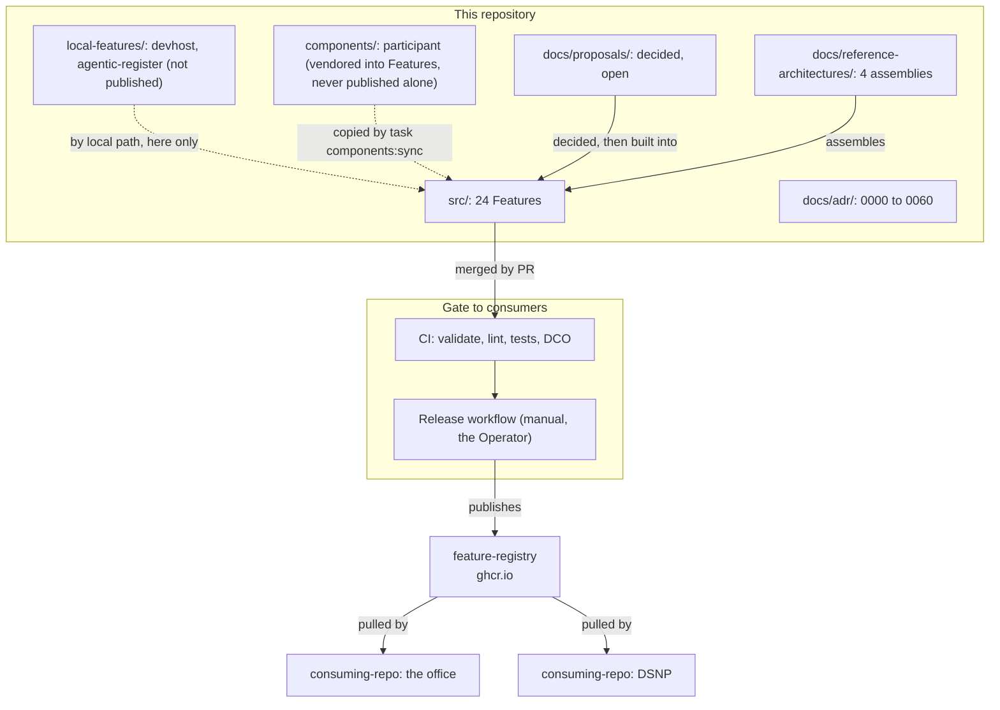

# State of the Architecture

As of 2026-11-20. Read from the files named in each table; this page links out and does not
restate them. Part of the [six](README.md).

## Built: the Features in `src/`

Version is the one in each `devcontainer-feature.json`. Whether a version is published is the
registry's fact, not the tree's: only `openbao` 1.6.0 is stated unreleased (its changelog and the
commit that added it); every other row is "to verify against the registry".

| Group | Feature (version) |
|---|---|
| Host and devcontainer | `devcontainer-cli` (1.22.1), `common` (1.0.4), `cloud-folder` (1.3.3), `audio` (1.1.0) |
| Git and identity | `git` (1.4.6), `gh` (1.1.0), `ssh-agent` (1.5.0), `openbao` (1.6.0, unreleased) |
| Agents | `agents` (2.4.0, deprecated: use `claude-code` `participants: true`), `claude-code` (1.12.0, unreleased: the `skills` adapter verb; 1.11.0 the participants list keys), `copilot` (0.1.0, unreleased: Copilot CLI as the second vendor of the participant component, [facilitator proposal](../proposals/facilitator-agent.md) slice 4; `dependsOn` on the official `copilot-cli` Feature, ruled by the Operator 2026-11-20), `component-registry` (1.5.0, published: the `db` source, explain colours (1.4.0, published only within 1.5.0), `heading: false` and front matter values (1.3.0); 1.6.0 in progress: agent definitions, [the component registry](../proposals/component-registry.md) section 6.1), `phi-check` (1.0.3), `go-task` (1.2.2), `coder-cli` (1.1.5), `dsc` (1.1.5) |
| Agent communication | `sign-packet` (0.6.0), `register-engine` (0.3.0), `packet-relay` (0.4.0), `facilitator` (0.9.0, unreleased: gate A, a node holds what arrives from another node until a person approves it: `limits.<level>.approval` gains `every-message` and `per-conversation` (private, public, HTTP clients; refused at local), held messages in a person's `mail` and the turn hook line, `facilitator approve` and `deny` and the `deny` MCP tool, signed notices and `message-approved`/`message-denied` audit entries, `verify` shows the approval; 0.8.0: cloud AIs over OAuth 2.1, the node a resource server only: `http.issuers` (named authorization servers), `http.url`, the protected-resource metadata, JWT checks (issuer, algorithm, JWKS signature, expiry, audience, scope) that fail closed, a client named by its (issuer, subject) and held until a person approves, `via` with issuer and subject, `facilitator http issuers`, slice N5b; 0.7.0: a hub issues its domain's certificates itself by default (a built-in root and issuing CA, no unseal), the CA key optionally in an ssh-agent (`node.issuer.ssh_agent`), `node issuer export-root` and `migrate` (the same CA into OpenBao), the hub on Kubernetes as a kustomize base with a Rancher Desktop overlay and a throwaway-kind-cluster test; 0.6.0: `role: peer` (no hub, each node its own issuer), `preset: open`, the cross-node public rules (join by key plus a person's approval, a separate public listener and join endpoint, `copy: addressed`, partial replicas in `verify`, revoke and cut-off), the mesh secret rotated on revoke, the signed `audit` register, an opaque `badge` in cards, slice N5a of [facilitator-node](../proposals/facilitator-node.md); 0.5.0: MCP over HTTP for CLIs with bearer tokens, a person's `http token` and `approve`, the node signing for the client with `data.via`, the reach rule, first-contact approval and the public limits, slice N4 of [facilitator-node](../proposals/facilitator-node.md); 0.4.0: hub and spoke with local and private trust, `mesh.yml`, node certificates from an OpenBao PKI, the two locks, join tokens, revoke, the peers part, qualified handles `@handle.node`, slice N3 of [facilitator-node](../proposals/facilitator-node.md); 0.3.1: installs the published bundle, pinned; 0.3.0: installs the node bundle (`bundles/facilitator`) at `/opt/facilitator`, options `mode: node | leaf` and `bundleVersion`, `dirVersion` and `slimVersion` deprecated, slice N2 of [facilitator-node](../proposals/facilitator-node.md); 0.2.0: MCP only, a person attaches their own Claude Code or Copilot session as a `human`-kind participant; 0.1.0 the first version on AGNTCY, slice 3 of the [facilitator proposal](../proposals/facilitator-agent.md); its own copies of register-engine's and sign-packet's libraries, checked by `task registerengine:check` and `task signpacket:check`) |
| Cloud and Kubernetes | `az` (1.1.3), `kustomize` (1.0.5), `kubeconform` (1.0.5), `argocd` (1.1.5), `velero` (1.0.6), `kube-state` (1.0.4) |

## Shared components: `components/`

Multi-file code several Features carry, with its own `COMPONENT_VERSION` and tests, vendored
into each by `task components:sync` and checked by `task components:check` (part of lint); no
`devcontainer-feature.json`, so the release and test workflows, which enumerate `src/`, never
see it ([ADR-0061](../adr/0061-the-facilitator-is-built-on-agntcy-first-with-the-mcp-split-in-two-and-the-agents-feature-moves-into-a-shared-participant-component.md)).

| Component (version) | Carried by | Role |
|---|---|---|
| `participant` (1.0.0) | `claude-code` (`participants: true`), `copilot` (`participants: true`), `agents` (deprecated) | The agent list, kinds, lease, session names, adapter verbs, `agents up` and the launcher's verbs, with the `agents:` tasks; installed once into `/usr/local/lib/dcf-participant` ([CHANGELOG](../../components/participant/CHANGELOG.md)) |

## Release assets: `bundles/`

A third kind of artifact beside the Features and the components: built by a script in `bundles/<id>/`, published
as a GitHub release asset by a manual workflow the Operator starts, pinned by digest in the Feature that installs
it, and never a Feature or a component itself.

| Bundle | What | Installed by |
|---|---|---|
| `bundles/facilitator` (bundle 0.3.0 released; 0.4.0 not released yet) | The facilitator node bundle per architecture (linux amd64, arm64): its own CPython, `dirctl`, `slimctl`, `slim-bindings`, the application; `SHA256SUMS`, a build attestation; workflow `release-bundle` | the `facilitator` Feature (its digests in `src/facilitator/digests.txt`; with no pin it builds the bundle from its own source with the copy `bundle-build.sh`, `task bundle:check`), and the node image `ghcr.io/nabil-becker/facilitator-node` (`bundles/facilitator/Dockerfile`, workflow `release-node-image`, not published yet) |

## Local and unpublished: `local-features/`

| Feature (version) | Role |
|---|---|
| `devhost` (1.16.0) | The way of working's tooling in the container; from 1.16.0 also a component-registry layer (`/usr/local/share/devhost/registry`, the generic `architecture-review`); local only ([ADR 0025](../adr/0025-the-devhost-feature-is-local-only-and-lives-outside-src.md)) |
| `agentic-register` (0.14.5) | The register, vendored unchanged from AOF; this repository's ledger runs on it ([ADR 0043](../adr/0043-the-aof-planting-keeps-four-local-rules-and-moves-the-ledger-onto-the-register-with-a-mirror-outside-git.md)) |

## Reference architectures

[Index](../reference-architectures/README.md). They combine: this repository's devhost is the
Windows workstation one with the agentic one on top.

| Architecture | Features |
|---|---|
| [Windows workstation devhost](../reference-architectures/windows-workstation-devhost.md) | `devcontainer-cli`, `git`, `ssh-agent`, `gh`, `go-task`, `common`, `cloud-folder`, `claude-code` |
| [Agentic devhost](../reference-architectures/agentic-devhost.md) | `agents`, `claude-code`, `git`, `gh`, `phi-check`, `go-task`, local `devhost`, `agentic-register` |
| [Secrets with OpenBao](../reference-architectures/secrets-with-openbao.md) | `openbao`, `ssh-agent`, `gh`, `az` |
| [Kubernetes toolbox](../reference-architectures/kubernetes-toolbox.md) | `kustomize`, `kubeconform`, `argocd`, `velero`, `kube-state` |

## Proposals

Status as [docs/proposals/README.md](../proposals/README.md) stated it before 2026-11-19, and what the
tree shows. The README rows were brought in line with the tree on 2026-11-19; the proposals' own
status lines were not (see Gaps).

| Proposal | Proposals README said | Tree shows |
|---|---|---|
| [Agents](../proposals/agents.md), [Agents version 2](../proposals/agents-v2.md), [Session names](../proposals/session-names.md) | decided or proposed; "build not started" | `agents` 2.1.3 with a lease and `session-name` in [NOTES](../../src/agents/NOTES.md); ADRs 0036, 0041 accepted; from 2.2.0 the code is the `participant` component, `agents` deprecated (ADR-0061) |
| [Cloud folder](../proposals/cloud-folder.md) | decided; build not started | `cloud-folder` 1.3.3 exists |
| [Host profile](../proposals/host-profile.md) | decided; build not started | built: `HOST_TYPE`, `HOST_TYPE_PRIORITY` and `DCF_HOST_*` in `devcontainer-cli` 1.22.1 ([NOTES](../../src/devcontainer-cli/NOTES.md)) |
| [Task aliases](../proposals/task-aliases.md) | draft; build not started | `taskAliases` (team file) in `go-task` 1.2.2 ([NOTES](../../src/go-task/NOTES.md)) |
| [Secrets master split](../proposals/secrets-master-split.md), [OpenBao key file](../proposals/openbao-key-file.md) | decided or proposed; build not started | `openbao` 1.6.0 (unreleased) with server mode and `unlock: keyfile`, the key file in `devcontainer-cli` 1.22.1, `ssh-agent` 1.5.0; ADRs 0048, 0056 |
| [Least privilege for agents, ending in one agent Linux user](../proposals/agent-linux-user.md) | accepted 2026-11-08; build not started | not built |
| [Personalization](../proposals/personalization.md) | open | superseded by the component registry (ADR-0063) |
| [Component registry](../proposals/component-registry.md) | accepted 2026-11-19 | slice 1 built: `component-registry` 1.0.0 (resolve, explain, the `.layer` grammar and match rule, `git` and `path` sources; skills only); slice 2 built: the adapter step (`component-registry` 1.1.0, `claude-code` 1.12.0, participant 1.2.0, ADR-0064). slice 3 built: the `http` source (`component-registry` 1.2.0) and the `cloud-folder` source (`cloud-folder` 1.4.0). slice 4 built: the first real use, `architecture-review` in two layers (`devhost` 1.16.0 and this repository's `.devcontainer/registry/repo`; byte-equal to the committed skill with `component-registry` 1.3.0); the switch-over is proposed, not done. The `db` source built and published (`component-registry` 1.5.0, with 1.4.0's explain colours). Release 2 agent definitions in progress (section 6.1; `component-registry` 1.6.0, participant 1.3.0, `claude-code` 1.13.0). Later: prompts and settings |
| [Secrets distribution (phase 2)](../proposals/secrets-distribution.md) | research notes, not designed | not built |
| [Facilitator](../proposals/facilitator-agent.md) | ruled 2026-11-19; MCP-only pivot ruled 2026-11-20; slices 0 to 2 done | `facilitator` 0.1.0 (slice 3, unreleased) and 0.2.0 (unreleased): `agntcy` backend only, no model, the pump not built; every `@handle` delivered (ruling M); no terminal chat: a person attaches over MCP (`say`, `mail`, `transcript`, `continue`, `who`), a person's message counts as a hop and only `continue` resets (option A); one shared MCP entry, the handle from `FACILITATOR_HANDLE` |; `copilot` 0.1.0 (slice 4, unreleased) has the `attach` option (claude-code's is not built); rule 1 reads only the addressed mentions (the first `@handle` and those right after it), which the scenario of section 2 needs |
| [Facilitator node](../proposals/facilitator-node.md) | ruled 2026-11-20 (the review's rulings AA to AI, the spike's SP1 to SP5, the readings BA to BJ) | N1 (the second spike) done; N2 built (`facilitator` 0.3.0 and 0.3.1, the bundle 0.3.0 published); **N3 built** (`facilitator` 0.4.0, unreleased): roles hub and spoke in `mesh.yml`, presets solo and team, certificates from an OpenBao PKI per domain, a listener per level and the application's SPIFFE ID check, join tokens, revoke, replicas across nodes, the Directory per role; leaf clients not built; **N4 built** (`facilitator` 0.5.0, unreleased): the `http` part on the `mcp` library 2.3.0 (off unless `http.listen`; TLS beyond loopback), static bearer tokens a person makes, `approve`, `via`, the single-node public rules; Claude Code and Copilot CLI run against it (`task test:facilitator-http`); OAuth and cloud AIs not built; **N5a built** (`facilitator` 0.6.0, unreleased): peer to peer and the cross-node public rules (see the Agent communication row); N5b (OAuth, cloud AIs) not started |
| Decided and closed: [King Arthur theme](../proposals/king-arthur-theme.md) (superseded), [Journalist back](../proposals/journalist-back.md), [Feature principles](../proposals/feature-principles.md), [Agent principles](../proposals/agent-principles.md), [Iteration package](../proposals/iteration-package.md) | decided or superseded | in the ADRs and [docs/principles/](../principles/) |

## Known gaps

| Gap | Where it shows |
|---|---|
| Proposal status lines lag the tree | the README rows are current (2026-11-19), but the status lines inside agents-v2, cloud-folder, host-profile and session-names still say nothing is built |
| Reference architecture partly lags `openbao` | [secrets-with-openbao](../reference-architectures/secrets-with-openbao.md): "What exists today" is current (2026-11-19); later sections still say "planned" for built parts |
| A new Feature has three hard-coded places in `test/_global` | CONTRIBUTING.md step 9 calls it a known manual step; forgetting one fails only in CI |
| Only three release tags in git | `git tag` shows `feature_*_1.0.0` for three Features; published state is in the registry, which this page did not query |
| The devhost does not start on `wslc` | `task test` needs `--privileged` docker-in-docker ([CLAUDE.md](../../CLAUDE.md)) |
| Agents have no least-privilege boundary yet | [agent-linux-user](../proposals/agent-linux-user.md) accepted, not built |
| `common:check` compares single files one level deep | a helper vendored into a subfolder would not be checked; `components:check` compares whole folders (`diff -r`) |
| `agents` 3.0.0 (retirement) waits on its conditions | [facilitator-agent](../proposals/facilitator-agent.md) 7.2: claude-code carried the component for a release, the office and DSNP moved, the launcher shown on the component alone |
| The participant component does not know the facilitator's keys | `components/participant` 1.0.0 reads `agents:` and `agents.yml` only and warns on `attachment`, `description`, `skills`; the facilitator reads `participants.yml` (alias `agents.yml`) itself |
| dirctl 1.9.1 cannot switch mDNS off; a loopback-only Directory still dials out to daemons it finds on its network segment | facilitator 0.4.0 NOTES ("The Directory, and mDNS"): peering needs `directory.firewall` (iptables, `NET_ADMIN`) or a firewall outside |
| The `openbao` Feature has no `openbao:pki:*` tasks (ADR-0069 decision 6): a hub's PKI is set up by hand with `bao` | facilitator 0.4.0 NOTES, step 3 |
| SLIM 3.4.6 reloads neither a renewed certificate nor a changed CA bundle while it runs, and checks no revocation list | facilitator 0.4.0: the peers part restarts SLIM after a renewal; revocation is the 24 h lifetime plus lock two |
| The facilitator's leaf client (`mode: leaf` reaching a node) is not built | proposal facilitator-node 11.2; N3 built hubs and spokes only |
| The HTTP endpoint's audit of enrolments is a hash-chained log, not a signed register; a bearer token has no expiry | facilitator 0.5.0 NOTES (Limits); a signed `audit` register type is a backlog item |
| An HTTP client's first message is a chain's root that no person wrote (the node vouches for it); `verify` accepts it by its `via` | facilitator 0.5.0; ADR-0070 decision 4 and ADR-0066 stand (only a person's local session resets hops); see the report's decision |
| The facilitator is the first published Feature with an MCP server and with daemons it starts | `src/facilitator/NOTES.md`; the NFR decision "MCP: none for now" is revised in `docs/principles/non-functional-requirements.md` |
| A person's session is not woken by a facilitator message | facilitator 0.2.0: `mail` is called, never pushed; Claude Code's turn hook shows a line at the next prompt; Copilot CLI has no such hook |
| Every token is readable by every process of the one Linux user | facilitator 0.2.0 gives a person a token too: an agent with a shell could read `tokens/you` and attach as the person; [agent-linux-user](../proposals/agent-linux-user.md) is the boundary that would close it |
| `copilot` depends on the official Feature, whose install is unverified and self-updating | `src/copilot/NOTES.md`; `dependsOn` is the Operator's ruling of 2026-11-20 (NFR-4), an exception to "installsAfter only"; no `version` option, since an option cannot be forwarded into `dependsOn` |
| `attach` registers one MCP entry that takes the handle from `FACILITATOR_HANDLE` | `src/copilot/NOTES.md`; facilitator 0.2.0 reads `FACILITATOR_HANDLE` itself, so it is the same shared entry; unverified that Copilot passes its environment to a stdio server without a login |
| The node bundle is not released, so the Feature builds it from source | `src/facilitator/digests.txt` is empty until the Operator runs `release-bundle` and a pull request pins it (`task bundle:pin`) |
| No arm64 test of the facilitator outside `release-bundle` | the arm64 bundle is cross-built and checked here, run only on `release-bundle`'s `ubuntu-24.04-arm` runner; `test.yaml` runs amd64 only |
| The facilitator node is not on the network yet | facilitator 0.3.0: a leaf installs but has no node to reach; the node image runs role standalone (slice N3) |
| Architecture documents are new | Data Flows and Data Inventory are written beside this page; C4 views are in `docs/model/` |

## Component registry (ADR-0063)

| Element | State | Builds on |
|---|---|---|
| component-registry Feature: `resolve`, `explain`, the layer list, the `.layer` grammar and match rule, `git` and `path` registry sources | built, slice 1 (`component-registry` 1.0.0, published) | nothing: standalone, skills resolved into its own volume |
| The CLI adapter's `skills` verb (`agent-adapter-claude`), `dcf-registry handover` and `refresh`, `resolve` at an agent's start, the per-agent `registry-path`, the utility skills in a built-in base layer | built, slice 2 (`component-registry` 1.1.0, `claude-code` 1.12.0, participant 1.2.0; unreleased) | agents CLI adapters (ADR-0037, amended by ADR-0064), the participant component (ADR-0061) |
| `http` and `cloud-folder` registry sources | built, slice 3 (`component-registry` 1.2.0, published 2026-11-20; `cloud-folder` 1.4.0) | OpenBao (`dcf-secret`), cloud-folder |
| A view per who-you-are path, hand-over records, `forget`, `refresh --session`; Claude Code's split of an agent's skills into the shared personal folder and its own folder read through `--add-dir`; the participant's hand-over `--as` the agent's path and `agents up` forgetting agents no longer listed | built (`component-registry` 1.8.0, `claude-code` 1.14.0, participant 1.4.0; unreleased; ADR-0074) | the Claude adapter's `skills` verb (ADR-0064), the participant start hook |
| Vendor templates (ADR-0077): each vendor's files rendered from Jinja templates by `minijinja-cli` (pinned, sha256-checked) at the hand-over, templates a component kind (`templates/<vendor>/<file>.j2` in a layer: replace whole, `extends` one block, or add; layer precedence, a `lock:` in the head, namespaces isolated), the base layer's Claude `SKILL.md` template byte-equal to the 1.10.0 files, `dcf-registry render` and `explain templates/...` | built (`component-registry` 1.11.0, `claude-code` 1.14.1, released); slice 2.1, Copilot's skills, built (`component-registry` 2.1.0, `copilot` 0.3.0; unreleased); `for: agent` not built: no CLI-native agent files (the Operator, 2026-11-24) | the CLI adapter's `skills` verb (it receives the rendered files), the layer sources |
| `db` registry source (`sqlite`, `postgres`: the rows of a table or query rendered into a `.layer` file) | built (`component-registry` 1.5.0, published) | OpenBao (`dcf-secret`), `sqlite3` or `psql` in the image |
| First real use: this repository's devhost resolves `architecture-review` from the devhost Feature's generic layer and this repository's layer (`.devcontainer/registry.yml`, both `heading: false`), checked byte-equal to the devhost template copy, and this repository commits no copy (`task test:registry-first-use`); with it `heading: false` on a layer and `name`/`description` values in a skill's front matter | built, slice 4 (`devhost` 1.16.0, local; `component-registry` 1.3.0, published within 1.5.0); switched over (`architecture-skill-switch-over`, `devhost` 1.18.0): this repository's committed copy is deleted; `devhost-init` plants the template only where the layer list does not name the devhost layer | the participant start hook, the Claude adapter's `skills` verb |
| Layer namespaces (ADR-0073 decision 4): `namespace: <name>` on a layer prefixes its components (`skills/acme:arch-review`, handed over as `acme--arch-review`); layers of one namespace merge, different namespaces and the Operator's un-namespaced layers never mix; references explicit (no prefix: the own namespace; `<ns>:<name>` from any layer), a missing target reported as a missing dependency while resolve goes on, one-hop `aliases` on a layer (the Operator's rulings N1 to N4, ADR-0073 amendment) | in progress (`component-registry` 1.7.0, on a topic branch, not merged) | the CLI adapter's `skills` verb (the folder name), `explain` |
| Agent definitions (release 2, proposal section 6.1): `agents/<name>` with `model` and `skills`, the registry winning over the agents list for those two fields (the Operator, 2026-11-21), the model handed to the adapter in `AGENT_MODEL` (Claude Code and Copilot: `--model`, in place of one in the arguments; `model.<cli>` for agents of one CLI) | in progress (`component-registry` 1.6.0, participant 1.3.0, `claude-code` 1.13.0, `copilot` 0.2.0; on a topic branch, not merged) | the participant start hook, the agents list, the CLI adapter contract (ADR-0037, as `AGENT_SESSION_NAME` in ADR-0041) |
