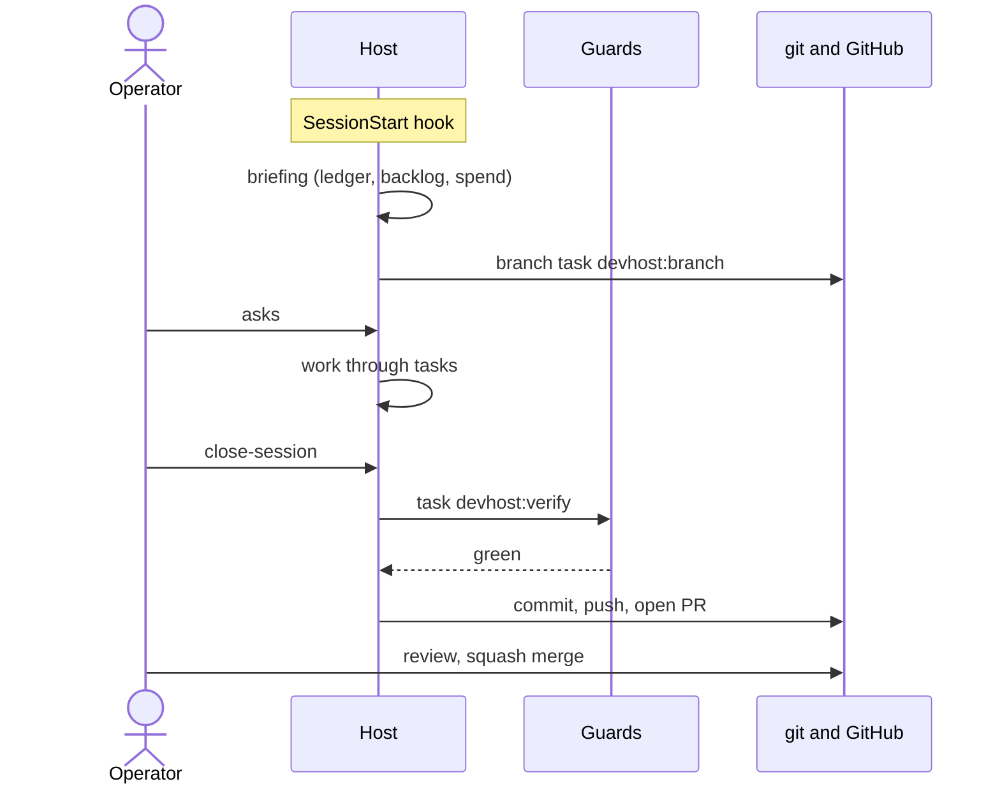
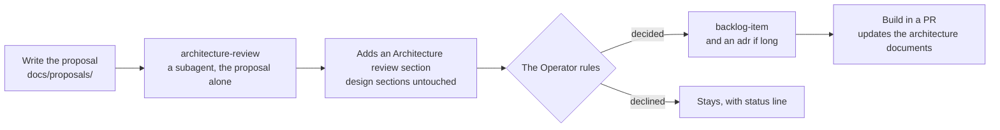
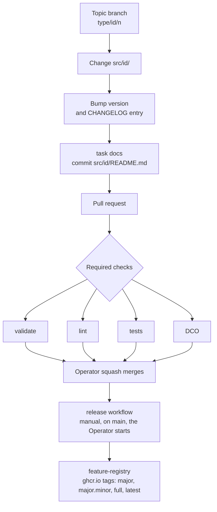
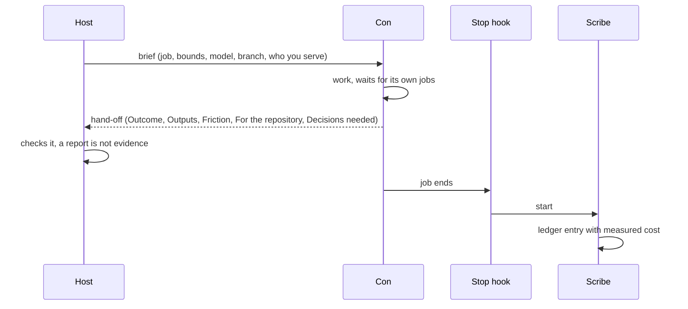
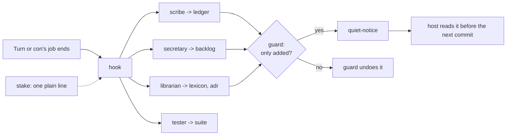
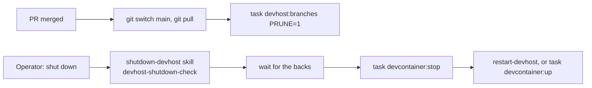

# Workflows

The main flows, in order. Sources: [PROCESS.md](../../PROCESS.md), [CLAUDE.md](../../CLAUDE.md),
[CONTRIBUTING.md](../../CONTRIBUTING.md), `.github/workflows/`, `.claude/skills/*/SKILL.md`.
Part of the [six](README.md). Node ids are ontology ids where they name a model thing; sequence diagrams use short ids, since a hyphen breaks a participant name there.

## 1. A session, start to close

The host commits and pushes; the Operator reviews and merges (ADR 0040).



The briefing arrives on its own. Work happens on a topic branch, never on `main`. Close runs the
records check, the guards and the diff scan before the commit.

## 2. A proposal



No proposal is in force until the Operator accepts it. The review comes before every ruling
([ADR 0039](../adr/0039-an-architecture-review-comes-before-every-ruling-and-nfr-13-says-we-manage-the-environment-not-the-cli.md)).
A proposal names which of the six architecture documents it changes ([README](README.md)).

## 3. A Feature change to a release



An agent says a release is due and what it would publish; it never runs it. Until the release, a
Feature cannot be named in `installsAfter` or pulled by a consumer. The release workflow needs
no write access: READMEs are committed, and the lint workflow checks they are current.

## 4. A con's job



One job per con, sized by blast radius (Sonnet by default, Opus only when the change reaches
every consumer, with the reason in the brief). A con replies once. Each job gets its own ledger
entry.

## 5. The backs after a turn



Backs run in the background, inside the devhost, and never make the host wait. They only add
(the secretary also ticks). Anyone leaves a stake when something might be missed. On a
workstation there are no backs; `/close-session` does their chores by hand.

## 6. After a merge, and shutdown



A merged branch is never pushed to again; a new branch starts the next piece of work.

## 7. Resolving the component registry

Built in slices 1 and 2 ([component-registry](../proposals/component-registry.md), ADR-0063,
ADR-0064): the participant component's start sequence (`agents start`, `agents up`) runs `resolve`
with the agent's who-you-are path (its `registry-path`, else `COMPONENT_REGISTRY_WHOAMI`), then
`dcf-registry handover`, which calls the CLI adapter's `skills` verb when `supports` lists it, and
only then starts the CLI. `task component-registry:resolve` runs the resolve by hand;
`/registry-refresh` runs resolve and the hand-over mid-session. No step ever blocks the start.

```mermaid
sequenceDiagram
  actor person as Person, or the participant component at an agent's start
  participant R as component-registry
  participant S as registry source
  participant C as CLI adapter
  person->>R: layer-list (is there a list?)
  alt no layer list
    R-->>person: one line, the agent starts with its plain skills
  end
  person->>R: resolve, for registry-path, COMPONENT_REGISTRY_WHOAMI or --as
  R->>R: take the lock (flock)
  loop each layer, each source
    R->>S: version
    alt unchanged
      R->>R: keep the layer copy
    else changed
      R->>S: fetch into a new copy
      S-->>R: layer copy
    else unreachable
      R->>R: use the last good copy, say so
    else never fetched and required
      R-->>person: fail, the view left as it was; the agent still starts, said
    end
  end
  R->>R: match for who you are, merge by value type
  opt a higher line breaks a lock, a type or a permission
    R->>R: skip the line, report it
  end
  R->>R: write a new view, swap the symlink, drop copies no layer names
  R-->>person: resolved N components, lines skipped
  person->>R: handover <cli> <name> <folder>
  R->>C: supports
  alt skills listed
    R->>C: skills, COMPONENT_REGISTRY_SKILLS = the view's skills (lock held shared)
    C->>C: copy, mark owned, remove owned copies no longer resolved
  else not listed or exit 3
    R-->>person: one line, the CLI keeps its plain skills
  end
  person->>person: start the CLI
  Note over R,C: /registry-refresh runs resolve and handover to every adapter, mid-session
```
