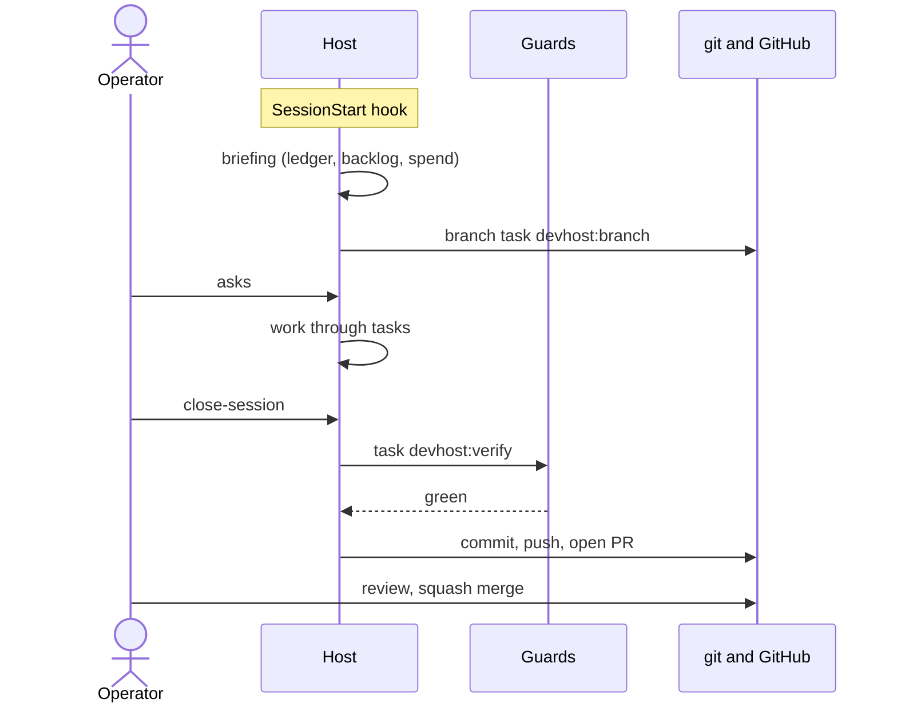
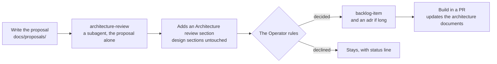
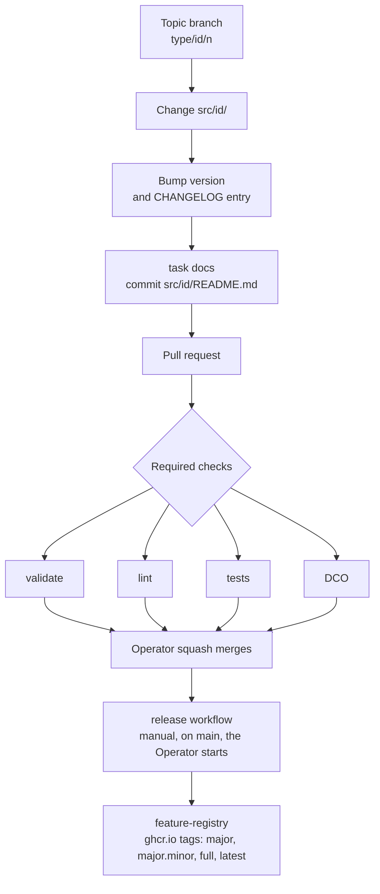
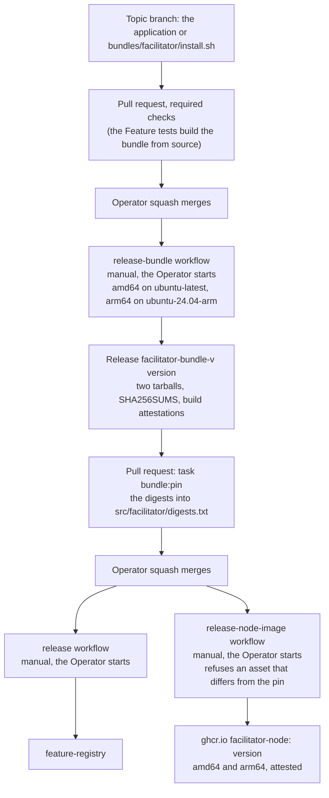
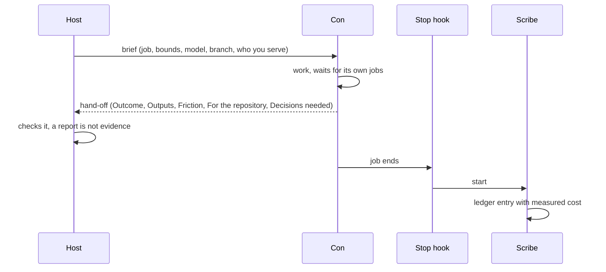
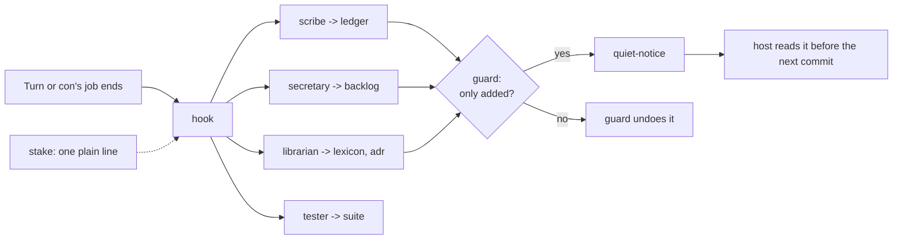
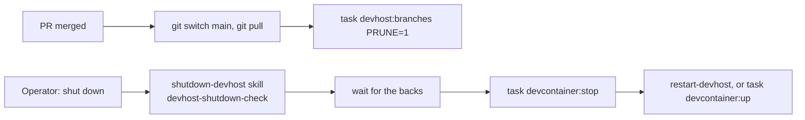
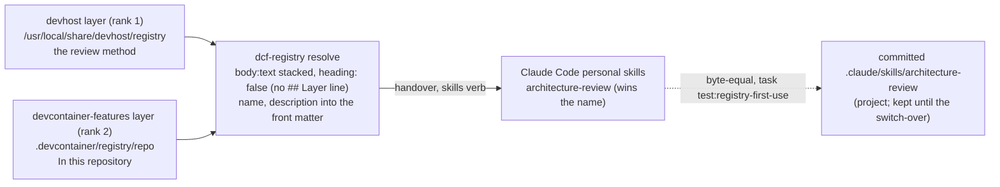

# Workflows

The main flows, in order. Sources: [PROCESS.md](../../PROCESS.md), [CLAUDE.md](../../CLAUDE.md),
[CONTRIBUTING.md](../../CONTRIBUTING.md), `.github/workflows/`, `.claude/skills/*/SKILL.md`.
Part of the [six](README.md). Node ids are ontology ids where they name a model thing; sequence diagrams use short ids, since a hyphen breaks a participant name there.

## 1. A session, start to close

The host commits and pushes; the Operator reviews and merges (ADR 0040).



The briefing arrives on its own. Work happens on a topic branch, never on `main`. Close runs the
records check, the guards and the diff scan before the commit.

## 2. A proposal



No proposal is in force until the Operator accepts it. The review comes before every ruling
([ADR 0039](../adr/0039-an-architecture-review-comes-before-every-ruling-and-nfr-13-says-we-manage-the-environment-not-the-cli.md)).
A proposal names which of the six architecture documents it changes ([README](README.md)).

## 3. A Feature change to a release



An agent says a release is due and what it would publish; it never runs it. Until the release, a
Feature cannot be named in `installsAfter` or pulled by a consumer. The release workflow needs
no write access: READMEs are committed, and the lint workflow checks they are current.

**A Feature that installs a release asset** (the facilitator and its node bundle, ruling AC of
[facilitator-node](../proposals/facilitator-node.md)) adds two manual workflows around the release, each
started by the Operator:



`release-bundle` needs `contents: write`, `id-token: write` and `attestations: write`; `release-node-image`
`packages: write` too; `release.yaml` keeps `contents: read` and `packages: write`. Sources:
`.github/workflows/release-bundle.yaml`, `.github/workflows/release-node-image.yaml`, `src/facilitator/NOTES.md`
("The bundle").

## 4. A con's job



One job per con, sized by blast radius (Sonnet by default, Opus only when the change reaches
every consumer, with the reason in the brief). A con replies once. Each job gets its own ledger
entry.

## 5. The backs after a turn



Backs run in the background, inside the devhost, and never make the host wait. They only add
(the secretary also ticks). Anyone leaves a stake when something might be missed. On a
workstation there are no backs; `/close-session` does their chores by hand.

## 6. After a merge, and shutdown



A merged branch is never pushed to again; a new branch starts the next piece of work.

## 7. Resolving the component registry

Built in slices 1 and 2 ([component-registry](../proposals/component-registry.md), ADR-0063,
ADR-0064): the participant component's start sequence (`agents start`, `agents up`) runs `resolve`
with the agent's who-you-are path (its `registry-path`, else `COMPONENT_REGISTRY_WHOAMI`), then
`dcf-registry handover`, which calls the CLI adapter's `skills` verb when `supports` lists it, and
only then starts the CLI. `task component-registry:resolve` runs the resolve by hand;
`/registry-refresh` runs resolve and the hand-over mid-session. No step ever blocks the start.
From release 2 (proposal section 6.1; component-registry 1.6.0, participant 1.3.0) the resolve is
handed the listed agents' names, and before the CLI starts the participant reads the agent's
definition from the view (only when the view is for the agent's path): its model goes to the adapter
in `AGENT_MODEL`, its skills replace the entry's; for those two fields the registry wins over the list.

```mermaid
sequenceDiagram
  actor person as Person, or the participant component at an agent's start
  participant R as component-registry
  participant S as registry source
  participant C as CLI adapter
  person->>R: layer-list (is there a list?)
  alt no layer list
    R-->>person: one line, the agent starts with its plain skills
  end
  person->>R: resolve, for registry-path, COMPONENT_REGISTRY_WHOAMI or --as (COMPONENT_REGISTRY_AGENTS: the listed agents)
  R->>R: take the lock (flock)
  loop each layer, each source
    R->>S: version
    alt unchanged
      R->>R: keep the layer copy
    else changed
      R->>S: fetch into a new copy
      S-->>R: layer copy
    else unreachable
      R->>R: use the last good copy, say so
    else never fetched and required
      R-->>person: fail, the view left as it was; the agent still starts, said
    end
  end
  R->>R: match for who you are, merge by value type, per namespace (1.7.0: a namespaced layer only among its own)
  opt a higher line breaks a lock, a type or a permission
    R->>R: skip the line, report it
  end
  R->>R: write a new view, swap the symlink and the path's own pointer, drop copies no layer names
  R-->>person: resolved N components, lines skipped
  person->>R: handover <cli> <name> <folder> --as <the agent's path>
  R->>C: supports
  alt skills listed
    R->>C: skills, COMPONENT_REGISTRY_SKILLS = that path's view (lock held shared)
    C->>C: copy, mark owned, remove owned copies no longer resolved; per agent (ADR-0074): what every agent's view shares personal, the rest in the agent's own folder (--add-dir)
    R->>R: record the hand-over (handovers.tsv)
  else not listed or exit 3
    R-->>person: one line, the CLI keeps its plain skills
  end
  opt release 2: the view is for this agent's path
    person->>person: read view/agents/<name>/: model, skills (they replace the list's)
  end
  person->>C: start, AGENT_MODEL = the definition's model (it replaces a model in the CLI args)
  Note over R,C: /registry-refresh: resolve and handover for the calling agent's own path (its session id), mid-session; with no agent, every recorded hand-over
```

In this repository (slice 4, the first real use) the list has two required layers, and the
resolved `architecture-review` reaches Claude Code's personal skills folder, which wins the name
over the committed project copy:



## 8. A node joins a hub (facilitator 0.4.0, slice N3)

A person on each side; neither step runs inside an agent's job (`node invite` refuses there). The token carries the
hash of the domain's trust bundle, so the spoke trusts the hub's certificate only after checking it.

```mermaid
sequenceDiagram
  participant P as person (hub side)
  participant H as hub (peers part, join endpoint)
  participant B as OpenBao PKI (intermediate; root offline)
  participant Q as person (spoke side)
  participant S as spoke
  P->>H: facilitator node invite
  H-->>P: join token (single use, 15 min, bundle hash); the join endpoint opens
  P->>Q: hand the token over
  Q->>S: facilitator node join --token
  S->>H: GET the trust bundle (unverified), check it against the token's hash
  S->>H: POST join over TLS checked against that bundle: token, node id, a request for its own key
  H->>H: token single use and unexpired; node not revoked, not joined
  H->>B: sign the request: spiffe://domain/node/id, 24 h (AppRole)
  B-->>H: certificate
  H->>B: roster backed up into KV
  H-->>S: certificate, bundle, mesh secret, the hub's address and name
  S->>S: certificate files; the hub into mesh.yml (role spoke)
  Q->>S: restart: SLIM links to the hub (type peer); the peers part says hello with its card
  S->>H: hello (card)
  H->>H: lock two on the card
  H-->>S: roster: every admitted card, the revoked nodes
```

## 9. An HTTP client enrols and its first contact is approved (facilitator 0.5.0, slice N4)

A person makes the token (never an agent's job); the CLI keeps it in its own config. The first message is written and
held; a person sees it in `mail` and approves. Bearer tokens only: the OAuth enrolment of cloud AIs is slice N5.

```mermaid
sequenceDiagram
  participant P as person
  participant N as node (http part, application)
  participant C as Claude Code or Copilot CLI
  participant A as public agent
  P->>N: facilitator http token claude-laptop
  N-->>P: the token, once (only its SHA-256 is kept); the audit line
  P->>C: claude mcp add --transport http ... --header "Authorization: Bearer ..."
  C->>N: POST /mcp: who
  N-->>C: only the agents exposed public
  C->>N: say "@jester ..."
  N->>N: reach rule, limits; the message written with via, held (first contact)
  N-->>C: held: a person must approve
  P->>N: mail names the client that waits; approve (the MCP tool or facilitator http approve)
  N->>N: an approved notice; the held message dispatched
  N->>A: delivered
  A->>N: reply
  C->>N: receive (at most 25 s)
  N-->>C: the answer; every packet of the client says via http
```
