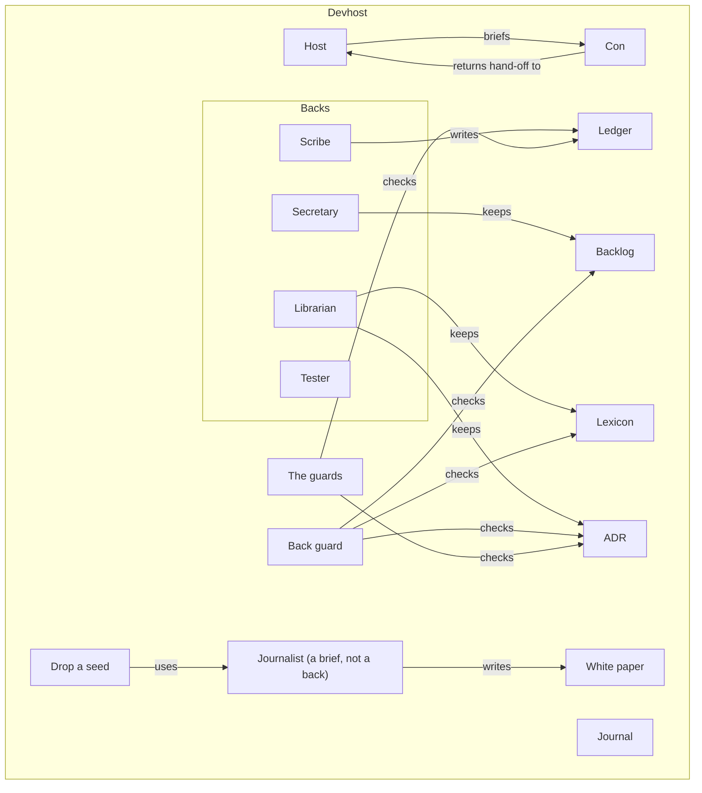
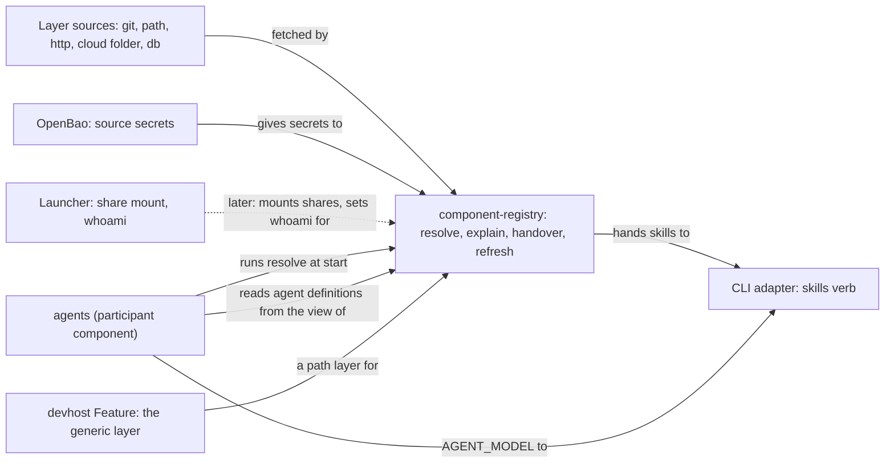

# C4 container: inside the devhost

The host briefs cons; the backs keep the records after each turn; the back guard undoes a back
that changed what it may only add to; the guards check the records at commit time. Node ids are
ontology ids.

## The component registry (ADR-0063)

Built (slices 1 to 4 and the `db` source; `component-registry` 1.5.0 published): `component-registry`
fetches its layers from all five registry sources (`git`, `path`, `http`, `cloud-folder` from the
cloud-folder Feature, `db` for sqlite and postgres) and resolves them; the participant component
runs `resolve` at every agent's start and `dcf-registry handover` gives the skills to the CLI
adapter's `skills` verb (ADR-0064). OpenBao gives a `git`, `http` or `db` source its secret,
through `dcf-secret`. The dashed relation comes later: the launcher's share mount and who-you-are
path.
Slice 4 (the first real use) adds the devhost Feature as a layer's owner: its image folder holds
the generic `architecture-review`, which this repository's own layer stacks on.
Release 2 (agent definitions, proposal section 6.1; in progress, component-registry 1.6.0) adds one relation: the participant component
reads an agent's definition from the resolved view and hands its model to the CLI adapter in
`AGENT_MODEL` (the adapter's own contract, no new verb).

