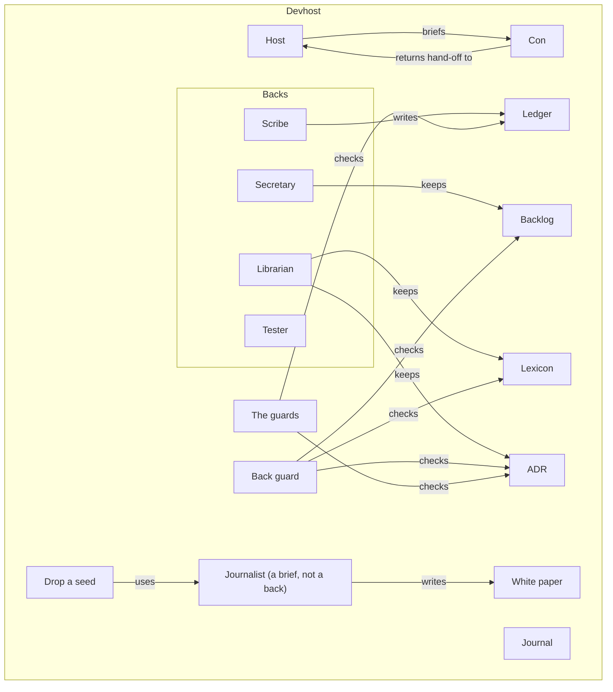
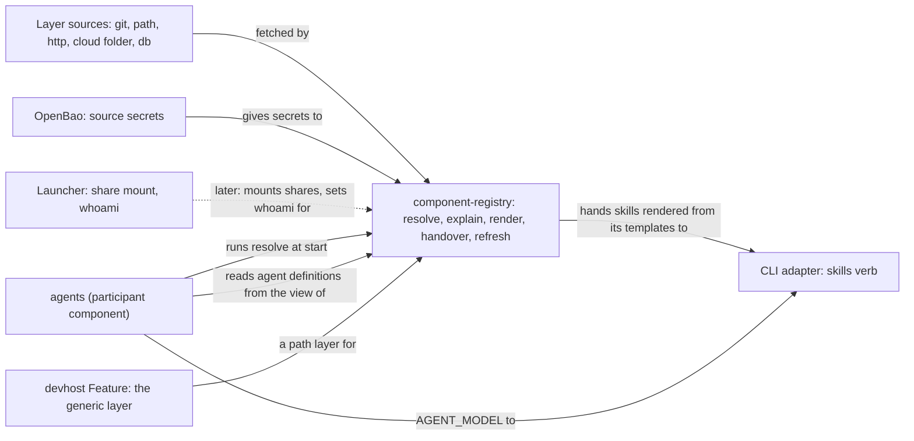
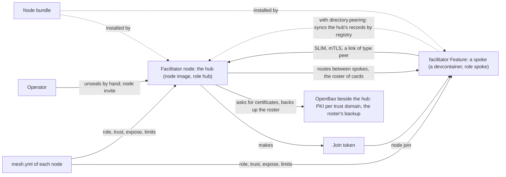
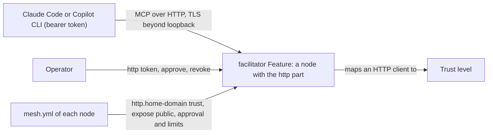

# C4 container: inside the devhost

The host briefs cons; the backs keep the records after each turn; the back guard undoes a back
that changed what it may only add to; the guards check the records at commit time. Node ids are
ontology ids.

## The component registry (ADR-0063)

Built (slices 1 to 4, the `db` source and agent definitions; `component-registry` 1.6.0 published): `component-registry`
fetches its layers from all five registry sources (`git`, `path`, `http`, `cloud-folder` from the
cloud-folder Feature, `db` for sqlite and postgres) and resolves them; the participant component
runs `resolve` at every agent's start and `dcf-registry handover` gives the skills to the CLI
adapter's `skills` verb (ADR-0064). OpenBao gives a `git`, `http` or `db` source its secret,
through `dcf-secret`. The dashed relation comes later: the launcher's share mount and who-you-are
path. Each who-you-are path keeps its own view and each agent its own
skills (ADR-0074).
Slice 4 (the first real use) adds the devhost Feature as a layer's owner: its image folder holds
the generic `architecture-review`, which this repository's own layer stacks on.
Release 2 (agent definitions, proposal section 6.1; published in component-registry 1.6.0, ADR-0073) adds one relation: the participant component
reads an agent's definition from the resolved view and hands its model to the CLI adapter in
`AGENT_MODEL` (the adapter's own contract, no new verb).
Layer namespaces (component-registry 1.7.0, ADR-0073): a layer listed with `namespace: <name>` brings its
components as `<name>:<component>` (on disk `<name>--<component>`); layers sharing a namespace merge with
each other and never reach the un-namespaced layers, which are the Operator's own. No new container or relation.
Vendor templates (component-registry 1.11.0, ADR-0077, built): `dcf-registry handover` renders the
CLI's winning templates (a layer's, else the built-in base layer's) with `minijinja-cli`, a pinned
binary inside the component-registry container, before the adapter's `skills` verb copies the
result; templates come from the same layer sources. The hand-over relation is unchanged in shape;
its label now says the skills are rendered. From component-registry 2.1.0 the Copilot adapter is a second `skills` receiver (copilot 0.3.0); no new container or relation.

## The facilitator mesh (slice N3, ADR-0067 to ADR-0071)

Built in `facilitator` 0.4.0: a hub (the node image) beside the OpenBao whose PKI issues its domain's node
certificates, and spokes (a devcontainer, or the image) that join it with a join token and link to it over SLIM. The
hub's listener holds only its level's CA bundle (lock one); every node's application checks each card and entry
against its own `mesh.yml` (lock two). The hub's Directory is synced by its spokes by registry, one way, only with
`directory.peering`.

## The facilitator endpoint over HTTP (slice N4, ADR-0070)

Built in `facilitator` 0.5.0: only when `facilitator.http.listen` is set, a node serves its MCP tools to CLIs with a
static bearer token a person made; the node signs for the client and the client is mapped through
`http.<home domain>` (public unless `mesh.yml` maps it private).

