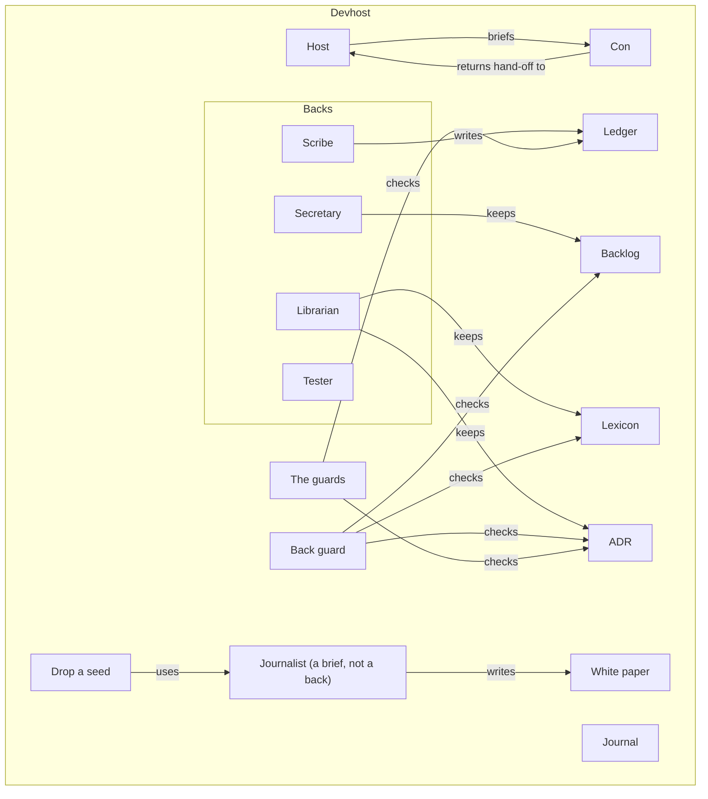
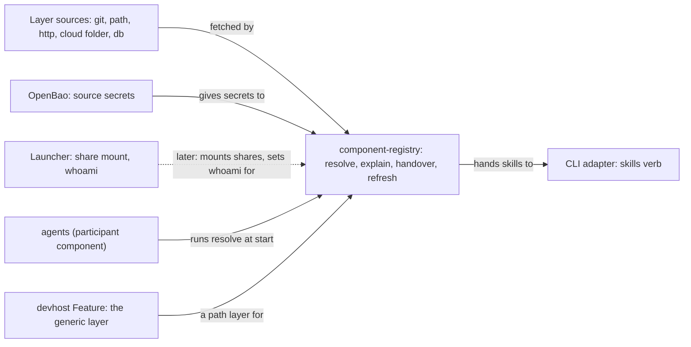

# C4 container: inside the devhost

The host briefs cons; the backs keep the records after each turn; the back guard undoes a back
that changed what it may only add to; the guards check the records at commit time. Node ids are
ontology ids.

## The component registry (ADR-0063)

Built in slices 1 and 2: `component-registry` fetches its layers and resolves them; the
participant component runs `resolve` at every agent's start and `dcf-registry handover` gives the
skills to the CLI adapter's `skills` verb (ADR-0064). The dashed relations come later: the
launcher's share mount and who-you-are path, and the `http` and cloud-folder sources (slice 3).
OpenBao gives a `git` source its secret today, through `dcf-secret`.
Slice 4 (the first real use) adds the devhost Feature as a layer's owner: its image folder holds
the generic `architecture-review`, which this repository's own layer stacks on.

