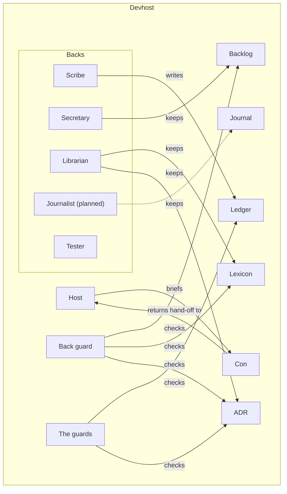

# C4 container: inside the devhost

The host briefs cons; the backs keep the records after each turn; the back guard undoes a back
that changed what it may only add to; the guards check the records at commit time. Node ids are
ontology ids.

