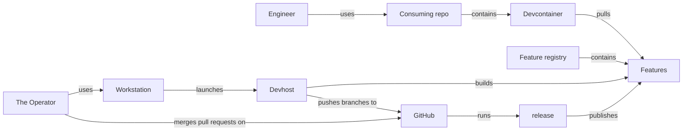

# C4 context: the product and where it is built

The product is the Features. An engineer works in a consuming repo; its devcontainer pulls the
Features from the registry. The Features are built in the devhost, with the way of working.
Node ids are ontology ids (`external-` for what is outside the model).

