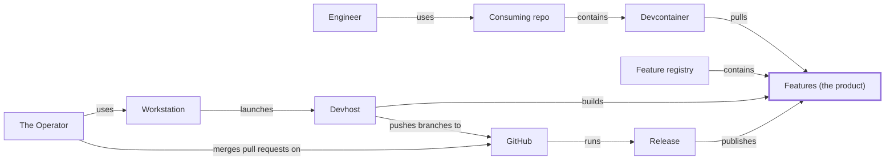

# C4 context: the product and where it is built

The product is the Features, at the centre. Read the top row first: an engineer works in a
consuming repo, its devcontainer pulls the Features, and the registry holds the released ones.
The row below is where they come from: the Operator launches the devhost from the workstation,
the devhost builds the Features and pushes branches to GitHub, and a release publishes them.
Node ids are ontology ids (`external-` for what is outside the model).

