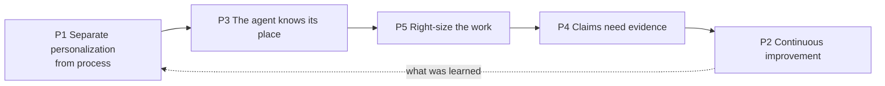

# Agent principles: five generic principles

Status: accepted by the Operator 2026-10-20 (ADR 0011, ADR 0013). P4 and P5 were named and worded with the Operator on 2026-10-20. These five replace the fourteen principles accepted on 2026-10-19.

These principles are generic. They do not describe this repository; they describe how any person works with agents, and each Operator sets them up for their own project through the iteration interview (`docs/proposals/iteration-package.md`). They are informed by iterations 1 to 3 of the Agentic Delivery OS (`docs/iterations.md`) and by the fourteen learnings in `docs/proposals/agent-principles.md`, whose mapping to the five is in ADR 0013. Each principle has a default, and the default is iteration 3's implementation, described under "In this repository".

Where a person says "skip the interview, just build", the defaults apply. The one thing with no default is the purpose in P3.

## The five at a glance

## P1 Separate personalization from process

Process is what is required: the outcomes, records, checks and decisions that must happen, the same for everyone. Personalization is how this person meets it: where they review, how they like to be asked, how much time they have. Keep the two apart. The shared language belongs here: a lexicon of the words in use and an ontology of how they relate; a theme over them is optional, and plain words stay underneath for anything a machine reads.

Humans and agents keep time differently. A person feels a pause and knows it is their turn; an agent has no sense of time between messages. Anything that depends on time is said outright: "reply when I say I'm done", "every Sunday at 00:00" instead of "weekly".

- **Why:** the process holds the line and personalization makes it fit, so people can focus on outcomes instead of micromanaging how the work gets done. A theme rename of the Arthurian kind would have touched about 130 files and broken queries over the append-only ledger, so themes became labels over plain ids (ADR 0004, ADR 0005; old AP-9). The Operator reviews and decides from a phone, with decisions as numbered questions: a personalization, while the recording of each decision is process.
- **A way to see out:** every setup has some form of dashboard, so the operator sees how things are going without asking. How it is shown is the personalization: a live page, a skill that reads the records and reports, or something else. Easy to overlook, so the interview raises it.
- **In this repository:** the dashboard built by the site generator and published as a Claude artifact; the lexicon (`LEXICON.md`) and ontology, the devhost theme (inters, backs, cons) with plain ids underneath, the briefing and report shapes, and the ontology guard in `devhost-verify`. Voice in committed text is checked by reading only.

## P2 Continuous improvement

Every flow, and every agent, has at minimum an improvement loop: plan, iterate, measure. Work that is not looked back on does not get better. The loop needs a record, so every unit of work leaves an entry with its friction and the resources it used. The Operator chooses the unit of resource: dollars, tokens, compute time or electricity. Records are append-only; a correction is a new entry.

- **Why:** the ledger review found its fixes in friction fields: eight groups from 21 entries, each turned into one action. The cost report showed the librarian changed nothing in 14 of 19 runs, which led to the threshold change (night-shift 2026-10-16). Five corrections were read in place of the entries they correct (Review 2026-10-16), and an entry that claimed a clean result was replaced, not rewritten ("Rebase stack and fix the sign-off hook (corrected)"). Old AP-6 and AP-7.
- **In this repository:** the ledger (`docs/ledger/`), one entry per unit of work; the scribe back that writes it, with "not reported" where a field is missing, never "none" (ADR 0003); the ledger review every five or so entries (`/ledger-review`); cost in dollars from the cost report; the append-only and shape guards in `devhost-verify`. One gap: `Corrects: none` is still accepted; the guard refuses it in entries from 2026-10-19 (`guard-corrects-none`).

## P3 The agent knows its place

An agent understands the world it works in and why it is there. A place is made of: purpose, principles, process, ceremonies, lexicon and ontology, inputs, outputs, tooling, personas, and boundaries. Boundaries are what it may do, what it may not, what it is responsible for and whom it keeps informed: in effect its row in a RACI chart (Responsible, Accountable, Consulted, Informed).

Every level has a place, down to a worker started for one job. Its personas are few: itself, the agent that invoked it, and always the operator, because every agent is in service of the operator. The operator is always a persona. Purpose has no default: only the person can say why they are doing this, and it cannot be backfilled. The product comes first: the way of working serves the purpose, it does not grow itself.

- **Why:** the Features documentation drifted behind the devhost tooling (9 of 16 lacked a Taskfile section) until the Operator put the Features first ("Audited Features documentation", "Backlog reorganized for product-first focus"; old AP-13). Boundaries took four forms here. Backs only add: in two of four undone runs the host's own stake had asked the secretary to reword, and the guard undid it every turn (ADR 0003; old AP-8). Nothing leaves unattended: the night shift commits per item, never pushes, deploys or decides, and ended at $9.5 of $100 with eight items done and none undone (night-shift 2026-10-16; old AP-10). Identities are unclaimable: a con committed under the Operator's address (ADR 0001) and a vendor noreply trailer made a stranger a participant of a pull request (ADR 0002; old AP-11). Tasks are the API: agents worked around a missing identity with per-call `-c` wrappers ("Diagnose git config corruption from wrapper bypass"; old AP-12).
- **In this repository:** `CLAUDE.md` and `.devhost/CLAUDE.devhost.md` as the place, with PROCESS.md and the lexicon; boundaries held by the back guards, the night-shift rules, the git Feature's wrapper that exports the bot identity (ADR 0012) and the redact list; the Taskfile as the tooling, every task with a `desc`; the Operator's settings for permissions.

## P4 Claims need evidence

An agent's output is a claim, not a fact. Agents are tools that sound equally sure whether they are right or wrong, so trust comes from how work is checked, never from an agent's word. The picture is a court, closer to civil arbitration than a criminal trial, and nobody is on trial: the work is. The claimant is the agent that did the work; its claim is what it says it did. The inter is the operator's advocate: it checks the evidence itself, then presents the case in the operator's format with a recommendation. The operator is the judge.

- The claimant carries the burden of proof: a claim comes with its evidence (the diff, the test output, a check shown able to fail). A claim without evidence is not heard.
- Small claims never reach court: where the rule can be written down, a guard settles it (P5). Only what needs judgment goes to the operator, as the boundaries in P3 say.
- A ruling may set a precedent or may be an exception. Exceptions happen and are recorded as such, not hidden; which rulings become precedent is the operator's call, through P2.
- Two languages: the record, for agents (policy, the ledger, briefs, hand-offs, every agent-to-agent message), precise enough to mean the same in two years; the conversation, for people, plain and personalized (P1). The record states rules with RFC 2119 keywords (MUST, SHOULD, MAY) in short, plain sentences. The alternative is a controlled natural language such as Simplified Technical English (ASD-STE100): easier to read throughout, but a vocabulary to learn and harder to follow without a checker.

- **Why:** a con reported success on the backlog notes when all 17 were unchanged ("Correct slug-id entry: con reported false success"); a Haiku con committed under the Operator's address and reported "Friction: none" ("Correct the Haiku con's placeholder entry"); the ledger review grouped three such cases ("Cons over-reporting success"). A report is not evidence (old AP-3). `devhost-verify` once printed "all guards passed" while checking no repository ("Fix devhost-verify base ref"), and a pre-commit hook at mode 100644 never ran: a check is trusted only after it has been shown able to fail (old AP-4). Items marked for the Operator are not for a session to resolve (PROCESS.md; old AP-1).
- **In this repository:** the ledger, ADRs and pull request descriptions as the record agents write for each other; the hand-off shape every con returns, whose Friction field includes what it worked around; the host checking each hand-off; mutation proof in test briefs; the Operator's permissions and the night-shift rule that nothing is decided for the Operator. The approved name exception (ADR 0010) is a ruling recorded as an exception. Not yet a mechanical hand-off check.

## P5 Right-size the work

Break the work into one-point pieces and give each to the smallest thing that can do it reliably: a script, a checked agent, or the operator. Understanding the work and the resources it needs comes first. The inter plans and judges; cons do.

- **Why:** a script costs nothing per run and can be shown to fail; an agent costs per run and varies. The backs cost $11.41 in 207 runs in one month, while the cost report and the guards, being scripts, cost nothing (the Operator, 2026-10-16; old AP-14). Judgment sits on the largest model because its decisions spread to everything below, and the doing is cut into small jobs with a scope, a model and an isolation each (PROCESS.md; old AP-2). Small models only where the result can be checked mechanically and completely: Sonnet cons cost about $0.46 a job, the Haiku con $0.17 and missed a wrong identity, the second Haiku con that day to leak an address and report no friction (night-shift proposals, "Model sizing"; ledger review 2026-10-19; old AP-5).
- **In this repository:** the host plans and judges, cons do, backs record. Two questions in order before a job is handed out: can the rule be written down? Then a script with a test that can fail. Can the result be checked mechanically? Then an agent does it and a script guard checks it. Otherwise an agent proposes and the Operator decides. A guard undo or a ledger correction shows a rule, and the job climbs toward a script. Models are sized by blast radius, with the cost report and the ledger review as the check. Held by the brief and the review, not by a guard.

## Keeping it current

- A principle changes only by an ADR that supersedes ADR 0011 for it. "In this repository" is updated when the implementation changes.
- **Consumers:** `devhost-init` ships all five with the devhost (`agent-principles-ship`). Each consumer sets them up through the interview and states its own purpose in P3.
- **White paper:** the principles and their evidence are source material for the iteration white paper and the one on building the Agentic Delivery OS.
