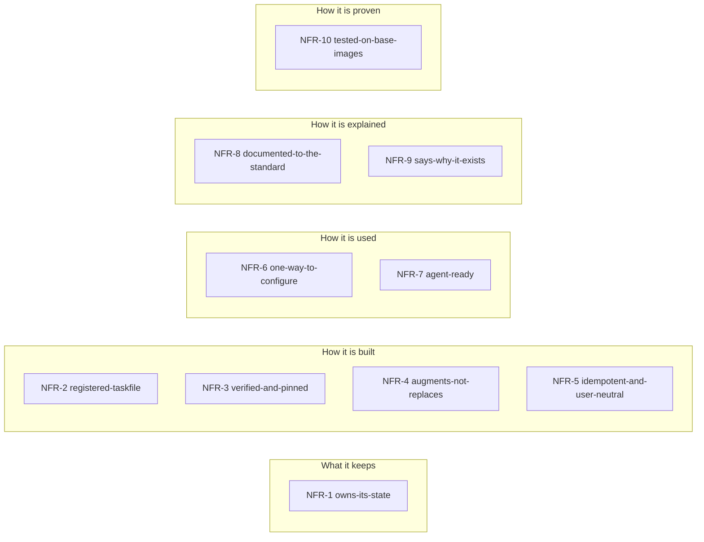
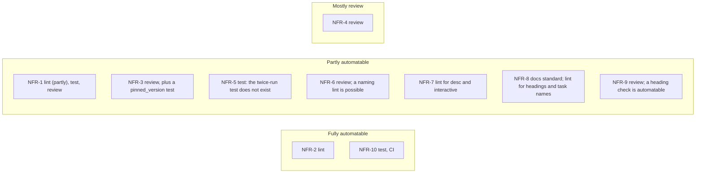
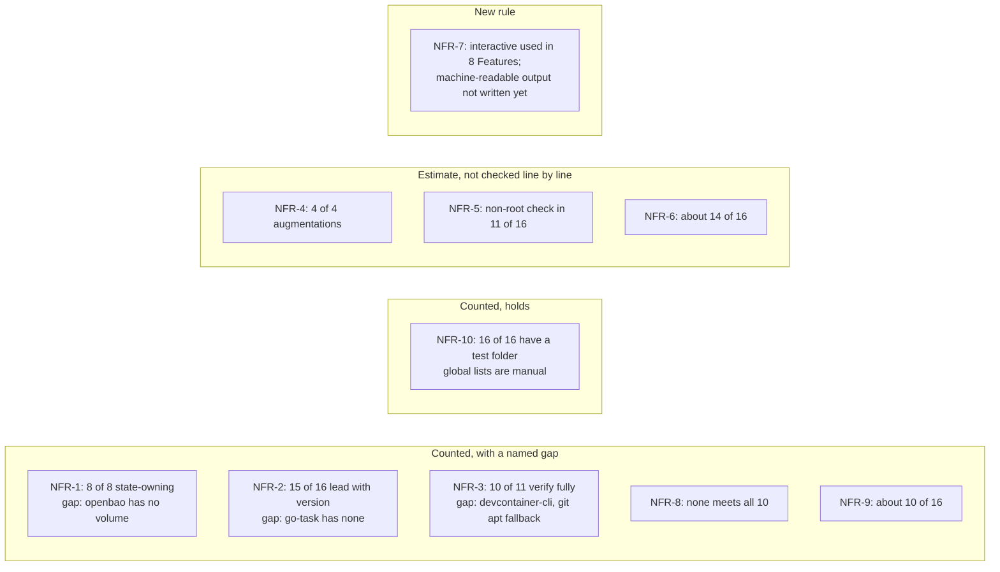

# Non-functional requirements for Features

Status: accepted by the Operator 2026-10-19 as the Feature principles FP-1 to FP-10; renamed non-functional requirements NFR-1 to NFR-10 on 2026-10-20 (same content and order); binding (ADR 0011). Every work item that touches a Feature must meet them, or record a backlog item or a written exception in the Feature's NOTES; a failing requirement does not block a release. The proposal and its reasoning stay in `docs/proposals/feature-principles.md`, under the old FP ids.

These are the requirements every Feature in this collection meets. Today they are implicit, spread over README, CONTRIBUTING and the code. They are what sets these Features apart from other Features for the same tool: this collection has its own Claude Code Feature because the others do not meet them.

They are checked, not aspirational. Each rule names how it is checked and whether that can be automated. "Today" counts the 16 Features, from a read of the repo on 2026-10-16, with later changes noted.

## The principles at a glance

Ten requirements, grouped by the question each one answers.

## The requirements

### NFR-1 owns-its-state
A Feature whose tool keeps state MUST own it in a named volume at `/var/lib/devcontainer-features/<id>`, set through `containerEnv`, made usable by `<id>-setup` via `dcf-persist`.

- **Why:** a rebuild must not log you out; a repo can still bind-mount the host disk.
- **Source:** CONTRIBUTING "Proposing a new Feature"; README "Feature state".
- **Checked by:** lint (partly), test, review. A JSON check for the mount and variable is automatable; "has state" is a judgement.
- **Today:** 8 of 8 state-owning Features. Gap: openbao has a login (`~/.vault-token`) and no volume (docs audit); the Operator decided on 2026-10-19 to add one after the release (`openbao-state-build`).

### NFR-2 registered-taskfile
A Feature MUST ship `taskfile.yml`, registered by the verbatim install block and switched by `installTaskfile`; every task MUST have a `desc`, and the first task MUST be `version`.

- **Why:** Task is the API; documents name tasks, not scripts.
- **Source:** CONTRIBUTING "taskfile.yml"; README "Feature Taskfiles".
- **Checked by:** lint. Fully automatable.
- **Today:** 16 of 16 ship one with a `desc` on every task. 15 of 16 lead with `version`; go-task has none.

### NFR-3 verified-and-pinned
A Feature that downloads MUST verify it against the publisher's checksum, take a `version` option, and say what `latest` resolves to.

- **Why:** a build must be reproducible and a download provable.
- **Source:** CONTRIBUTING "install.sh" step 6; README under the table.
- **Checked by:** review, plus a test that `pinned_version` installs exactly that version. The test is automatable; "uses a checksum" can be grepped.
- **Today:** 10 of 11 installers verify fully. devcontainer-cli verifies Node.js but not the npm CLI. git's apt fallback is unverified (audit).

### NFR-4 augments-not-replaces
Where an official Feature exists, this one MUST order after it with `installsAfter`, never `dependsOn`, and MUST install the tool only when absent.

- **Why:** adopters keep the official install method.
- **Source:** README "Augment, don't duplicate"; CONTRIBUTING.
- **Checked by:** review. Mostly not automatable.
- **Today:** claude-code, git, gh, az follow it (4 of 4 augmentations). The other 12 have no official counterpart in play. Estimate: not every Feature was checked line by line.

### NFR-5 idempotent-and-user-neutral
`install.sh` MUST run twice with the same result, MUST run as root without assuming a `remoteUser`, and `<id>-setup` MUST be idempotent and never fatal.

- **Why:** images rebuild; users differ per repo.
- **Source:** CONTRIBUTING "install.sh" step 10, "devcontainer-feature.json".
- **Checked by:** test (run twice, run as non-root). Automatable, but the twice-run test does not exist.
- **Today:** estimate only. The non-root check is in the `pinned_version` scenarios (11 of 16). Idempotence is stated, and I did not verify it per Feature.

### NFR-6 one-way-to-configure
Settings MUST be options or plain variables, resolved CLI, then `.env`, then environment, with the same names in tasks and scripts.

- **Why:** the same name works in every repo and every shell.
- **Source:** README "Settings are plain variables, three ways".
- **Checked by:** review; a lint for naming (`<ID>_SETUP_*`) is possible.
- **Today:** estimate, about 14 of 16. Host-side tooling follows it; I did not diff every Feature's variable names.

### NFR-7 agent-ready
Every task an agent may run MUST be non-interactive unless marked `interactive: true`, and MUST accept extra flags through `CLI_ARGS`.

- **Why:** agents and humans use one entry point, `task --list`.
- **Source:** CONTRIBUTING "taskfile.yml"; README "Task is the API".
- **Checked by:** lint for `desc` and `interactive` on login tasks; machine-readable output is review only.
- **Today:** the `interactive` marking is used in 8 Features (login tasks). Machine-readable output is not a written rule yet: this one is new.

### NFR-8 documented-to-the-standard
`NOTES.md` MUST cover these 10 items, or say in one line that an item does not apply:

1. What it installs and where it lands, and how the download is verified (or the plain statement
   that it is not).
2. Each option: what it does and when to change it.
3. State: what persists across rebuilds, in which volume (NFR-1), or that there is none.
4. A minimal, copy-pasteable `features` block for `devcontainer.json`.
5. How to verify it works: the command and what it prints.
6. What it pairs with, and what it needs from other Features.
7. Every task in its `taskfile.yml`, by name (NFR-2).
8. Its limits and known gaps, and how to troubleshoot them.
9. Why it exists, when a similar Feature is published elsewhere: which one and what differs (NFR-9).
10. Version and upgrade: how a version is pinned or changed, and what an upgrade changes.

- **Why:** absence then always means "forgotten".
- **Source:** the docs audit of 2026-10-16 (its report was lost with a scratchpad; items 1 to 9 are
  the sections the Features' NOTES were brought to on 2026-10-17 and 2026-10-19, item 10 added by the
  Operator on 2026-10-21); CONTRIBUTING "NOTES.md".
- **Checked by:** the docs standard. Lint can check headings and that every task is named.
- **Today:** none meets all 10 yet. Eight Features' NOTES were brought to the standard on 2026-10-17 and 2026-10-19.

### NFR-9 says-why-it-exists
A Feature with a published alternative MUST say, in one paragraph, which and what differs.

- **Why:** the trust question; it is the Feature's reason to exist.
- **Source:** audit item 9; CONTRIBUTING "NOTES.md".
- **Checked by:** review. A heading check is automatable.
- **Today:** about 10 of 16 have one (audit, item 9 column).

### NFR-10 tested-on-base-images
A Feature MUST have `test.sh`, a `pinned_version` scenario if it installs a binary, a scenario per option, and a place in the global scenario.

- **Why:** CI proves it on the listed images.
- **Source:** CONTRIBUTING "Tests"; `.github/workflows/test.yaml`.
- **Checked by:** test, CI. Automatable.
- **Today:** 16 of 16 have a test folder. The matrix runs debian, ubuntu and the Microsoft base image. The global lists are manual (CONTRIBUTING step 9).

Where each requirement is checked, from each "Checked by" line: how far the check can be automated.

How the "Today" counts read: where a count shows a gap, where a rule holds, and where the number is only an estimate.

## Decisions taken with the requirements (2026-10-19)

- **MCP: none for now.** No Feature offers an MCP server; tasks are the agent API (NFR-7). Revisit per tool when an agent shows friction a task cannot fix. "Offer MCP" would mean an optional `mcp` option installing a pinned, verified server registered for Claude Code, with its credentials in the Feature's state volume.
- **git:** the doc says git is installed from the distribution only when absent, unverified; the apt fallback keeps the wrapper working on a bare base image. Revisit if NFR-3 is made strict.
- **openbao:** a state volume and setup hook after the release (`openbao-state-build`).
- **devhost "Where it comes from":** moved out of the Feature's NOTES into `docs/iterations.md`; it told an adopter nothing to act on.
- **"Why this exists":** mandatory only where a published alternative exists (NFR-9); one line "none" elsewhere.

## Keeping it current

- A requirement changes only by an ADR that supersedes ADR 0011 for it; the "Today" lines are updated by whoever changes a count.
- Lint rules for the automatable ones, first NFR-2, then NFR-3's `pinned_version`, NFR-8's headings and task names, NFR-10 (`feature-principles-lint`).
- A conformance table per Feature (`feature-conformance`), with the docs audit's fixes folded in.
