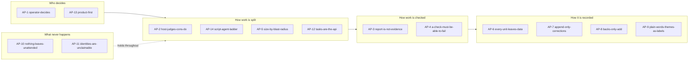
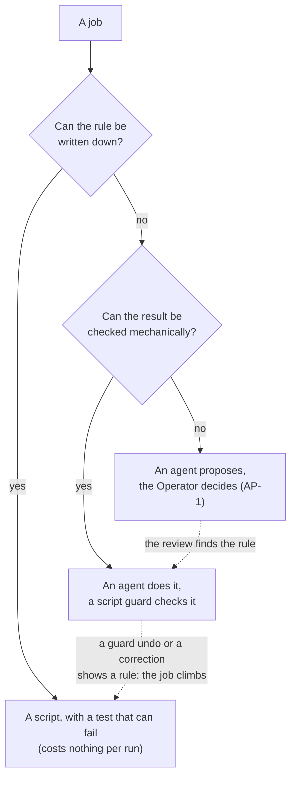

# Proposal: the principles of how agents work here

Status: accepted by the Operator 2026-10-19 as fourteen principles; superseded on 2026-10-20 by the five generic principles in `docs/principles/agents.md` (ADR 0013). The fourteen stay here as the learnings that inform the five.

These principles say how agents work in this repository. Until now they lived in the Operator's head, in briefs and in lessons scattered through the ledger. They are learnings for the Agentic Delivery OS (`docs/iterations.md`): the foundation that each project iteration defines further. This is the third iteration.

They differ from the Feature principles (`docs/proposals/feature-principles.md`), which cover what every Feature guarantees. These cover how the work gets done. Each one came from evidence, cited below. None is invented ahead of a failure.

## The principles at a glance

Fourteen principles, grouped by the question each one answers. The arrows are the order a piece of work meets them.

## The principles

### AP-1 operator-decides
Agents propose; the Operator decides.
- **Why:** items marked for the Operator are not for a session to resolve (PROCESS.md). The night shift never decides for the Operator and lists its open questions in the morning report (night-shift 2026-10-16, "Questions for the Operator"). A permission counts only when the Operator grants it.
- **Enforced by:** the night-shift rules and the briefing's "decisions for the Operator". Nothing stops a daytime session from deciding.

### AP-2 host-judges-cons-do
The host plans and judges; cons do; backs record.
- **Why:** judgment sits on the largest model because its decisions spread to everything below (PROCESS.md). The doing is cut into small jobs with a scope, a model and an isolation each. Backs keep records so no turn is spent on upkeep.
- **Enforced by:** the brief shape, the hand-off shape and the cost report. Not mechanically.

### AP-3 report-is-not-evidence
A report is not evidence. The host checks every hand-off.
- **Why:** a con reported success fixing the backlog notes when all 17 were unchanged ("Correct slug-id entry: con reported false success"). The kube con's three frictions were lost from its entry. A Haiku con committed under the Operator's address and reported "Friction: none" ("Correct the Haiku con's placeholder entry"). The ledger review grouped three such cases ("Cons over-reporting success").
- **Enforced by:** the con brief (asks for worked-around friction) and the host's habit. Not yet by a guard.

### AP-4 a-check-must-be-able-to-fail
A check is trusted only after it has been shown able to fail.
- **Why:** `task devhost:verify` printed "all guards passed" while every task ran in the includes folder and it checked no repository ("Fix devhost-verify base ref"). The pre-commit hook sat at mode 100644 and never ran. Redaction tests meant something only on the Operator's machine ("Seed placeholder in redaction assertions with mutation proof"). A passing check with no proof is worse than none.
- **Enforced by:** the hook-mode guard (night-shift item 1) and mutation proof in test briefs. Not yet for guards in general.

### AP-5 size-by-blast-radius
Size the model by blast radius. Small models only where the result can be checked mechanically and completely.
- **Why:** Sonnet cons cost about $0.46 a job; the Haiku con cost $0.17 and missed a wrong identity. It was the second Haiku con that day to leak an address and report no friction (night-shift proposals, "Model sizing"). The scribe stays small because its failures were pipeline faults, not model size (ADR 0003).
- **Enforced by:** the brief, the cost report and the ledger review. Not by a guard.

### AP-6 every-unit-leaves-data
Every unit of work leaves data to iterate on: an entry, a cost and its friction.
- **Why:** the ledger review found its fixes in friction fields: eight groups from 21 entries, each turned into one action. The cost report showed the librarian changed nothing in 14 of 19 runs, which led to the threshold change (night-shift item 4). The scribe also writes "not reported" when a field is missing, never "none" (ADR 0003).
- **Enforced by:** the scribe back, the cost report and the verify guard on ledger shape.

### AP-7 append-only-corrections
Records are append-only. A correction is a new entry.
- **Why:** five corrections were read in place of the entries they correct (Review 2026-10-16). The ledger guard refuses edits. An entry that claimed a clean result was replaced, not rewritten ("Rebase stack and fix the sign-off hook (corrected)").
- **Enforced by:** the ledger append-only guard in `devhost-verify`. One gap: `Corrects: none` is still accepted (night-shift questions).

### AP-8 backs-only-add
Backs only add. A change request becomes an amend item.
- **Why:** in two of four undone runs the host's own stake had asked the secretary to reword. The guard undid it and the secretary retried every turn (ADR 0003). The secretary also overwrote the host's backlog edits once (`secretary-edit-race`).
- **Enforced by:** the guards, which undo anything but an addition or a tick.

### AP-9 plain-words-themes-as-labels
Anything a machine reads uses plain words. Themes are labels only.
- **Why:** a rename would touch about 130 files and break queries over the append-only ledger (ADR 0004). The ontology keys the themes to plain ids (ADR 0005).
- **Enforced by:** the ontology guard in `devhost-verify` (ADR 0005). Voice in committed text is checked by reading only.

### AP-10 nothing-leaves-unattended
Nothing leaves the devhost unattended. Unattended work runs only under the night-shift rules.
- **Why:** the night shift commits once per item with checks green, never pushes, deploys, sends or decides, and stops at a cap. It ended at $9.5 of $100 with eight items done and none undone (night-shift 2026-10-16). It also refused to write a skill, because night rules forbid new skills.
- **Enforced by:** the night-shift skill and the Operator's settings. The cap is by agreement, not by a guard.

### AP-11 identities-are-unclaimable
An identity is never a person's and can never be claimed.
- **Why:** a con's first commits carried the Operator's address in author and sign-off (ADR 0001). The vendor noreply address in a trailer made a stranger's account a participant of the first pull request (ADR 0002). The sign-off hook then added second sign-offs to 29 commits ("Rebase stack and fix the sign-off hook").
- **Enforced by:** the git Feature's `containerEnv` identity, the `.invalid` trailer address and the redact list. Trailer addresses are checked by reading only.

### AP-12 tasks-are-the-api
One way to do each action: its task, for engineers and agents alike.
- **Why:** agents worked around a missing identity with per-call `-c` wrappers (ADR 0001, "Diagnose git config corruption from wrapper bypass"). A wrapper in a consumer is a backlog item here (CLAUDE.md). The new-Feature steps were spread over five places until one checklist replaced them.
- **Enforced by:** verify checks that every task has a `desc`. Nothing stops an agent from running a raw command.

### AP-13 product-first
The product comes first. The devhost serves the Features.
- **Why:** the Features documentation drifted behind devhost tooling ("Audited Features documentation": 9 of 16 lacked a Taskfile section). The Operator then reordered the backlog to put the Features first ("Backlog reorganized for product-first focus").
- **Enforced by:** the backlog order and the review. Not yet by a guard.

### AP-14 script-agent-ladder
Choose between a script and an agent by asking two questions in order. Can the rule be written down? Then it is a script, with a test that can fail. If not, can the result be checked mechanically? Then an agent does it and a script guard checks it. If neither, an agent proposes and the Operator decides (AP-1). The first question is "does this need to be deterministic?"; the second is whether the rule can be written.

- **Use an agent to build the script, not to be the script.** A con pays once to write a generator; every run after is free and the same. The docs site is built this way: a tested generator, and only the publish call, which needs the Artifact tool, is left to an agent.
- **Jobs climb the ladder.** Every guard undo and every ledger correction marks a rule that could be written down; the ledger review turns it into a check. Example: the secretary ticked two draft proposals done (2026-10-16); "an item whose proposal still says draft is not done" is a rule a guard can hold.
- **Why:** a script costs nothing per run and can be shown to fail (AP-4); an agent costs per run and varies. The backs cost $11.41 in 207 runs this month; the cost report and the guards, being scripts, cost nothing (the Operator, 2026-10-16).
- **Enforced by:** the brief, which asks both questions before a job goes to a con or a back, and the ledger review, which asks of each friction group whether it can now be a rule. Not by a guard.

## Gaps

How each principle is held today. A guard refuses by itself; a brief or a skill holds only if it is followed; habit holds only while someone remembers.

```mermaid
flowchart LR
  subgraph guard["By a guard"]
    g6["AP-6 ledger shape"]
    g7["AP-7 append-only ledger"]
    g8["AP-8 the back guard"]
  end
  subgraph part["Partly by a guard"]
    p4["AP-4 hook modes only"]
    p9["AP-9 ontology guard, not merged yet"]
    p11["AP-11 identity set, trailers by reading"]
    p12["AP-12 every task has a desc"]
  end
  subgraph brief["By a brief, a skill or settings"]
    b2["AP-2"]
    b3["AP-3"]
    b5["AP-5"]
    b10["AP-10 night-shift rules"]
    b14["AP-14"]
  end
  subgraph habit["By habit"]
    h1["AP-1"]
    h13["AP-13"]
  end
  habit -->|"the review moves them"| brief -->|"a guard"| part --> guard
```

Followed but not enforced, and what would enforce each:
- **AP-3:** a mechanical hand-off check, for example the host's verify recipe run on every con's branch before a merge.
- **AP-4:** a mutation step in `devhost-verify` for new tests, or a brief line the host checks.
- **AP-5:** the dispatcher refuses a Haiku con on a job that touches identity, tests or shared tooling.
- **AP-7:** refuse `Corrects: none` from 2026-10-17.
- **AP-10:** a spend cap the runner enforces.
- **AP-12:** a raw `git -c` and `docker` lint in agent briefs.
- **AP-14:** a brief field "why not a script", which the host checks.
- **AP-13:** a review question: "which Feature did this serve?"

## Adoption

- **Binding text:** move the accepted principles to `docs/principles/agents.md`, one section each, with "Enforced by" kept current. The backlog item `agent-principles` covers it and folds in `ai-tenets`.
- **An ADR:** one decision record that makes the file binding and says a principle changes only by a superseding ADR.
- **Consumers:** `devhost-init` ships AP-1 to AP-12 with the devhost. AP-13 is this repository's and stays out; each consumer states its own product.
- **White paper:** these principles, with their evidence, are source material for the iteration white paper and for the final one on building the Agentic Delivery OS.
