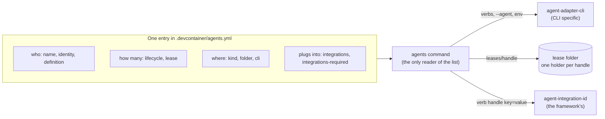
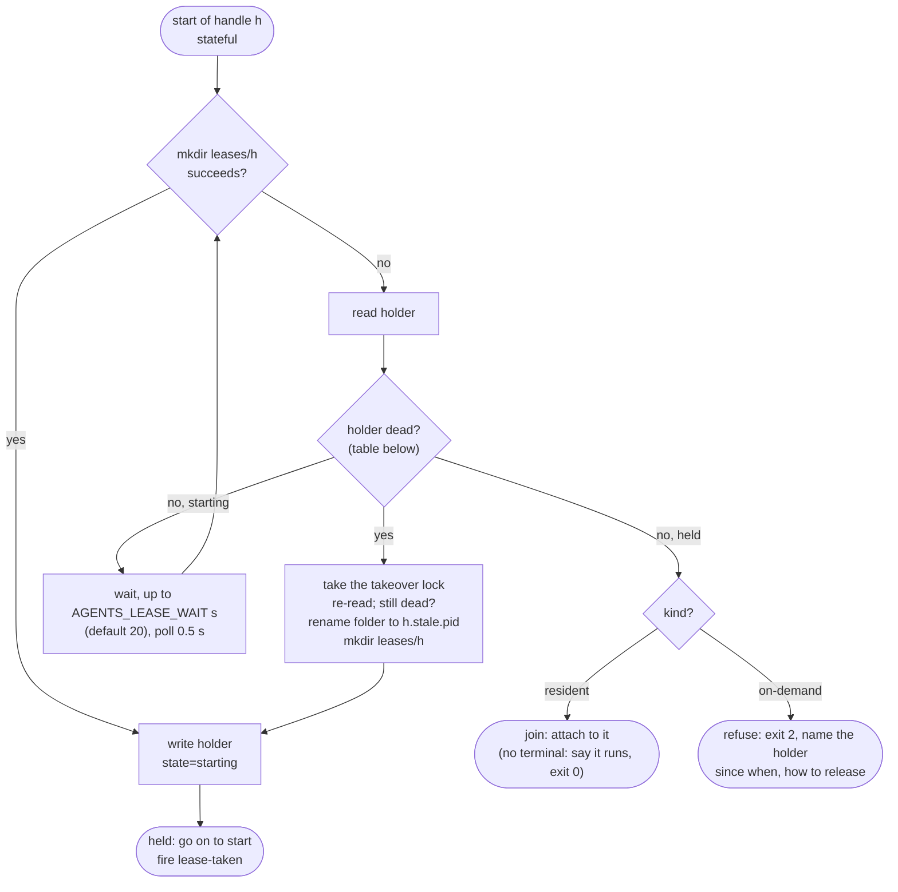
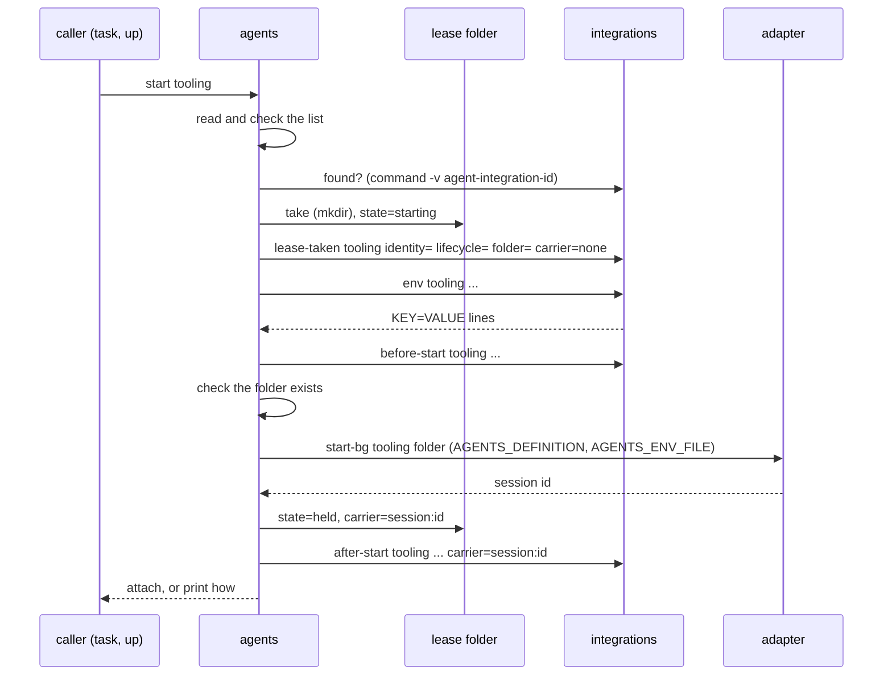

# Proposal: agents version 2, an agent defined in one place

Status: Proposed 2026-10-29; Operator decided version 2.0.0 (exclusive lease for every stateful agent) and accepted the recommendations on 2026-10-29. The open questions in section 13 still await rulings. Nothing here is built. Backlog: `fleet-design-rethink` (this proposal absorbs part of it, section 11) and `agents-file-decisions` (still open; section 11 says what v2 assumes).

Who this serves: the Operator, who rules on it, and the maintainers of a framework that consumes the agents Feature. They will write two integrations (one that registers an agent and its identity, one that makes it reachable) against the contract in section 7, and want a repository to define an agent completely in its one list. The engineers who start agents in a devcontainer get the same verbs they have today, plus an exclusive copy per stateful agent.

## 1. The ask, and what the list cannot say today

Today one agent is spread over three places. The list says its name, CLI, folder, kind and args; the Claude Code profile is a `--agent tooling` pair in `args`; and the identity the agent signs its writes with is an environment variable that has to be smuggled in as `--settings` JSON in `args`:

```yaml
- name: tooling
  cli: claude
  kind: resident
  folder: .worktrees/tooling
  args: [--agent, tooling, --settings, '{"env":{"AGENTIC_REGISTER_AS":"tooling"}}']
```

Nothing in the Feature knows two copies of `tooling` must not run. It reports a duplicate session (`+1` in `agents:list`, `agents:stop --extras`) after the fact. The framework wants the list to be the whole definition: who the agent is, how many copies may run, where it runs, and what it plugs into. The design test is that the line above needs no `args` in v2.



The picture shows the one rule that keeps the layers apart: the Feature reads the list; adapters and integrations never do. They receive what they need as arguments and environment, so the Feature learns no CLI flag and no project name.

## 2. Decided, and recommended

### Decided by the Operator (2026-10-29)

- **Version 2.0.0, option b.** The lease is exclusive for **every** stateful agent, including lists with no integrations. A duplicate start joins or refuses instead of being reported. That changes behaviour for existing lists, so it is a major version, and section 12 is the written upgrade path for 1.x lists.

- **Vendor-neutral contracts (2026-10-29, from section 14).**
  1. Section 7.1 no longer says the settings file is the only route: each adapter picks its own route for the `env` output (Claude Code: a settings file, since its sessions run under a supervisor; CLIs whose session is a child process: the environment). Claude's facts stay as the Claude adapter's mapping. Refusal and error texts say "adapter", not "claude-code release".
  2. Two new optional adapter verbs, answered with exit 3 when not supported: `trust <folder>` and `run-once` (section 7.1).
  3. An agents-owned detached carrier (`process:<pid>`) is deferred. Adapters without a native background mode serve on-demand and ephemeral agents only; the lease's liveness check uses the adapter's list when it has one and otherwise the agents Feature's own record. Revisit when a consumer needs a resident agent on another CLI.
  4. GitHub Copilot CLI is the second adapter, on-demand and ephemeral first (section 12, slice 6).
  5. New requirement NFR-12 `vendor-neutral-contracts` in `docs/principles/non-functional-requirements.md`.

### Recommended by the host (the Operator has seen these four; they rule on the proposal as a whole)

1. **`lifecycle` is a new key, not a third `kind` value.** `kind` says when it runs (`resident` at container start and kept, `on-demand` when asked); `lifecycle` says what it keeps (`stateful`: an identity, a lease and records; `ephemeral`: nothing, discarded). The two are independent, so a third `kind` would multiply values (`resident-stateful`, ...) and break every 1.x list that reads `kind`. `ephemeral` with `resident` is refused (section 5). A list without `lifecycle` reads as `stateful`, which is what a 1.x agent already was in practice: one named agent with a conversation.
2. **The lease lives in the agents Feature's state folder and is taken with `mkdir`.** `/var/lib/devcontainer-features/agents/leases/<handle>/`, a holder file inside records carrier, pid, container, time. Dead holder: the container differs, the CLI adapter says the carrier is not running, or the pid is gone. Takeover is a rename of the stale folder, then `mkdir`. Section 6 works this out and makes four refinements, each from reading the code and NFR-1; the rule in the recommendation stands:
   - **No volume.** The agents Feature owns no volume today (its state folder is a plain directory, mode 1777, holding once-per-container-start markers). NFR-1 asks a Feature to keep state in a volume when the state must survive; a lease that survives a rebuild is by definition stale, so a volume would be the wrong default. The container check still matters, because a plain restart keeps the writable layer, and a repository may bind-mount the same target (NFR-1 allows it). NOTES records this as the reasoned exception.
   - **Container identity is two values.** The container id alone does not change on `docker restart`, when every process and every background session is gone. The Feature already keys its markers by the start of PID 1 (`/proc/1/stat`, field 22). The holder records both, and either differing means a dead holder.
   - **A takeover lock.** A bare "rename away, then `mkdir`" has an ABA hole: taker A judges the holder dead, taker B takes over and starts a live copy, then A renames B's live lease away. A short-lived `mkdir leases/<handle>.takeover` serialises takers, and each re-reads the holder after getting it.
   - **Liveness is asked of the adapter by agent, not by comparing ids.** Claude Code changes a session's full id on `/clear` (the adapter's records track the stable job id for this reason, ADR 0033). A holder file that stored a session id and compared it with `list` would call a live agent dead after `/clear` and start a second copy. The holder keeps the carrier id for display and for integrations, refreshed at every start or join; "is it running" is `state_of` (identity by name and folder, record-aware), as the 1.x code already does.
3. **Scope beyond one container is refused in 2.0, with the reason documented.** There is no cross-container atomic primitive in bash, awk and sed. `scope: machine` over a named volume shared by containers on one engine is possible later (the same `mkdir`, in a volume the Feature then owns, which turns NFR-1 into a requirement for it). Across machines needs a server, which is the framework's register or a2a, not this Feature. Supported: `container` and `none`.
4. **An on-demand stateful agent holds the lease for the session's life, not only while it writes.** The lease is what makes a copy "the" agent; if it were taken only around writes, two copies would both be the agent while thinking. Write ordering is the register's job (the framework), not the lease's.

## 3. The concepts, in the framework's words

The framework's words are used as given. Where one sits badly on the Feature, it says so.

| Concept | In the list or the Feature | Fit |
| --- | --- | --- |
| Handle | `name` (letters, digits, `-`, `_`; unique in the list). An address, not an identity. | Fits. It is also the lease folder's name, so the character set stays path-safe. |
| Agent definition | The stateless keys of an entry: `cli`, `definition`, `args`. | Partly. In the framework a definition is a thing two agents share. In the list one entry is one agent and two entries share by repeating three keys; there is no `definitions:` section in 2.0 (section 4). The list's key `definition` (the CLI's profile, Claude Code `--agent`) is also narrower than the concept; `profile` would read better (open question 10). |
| Stateful agent | `lifecycle: stateful` (the default): has an `identity`, takes the lease, "state in records not the session" is the framework's side. | Fits. The Feature carries the identity and the lease only. |
| Ephemeral agent | `lifecycle: ephemeral`: no lease, any number of copies, not resumed. A stateful agent's background runs are ephemeral entries with the stateful agent's `identity`. | Fits, with one gap: the Feature has no notion of "one task". Discarding is `agents reset --purge` and the CLI's own end of session; nothing else is promised. |
| Identity | `identity`, default `name`. Passed to integrations; the Feature never writes with it. | Fits. |
| Carrier | Not a list key. A runtime fact the Feature records and passes as `carrier=<kind>:<id>`: `session:<id>` for a background session, `process:<pid>` for a foreground session, `none` before a start. | Fits. A carrier is never assumed to be the agent: the lease is held by the agent, and the carrier is what it currently runs on. Container and machine carriers are the scope, not a value here. |
| Lease | The `leases/<handle>/` folder and the `lease` key. | Fits (section 6). |

## 4. The list format

New keys, all optional. `name`, `cli` and `kind` stay required; `folder` and `args` as today.

```yaml
agents:
  - name: tooling                     # the handle
    cli: claude                       # the CLI adapter, as today
    definition: tooling               # the CLI's agent profile (Claude Code: --agent tooling)
    lifecycle: stateful               # stateful (default) | ephemeral
    kind: resident                    # resident | on-demand, as today
    identity: tooling                 # the principal it signs as; default = name
    folder: .worktrees/tooling        # repo-relative, must exist when the CLI starts
    lease: container                  # container (default for stateful) | none (default for ephemeral)
    integrations: [register, a2a]     # adapters that act on this agent's lifecycle
    integrations-required: [register] # the ones whose absence or failure blocks a start
    args: []                          # still passed through
  - name: tooling-night               # a background run of tooling, acting under its identity
    cli: claude
    definition: tooling
    lifecycle: ephemeral
    kind: on-demand
    identity: tooling
    folder: .worktrees/tooling-night
    integrations: [register]
```

### Can the awk subset read `lease: { scope: container }`?

Checked 2026-10-29 by running `agents check` from the tree on four lists. **No.** An inline map is not in the subset: a known key whose value starts with `{` is refused (`'<key>' must be a plain or quoted value`), and an entry written as `{ ... }` is refused too. Today the key `lease` is not known, so on 1.x `lease: { scope: container }` is read as an unknown key and ignored with a warning, and a block map under it (`lease:` then an indented `scope: container`) is skipped the same way. The list in the ask reads on 1.x, it just means nothing there.

Proposed form: **a flat scalar, `lease: container`**, with any later lease setting as a flat sibling key (`lease-wait: 30`). Why, honestly:

- awk could read a one-line map: the list reader `flow()` is 35 lines and a map reader is of the same size. The reason against is the cost of a second grammar for one word. The subset today is "a key and a scalar, or a key and a list of scalars"; each key is one line, and the unknown-key skipper works by indentation. A nested map adds depth state, quoting of `:` and `,` inside it, and a new class of error messages.
- The flat form changes nothing about the parser's records (`K <entry> <key> <value>`), and a later `scope: machine` is the same key with a new accepted value.
- Cost: `lease: container` is a value that carries one fact, where the ask's form leaves room for named settings. If the framework needs several settings per lease, the flat siblings do the same job with one more line each.

The two lists use the existing flow or block form (`integrations: [a, b]` or one `- a` per line); items are ids matching `^[a-z0-9][a-z0-9_-]*$`. The parser's record stream grows one field: `G <entry> <list> <value>` (the list name: `args`, `integrations`, `integrations-required`).

### How "required" is written

Options weighed:

| Option | Reads | Verdict |
| --- | --- | --- |
| A second list, `integrations-required: [register]` | A name in it must also be in `integrations` (checked). | **Recommended.** Uses only what the parser reads; the reader sees the strong and the weak ones at a glance; a typo is a list error. |
| A marker on the item, `register!` | Compact. | Rejected: `!` is a YAML tag character and the parser already refuses plain values starting with it; the marker is easy to miss. |
| A map per item, `{ id: register, required: true }` | Self-describing. | Rejected: inline maps are not in the subset (above). |

### Rules the list check adds

Every problem is named by file and line, as today; a broken list exits 2.

- `lifecycle` is `stateful` or `ephemeral`. `ephemeral` with `kind: resident` is refused: the container start would create and discard an agent every time.
- `lease` is `container` (stateful only) or `none` (ephemeral only). A stateful agent with `lease: none` is refused, because without a lease it is the 1.x behaviour and that is what `ephemeral` means. `machine` and `cluster` are refused with the reason of section 2, item 3, so the key reserves the words.
- `identity` is validated like `name`. **Two stateful entries may not share an `identity`**: a principal with two live copies is what the lease prevents, and a lease per handle would not catch two handles for one principal. Ephemeral entries may share an identity with each other and with one stateful entry (the background-run case).
- `definition` and a `--agent` in `args` together are refused (two sources for one fact). The reverse stays legal, so a 1.x list keeps working and migrates one agent at a time.
- Every id in `integrations-required` is in `integrations`; ids are unique.
- The `folder` rule stays (inside the repository). Whether it must exist is checked later than today (section 8).

## 5. What `kind` and `lifecycle` mean together

|  | `resident` | `on-demand` |
| --- | --- | --- |
| **stateful** | Runs in the background from the container start; the lease is held while it runs; a second start attaches to it. | Opens a foreground session; the lease is held for the session's life; a second start is refused while it runs. `--resume` as today. |
| **ephemeral** | Refused. | Opens a new session on every start, no lease, any number at once. `--resume` is refused (nothing is kept). With `--bg` (section 8) it starts in the background without attaching. |

`agents list` shows the lifecycle and the lease (section 9). An ephemeral agent's several running sessions are normal, so the "N more running" notice is not printed for it, and `agents stop <handle>` stops the newest while `--all` stops every copy.

## 6. The lease

### Shape

```
/var/lib/devcontainer-features/agents/
  <start key>/...          the once-per-container-start markers, as today
  leases/                  mode 0777 (no sticky bit: a holder of another user may be taken over)
    <handle>/              the lease: exists while someone holds it
      holder               plain text, one key=value per line
    <handle>.takeover/     held for the few milliseconds a takeover needs
```

The holder file:

```
state=starting|held
pid=<the agents process that took it>
pidstart=<field 22 of /proc/<pid>/stat>
boot=<field 22 of /proc/1/stat>
container=<hostname>
carrier=session:<id> | process:<pid> | pending
time=<epoch seconds>
```

`hostname` is the container id in Docker unless a repository sets `--hostname`; either way it is written and compared as a string. The file is written to a temporary name inside the folder and renamed over `holder`, so a reader never sees half a file.

### Take, join, refuse, take over



**Dead holder.** Rules in this order, the first that applies decides:

| # | Condition | Verdict |
| --- | --- | --- |
| 1 | No readable holder file and the folder is older than 5 s (its taker died between `mkdir` and writing). Younger: treat as `starting`. | dead / starting |
| 2 | `boot` or `container` differs from this container's | dead (`new-container`) |
| 3 | `state=starting` and the pid is gone, or its start time differs (pid reused) | dead (`start-died`); else starting |
| 4 | `state=held` and the adapter's `list` shows no running session of this agent (by name, folder and record), and the pid (a foreground session's wrapper) is gone or reused | dead (`session-gone`) |
| 5 | `state=held` and either of those is alive | held |
| 6 | The adapter cannot list (exit 3) and the holder has no live pid | held, said: "cannot tell". Never take over what may be running (the 1.x fallback rule); the way out is `agents release --force`, or the next container start (rule 2) |
| 7 | The adapter's listing fails (exit 1) | held, said: nothing is taken on a guess (the 1.x `error` state) |

**Takeover**, atomic as a whole. `mkdir leases/h.takeover` (a taker that finds it checks the pid in it and retries after 0.2 s, up to 5 s, then treats it as stale); re-read the holder and apply the table again; if it is still dead, `mv leases/h leases/h.stale.<pid>`, then the ordinary `mkdir leases/h`; remove the stale folder and the takeover lock. A third party that wins the `mkdir` first is a legitimate take; the taker then joins or refuses as for any live holder. `lease-released reason=stale` fires for the old holder, then `lease-taken` for the new.

A takeover can find the agent already running: after a container restart the CLI's supervisor may restore a background session before `agents up` runs. The lease is then taken for that session (carrier from `list`) and nothing is started; this is the existing settle-then-adopt behaviour with a lease under it.

### When it is taken and released

- **Taken** for a stateful agent at every start path: `agents start`, `agents up` (each resident), `--new`, `reset`'s start of a resident. `list`, `logs`, `check` and `release` take nothing.
- **Held** until the carrier ends. A resident's lease outlives the `agents` process that started it: `state` goes from `starting` to `held` once the session id is known, and the process may exit. A foreground session's lease is held by the `agents start` process, which stays and waits for `new` to return (it traps `EXIT`, `INT`, `TERM` and `HUP` and releases); on `SIGKILL` the pid check (row 4) finds it dead.
- **Released** by `agents stop` after the adapter stopped the session (`reason=stopped`), by the foreground wrapper on exit (`exited`), by a failed start (`failed-start`), by `agents release <handle>` (a dead holder; `--force` a live one, `forced`) and by takeover (`stale`).
- **Not by the CLI.** A session started by hand with `claude --bg --name tooling` never takes a lease. The lease guards what goes through `agents`; the 1.x duplicate report (`+N`, `--extras`) stays as the backstop for copies that did not, and `agents up` still prints it.

### Start sequence



The order is one rule per step: the lease first, so a second caller waits or joins and the integrations are called once; `lease-taken` before `env`, so a record the integration writes on taking the lease exists before the session can sign anything; the folder check after `before-start`, so an integration may create the folder (a worktree); the carrier recorded before `after-start`, so integrations see it.

## 7. The integration contract

Beside the CLI contract, the same shape and the same exit codes. One executable per integration on PATH, `agent-integration-<id>`, supplied by the framework, never by this Feature.

```
agent-integration-<id> <verb> <handle> [key=value ...]
  env             print KEY=VALUE lines for the session, nothing else; no side effects
  before-start    a session is about to start or wake
  after-start     it started or woke; carrier is known
  lease-taken     the handle's lease was taken (stateful only)
  lease-released  the lease ended; reason=...
  stop            the agent is being stopped on purpose; reason=...
  check           is this integration usable for this agent now; message on stdout
Exit: 0 done, 1 failed, 2 bad use, 3 not supported (verb or agent).
```

The arguments `agents` passes (always `key=value`, one word each, no quoting rules to learn):

| Key | Value | On |
| --- | --- | --- |
| `identity` | the principal | every verb |
| `lifecycle` | `stateful` or `ephemeral` | every verb |
| `kind` | `resident` or `on-demand` | every verb |
| `cli` | `claude` | every verb |
| `definition` | the CLI profile, omitted when none | every verb |
| `folder` | absolute path (it may not exist before `before-start`) | every verb |
| `carrier` | `session:<id>`, `process:<pid>` or `none` | every verb; `none` until the start has run |
| `scope` | `container` (stateful) or `none` | every verb |
| `reason` | `stopped`, `exited`, `stale`, `forced`, `failed-start`, `purged` | `lease-released`, `stop` |
| `previous` | the old carrier, for a takeover | `lease-released` with `reason=stale` |

**An integration never parses `agents.yml`.** Everything it needs is in those arguments and in its own configuration. A new fact is a new key; an integration ignores keys it does not know, and `agents` never removes one.

**Behaviour the Feature guarantees**

- **Presence and required.** Each id in `integrations` is looked up on PATH at the start of every start path. A missing optional integration is one line (`tooling: integration a2a is not installed; skipping it`) and the start goes on. A missing integration listed in `integrations-required` refuses the start (exit 1, nothing taken, nothing started, the id and the way to add it named). `agents check` reports both, `ok`, `missing (optional)` or `missing (required)`, and exits 1 only for the required.
- **Failure.** A verb that exits 1 or 2, or times out (`AGENTS_INTEGRATION_TIMEOUT`, default 30 s), fails the step for a required integration (before-start and lease-taken abort the start and release the lease; the others are said and the run goes on) and is only a warning for an optional one. Exit 3 is skipped without a word. An integration that exits 0 having printed nothing for `env` adds no variables.
- **Order.** In the order of `integrations`; for `stop` and `lease-released` in reverse.
- **At least once.** A starter killed between `lease-taken` and its record may leave the next one to call the verb again; integrations must tolerate a repeat. The Feature never calls `after-start` without a carrier.
- **`env`.** Output lines must match `^[A-Z_][A-Z0-9_]*=` and are one line each. A name `agents` reserves (`AGENTS_*`, `PATH`, `LD_*`, `HOME`, `BASH_ENV`, `ENV`, `IFS`) fails the integration's step; the same name from two integrations is a failure naming both, never a silent last-wins. The merge is written to `env/<handle>.env` in the Feature's state folder, mode 600, removed on release, and handed to the adapter (section 7.1). The Feature adds three generic variables of its own, `AGENTS_HANDLE`, `AGENTS_IDENTITY` and `AGENTS_LIFECYCLE`, so a session can tell who it is without any integration (open question 8).
- **Streams.** An integration's stdout and stderr appear prefixed `agents: <handle>: <id>:`, except `env`'s stdout, which is parsed. Its working directory is the repository root. It gets the container's environment and no extras.
- **`check` is not run by the plain `agents check`**, which stays instant and offline (it runs in post-create hooks). `agents check --deep` (task `agents:check -- --deep`) calls it for every agent and integration.

### 7.1 How `definition` and `env` reach the session, in the adapter

The CLI contract is unchanged (verbs, arguments, exit codes, the fallbacks). Two inputs are added, **as environment variables of the adapter call**, so an adapter that does not know them ignores them:

| Variable | Meaning |
| --- | --- |
| `AGENTS_DEFINITION` | the list's `definition`, empty when none |
| `AGENTS_ENV_FILE` | path of the merged `KEY=VALUE` file, empty when there is none |

`agent-adapter-<cli> supports` may print two more lines, `definition` and `env`, which are capabilities, not verbs. `agents` asks before a start. **If the list sets `definition`, or an integration produced env, and the adapter does not list the capability, the start is refused (exit 2) naming the adapter (and the release that adds it).** The alternative, starting a stateful agent without its identity variable, writes under the wrong identity, and a loud refusal is cheaper. A 1.x-shaped list needs neither, so the 1.8.x adapter keeps working with agents 2.0.0.

**The Claude Code adapter** (claude-code 1.9.0) does the CLI-specific part:

| Input | Claude Code | Notes |
| --- | --- | --- |
| `AGENTS_DEFINITION=tooling` | `--agent tooling`, placed before the list's `args` | Passed by `start-bg`, `new`, `wake` and `resume` alike. Refused when `args` already holds `--agent` (the list check already does). |
| `AGENTS_ENV_FILE` | the adapter writes `<state>/settings/<agent>.json` (`{"env":{"K":"V",...}}`, mode 600, JSON-escaped by the adapter, no jq) and passes `--settings <that path>` | Settings `env` is how Claude Code exports variables to a session's tools, hooks and MCP servers. The path is stable per agent, so the flag is identical between runs. |

**Each adapter picks its own route for the `env` output; the contract does not name one.** Claude Code uses a settings file because its background sessions are started by a supervisor, not by the `claude --bg` client, so the client's environment does not reach the session (checked, section 13); a settings file is a documented route and `--bg` keeps its flags. A CLI whose session is a child process of the adapter's call (Copilot, Codex, Gemini, OpenCode in 14.1) uses the environment: the adapter exports the variables from `AGENTS_ENV_FILE` into the CLI's process (and adds whatever the CLI needs to let them through, such as Codex's `shell_environment_policy`). The Claude facts above and below are the Claude adapter's mapping, not the contract.

How this fits the adapter's saved-options rule: Claude Code puts back the options a background session was started with (`respawnFlags`) on a bare `wake`, and the adapter wakes bare only when those equal what `start-bg` passes. `want_flags` therefore has to include `--agent <definition>` and `--settings <path>` in the same order as a start. Because the path is stable, a bare wake re-reads the **current** file, which the adapter rewrites from the env file before every wake; so a changed identity reaches a woken session. A session started under 1.x with its `--settings` JSON in `args` has different saved options, so its first wake after the move to `definition` falls to the existing "wake with the agent's options, which may start a copy" path, said on stderr; `agents stop --extras` removes the copy. Claude Code does not merge two `--settings` flags (the last wins, section 13), so the list check refuses a `--settings` in `args` when `integrations` is set.

All of this stays in `agent-adapter-claude`. `agents` never writes a Claude flag, and another CLI's adapter maps the same two inputs its own way (a different CLI has its own profile and environment mechanism).

**Two optional verbs** (decided 2026-10-29; each answers exit 3 when the adapter does not support it, and `supports` lists them):

| Verb | Meaning | Fallback on exit 3 |
| --- | --- | --- |
| `trust <folder>` | pre-approve a folder for unattended starts, each CLI its own way (Claude Code: its trust acceptance; Copilot: `trustedFolders` or `--trust-folder`; Codex: `trust_level`; Gemini: `GEMINI_CLI_TRUST_WORKSPACE`). `agents` never writes another vendor's trust file. | `agents check` names the folder as untrusted and the start refuses as today, saying the folder must be trusted by hand |
| `run-once` | a non-interactive one-shot run (prompt in, exit when done), for ephemeral agents (`-p`, `exec`, `run`) | an ephemeral `--bg` start calls `start-bg`; an adapter with neither serves no ephemeral background run |

**Carriers and liveness without a native background mode** (decided 2026-10-29). An agents-owned detached carrier (`process:<pid>`, 14.3 point 2) is deferred. An adapter with no native background mode (`start-bg` answers 3) serves **on-demand and ephemeral agents only**, and `check` refuses `kind: resident` for it. The lease's liveness check uses the adapter's list when it has one and otherwise the agents Feature's own record. Revisit when a consumer needs a resident agent on another CLI.

## 8. Join or refuse, and what the container start does

| Start path | Lease free | Held, live | Held, starting | Held, dead |
| --- | --- | --- | --- | --- |
| `agents start <resident>` | take, start, attach | **join**: attach to the carrier (no terminal: say it runs, exit 0) | wait up to `AGENTS_LEASE_WAIT`, then join | take over, start, attach |
| `agents up` / post-start, each resident | take, start | **join** silently: `tooling: running (id)`, exit 0 | wait, then join | take over, start (or adopt a restored session) |
| `agents start <on-demand stateful>` | take, open the session | **refuse**, exit 2: names the holder (`process:<pid>`, since when) and `agents release` | wait, then refuse | take over, open |
| `agents start --new <resident>` | as `start` | asks, stops it, starts a fresh one; the lease is released and taken again in one run, no waiting | wait | take over |

The existing behaviour of `agents start <name>` is already "join" for a resident (it finds the running session and attaches), so a second start of a resident changes only in being guarded by the lease: two concurrent starts are one start and one join. A container start's auto-start **never refuses and never fails the container start**: held means running, which is what it wants, and it prints one line. An on-demand agent cannot be joined (a foreground session in another terminal cannot be attached to), so it refuses, in plain words: the agent is stateful, it already runs there, and an engineer who wants several at once means `lifecycle: ephemeral`.

**Folder check later.** Today `adapter_of` refuses a start when the folder does not exist, before anything else. In 2.0 that check moves after `before-start`, so an integration may create the folder (a worktree at `.worktrees/tooling`). `agents check` and `agents list` still say `no-folder`.

**Ephemeral background runs (`--bg`).** The ask's "a stateful agent's background runs are ephemeral agents" needs one way to start an on-demand agent in the background without attaching: `agents start <handle> --bg [-- args]` calls the adapter's existing `start-bg`, prints the session id and exits. It is allowed only for `ephemeral` agents (a stateful on-demand agent holds its lease through a foreground wrapper). A framework that wants a task prompt passes it in the args after `--`, as today. Open question 6.

## 9. What the verbs print

```
$ task agents:check
agents: /workspaces/repo/.devcontainer/agents.yml (the default): 2 agent(s)
  tooling: cli claude, definition tooling, resident, stateful (identity tooling, lease container), folder .worktrees/tooling, args: none
    integrations: register (required), a2a
  tooling-night: cli claude, definition tooling, on-demand, ephemeral (identity tooling, lease none), folder .worktrees/tooling-night, args: none
    integrations: register
integrations: register found, a2a missing (optional; tooling skips it)

$ task agents:list
NAME            KIND       LIFECYCLE  CLI     STATE      LEASE                 ID        FOLDER
tooling         resident   stateful   claude  running    held session:ab12cd   ab12cd..  .worktrees/tooling
tooling-night   on-demand  ephemeral  claude  running+2  -                     ef34..    .worktrees/tooling-night

$ task agents:leases
HANDLE   STATE  CARRIER             SINCE      HOLDER
tooling  held   session:ab12cd      14:02:11   pid 311, this container
```

`list --json` gains `lifecycle`, `identity`, `lease` (`none`, `free`, `held`, `starting`, `stale`) and `carrier`, all additive. New tasks (each with a `desc`, NFR-2, `-- --json` where it lists, NFR-7): `agents:leases` (the table above), `agents:release -- <handle> [--force]`. `agents:version` and `agents:check` print the new keys.

## 10. Tests

All Docker-free, in `test/agents/unit/` with the fake adapter that exists (sessions in a file, every call recorded), and two additions: a **fake integration**, `agent-integration-fake`, that logs every call it gets (verb, handle, every `key=value`) to a file, prints `FAKE_IDENTITY=<identity>` for `env`, and can be told to fail, time out, answer exit 3 or be absent; and a fake adapter that supports `definition` and `env` and writes the `AGENTS_DEFINITION` and the content of `AGENTS_ENV_FILE` it received into the session it creates. The claude adapter's tests keep their fake `claude`.

The five cases the framework asked for, with what each asserts:

| Case | Asserts |
| --- | --- |
| Two concurrent starts for one stateful handle give exactly one copy | Launch eight `agents start tooling` at once (a slow fake `start-bg`): the fake adapter's calls hold one `start-bg`; the sessions file one running session; one process started it, the others joined (exit 0, "running"); the integration log has one `lease-taken` and one `after-start`. The same for `agents up` racing `agents start`. On-demand (a fake `new` that waits): one opens, seven exit 2. |
| A dead holder's lease is taken over | Four cases, one per rule: a holder with another `boot`, another `container`, a dead `starting` pid, and `held` with no running session. Each: the next start takes over, the log shows `lease-released reason=stale previous=...` then `lease-taken`, exactly one new session. Plus: eight concurrent takers of one dead lease give exactly one winner (the takeover lock), and a live lease is never renamed away. |
| An ephemeral agent takes no lease | `leases/` has no folder for it; two starts run side by side; no `lease-taken` or `lease-released` in the log, `before-start` and `after-start` fire; `--resume` is refused; `ephemeral` with `resident` fails the list check. |
| Env reaches the session | The fake integration's `env` prints `FAKE_IDENTITY=tooling`; the session the fake adapter made holds that line and `AGENTS_DEFINITION=tooling`. A reserved name, and the same name from two integrations, fail the start with both named. An adapter without the `env` capability gets the refusal of section 7.1. |
| A missing optional integration does not block; a missing required one does | Optional absent: the start succeeds, one line says so, `agents check` exits 0 and reports `missing (optional)`. Required absent: exit 1, no lease folder, no session, nothing recorded as called; `agents check` exits 1. A required one that fails `lease-taken` releases the lease and starts nothing; an optional one that fails only warns. A hanging integration is cut at `AGENTS_INTEGRATION_TIMEOUT`. |

Further tests, grouped by slice in section 12: the list format (flat `lease`, the refused inline map with a message pointing at the flat form, `integrations`, `integrations-required` subset, duplicate stateful identity, `definition` with `--agent`, a 1.x list reading exactly as before); join and refuse per the table of section 8; takeover after `docker restart` (boot differs) and after `/clear` (a changed session id with the same job: still held); the lease released by `stop`, by a foreground wrapper's exit and by `SIGTERM`; `release` and `release --force`; `--bg`; the folder created by `before-start`; and, in `adapter_test.sh`, `--agent` and the settings file (content, mode, JSON escaping of a quote and a backslash, rewritten before a wake) and a bare wake still bare.

## 11. Relation to the open backlog

**`fleet-design-rethink`** (agents without sessions, from what Claude Code provides) asked for a model, what wakes a worker, two sessions in one room, idle cost, the ledger as the only memory, the migration, and the shutdown handshake. The 1.x agents Feature already absorbed the facts and taking the session out of the domain (`agent-kind-standard`, done). This proposal absorbs:

- **two sessions in one room**: at most one live copy per handle, exclusive (section 6), and several workers in a room as ephemeral handles with a shared identity (sections 4 and 5);
- **a disposable background worker**: the `ephemeral` lifecycle and `--bg`;
- **the identity half of "the ledger as the only memory"**: a stateful agent has an identity that signs its writes, and the Feature carries it to the session. The records themselves stay the framework's.

It does **not** absorb: what wakes a worker (backlog, schedule or events: the framework's a2a and a scheduler); idle cost; the records server; and the shutdown handshake. The handshake is only given a place to hang: the `stop` verb exists, but in 2.0 an integration cannot veto a stop (a failing `stop` is said and the stop goes on). A vote that can veto needs its own design. The claude-code 2.0 removal of `claude-host`, `claude-fleet` and the pin hook is unchanged and independent. After a ruling, the item narrows to those parts (a stake for the secretary).

**`agents-file-decisions`** is still open: how a repository points at a list other than `.devcontainer/agents.yml`, that paths in it are repository-relative, and which source wins. v2 assumes what is built and was recommended: `AGENTS_FILE` is the only setting (task variable, `.env`, `.devcontainer/.env`, environment, default), no Feature option, `folder` and every path in the list relative to the repository root. Nothing in v2 depends on that answer beyond the folder rule; if the Operator rules otherwise (an `agentsFile` option), only `resolve_file` changes. The lease state is not per list: it is keyed by handle, so two lists in one container with the same handle would share a lease, which is the right outcome for a stateful agent.

## 12. Slices, versions and the upgrade path

| Slice | Content | Version | Tests |
| --- | --- | --- | --- |
| 1 | The keys `lifecycle`, `identity`, `lease` and `definition` (parsed, checked, shown; `definition` only stored), the lease (`mkdir`, holder, takeover lock, join and refuse, release by stop, foreground wrapper), `agents:leases`, `agents:release`, `list` and `check` columns, NOTES, `docs/migrations/agents.md` (the 1.x to 2.0 section), `task docs` | agents **2.0.0** | the lease cases of section 10 (concurrent starts, takeover, ephemeral, join and refuse), the list-format cases, a 1.x list unchanged |
| 2 | The integration contract: `integrations`, `integrations-required`, the verbs at their points, `env` merge and the env file, `AGENTS_DEFINITION` and `AGENTS_ENV_FILE`, the capability check, the folder check moved, `check --deep`, `AGENTS_INTEGRATION_TIMEOUT` | agents **2.1.0** | the integration cases (fake integration; missing optional and required; failing, timing out; order), env reaching a fake adapter |
| 3 | The Claude Code adapter: `definition` to `--agent`, env to the settings file and `--settings`, `want_flags` and the bare wake, `supports` lines | claude-code **1.9.0** (adapter only; additive) | `adapter_test.sh` with the fake `claude` |
| 4 | `--bg` for ephemeral agents, `stop --all`, `reset` sweeping stale leases of listed agents | agents **2.2.0** | the `--bg` and ephemeral-stop cases |
| 5 | Consumers: the framework writes its two integrations against slice 2 and moves its list (drops its `--settings` args); this repository and DSNP and the office read `docs/migrations/agents.md` | none here | the framework's own |

| 6 | The second adapter, GitHub Copilot CLI (`agent-adapter-copilot`), in its own CLI Feature (`copilot-cli`, name to settle), as slice 5 of the 1.x proposal put an adapter in the CLI's Feature: `new`, `resume`, `supports` (`definition`, `env`, `trust`, `run-once`), one-shot; exit 3 for every resident verb; first a check on the real CLI of the undocumented cells (shell env, `-p` trust) | new Feature, first release | the contract tests against two fake adapters with different capabilities (NFR-12), `adapter_test.sh` with a fake `copilot` |

Slice 1 is the release the Operator decided (2.0.0); slices 2 to 4 are minors of 2.x, so a repository can take the lease alone. No devcontainer-cli change: `task devcontainer:agent` passes the flags through (`-- --bg`, `-- --deep`); a host-side task for `agents:leases` is a later minor if the Operator wants one. A release is due after slice 3, which the Operator starts; the framework cannot name the Feature until it is published.

### The upgrade path for 1.x lists

What changes with 2.0.0 for a list that has none of the new keys:

| What | Before (1.x) | After (2.0.0) | What to do |
| --- | --- | --- | --- |
| Entry without `lifecycle` | not a concept | reads as `stateful` | nothing |
| A `resident` agent, started twice | the second attaches to the running session | the same, guarded by the lease: two concurrent starts are one start | nothing |
| An `on-demand` agent started in a second terminal while one runs | opens a second session | **refused** (exit 2): the agent is stateful and the lease is held | add `lifecycle: ephemeral` to an agent you run several of at once; its `--resume` is then refused |
| Duplicate running sessions | reported (`+N`) | still reported, for those not started through `agents` | nothing |
| First start after the upgrade | | a session already running (restored, or started by hand) is adopted: the lease is taken for it, nothing restarts | nothing |
| A container restart | a resident was woken or started | the same; the old lease is dead (`boot` differs) and is taken over | nothing |
| `agents list` | `NAME KIND CLI STATE ID FOLDER` | two more columns, `LIFECYCLE` and `LEASE` | a script reads `-- --json`, whose fields are only added to |
| State | a markers folder | the same folder plus `leases/` | nothing; no volume |
| claude-code | 1.8.x adapter | the same adapter works: `list` is all the lease needs | take claude-code 1.9.0 only to use `definition` or integrations |
| Pin | `agents:1` | `agents:2` | change the Feature version; `agents:1` never moves to 2 on its own |

A consumer that runs on-demand agents in several terminals (a reviewer, a pair) is the only one that must edit its list. The rest edit nothing. A 2.x list on a 1.x install reads the new keys as unknown (a warning) and gets no lease and no integrations, silently apart from that warning; the pin above is what prevents it. The upgrade note goes into `docs/migrations/agents.md` in slice 1, and each consumer's `.devcontainer/DEVCONTAINER_CONTRIBUTION.md` carries the line.

## 13. Open questions

Facts to check on the real CLI: the five that stood here are answered below.

### Facts checked 2026-10-29 (Claude Code 2.1.308)

Checked in a trusted throwaway folder (`projects[<path>].hasTrustDialogAccepted`, the Operator set it by hand); haiku sessions named `factcheck-*`, 3 sessions plus one accidental copy, all stopped by id. A first attempt in an untrusted folder was refused (`Workspace not trusted`), so: **extra fact, trust is honoured by `claude --bg`, and a subfolder (`<trusted>/run1`) is covered too.**

| # | Fact | Verdict | Evidence |
| --- | --- | --- | --- |
| 1 | The `--bg` client's environment reaches the session | **no** | `FOO=bar1 claude --bg ...` then Bash `echo $FOO` printed it empty; the job's `state.json` has `providerEnv` holding only `CLAUDE_CONFIG_DIR` |
| 2 | `--settings` env applies in a background session, and on a bare wake | **yes, both** | `--settings s1.json` (`{"env":{"SETA":"a1"}}`) gave `SETA=a1`. After the file was changed to `a2` and the session stopped, bare `claude --bg --resume <full id>` ("woke session ... with its saved options") with a prompt gave `SETA=a2`: the file is re-read |
| 3 | `--agent` is stored and a bare wake keeps it | **yes** | `jobs/<short id>/state.json` `respawnFlags` = `--name factcheck-env --settings <path> --agent fcagent --model haiku`; the wake note listed the same four. The saved order is fixed (name, settings, agent, model), not the order given on the command line |
| 4 | two `--settings` flags merge | **no, the last wins** | `--settings s1.json --settings s2.json` (SETA, SETB): the session saw `SETB=b1` and an empty `SETA`; `respawnFlags` kept only `s2.json` |
| 5 | pid after `kill -9`; session id on a wake | **a zombie for under 0.5 s; id unchanged** | killed pid 721359 (verified: cwd and `claude agents --json` entry were my session's): `kill -0` succeeded once at 0 s (`/proc/<pid>/status` `State: Z`), failed from 0.5 s; the list showed no pid and `state` `done` by the next call (a few seconds). The session id stayed the same across stop and wake (`0da22bc8-25fc-...`) |

Also seen: a session whose `state` is `done` is still a running process with a pid until it is stopped, and `claude --bg --resume <id>` of it started a copy under a new id (`0e93fa55`, empty saved options) instead of waking it; a prompt given with `--resume` on a stopped session did not start a copy and kept its saved options.

What changes in the design:

- **Section 7.1 (environment):** the process environment is not an option; the settings file is the only route (the "would use the environment as well" sentence is dropped). Open question 1 is answered.
- **Section 7.1 (two `--settings`):** last wins, so a list's own `--settings` in `args` would silently cancel the integration's env; the list check refuses `--settings` in `args` whenever `integrations` is set. Open question 4 is answered.
- **Section 7.1 (`want_flags`):** compare with the saved options in Claude Code's fixed order (name, settings, agent, model), not the start order; `--agent` is kept, so a bare wake works.
- **Section 6 (dead-holder row 4):** a pid disappears within a second of `kill -9`, so the lag is negligible; `kill -0` right after can still succeed for under 0.5 s (zombie), which a second poll covers. Open question 5 is answered.
- **Section 8 and the adapter:** the adapter wakes only a stopped session (`claude stop` first, never a `done` one with a live pid); a session id is stable across a wake, though the name and folder stay the key.

Design points the Operator or the framework rules on:

6. **`--bg` for ephemeral agents** (section 8) is not in the ask. It is the smallest way to give "a stateful agent's background run" a start verb; the alternative is that the framework starts such runs itself (`claude --bg ...`) and the Feature only names them. Keep `--bg`?
7. **`--resume` of an ephemeral agent refused** (section 5): "discarded" says nothing is kept, but a 1.x on-demand agent given `lifecycle: ephemeral` to run in several terminals loses its `--resume`. Refuse, or allow it with the newest-session rule?
8. **`AGENTS_HANDLE`, `AGENTS_IDENTITY` and `AGENTS_LIFECYCLE` exported by the Feature** to every session, besides what integrations print. Generic, no project names; keep or drop?
9. **"Retire on removal"** in the framework's register has no verb of its own. `lease-released` with `reason=purged` (from `agents reset --purge`) and `reason=stopped` is proposed; a removal from the list cannot be seen at all (the list is gone). Does the framework need a separate verb for a purge?
10. **The key's name, `definition` or `profile`** (section 3): the framework rules; the parser knows one name at a time, so this is a one-line change.
11. **Two stateful agents with one identity are refused** (section 4). Confirm: the lease per handle then equals a lease per principal.
12. **The takeover lock and the sticky bit**: `leases/` is mode 0777 without the sticky bit so a holder owned by another user (root at post-start, the remote user in a terminal) can be taken over; the container is single-tenant. Acceptable?
13. **Waiting**: `AGENTS_LEASE_WAIT` default 20 s for a starting holder, `AGENTS_INTEGRATION_TIMEOUT` default 30 s. A container start with several residents and a slow integration is bounded by the sum; whether the post-start path wants a lower total is for the first real run.

## 14. Other CLIs (checked 2026-10-29 from docs)

Who this serves: the Operator, and the consumers' maintainers who may use a CLI other than Claude Code. Nothing was installed or run; every cell comes from the vendors' own docs or official source repos. The versions are not pinned: the pages read state none, so a cell is true of the docs as read on 2026-10-29 and each adapter's first slice re-checks it on the real CLI. `developers.openai.com`, `opencode.ai` and `github.com` pages could not be fetched from the devhost, so Codex and OpenCode are cited from their official repos (`raw.githubusercontent.com`); Codex's published docs pages (config reference, app-server) were reached only through search snippets and are marked. A fact the docs do not state is "undocumented", never a guess. Claude Code is section 13 and the 1.x adapter.

### 14.1 The matrix

native = a command or flag does it; fallback = workable with something `agents` or the adapter adds; no = the CLI has nothing (adapter says exit 3; what agents does instead is in 14.3).

| Capability | Claude Code | Copilot CLI | Codex CLI | Gemini CLI | OpenCode |
| --- | --- | --- | --- | --- | --- |
| Background session | native `--bg` | no (local); fallback wrapper; `--cloud` is GitHub-hosted | fallback app-server daemon | no; fallback wrapper | native `serve` |
| Name a session | native `--name` | native `-n/--name` | fallback `/rename`; `--name` undocumented | no (only checkpoint tags) | native `run --title` |
| List, machine-readable (name, id, folder, state, pid) | native `agents --json` | no; fallback `agents` records | fallback app-server `thread/list`; no CLI JSON | no (`--list-sessions` is text); fallback `agents` records | native `session list --format json`; fields undocumented; no pid |
| Resume by id | native | native `--resume <id, prefix or name>` | native `resume <uuid or name>` | native `--resume <id, index or latest>` | native `-s <id>` |
| Attach to a running session | native `attach` | no for local; `--connect` is for remote sessions | fallback `--remote` to the daemon | no | native `attach <url>` |
| Stop a session | native `stop` | no; fallback kill the pid | fallback daemon `stop`; `agents` view stops a turn | no; fallback kill the pid | fallback `POST /session/:id/abort` |
| Logs, transcript | native | native files `session-state/<id>/events.jsonl`, `logs/`; `--share` | fallback `exec --json` events; location undocumented | native files `~/.gemini/tmp/<hash>/chats/` | native `export <id>`; `GET /session/:id/message` |
| Profile / persona (`definition`) | native `--agent` | native `--agent` (`.agent.md`) | fallback `--profile` (config layer, not a persona) | fallback `GEMINI_SYSTEM_MD`; subagents only | native `--agent` (`agents/*.md`) |
| Env or settings into the session (`env`) | settings file only (process env does not reach it) | undocumented that process env reaches shell tools; `--secret-env-vars` implies it | fallback process env, filtered by `shell_environment_policy` | native process env, `.env`, `$VAR` in settings | native process env, `OPENCODE_CONFIG_CONTENT` |
| Trust gate, pre-approve | `hasTrustDialogAccepted` (by hand) | `--trust-folder` (one run); `trustedFolders` | `projects.<path>.trust_level` | `GEMINI_CLI_TRUST_WORKSPACE=true` or `--skip-trust` | no folder gate; `external_directory` asks |
| One-shot, non-interactive | native `-p` | native `-p` | native `exec` (`--ephemeral`) | native `-p` | native `run` |
| Unattended permissions | native modes | `--allow-all-tools`, `--allow-all`, `--no-ask-user` | `approval_policy`, `sandbox_mode`, `--yolo` | `--approval-mode`, `--yolo` | `--auto`, permission rules |

### 14.2 Per CLI

**GitHub Copilot CLI.** Closest to the 1.x shape for on-demand work, weakest for residents.
- Commands: `copilot -p "<prompt>"` (exits when done, `--share` writes a Markdown transcript), `-i`, `--agent <id>`, `-n/--name`, `--continue`, `--resume [id|prefix|name]`, `--session-id <uuid>`, `--output-format json` (JSONL), `--allow-all-tools`, `--allow-all` (`--yolo`), `--no-ask-user`, `--autopilot`, `--trust-folder`, `--log-dir`, `--acp`, `COPILOT_HOME`.
- Agents are `.agent.md` files in `~/.copilot/agents/`, `.github/agents/`, `.claude/agents/` (so a Claude profile is read as it is) and others.
- Sessions live in `session-state/<id>/events.jsonl`; a `copilot` list of sessions is undocumented (picker only). Local background, attach and stop are undocumented; `--cloud` and `--connect` are GitHub-hosted sessions.
- Trust: a prompt per launch directory, "this and future sessions" persists it in `config.json`; the key is `trustedFolders` in the current docs, `trusted_folders` elsewhere; `-p` behaviour is undocumented officially (a third-party page says workspace MCP config is skipped), so `--trust-folder` is the documented unattended route.
- Sources: https://docs.github.com/en/copilot/reference/copilot-cli-reference/cli-command-reference ; https://docs.github.com/en/copilot/how-tos/copilot-cli/set-up-copilot-cli/configure-copilot-cli ; https://docs.github.com/en/copilot/concepts/agents/about-copilot-cli ; https://raw.githubusercontent.com/github/docs/main/content/copilot/reference/copilot-cli-reference/cli-config-dir-reference.md

**OpenAI Codex CLI.** Has a real background carrier (the app-server daemon), but no CLI that prints it.
- Commands: `codex exec [--json] [--ephemeral] [-o file]`, `codex exec resume <uuid|name> [prompt]`, `codex resume <uuid|name>|--last|--all`, `fork`, `archive`, `delete`, `queue --thread <s> --message <t>`, `agents` (browse sessions on the shared daemon), `app-server daemon start|stop|...`, `--remote ws://...`, `--profile`, `--cd`, `--yolo` (`--dangerously-bypass-approvals-and-sandbox`), `--sandbox`.
- Config: `approval_policy` (`never`, `on-request`), `sandbox_mode` (`read-only`, `workspace-write`, `danger-full-access`), `projects.<path>.trust_level` (`trusted`, `untrusted`), `shell_environment_policy` (`inherit` `core|all|none`, `set`). Profiles are `$CODEX_HOME/<name>.config.toml`.
- Naming: a thread name exists and `resume` takes it, but a start-time flag is undocumented (open request: https://github.com/openai/codex/issues/14482); the app-server method `thread/name/set` and `/rename` set it.
- Machine-readable list: only through the app-server JSON-RPC `thread/list` (search snippet of https://developers.openai.com/codex/app-server; fields not read). Whether a thread keeps running after its client leaves is stated for the TUI exit message only ("Any running work continues").
- Sources: https://raw.githubusercontent.com/openai/codex/main/codex-rs/cli/src/main.rs ; https://raw.githubusercontent.com/openai/codex/main/codex-rs/exec/src/cli.rs ; https://raw.githubusercontent.com/openai/codex/main/codex-rs/utils/cli/src/shared_options.rs ; https://raw.githubusercontent.com/openai/codex/main/codex-rs/core/config.schema.json ; https://developers.openai.com/codex/config-reference (snippet only)

**Google Gemini CLI.** Strong one-shot, no session management beyond resume.
- Commands: `gemini -p`, `--output-format text|json|stream-json` (stream `init` event carries the session id; the single JSON object does not list it), `--resume latest|<index>|<uuid>`, `--list-sessions` (text: number, title, age, short id), `--delete-session`, `--approval-mode default|auto_edit|yolo|plan`, `--yolo`, `--sandbox`, `--include-directories`, `--experimental-acp`. Exit codes 0, 1, 42, 53.
- No session name, background, attach or stop is documented. Sessions are per project in `~/.gemini/tmp/<hash>/chats/`.
- Profile: subagents in `.gemini/agents/*.md` are delegates, not the main session; running the main session as one is not documented. `GEMINI_SYSTEM_MD` replaces the system prompt.
- Env: process env, `.env` files, `$VAR` in settings, `GEMINI_CLI_HOME`. Trust: `security.folderTrust.enabled`; the trust page says disabled by default, the configuration page says default true (conflict, so the gate must be assumed on); headless in an untrusted folder exits with `FatalUntrustedWorkspaceError` unless `--skip-trust` or `GEMINI_CLI_TRUST_WORKSPACE=true`; the file schema of `~/.gemini/trustedFolders.json` is undocumented.
- Sources: https://raw.githubusercontent.com/google-gemini/gemini-cli/main/docs/cli/cli-reference.md ; .../docs/cli/session-management.md ; .../docs/cli/headless.md ; .../docs/cli/trusted-folders.md ; .../docs/reference/configuration.md ; .../docs/core/subagents.md

**OpenCode.** The only one besides Claude Code with a documented headless carrier and list.
- Commands: `opencode serve [--port --hostname]` (`OPENCODE_SERVER_PASSWORD` for basic auth), `opencode attach <url> [-s id|-c]`, `opencode run [msg] [--attach url] [-s id] [--title t] [--agent a] [--format json] [--auto] [--dir d]`, `opencode session list [--format json] [-n N]`, `opencode export <id>`. Server API: `GET /session`, `GET /session/status`, `POST /session/:id/prompt_async`, `POST /session/:id/abort`, `GET /session/:id/message`, `GET /event`, OpenAPI at `/doc`.
- Profile: `--agent`, files in `.opencode/agents/` or `~/.config/opencode/agents/` (name = file name). Env: process env plus `OPENCODE_CONFIG_CONTENT` (inline JSON) and `{env:VAR}` in config; for a server, the env that matters is the server process's.
- Permissions: allow, ask, deny per tool; `--auto` approves what would ask; `external_directory` defaults to ask. A folder-trust gate is not documented. Whether an unanswered ask blocks `run` is undocumented.
- Undocumented: the fields of `session list` json (a pid is unlikely, the server owns the sessions), how to delete a session.
- Sources: https://raw.githubusercontent.com/sst/opencode/dev/packages/web/src/content/docs/cli.mdx ; .../server.mdx ; .../agents.mdx ; .../permissions.mdx ; .../config.mdx

### 14.3 Where v2 is Claude-only

Each line: the design point, then the fallback or the change that makes it vendor-neutral. All are for the Operator to rule on; none changes sections 1 to 13.

1. **The lease's carrier `session:<id>` and its liveness check ride on `claude agents --json` (pid, state).** No other CLI prints that except OpenCode (no pid). Change: the adapter contract says an adapter without `list` answers 3 and agents keeps its own record (the `record` verb) and the carrier becomes `process:<pid>` of the wrapper agents started (already a carrier kind in section 6); liveness is `kill -0` plus the recorded start time.
2. **A resident needs `start-bg`, attach and stop; only Claude Code (`--bg`) and OpenCode (`serve`) have them natively.** Change: an agents-owned carrier for CLIs that lack one: a detached process in a terminal multiplexer, `attach` = the multiplexer's attach, `stop` = kill the pid. That is our own mechanism, not a vendor feature, and it is a new optional contract piece (the adapter prints `carrier-process` in `supports` and receives the command to run). Until then those adapters are on-demand only: exit 3 on `start-bg`, and agents refuses `kind: resident` for them at `check` rather than at start.
3. **Section 7.1: "the process environment does not reach a background session, so the settings file is the only route".** True of Claude's supervisor model only. The other four CLIs run as a child of the launcher, so the adapter can export `AGENTS_ENV_FILE` into the CLI's process (Codex then filters it with `shell_environment_policy`, so the adapter also adds `--config shell_environment_policy.set=...` or `inherit=all`; Copilot shell inheritance is undocumented and is a first-slice check). Change: reword section 7.1 as "each adapter picks its own route"; the contract (two variables, `env` capability) already allows it.
4. **`want_flags` and the bare `wake`** (respawnFlags, the fixed order, the copy on a mismatch) exist only in Claude Code. Every other CLI resumes with the flags given again, so `wake` is `resume` with the same flags and exit 3 for the saved-options logic; no change to the contract, it is an adapter detail already.
5. **`definition` maps to `--agent`** for Claude Code, Copilot and OpenCode, which share the idea (markdown file with a prompt). Copilot even reads `.claude/agents/`, so one file can serve two CLIs. Codex has no persona flag (`--profile` is config, not a prompt) and Gemini cannot run the main session as a subagent. Change: none to the key; those adapters leave `definition` out of `supports` and agents refuses a list that sets it (section 7.1 already does), naming the adapter's release. The refusal text must say "adapter", not "claude-code release".
6. **`session-busy`, `session-stop`, `session-remove` and `reset --purge`** assume sessions can be stopped and removed by id. Native only for Claude Code; Codex has `delete`/`archive`; OpenCode can abort but has no documented delete; Copilot and Gemini none (Gemini has `--delete-session`, by index or id). Change: all three are already optional verbs; where absent, reset reports "not supported" and removes only agents' own records.
7. **The trust gate (`hasTrustDialogAccepted`) is a per-CLI fact in the start sequence's "refused untrusted folder" path** and a different file and key on each CLI (14.1). Change: `check` per adapter names the gate and the documented pre-approval (`--trust-folder`, `trust_level`, `GEMINI_CLI_TRUST_WORKSPACE`), and a new optional adapter verb `trust <folder>` prints it; agents never writes another vendor's trust file.
8. **`--bg` for ephemeral agents (section 8) calls `start-bg`**, which only Claude Code and OpenCode have. Every CLI has a native one-shot (`-p`, `exec`, `run`) that is closer to what an ephemeral background run is. Change: let `agents start <handle> --bg` call a new optional verb `run-once` (prompt in, exit when done), `start-bg` as the fallback.
9. **Section 9's `ID` and `FOLDER` columns come from the CLI's list.** Without a list, they come from agents' record (id of the carrier, the list's folder); the `ID` column may then be a pid, which section 9 already allows (`process:<pid>`).
10. **`name` as the key to find a session (identity is the name, section 5 of 1.x).** Claude retitles; Gemini has no names; Codex names only after the fact. Change: agents' record, not the CLI's name, is the primary key everywhere; this already holds in the Claude adapter (1.8.0).

### 14.4 Recommendation for the second adapter

Build **Copilot CLI** second, as the 1.x proposal named it, and scope the first slice to `new`, `resume`, `supports` (`definition`, `env`) and one-shot, with exit 3 for every resident verb.
- It is a different vendor on a different model of work (a GitHub-hosted model service), so it proves vendor-neutrality, which an OpenCode adapter (also multi-vendor) proves less.
- Its `-p`, `--agent`, `-n`, `--resume <name>`, `--trust-folder` and `--allow-all-tools` cover the on-demand and ephemeral paths in section 5 and the `definition` key natively; `.claude/agents/` is read as it is, so a consumer's existing profile works on both.
- Residents wait for point 2 of 14.3 (an agents-owned carrier). Doing that carrier first would help Copilot, Codex and Gemini at once.
- OpenCode is the better fit for residents and the lease (`serve`, `session list --format json`, `attach`, `prompt_async`, `abort`) and is the third adapter, or the second if the Operator's consumers do not use Copilot CLI. Codex follows (the daemon is promising but its list is JSON-RPC only), Gemini last (no names, list or background).
- Before any adapter: a first-slice check on the real CLI for the undocumented cells (Copilot shell env and `-p` trust; OpenCode list fields and delete; Codex daemon survival and start-time name).
