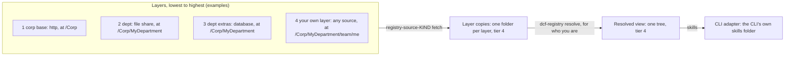
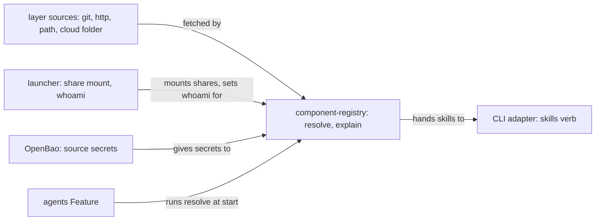
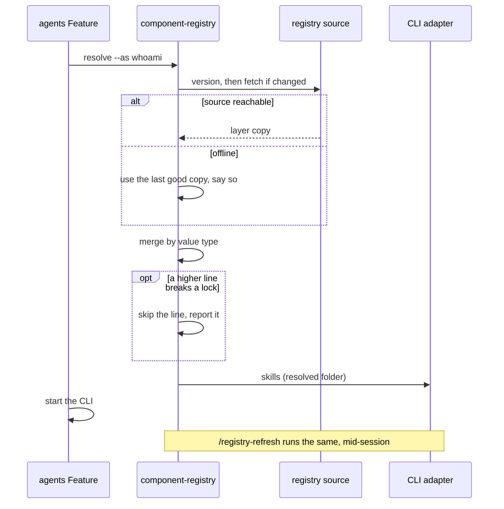
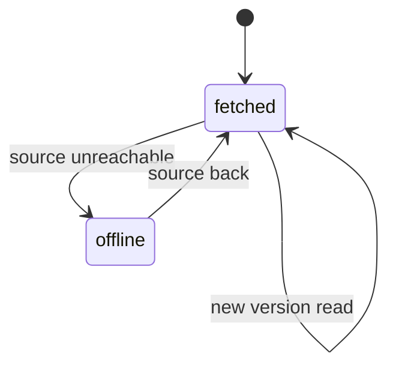
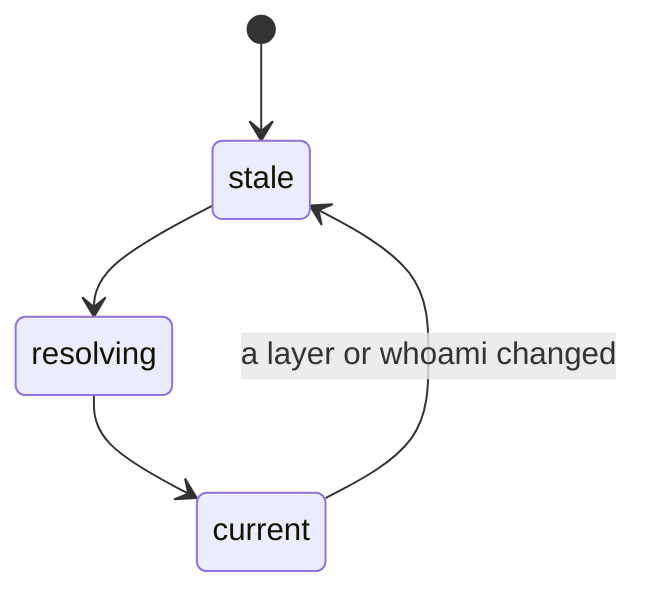
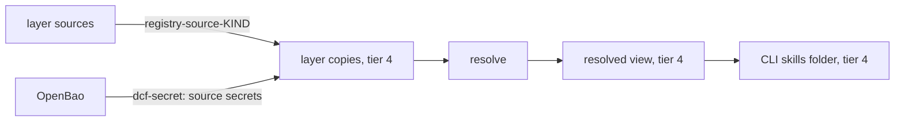
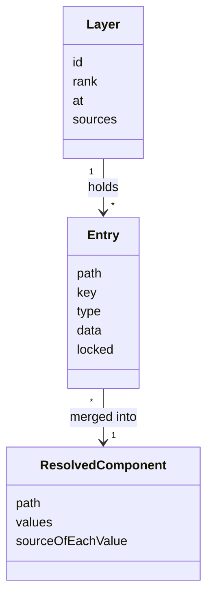

# Proposal: the component registry, a registry for agentic components

Status: accepted by the Operator 2026-11-19, with the architecture review's changes applied (the
last section) and the rule that no layer widens a permission; ADR-0063. Supersedes the
[personalization](personalization.md) proposal. Slice 1 (section 12) is built: `component-registry` 1.0.0 (2026-11-20); slice 2 is built: `component-registry` 1.1.0, `claude-code` 1.12.0, participant 1.2.0, ADR-0064 (2026-11-20); slice 3 is built: `component-registry` 1.2.0 (`http`, one `.layer` file, auth settings only; archives not read) and `cloud-folder` 1.4.0 (`cloud-folder` source) (2026-11-20); slice 4 is built: `architecture-review` in two layers, `devhost` 1.16.0 and this repository's layer, byte-equal to the committed skill with `component-registry` 1.3.0 (`heading: false`, front matter values), the switch-over waiting for the Operator (section 12) (2026-11-20); release 2, agent definitions (section 6.1), is built: `component-registry` 1.6.0, participant 1.3.0, `claude-code` 1.13.0 (2026-11-20); slice 5 is not.

Who this serves: the Operator, who rules on it and is its first user (their own layer: "I'm
colour-blind, adapt diagram colours"); a consumer's maintainer, who points devhosts at an
organization or department layer once; and the engineers whose agents read the result without
knowing layers exist.

The review boards (Whiteboards, private to the Operator) show this design as the six standing
documents; this file is their reviewed source:
[state](https://claude.ai/artifact/GVg1XvgHpjAHZRwJbKnjpQ),
[C4](https://claude.ai/artifact/WpPM7h7JodFqNamxbypnYL),
[workflows](https://claude.ai/artifact/8q9pn2s9jrUntEJf5mUR7Q),
[lifecycles](https://claude.ai/artifact/JBV3JnEMFqu62BWrYESe1h),
[data flows](https://claude.ai/artifact/EvaLTHSeLn2zfhr2MccNQQ),
[data inventory and models](https://claude.ai/artifact/4u4akyDoqNLbeu5Enkc5FZ).

## 1. The problem

A skill that produces architecture artifacts is written once. An organization wants it to use its
lexicon and mark every page "internal"; a department wants C4, not UML; one person needs a
colour-blind-safe palette. Today each of those is either written into the skill (a personal or
corporate taste committed to a shared repo) or said again in every session. The
[personalization](personalization.md) proposal solved one person's preferences with one file. The
need is wider: any number of owners, each publishing from wherever they keep things, for every kind
of agentic component; the first release does it for skills.

## 2. Decided by the Operator (2026-11-19)

1. **A registry for agentic components, shaped like the Windows Registry**: layers are like hives,
   paths like keys, typed values like registry values, locks like Group Policy, `resolve` like the
   merged `HKCR` view, `explain` like `regedit`. The shape is borrowed, not the Windows Registry
   itself (binary, Windows-only, two fixed hives).
2. **Layers: any number, each with one or more sources of any kind** (git, http/REST, a path or
   file share, the cloud folder, a database). Organization, department, team and person are
   examples, never fixed levels.
3. **A person's own layer is just the top layer**, from any source they like (a tier 3 folder, a
   git-ignored folder in the repository, their own git repository, anything else). No tier is
   enforced; what `resolve` builds from it is kept owner-only (section 9).
4. **One tree** of paths with typed `:key` values.
5. **Who wins**: the higher layer wins; inside one layer the more specific path wins; a locked key
   beats both.
6. **Who you are is a path** (`/Corp/MyDepartment/team/me`), per person and per agent.
7. **Merge by value type**: `value` replaces, `list` combines (`!` takes an item out), `text`
   stacks in layer order, `ref` points at another path (and replaces). A definition is a key with
   values, so each value merges by its own type.
8. **Query syntax**: gitignore-style paths, then `:key`; five symbols (`/`, `*`, `**`, `:key`,
   `!`); no value filters. Patterns replace the earlier facets idea.
9. **Files at the core; any backend through a registry source** (`registry-source-<kind>`) that
   fetches a layer into a local layer copy; offline, the last good copy is used.
10. **Review is the source's own release process.** The registry only pins what to read (a git
    branch, tag or commit; a folder; a URL) and how to log in.
11. **http/REST sources take authentication settings only** (token, header or basic; the secret
    from OpenBao). No manifest or signature is required; reading an open endpoint is the layer
    owner's choice.
12. **`resolve` and `explain`** are the two verbs; `explain --uses` answers "who uses this?".
13. **The adapter step and the utility skills** (`/registry-refresh`, `/registry-explain`;
    `/registry-remember` was removed in 2.0.0: the registry does not write layers); a refresh is picked up live where the CLI supports it.
14. **Release 1 ships skills only.** Agent definitions, prompts and settings come later.
15. **No RDF graph**: no agent tool uses RDF, and one resolved tree answers the same questions.
16. **Name**: the Feature is `component-registry`, the command `dcf-registry`.

## 3. The model



| Windows Registry | Component registry |
|---|---|
| hive (HKLM, HKCU) | layer, any number, any source |
| key `HKCU\Software\Corp\MyDepartment` | path `/Corp/MyDepartment` |
| value: name, type, data | `:key`, type, data |
| value types (`REG_SZ`, `REG_MULTI_SZ`) | `value`, `list`, `text`, `ref`: the type picks the merge rule |
| Group Policy keys | locked keys |
| `HKCR`, the merged view | `dcf-registry resolve` |
| `regedit` | `dcf-registry explain` |
| key permissions | the source's own access control |
| (no wildcards) | patterns: `/**/skills/diagrams:color` |
| (no equivalent) | a layer namespace (component-registry 1.7.0, ADR-0073): `namespace: acme` on a layer prefixes its components, `skills/acme:arch-review`; layers of one namespace merge, different namespaces never mix |

### 3.1 Settings and the layer list

Who you are is a plain variable (NFR-6), never in a committed file:

| Setting | Where | Default |
|---|---|---|
| `COMPONENT_REGISTRY_WHOAMI` | `.env` or the launcher, per person; an agents list entry may override it per agent | none: `resolve` refuses to run without it and says how to set it |
| `COMPONENT_REGISTRY_FILE` | Feature option | `.devcontainer/registry.yml` |

The layer list holds layers only (tier 1, shared, committed). Lowest layer first:

```yaml
layers:
  - id: corp-base
    at: /Corp
    sources:
      - kind: http
        url: "https://registry.example.invalid/corp/layer.layer"
        auth: { type: bearer, secret: registry/corp-base }   # a dcf-secret path
        required: true
  - id: dept
    at: /Corp/MyDepartment
    sources:
      - { kind: git, url: "https://git.example.invalid/dept/registry.git", tag: v3 }
  - id: mine
    at: /Corp/MyDepartment/team/me
    sources:
      - { kind: path, path: .registry-mine }    # git-ignored in this repository, the person's choice
    writable: true                               # ignored since 2.0.0: the registry does not write layers
    heading: false                               # (1.3.0) its text stacks without "## Layer mine"
  - id: acme-community
    at: /
    namespace: acme                              # (1.7.0) a public source, isolated: acme:<name>
    sources:
      - { kind: git, url: "https://git.example.invalid/acme/skills.git", tag: v2 }
```

Several sources in one layer merge in their listed order. `heading` (component-registry 1.3.0,
`true` by default) says whether the layer's `text` lines are stacked under a `## Layer <id>`
heading (rule 5 of 3.3). A `required` layer that has never been
fetched stops `resolve`; any other unreachable source falls back to its last good layer copy, and
`resolve` and `explain` say so.

**Layer namespaces** (component-registry 1.7.0, ADR-0073 decision 4). `namespace: <name>` (lower-case
letters and digits in words joined by one `-`, at most 40; `component-registry` and
`anthropic-skills` reserved; anything else refused with `file:line`) gives every component the
layer brings the prefix: its `[skills/arch-review]` is `skills/acme:arch-review`. The match rule of
3.3 runs per namespace: a section reaches only components of its own layer's namespace (none: the
Operator's own), so layers sharing a namespace merge exactly as layers do (order, specificity,
locks, `@replace`, types, permission keys from the namespace's lowest layer), different namespaces
never mix, and a namespaced layer cannot stack onto, override or lock anything outside its
namespace. References are explicit (ruled 2026-11-21): no prefix is the referrer's own
namespace, `<ns>:<name>` namespace `<ns>` from any layer; nothing names the un-namespaced set from
inside a namespace. A target not in the view is a missing dependency, reported while `resolve`
goes on (as a Helm chart's dependency); `aliases: { acme: acme-public }` on a layer maps a
namespace name in that layer's references, one hop. A namespaced
skill is handed over as `<ns>--<name>` (folder and `SKILL.md` name; a `:` is no skill folder name),
its registry name staying `<ns>:<name>`; a namespaced agent definition applies to no agent of the
agents list (ruled 2026-11-23: whether a layer is namespaced is the lister's choice).

### 3.2 A layer's content: the `.layer` format

Plain text, one or more `*.layer` files at the root of each layer's copy, read with awk (NFR-7).

```
file      = *( section / comment / blank )
section   = "[" path "]" [ " " directive ] NL *( entry / lock / comment / blank )
path      = absolute / relative           ; absolute starts with "/", relative is joined to the layer's `at`
directive = "@replace"                    ; this layer replaces the whole component below it
entry     = key ":" type " = " data NL
lock      = "lock " key NL                ; this key cannot be changed by a higher layer
type      = "value" / "list" / "text" / "ref"
data      = for value: the rest of the line
          / for list: items separated by ", "; "!item" removes; "ref:/path" is a reference item
          / for text: the rest of the line, or "@file <relative file>"
          / for ref: a path
comment   = ";" text NL
component = kind "/" [ namespace ":" ] name   ; the namespace comes from the layer list, never a section
reference = [ scope "/" ] kind "/" [ namespace ":" ] name [ ":" key ]   ; no namespace: the referrer's own
namespace = word *( "-" word )                 ; word = 1*( a-z / 0-9 ), at most 40 characters
```

A path is segments separated by `/`. In a pattern, `*` matches one segment, `**` matches any
number, and a leading `!` on a section path excludes what it matches from the sections above it in
the same file. `!` therefore always means "not": a list item taken out, or a path excluded.

**A component and its scope.** A path is split at its first component-kind segment (`skills`,
later `agents`, `prompts`, `settings`, `lexicon`): what is before it is the **scope**, what follows
is the **component**. `/Corp/MyDepartment/skills/diagrams` has scope `/Corp/MyDepartment` and
component `skills/diagrams`. A skill's files sit beside the `.layer` file and are named by `@file`
or by a `files:value = @dir <folder>` entry; a higher layer's file of the same name replaces the
lower one, and `body:text` stacks on the skill's `SKILL.md` text.

**Front matter values** (component-registry 1.3.0). A skill's `name:value` and
`description:value` are written into the front matter of its `SKILL.md` (the first `body` block's
`---` block): the key's line is replaced, or added, or a front matter is made. Only these two
keys; every other front matter line stays the lowest block's, so a permission key keeps the lowest
layer's.

### 3.3 Resolve: the match rule and precedence

For a person (or agent) at path `W`:

1. **Which lines apply.** A line applies when its scope, read as a pattern, matches `W` or an
   ancestor of `W`. `/Corp` applies to `/Corp/MyDepartment/team/me`; `/Corp/Finance` does not;
   `/**` applies to everyone; `/**/MyDepartment/**` applies under any `MyDepartment`.
2. **Order.** For one component key, order the applying lines by layer (higher wins), then inside a
   layer by specificity: the deeper the ancestor of `W` the scope matched, the stronger; on a tie,
   fewer wildcard segments; on a tie, the later line in the file.
3. **Types.** The lowest layer that defines a key fixes its type. A higher layer's line with
   another type is skipped and reported.
4. **Locks.** A locked key keeps the value of the layer that locked it; a higher layer's line for it
   is skipped and reported.
5. **Merge by type.** `value` and `ref`: the strongest line wins. `list`: items are combined from
   the weakest line to the strongest, each `!item` removing what came before. `text`: all lines
   stacked from the lowest layer to the highest, each layer's under a heading naming it, unless
   the layer list says `heading: false` for that layer (component-registry 1.3.0: then one blank
   line only; `explain` still names each line's layer). A skill's `name` and `description` values
   go into its `SKILL.md` front matter (3.2).
   `@replace` on a section drops every weaker line for that component.
6. **Never fails on content.** A skipped line is reported by `resolve` and shown by `explain`;
   `resolve` fails only for a missing `required` layer or a missing `COMPONENT_REGISTRY_WHOAMI`.

**Worked example.** `W = /Corp/MyDepartment/team/me`, three layers:

```
; layer 1 corp-base (at /Corp)
[skills/architecture-artifacts]
body:text = @file architecture-artifacts/SKILL.md
classification:value = internal
lock classification

; layer 2 dept (at /Corp/MyDepartment)
[skills/architecture-artifacts]
body:text = Draw C4, not UML.
terms:list = C4, ADR, SLA
[/Corp/Finance/skills/architecture-artifacts]
body:text = Use the finance templates.

; layer 3 mine (at /Corp/MyDepartment/team/me)
[/**/skills/architecture-artifacts]
body:text = Use colour-blind-safe colours.
terms:list = !ADR
classification:value = public
```

Result for `skills/architecture-artifacts`: `body` is the corp `SKILL.md`, then "Draw C4, not
UML.", then "Use colour-blind-safe colours."; the finance line does not apply (its scope is not an
ancestor of `W`); `terms` is `C4, SLA`; `classification` stays `internal` (locked by layer 1), and
`explain` reports layer 3's line as skipped by the lock.

## 4. Registry sources

Same shape as the agents Feature's CLI adapters: one executable on `PATH` per source kind,
installed by the Feature that owns the transport. The lexicon reserves "adapter" for the CLI
adapter, so these are **registry sources**.

```
registry-source-<kind> fetch <layer> <dest> key=value...   write the layer's files into <dest>
registry-source-<kind> version <layer> key=value...        print a commit, tag, etag or fetch time
registry-source-<kind> supports                            the verbs it implements
exit codes: 0 done, 1 failed, 2 bad use, 3 not supported (the Feature falls back)
```

| Kind | Installed by | What the layer list pins | Log-in |
|---|---|---|---|
| `git` | component-registry | `url` and one of `branch`, `tag`, `commit`; from 2.2.0 `path`, a folder of the repository as the layer root (a monorepo) | optional; secret through `dcf-secret` |
| `http` | component-registry | `url` (a `.layer` file, or with `archive: tar.gz\|tgz\|zip` an archive, 2.2.0, with optional `sha256` and `path`, a folder inside it) | `auth`: bearer, header or basic; secret through `dcf-secret`; none for an open endpoint |
| `path` | component-registry | `path` (a file share is mounted on the host by the launcher, `DCF_HOST_*`) | the folder's own permissions |
| `cloud-folder` | cloud-folder | `remote` | its existing rclone set-up |
| `db` | component-registry (1.5.0) | `driver` (`sqlite` or `postgres`); `path`, or `host`, `port`, `database`, `user`, `sslmode`; one of `table` or `query` returning `(section, key, type, data, locked)` | `auth.secret` (the postgres password) through `dcf-secret`, into the client's environment only |

Review and release are the owner's, before the source; the registry reads what is there.

## 5. The verbs and tasks

| Verb | Task (NFR-2) | Does |
|---|---|---|
| `dcf-registry resolve [--as <path>]` | `registry:resolve` | fetch each layer (`version` first, so an unchanged layer is skipped), merge (section 3.3), write the resolved view to a temporary folder and swap it in, hand each kind to its consumer, remove copies it owns that no layer still names; idempotent (NFR-5) |
| `dcf-registry explain <path> [--uses] [--color auto\|always\|never]` | `registry:explain` | read-only: every line of a resolved component with the layer it came from and the version that layer was read at; skipped lines and why; refs that point at nothing; `--uses` lists what refers to the path; `--color` (1.4.0) paints each line by its layer with a legend, in six colours chosen for colour-vision deficiencies and with the layer id always printed, skipped lines and dangling refs dim and struck through; `auto` colours only on a terminal without `NO_COLOR`, and without colour the text is unchanged |

A lock file in the state folder serialises two `resolve` runs.

## 6. Consumers: the adapter step (release 1: skills)

At an agent's start the agents Feature runs `resolve`, then hands skills over:

- **A new optional CLI adapter verb, `skills <name> <folder>`**, listed by `supports`, with the
  resolved skills folder in `COMPONENT_REGISTRY_SKILLS`. It copies them into the CLI's own skills
  folder (Claude: `$CLAUDE_CONFIG_DIR/skills/`, a volume), marked as owned by the registry. Never the
  repository's `.claude/skills`: a resolved skill can carry personal facts. This amends the CLI
  contract of ADR-0037 and `src/agents/NOTES.md`.
- **Claude facts** (from the Claude Code skills documentation,
  https://code.claude.com/docs/en/skills, checked 2026-11-19): skills directories are watched and
  changes are picked up in the running session; a skills directory that did not exist at the
  session's start needs `/reload-skills`, so the adapter creates the folder at start even when
  empty; a personal skill wins over a project skill of the same name, so a resolved copy wins a
  name clash. Those three go into a new "skills folder" row of the capability matrix
  (agents-v2 section 14).
- **Other CLIs (NFR-12)**: until their adapter implements `skills`, it answers exit 3 and the agent
  starts with its plain skills, saying so.
- **Permissions are never widened**: a skill's `allowed-tools` and any permission key are taken
  from the component's lowest layer only; a higher layer's line for them is skipped and reported.

Utility skills, shipped by the Feature in its own base layer:

| Skill | Does |
|---|---|
| `/registry-refresh` | `resolve` now; Claude picks up changed skill files in the running session; another CLI gets the files and a note that it needs a restart |
| `/registry-explain <path>` | `explain`, shown to the person |

A skill already used in a conversation keeps its old text until it is used in a new conversation;
`/registry-refresh` says so.

### 6.1 Agent definitions (release 2)

*Built (2026-11-20, the Operator's rulings of 2026-11-21 applied): `component-registry` 1.6.0,
participant 1.3.0, `claude-code` 1.13.0, `copilot` 0.2.0.* Decision
14 left agent definitions for later; this is the smallest form that makes the layering useful: an
organization, a department or a person choosing the model an agent runs on and the skills it is
said to use, without editing any repository's agents list.

**What it is in the tree.** A component `agents/<name>`, where `<name>` is the agent's handle in
the agents list (one segment). Its keys are fields, each merged by its type (section 3.3), and
only these are read (a key may hold `.` from 1.6.0, for the CLI suffix):

| Key | Type | Merge | What it does |
|---|---|---|---|
| `model` | `value` | the strongest line | the model the agent's own CLI (the agents list's `cli`) runs on: one word of letters, digits and `. _ : / @ [ ] -`, at most 100 characters |
| `model.<cli>` | `value` | the strongest line | the same, for agents of that CLI only (`model.claude`, `model.copilot`); a suffix no listed agent has applies to none (a CLI not installed yet is fine) |
| `skills` | `list` | combined, `!item` removes | the skills the agent is said to use (what `agents list --json` shows the facilitator): a skill name or `ref:skills/<name>` (a ref is checked like any ref, so `explain skills/<name> --uses` lists the agents that name it) |

```
; layer corp (at /Corp): every agent a layer or the list names
[/Corp/agents/*]
model:value = sonnet
; layer dept (at /Corp/MyDepartment)
[agents/reviewer]
model:value = opus
skills:list = ref:skills/architecture-review, ref:skills/diagrams
; layer mine (at /Corp/MyDepartment/team/me)
[/**/agents/reviewer]
skills:list = !ref:skills/diagrams
```

For `W = /Corp/MyDepartment/team/me`, `agents/reviewer` resolves to `model` `opus` and `skills`
`architecture-review`; every other agent to `model` `sonnet`.

**A model per CLI** (the Operator's ruling of 2026-11-21, option 2 of three: a plain key per agent,
a key per CLI, or a model name mapped per CLI). One agent runs one CLI, but a department's
`[agents/*]` reaches agents of several CLIs, whose model names differ. So the effective model of an
agent is the strongest of its `model` line and its `model.<its cli>` line, in the usual order
(higher layer, then the more specific path, then fewer wildcards); only on a tie there does the
suffixed key win, and then the later line. A higher layer's plain `model` therefore beats a lower
layer's `model.claude`. A `lock model` holds every `model.<cli>` too. `resolve` writes the effective
model into the view for each agent's CLI (the participant names the CLIs, below), and `from.tsv`
records the key it came from.

```
[/Corp/agents/*]
model:value = sonnet
model.copilot:value = gpt-5.4        ; Copilot agents: gpt-5.4; every other agent: sonnet
```

**Which agents.** A component exists when a section names it literally, as for skills; a pattern
(`[agents/*]`) applies to those. So that a department's `[agents/*]` reaches the agents of a
repository that no layer names, the participant hands `resolve` the names of the listed agents
and their CLIs (the variable `COMPONENT_REGISTRY_AGENTS`, comma-separated `name:cli` items); `resolve` resolves `agents/<name>`
for each of them too, and keeps the names in the view, so `/registry-refresh` keeps them. An
older `dcf-registry` ignores the variable.

**What the registry never sets.** Everything else of an agent stays the agents list's, and a line
for it is skipped and reported (`explain` shows why): the identity and address (`name`,
`identity`, `session-name`, `registry-path`), where and how it runs (`cli`, `kind`, `folder`,
`lifecycle`, `lease`, `default`, `attachment`), and anything that can widen a permission: `args`
(a flag such as a permission mode), `definition` (a CLI profile carries its own tools) and every
permission key (`allowed-tools`, `disallowed-tools`, `permission*`). Rule 3 (permissions from the
lowest layer only) is not enough for an agent, since the lowest layer is not the repository; an
agent definition carries no permission key at all.

**Precedence: the registry wins** (the Operator's ruling of 2026-11-21, which reversed the first
draft's "the agents list wins": "It's not our responsibility to manage that"). The committed agents
list stays the source of which agents exist and of every field the registry may never set; for the
two fields it may set, a registry value replaces the list's, and the list fills only what the
registry leaves unset:

- `skills`: the registry's skills replace the list entry's `skills:`; the entry's stand only when
  the registry resolves none for the agent.
- `model`: the list has no model key; the registry's model replaces any model chosen in the
  agent's CLI arguments, the list's `args` and the extra arguments of one start alike (one rule,
  no exception to explain). Which flag chooses the model is a CLI fact, so the adapter does the
  replacing (NFR-13): the participant hands the registry's model over in `AGENT_MODEL`, and the
  adapter drops the arguments' own model flag and passes the registry's, saying in one line what it
  replaced. A person who wants another model for an agent sets it in their own layer, the top one.

The first draft argued the reverse: a layer outside the repository changes a committed decision
without a trace in the repository. The Operator ruled that managing which model or skills an
agent gets is the layers' owners' business, not the repository's; `agents check` and the start
line name every value the registry replaced, which is the trace. A resolve that fails, or no
registry, still leaves an agent as the list says. Locks need no special rule: the registry already
beats the list.

**How the participant reads it.** At an agent's start (section 6), after `resolve` for the agent's
`registry-path` (else `COMPONENT_REGISTRY_WHOAMI`), the participant reads the resolved view's
`agents/<name>/`, and only when the view's `whoami` is the agent's path (else one line says the
view is another path's and the agent starts without registry fields). The view is
machine-readable: `model` (one line), `skills` (one name per line) and `from.tsv` (field, layer,
`source:file:line` of each line used). The model reaches the adapter in the environment variable
`AGENT_MODEL` (the effective model for its CLI) on every call about that agent, as `AGENT_SESSION_NAME` does (ADR-0041), empty on
every other call; an adapter that does not read it starts its CLI on the CLI's own default model
(NFR-12; no `supports` capability, a variable cannot answer exit 3). Claude Code's adapter
(`claude-code` 1.13.0) passes `--model` on `start-bg`, `new` and `resume`, and Copilot's
(`copilot` 0.2.0, Copilot CLI 1.0.114's `--model <model>`) on `new` and `resume`, in place of any
`--model` in the arguments; a woken session keeps the options it was saved with (a wake is always
bare). A failed or slow resolve, or no layer list, leaves the agent as the list says.

**How it shows.** `dcf-registry explain agents/<name>` shows an agent definition like any
component: each field with every line, its layer and version, the skipped lines and why (a field
the registry never sets, a model that is not one word), and closes with the effective model for
the agent's CLI and the key and layer it came from. `agents check` shows the fields that came
from the registry and from which layers (`model opus (registry: dept)`), and names the list's
values it replaced (`replacing --model haiku in its args`, `replacing the list's skills [x]`).

### 6.2 Vendor templates (ADR-0077, built in component-registry 1.11.0)

The last step of the adapter step, writing the files a vendor's CLI reads, is a template, not
adapter shell (the Operator's rulings of 2026-11-21 and 2026-11-23). The merge of section 3.3 is
unchanged; templates are one more component kind, merged by layer precedence only.

```text
  layer copies --resolve--> view: skills/, agents/, meta/, templates/<group>/<vendor>/<layer>/*.j2
                                     |
             dcf-registry handover <cli>   (render, then the adapter's skills verb)
                                     |
   minijinja-cli <winning template> <context.json>  per skill (for: skill) or once (for: once)
                                     |
   renders/<cli>.<agent>.<pid>/skills/<dir>/...  --COMPONENT_REGISTRY_SKILLS-->  agent-adapter-<cli> skills
```

- **Engine.** `minijinja-cli`, one pinned static binary checked against its sha256, installed by
  the Feature through `dcf_curl` (ADR-0034); no Python Jinja (ADR-0061 keeps `claude-code`
  Python-free). Run with no configuration, no environment, strict undefined names, includes only
  inside the template's group of layers, and a fuel limit: a template only writes files.
- **Component.** `templates/<vendor>/<file>.j2` in a layer copy (`templates/<vendor>/<ns>:<file>.j2`
  in a namespaced layer). Its head, a leading Jinja comment, says `for:` (`skill`, `once`; `agent`
  in slice 2), `output:` (the path written, a template too) and optionally `lock: true`.
- **Precedence.** The highest layer's template wins whole; replacement never stacks; the lowest
  layer that locks one keeps it; a layer applies where its `at` is the who-you-are path or an
  ancestor; a namespaced layer's templates compete only within its namespace, render only its
  skills, write only in their folders, and never replace a file the Operator's templates write.
- **The three ways.** Replace the file; change a block with ``
  (`component-registry/SKILL.md.j2` for the base; only lower layers can be extended); add a file
  the base does not produce. An empty output is not written.
- **The base.** `templates/claude/SKILL.md.j2` (blocks `front_matter` and `body`) reproduces every
  resolved `SKILL.md` byte for byte, so the 1.11.0 hand-over gives Claude Code exactly the 1.10.0
  files (tested on fixtures, on this repository's real layer list, and through the real adapter).
- **Where rendering runs, and failure.** At the hand-over, not at `resolve`: the vendor is known
  there, `resolve` and `explain` keep working without the binary, and a broken template for one
  vendor never blocks another. `resolve` checks only heads (a bad head is skipped and reported, the
  template below wins). A template that does not render, or no `minijinja-cli`, fails that
  hand-over with the layer and file named; the adapter is not called, so the CLI keeps its last
  good files. A CLI no template names is handed the view's `skills/` as before.
- **Shown by** `dcf-registry explain templates[/<vendor>[/<file>.j2]]` (candidates, the winner, the
  base it extends) and `dcf-registry render <vendor> <folder>` (a preview).
- **Next (slice 2).** Copilot's files (its adapter gains a `skills` verb that takes rendered
  files) and `for: agent` (agent definition files rendered per agent).

## 7. Why not the CLI's own distribution (NFR-9)

Claude Code already distributes skills through plugins and marketplaces and orders managed, user
and project settings. Those move packages from one publisher with a fixed scope order for one
vendor. The registry adds what they do not: any number of owners and sources stacked in one order,
merge by value type inside one skill, locks, a who-you-are path, and `explain`. It hands its result
to the CLI's own mechanism (the skills folder), so the two do not compete; a plugin could later be
one more consumer. Settings are deferred (decision 14) until the CLI's own settings merge is
compared, so the registry does not re-implement it.

## 8. The Feature (NFR-1, NFR-5, NFR-8, NFR-10)

- State in a named volume at `/var/lib/devcontainer-features/component-registry` (layer copies,
  the resolved view, the lock file), set through `containerEnv`; a `component-registry-setup`
  script creates it owner-only at start; idempotent.
- Tests: fixture layers for the grammar and the worked example; one scenario per option; the
  two-fake-adapter contract test of NFR-12 for the `skills` verb; an offline source; a lock; a
  type clash.

## 9. Data, sensitivity and trust

- A resolved component, a layer copy and `explain` output are as sensitive as their most sensitive
  input. A person's own layer may hold health facts (colour blindness), so all of them are kept
  owner-only in tier 4 and never committed. Where the person keeps their own layer is their choice;
  keeping health facts where only they can read it is advice, not a rule.
- Cons and backs get resolved components, never raw layers or other people's layers.
- A layer is instructions fed to agents. Which endpoint to trust, and how its owner reviews
  changes, is the layer owner's and the person's choice (decisions 10, 11); the registry
  authenticates as configured and never widens a permission (section 6).
- A layer whose source the person does not control is given a namespace (1.7.0): what it brings
  is prefixed and cannot change or lock anything outside it, nor refer to the person's own
  components; it may refer to other namespaces explicitly, which the person installs or not; the
  person adapts it with a layer of their own in the same namespace.

## 10. Placement (NFR-13)

| Element | Where it belongs | Why |
|---|---|---|
| layer list, resolve, explain, `git`/`http`/`path` sources, utility skills | new Feature `component-registry` | manages the agent's environment (its skills), not a CLI capability |
| `cloud-folder` source | `cloud-folder` Feature | it owns the transport |
| `skills` adapter verb | each CLI Feature's adapter (`claude-code` first) | where the CLI's skills folder lives is a CLI fact |
| calling `resolve` at start, the per-agent who-you-are override | `agents` Feature and its list | it already owns the start sequence and each agent's entry |
| file-share host mount, `COMPONENT_REGISTRY_WHOAMI` from the workstation | the launcher (`devcontainer-cli`, `DCF_HOST_*`) | host mounts and per-person values live there |
| source secrets | OpenBao through `dcf-secret` | the secrets rule (ADR-0048) |

## 11. Changes to the six standing documents (deltas)

Applied in the pull request that builds each slice, not by this proposal.

**State of the Architecture**: a new row, and the personalization row (line 78) becomes
"superseded by the component registry".

| Element | State | Builds on |
|---|---|---|
| component-registry Feature (resolve, explain, registry sources, utility skills) | proposed | agents CLI adapters, cloud-folder, OpenBao |

**C4 Models** (container view):



**Workflows**: an agent's start gains two steps, with the offline and lock branches.



**Lifecycles**: two state machines.





**Data Flows**:



**Data Inventory and Models**:

| Data | Where | Source | Tier | Sensitivity | Lost with the machine? |
|---|---|---|---|---|---|
| Layer list | `.devcontainer/registry.yml` | git | 1 | public | no |
| Who-you-are path | `.env` or the launcher | the person | per person | internal | no (set again) |
| A layer's `.layer` files | its source | any | the owner's choice | internal; a person's own layer is personal | no |
| Layer copies | state volume, one folder per layer | fetched | 4 | as its layer | refetched |
| Resolved view | state volume | resolve | 4 | as its most sensitive input | rebuilt |
| Resolved skills in the CLI | the CLI's skills folder (Claude: claude-code volume) | the adapter | 4 | as the resolved view | rebuilt |
| `explain` output | terminal only | explain | none | as the resolved view | not kept |
| Source secrets | OpenBao | the person or owner | OpenBao's | secret | no |



## 12. Slices

1. **Core**: the Feature, the layer list, `COMPONENT_REGISTRY_WHOAMI`, the `.layer` grammar, the four
   value types, patterns, the match rule, locks, `resolve` and `explain` (`--uses`), sources `git`
   and `path`, tasks and tests.
2. **Adapter step**: the `skills` verb in `agent-adapter-claude`, `resolve` in the agents start
   sequence, the per-agent override, the three utility skills, the matrix row.
3. **More sources**: `http` with authentication; `cloud-folder` in the cloud-folder Feature.
4. **First real use**: split the `architecture-review` skill into a base layer and this
   repository's layer, and check the resolved skill matches today's.
   *Built (2026-11-20).* The devhost Feature's layer (`/usr/local/share/devhost/registry`, the
   review method) and this repository's (`.devcontainer/registry/repo`, "In this repository": the
   NFR file, the capability matrix, NFR-13, the placement layers), listed in
   `.devcontainer/registry.yml`, both `heading: false`; `task test:registry-first-use` checks the
   resolved skill equals the committed one **byte for byte**. Gaps found and ruled on by the
   Operator (2026-11-20; `src/component-registry/NOTES.md`, "First real use"): a heading for every
   layer, and front matter from the lowest block only, are fixed in component-registry 1.3.0
   (`heading: false`; `name` and `description` values in the front matter); `text` only appends,
   layer by layer, so the committed skill was restated once as the method followed by "In this
   repository", and the restated skill is the reference (no anchors or slots).
   *Switch-over: waits for the Operator.* The resolved copy already wins the name (personal over
   project), so after the next rebuild this repository runs it. Switching over removes
   `.claude/skills/architecture-review/` (a session without the registry then has no review) and
   decides what consumers of the devhost Feature get: the template `devhost-init` copies made the
   base layer only, or consumers adding the component-registry Feature and a layer list naming the
   devhost layer.
5. **The `db` source**: *built* (component-registry 1.5.0; sqlite and postgres through the `sqlite3` and `psql` CLIs on PATH, the row contract in the Feature's NOTES).
6. **Later releases**: prompts and settings as component kinds. Agent definitions are built
   (section 6.1, component-registry 1.6.0: `model` and `skills`, the registry winning).

## 13. Relation to other work

- Supersedes [personalization](personalization.md): the one preferences file becomes one person's
  top layer.
- [Task aliases](task-aliases.md) keep their own team and personal files; they could become a
  component kind later.
- Amends ADR-0037 (the CLI contract gains the optional `skills` verb) and `src/agents/NOTES.md`.
- Lexicon terms to add with the build: registry layer, registry source, layer copy, resolved view,
  lock, who-you-are path, `.layer` file. "Layer" alone stays the theme layer; "snapshot" stays
  OpenBao's.

## 14. Open questions

None for release 1. The review's questions were ruled on 2026-11-19 (section 2: decisions 3, 10, 14; ADR-0063
back to proposed), and the per-agent who-you-are override sits in the agents list entry
(section 3.1). Release 2 (section 6.1): the precedence was ruled on 2026-11-21 (the registry wins),
which also settles whether a lock beats the list.

## Architecture review (2026-11-19)

**Verdict:** fit with changes

Requirements (NFR), one line each. Met: NFR-3 (no build-time download; the runtime fetch is not
the build-time rule of ADR-0034), NFR-4 (no official Feature to order after), NFR-11 (the tool is
not a linter), NFR-13 (placement in section 8 is right, see finding 5). Needs the proposal to say
it: NFR-1 (section 9 says "named volume" but not `/var/lib/devcontainer-features/component-registry`,
`containerEnv` and `component-registry-setup`), NFR-2 (no tasks named; `resolve` and `explain` need
registered tasks with a `desc`), NFR-5 (`resolve` and setup idempotent: not stated), NFR-8 and
NFR-10 (slice 1 tests fixtures; the scenario per option and the two-fake-adapter contract test of
NFR-12 are not named). Not met: NFR-6 (finding 3), NFR-9 (finding 5), NFR-12 (finding 2).

### Findings
1. **The `.layer` grammar and the match rule are not specified enough to build (section 3.2, 3.3).**
   Section 3.2 defers the grammar to "the build's NOTES", but the proposal leaves open: how a
   section header relates to the layer's `at` (the examples are absolute while a layer is mounted at
   a path); how "who you are" selects lines (is a line applied when its path is an ancestor of the
   `whoami` path?); "more fixed path names wins" when `**` is involved; three meanings of `!` (list
   removal, a lock after the type, `!replace` on a section); `skills:list = ref ...` mixes two
   types; the same key with different types in two layers; whether a refused line fails the
   resolve or is ignored; and how a skill with more than one file (references, scripts) is
   carried when `body:text` holds one `@file`. Recommended change: write the grammar (ABNF or a
   table) and one worked resolve of the section 3.2 example, with the match rule and a tie-break
   order, into the proposal or a first-slice spec before the Operator rules.
2. **The `skills` adapter verb has no row in the capability matrix, so NFR-12 is only half shown
   (section 6, 8; agents-v2 section 14.1).** The matrix has no skills-folder capability for any
   CLI. The exit 3 fallback is named (plain skills, said so), which meets NFR-12's letter, but the
   claim that Claude ranks personal above project skills, and that a created-empty folder is watched
   live, are CLI facts without a source, and Copilot reading `.claude/skills` is unchecked. The verb
   `skills <name> <folder> --from <dir>` also differs in shape from the optional verbs in
   `src/agents/NOTES.md` (`<verb> <name> <folder>`), and amends the contract of ADR-0037.
   Recommended change: add a "skills folder" row (and the precedence and live-reload cells, with
   their sources) to the matrix, make `skills` a `supports` verb, and name ADR-0037 and
   `src/agents/NOTES.md` as amended in ADR-0063.
3. **`whoami` sits in a committed shared file (section 3.1; NFR-6; ADR-0045 tier 1).** The example
   puts `/Corp/MyDepartment/team/me` in `.devcontainer/registry.yml`, which is tier 1 and shared,
   while the proposal says it is "per person". NFR-6 wants settings as options or plain variables
   (CLI, then `.env`, then environment). Recommended change: take `whoami` from a variable
   (`COMPONENT_REGISTRY_WHOAMI`, `.env` or the launcher), keep the yml for layers only, and let
   the agents list entry override it per agent (open question 2).
4. **A personal layer's data tier is unstated (sections 7, 9; ADR-0045, ADR-0049).** The inventory
   says a layer is "1, 2 or 3 by owner", and the personal layer's example source is `cloud-folder`
   (tier 2, shared), yet it may hold health facts. ADR-0045 keeps tier 3 out of the mounts by
   default. Also not in the inventory: the resolved skill copies in the CLI's own volume
   (`claude-code`, tier 4), the `explain` output, and the OpenBao token path (data flows show no
   secret edge). Recommended change: state that a personal layer lives in tier 3 or in a tier 2
   folder the person alone can read, add the skills-folder copies and the `dcf-secret` edge to
   the inventory and data-flow deltas, and name the token's secret path.
5. **No statement of why not the CLI's own distribution (NFR-9, NFR-13; section 8).** Claude Code
   already has plugins, marketplaces and managed settings with their own scope order. The
   placement is right (skills hand-over in the adapter, start in agents), but the proposal never
   says what is added over them (many sources, merge by type, locks, `explain`), and the
   `settings` and `prompts` kinds come close to re-implementing the CLI's settings merge. Recommended
   change: add the one paragraph NFR-9 asks for, and limit the first release to skills and agent
   definitions, with `settings` deferred until the CLI's own merge is compared.
6. **Trust of an http layer is weaker than stated (sections 4, 7).** The `manifest.json` comes from
   the same host as the files, so a sha256 match proves only transfer, not origin; the layer is
   instructions fed to agents and may carry tool permissions. Recommended change: pin the
   manifest's digest in the layer list, or have the owner sign it (the `sign-packet` Feature
   exists), and say a layer may not carry permission or `allowed-tools` settings.
7. **Mermaid blocks have defects (section 9).** The `classDiagram` puts members on one line with
   semicolons (`class Layer { id; rank; at; sources }`), which is not valid member syntax; each
   member needs its own line. The `stateDiagram-v2` joins two unrelated machines in one block with
   two `[*]` starts and an unused `state ... as rc`. `registry-source-&lt;kind&gt;` in a flowchart
   label may render literally; use `#lt;kind#gt;` or avoid angle brackets. Recommended change: fix
   the class members, split the state diagram into a layer-change machine and a resolved-component
   machine (add an offline-snapshot state), and replace the escapes.
8. **Source adapter collides with the lexicon (LEXICON "CLI adapter", "Snapshot").** The lexicon
   says "adapter" is used only for the CLI adapter; `registry-source-<kind>` is called a "source
   adapter" (decision 9, section 4). "Snapshot" is already the OpenBao raft file. "Layer" collides
   with the bar and life layers (section 11 handles it). Needs terms: registry layer, registry source,
   resolved view, lock, who-you-are path (`whoami`), `.layer` file. Recommended change: call the
   executables "registry sources" (a `registry-source-<kind>` executable), call the local copy a
   "layer copy", and ask the librarian for the six terms; the component-registry ontology id
   already exists.
9. **ADR-0063 is accepted ahead of this review and drifts from the proposal.** ADR-0039 puts the
   architecture review before the ruling; the ADR already says accepted. The ADR says agent
   definitions go to the agents Feature, while slice 5 defers them; it omits the open questions
   and the amendment of ADR-0037. No accepted ADR is otherwise contradicted (ADR-0036, 0037, 0045,
   0048, 0060 are consistent). Recommended change: keep the ADR proposed until the Operator
   rules, and align its item 8 with slice 5.
10. **Standing documents: the state, C4, workflow, lifecycle, data flow and inventory deltas are all
    present (section 9), good, but two are thin.** The state row lacks the supersession of the
    personalization row at state-of-the-architecture line 78; the C4 delta lacks the host launcher
    (file-share mount) and OpenBao; the workflow shows no refused-lock or offline path. Recommended
    change: add the personalization row change, the two C4 relations and an alt branch for lock
    refusal and offline fallback.
11. **Smaller gaps.** A skill the layers drop leaves a stale copy in the skills folder; two
    concurrent resolves can race on the folder; the `git` source's credentials are not named
    (OpenBao through `dcf-secret`, like `http`). Recommended change: say `resolve` writes to a
    temporary folder and swaps it in, and removes copies it owns that no layer still names.

### Open questions for the Operator
- Should the first release ship skills only (recommended), with agent definitions, prompts and
  settings later, so the design does not duplicate the CLI's own settings layering?
- Where does a personal layer with health facts live (recommended: tier 3, or a private tier 2
  folder), given ADR-0045 keeps tier 3 unmounted by default?
- Keep ADR-0063 accepted now, or move it back to proposed until this review's changes are made
  (recommended: proposed)?
- Review of changes (open question 1) and an agent's own path (open question 2): the proposal's
  recommendations are sound; the review agrees with both.

## Changes after the architecture review (2026-11-19)

| Finding | Change |
|---|---|
| 1 grammar and match rule | Sections 3.2 and 3.3: the grammar, scope and component, the match rule, tie-breaks, one meaning of `!`, `lock` lines, `@replace`, list refs, type clashes, multi-file skills, a worked example |
| 2 `skills` verb and NFR-12 | Section 6: a `supports` verb in the `<verb> <name> <folder>` shape; Claude facts sourced; a matrix row; ADR-0037 and the agents NOTES named as amended |
| 3 `whoami` committed | Section 3.1: `COMPONENT_REGISTRY_WHOAMI`, per person, per-agent override |
| 4 personal layer tier, inventory | The Operator ruled: the person's own layer is the top layer from any source, no tier enforced; resolved output owner-only in tier 4 (sections 2, 9); inventory and data flows gain the CLI skills copies, `explain` output and the secret edge |
| 5 why not CLI distribution | Section 7; release 1 is skills only (decision 14) |
| 6 http trust | The Operator ruled: authentication settings only, review is the owner's (decisions 10, 11); kept: permissions are never widened (section 6) |
| 7 Mermaid | Class members one per line; two state diagrams; no angle-bracket escapes |
| 8 lexicon | "Registry source" and "layer copy"; terms listed in section 13 |
| 9 ADR drift | ADR-0063 back to proposed; aligned with release 1 and ADR-0037 |
| 10 thin deltas | Personalization row, launcher and OpenBao in C4, offline and lock branches in the workflow |
| 11 smaller gaps | Section 5: temporary folder and swap, a lock file, owned copies removed; git secrets through `dcf-secret` |
| NFR-1, 2, 5, 8, 10 | Sections 5 and 8 |

