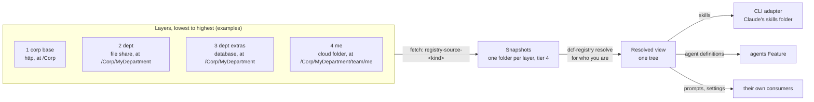
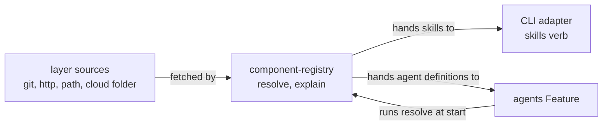
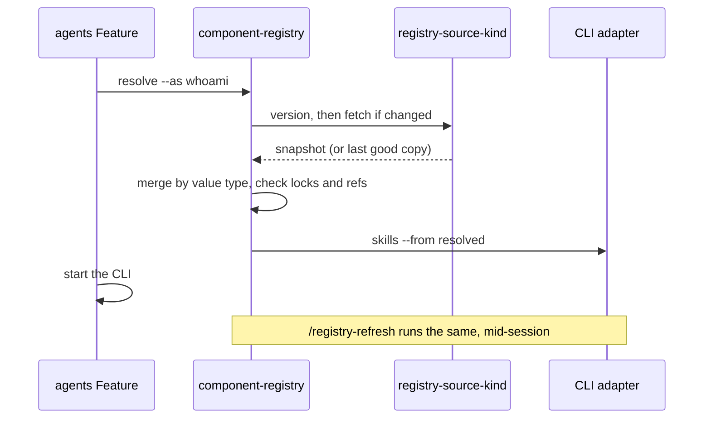
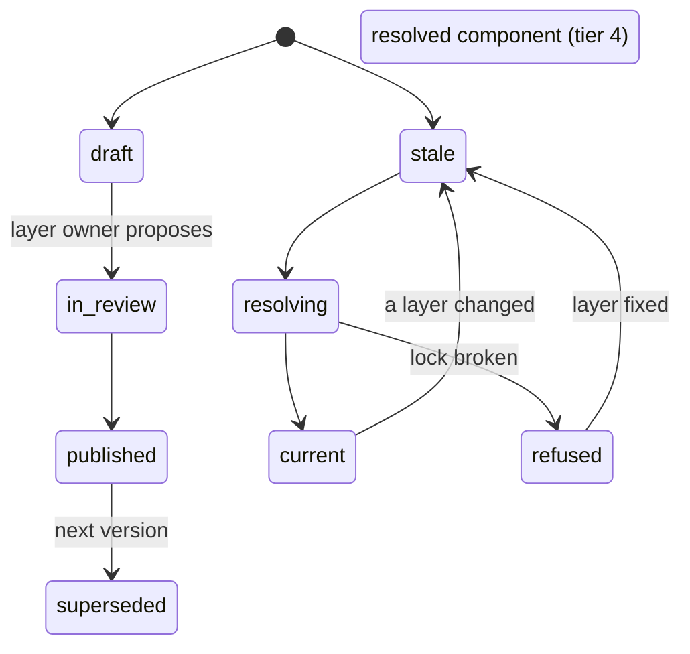
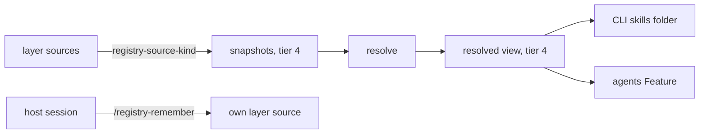
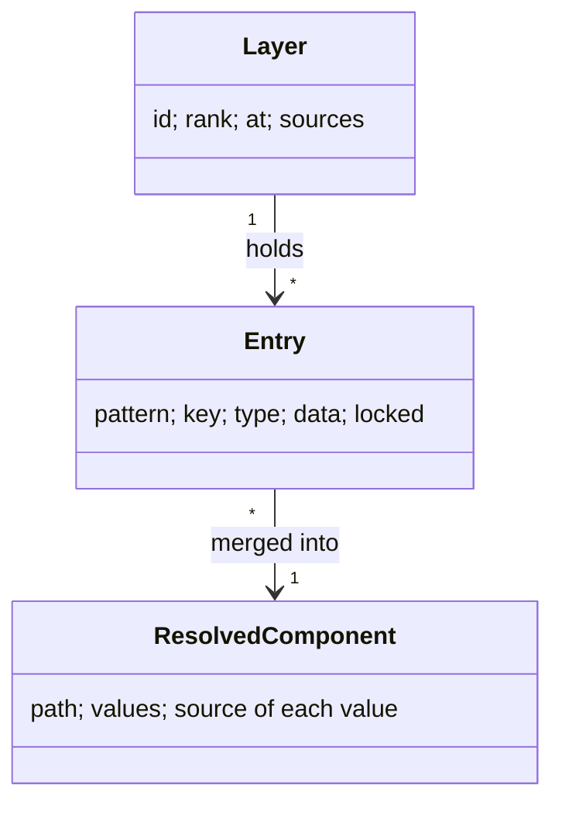

# Proposal: the component registry, a registry for agentic components

Status: proposed 2026-11-19. The design was decided piece by piece by the Operator on 2026-11-19
(section 2, ADR-0063); one point is open (section 12). Supersedes the
[personalization](personalization.md) proposal. Nothing is built.

Who this serves: the Operator, who rules on it and is its first user (a personal layer: "I'm
colour-blind, adapt diagram colours"); a consumer's maintainer, who publishes an organization or
department layer once and has every devhost pick it up; and the engineers whose agents read the
result without knowing layers exist.

The review boards (Whiteboards, private to the Operator) are the six standing documents for this
design; this file is their reviewed source:
[state](https://claude.ai/artifact/GVg1XvgHpjAHZRwJbKnjpQ),
[C4](https://claude.ai/artifact/WpPM7h7JodFqNamxbypnYL),
[workflows](https://claude.ai/artifact/8q9pn2s9jrUntEJf5mUR7Q),
[lifecycles](https://claude.ai/artifact/JBV3JnEMFqu62BWrYESe1h),
[data flows](https://claude.ai/artifact/EvaLTHSeLn2zfhr2MccNQQ),
[data inventory and models](https://claude.ai/artifact/4u4akyDoqNLbeu5Enkc5FZ).

## 1. The problem

A skill that produces architecture artifacts is written once. An organization wants it to use its
lexicon and mark every page "internal"; a department wants C4, not UML; one person needs a
colour-blind-safe palette. Today each of those is either written into the skill (a personal or
corporate taste committed to a shared repo) or said again in every session. The
[personalization](personalization.md) proposal solved one person's preferences with one file. The
need is wider: any number of owners, each publishing from wherever they keep things, for every kind
of agentic component, not only skills.

## 2. Decided by the Operator (2026-11-19)

1. **A registry for agentic components, shaped like the Windows Registry**: layers are like hives,
   paths like keys, typed values like registry values, locks like Group Policy, `resolve` like the
   merged `HKCR` view, `explain` like `regedit`. The shape is borrowed, not the Windows Registry
   itself (binary, Windows-only, two fixed hives).
2. **Layers: any number, each with one or more sources of any kind** (git, http/REST, a path or
   file share, the cloud folder, a database). Organization, department, team and person are
   examples, never fixed levels.
3. **One tree** of paths with `:key` values. Each layer's content is mounted at a path.
4. **Who wins**: the higher layer wins; inside one layer the more specific path wins; a locked key
   beats both.
5. **Who you are is a path** (`/Corp/MyDepartment/team/me`), set per person and per agent.
6. **Any component kind**: skills, agent definitions, prompts, settings, lexicons, more.
7. **Merge by value type**: `value` replaces, `list` combines (with `!` to take one out), `text`
   stacks in layer order, `ref` points at another path (and replaces). A definition is a key with
   values, so every field merges by its own type. A layer may force replace for a whole component.
8. **Query syntax**: gitignore-style paths, then `:key`; five symbols (`/`, `*`, `**`, `:key`,
   `!`); no value filters (no use case). Patterns replace the earlier facets idea.
9. **Files at the core; any backend through a source adapter** (`registry-source-<kind>`), each
   fetched into a local snapshot; an http source is accepted only when its files match a sha256
   manifest; offline, the last good snapshot is used.
10. **`resolve` and `explain`** as the two verbs; `explain --uses` answers "who uses this?".
11. **The adapter step in agents and the utility skills** (`/registry-refresh`, `/registry-explain`,
    `/registry-remember`); a refresh is picked up live where the CLI supports it.
12. **No RDF graph**: no agent tool uses RDF, and one resolved tree answers the same questions.
13. **Name**: the Feature is `component-registry`, the command `dcf-registry`.

## 3. The model



| Windows Registry | Component registry |
|---|---|
| hive (HKLM, HKCU) | layer, any number, any source |
| key `HKCU\Software\Corp\MyDepartment` | path `/Corp/MyDepartment` |
| value: name, type, data | `:key`, type, data |
| value types (`REG_SZ`, `REG_MULTI_SZ`) | `value`, `list`, `text`, `ref`: the type picks the merge rule |
| Group Policy keys | locked keys |
| `HKCR`, the merged view | `dcf-registry resolve` |
| `regedit` | `dcf-registry explain` |
| key permissions | who may write a layer (its source's own access control) |
| (no wildcards) | patterns: `/**/diagrams:color` |

### 3.1 The layer list

One file per repository, path set by `COMPONENT_REGISTRY_FILE` (default
`.devcontainer/registry.yml`), read only by the Feature. Lowest layer first:

```yaml
whoami: /Corp/MyDepartment/team/me      # per person; an agent may override it (section 12)
layers:
  - id: corp-base
    at: /Corp
    sources:
      - { kind: http, url: "https://example.invalid/registry/manifest.json", required: true }
  - id: dept
    at: /Corp/MyDepartment
    sources:
      - { kind: path, path: /mnt/dept-share/registry }
  - id: me
    at: /Corp/MyDepartment/team/me
    sources:
      - { kind: cloud-folder, remote: registry/me }
```

Several sources in one layer merge in their listed order. A layer marked `required` that was never
fetched stops `resolve`; any other unreachable source falls back to its last good snapshot and
`resolve` says so.

### 3.2 A layer's content

Plain text in each layer's source, one or more `*.reg` files, read with awk (NFR: shell tools only):

```ini
[/**/skills/diagrams]
color:value = colour-blind-safe

[/Corp/MyDepartment/lexicon]
terms:list = C4, SLA, !ADR

[/Corp/skills/architecture-artifacts]
body:text = @file skills/architecture-artifacts/SKILL.md
classification:value! = internal          ; "!" after the type locks the key

[/Corp/MyDepartment/agents/reviewer]
model:value = <model id>
skills:list = ref /Corp/skills/architecture-artifacts
```

A section header is a path or a pattern; `@file` points at a file beside the `.reg` file; a `ref`
names a path. The format is ours and small; its grammar is in the build's NOTES.

### 3.3 Precedence and merge

For one resolved key: take every line whose pattern matches it, from every layer. Order by layer
(higher wins), then by specificity inside a layer (more fixed path names wins), and apply the
value type's rule: `value` and `ref` keep the winner, `list` combines in that order applying `!`,
`text` stacks in layer order. A locked key stops at the layer that locked it: a higher layer's line
for it is refused, and `explain` names the lock. A layer may write `!replace` on a section to drop
everything below it for that component.

## 4. Source adapters

Same shape as the agents Feature's CLI adapters (`agent-adapter-<cli>`): one executable on `PATH`
per source kind, installed by the Feature that owns the transport.

```
registry-source-<kind> fetch <layer> <dest> key=value...   write the layer's files into <dest>
registry-source-<kind> version <layer> key=value...        print an etag, commit or digest
registry-source-<kind> supports                            the verbs it implements
exit codes: 0 done, 1 failed, 2 bad use, 3 not supported (the Feature falls back)
```

| Kind | Installed by | Notes |
|---|---|---|
| `git` | component-registry | clone or pull a pinned ref |
| `http` | component-registry | HTTPS only; a `manifest.json` lists files and sha256, every file must match; token from OpenBao through `dcf-secret`, never a file |
| `path` | component-registry | a folder; a file share is mounted on the host by the launcher (`DCF_HOST_*`), never SMB in the container |
| `cloud-folder` | cloud-folder | uses its existing rclone modes |
| `db` | a later slice | one more kind; the resolver does not change |

## 5. The verbs

- `dcf-registry resolve [--as <path>]`: fetch (each adapter, `version` first so an unchanged layer
  is skipped), merge (section 3.3), check locks and refs, write the resolved view (tier 4), hand
  each component kind to its consumer. A broken lock refuses that component; the last good copy
  stays.
- `dcf-registry explain <path> [--uses]`: read-only. Every line of a resolved component with the
  layer it came from; each source's state (fetched, or offline with the snapshot's date); refs that
  point at nothing; `--uses` lists what refers to the path.

## 6. Consumers: the adapter step

At an agent's start the agents Feature runs `resolve`, then hands over:

- **skills**: a new optional CLI adapter verb, `agent-adapter-<cli> skills <name> <folder> --from
  <dir>`, copies them into the CLI's own skills folder (Claude: `$CLAUDE_CONFIG_DIR/skills/`, a
  volume). Never the repository's `.claude/skills`: a resolved skill can carry personal facts.
  Claude ranks personal skills above project skills, so a resolved copy wins a name clash. The
  adapter creates the folder even when empty, so later changes are seen live. An adapter that
  answers exit 3 leaves the plain skills and says so.
- **agent definitions**: read by the agents Feature itself.
- **prompts, settings, lexicons**: each kind names its consumer in the build; until then
  `dcf-registry explain` and the resolved view are how they are read.

Utility skills, shipped by the Feature in its own base layer:

| Skill | Does |
|---|---|
| `/registry-refresh` | `resolve` now; Claude picks up changed skill files in the running session (documented); another CLI gets the files and a note that it needs a restart |
| `/registry-explain <path>` | `explain`, shown to the person |
| `/registry-remember <line>` | appends a line to the person's own layer source, then refreshes |

A skill already used in a conversation keeps its old text until it is used in a new conversation;
`/registry-refresh` says so.

## 7. Data, sensitivity and trust

- A resolved component, a snapshot and `explain` output are as sensitive as their most sensitive
  input. A personal layer may hold health facts (colour blindness), so resolved output is personal
  data: never committed, never in the checkout, owner-only modes.
- Cons and backs get resolved components, never raw layers or other people's layers.
- An http layer is instructions fed to agents: HTTPS, a sha256 manifest, a token from OpenBao. A
  mismatch refuses the layer.
- A layer is written only through its own source (a pull request, a share, the cloud folder);
  the container writes only the person's own layer (`/registry-remember`).

## 8. Placement (NFR-13)

| Element | Layer it belongs in | Why |
|---|---|---|
| layer list, resolve, explain, `git`/`http`/`path` sources, utility skills | new Feature `component-registry` | manages the agent's environment (its skills, its definitions), not a CLI capability |
| `cloud-folder` source | `cloud-folder` Feature | it owns the transport |
| `skills` adapter verb | each CLI Feature's adapter (`claude-code` first) | where the CLI's skills folder lives is a CLI fact |
| calling `resolve` at start, reading agent definitions | `agents` Feature | it already owns the start sequence |
| file-share host mount | the launcher (`devcontainer-cli`, `DCF_HOST_*`) | host mounts live there |

NFR-12 (two vendors or a named fallback): Claude's adapter first; any other adapter answers exit 3
and the agent starts with its plain skills, saying so.

## 9. Changes to the six standing documents (deltas)

Applied in the pull request that builds each slice, not by this proposal.

**State of the Architecture**: a new row.

| Element | State | Builds on |
|---|---|---|
| component-registry Feature (resolve, explain, source adapters, utility skills) | proposed | agents CLI adapters, cloud-folder |

**C4 Models** (container view): two containers and their relations.



**Workflows**: an agent's start gains two steps; a refresh flow is new.



**Lifecycles**: two new state machines.



**Data Flows**: layer sources, through source adapters, to snapshots, to the resolved view, to
consumers; the person's own layer is the only one written from the container.



**Data Inventory and Models**: rows and the model.

| Data | Where | Source | Tier | Sensitivity | Lost with the machine? |
|---|---|---|---|---|---|
| Registry list | `.devcontainer/registry.yml` | git | 1 | public | no |
| A layer's `.reg` files | its source | any | 1, 2 or 3 by owner | internal; a personal layer is personal | no |
| Snapshots | named volume, one folder per layer | fetched | 4 | as its layer | refetched |
| Resolved view | named volume | resolve | 4 | as its most sensitive input | rebuilt |



## 10. Slices

1. **Core**: the Feature, the layer list, `.reg` parsing, the four value types, patterns, precedence,
   locks, `resolve` and `explain` (`--uses`), sources `git` and `path`. Tests on fixture layers.
2. **Adapter step**: the `skills` verb in `agent-adapter-claude`, `resolve` in the agents start
   sequence, the three utility skills.
3. **Remote sources**: `http` with the manifest and the OpenBao token; `cloud-folder` in the
   cloud-folder Feature.
4. **First real use**: split the `architecture-review` skill into a base layer and this
   repository's layer, and check the resolved skill matches today's.
5. **Later**: the `db` source; agent definitions read from the registry.

## 11. Relation to other work

- Supersedes [personalization](personalization.md): the one preferences file becomes one person's
  layer.
- [Task aliases](task-aliases.md) keep their own team and personal files; they could become a
  component kind later, not in this proposal.
- The lexicon keeps "layer" for the theme layers (the bar); here the word is always "registry
  layer" in prose that could be confused.

## 12. Open questions

1. **How each layer owner reviews changes** before they take effect. Recommended: a pull request in
   the owner's own git repository, published read-only through a source.
2. **An agent's own path** (`whoami` per agent): a key in the agents list entry, or a registry
   value under the agent's definition. Recommended: the agents list entry, so the list stays the
   one place an agent is defined.

## Architecture review (2026-11-19)

**Verdict:** fit with changes

Requirements (NFR), one line each. Met: NFR-3 (no build-time download; the runtime fetch is not
the build-time rule of ADR-0034), NFR-4 (no official Feature to order after), NFR-11 (the tool is
not a linter), NFR-13 (placement in section 8 is right, see finding 5). Needs the proposal to say
it: NFR-1 (section 9 says "named volume" but not `/var/lib/devcontainer-features/component-registry`,
`containerEnv` and `component-registry-setup`), NFR-2 (no tasks named; `resolve` and `explain` need
registered tasks with a `desc`), NFR-5 (`resolve` and setup idempotent: not stated), NFR-8 and
NFR-10 (slice 1 tests fixtures; the scenario per option and the two-fake-adapter contract test of
NFR-12 are not named). Not met: NFR-6 (finding 3), NFR-9 (finding 5), NFR-12 (finding 2).

### Findings
1. **The `.reg` grammar and the match rule are not specified enough to build (section 3.2, 3.3).**
   Section 3.2 defers the grammar to "the build's NOTES", but the proposal leaves open: how a
   section header relates to the layer's `at` (the examples are absolute while a layer is mounted at
   a path); how "who you are" selects lines (is a line applied when its path is an ancestor of the
   `whoami` path?); "more fixed path names wins" when `**` is involved; three meanings of `!` (list
   removal, a lock after the type, `!replace` on a section); `skills:list = ref ...` mixes two
   types; the same key with different types in two layers; whether a refused line fails the
   resolve or is ignored; and how a skill with more than one file (references, scripts) is
   carried when `body:text` holds one `@file`. Recommended change: write the grammar (ABNF or a
   table) and one worked resolve of the section 3.2 example, with the match rule and a tie-break
   order, into the proposal or a first-slice spec before the Operator rules.
2. **The `skills` adapter verb has no row in the capability matrix, so NFR-12 is only half shown
   (section 6, 8; agents-v2 section 14.1).** The matrix has no skills-folder capability for any
   CLI. The exit 3 fallback is named (plain skills, said so), which meets NFR-12's letter, but the
   claim that Claude ranks personal above project skills, and that a created-empty folder is watched
   live, are CLI facts without a source, and Copilot reading `.claude/skills` is unchecked. The verb
   `skills <name> <folder> --from <dir>` also differs in shape from the optional verbs in
   `src/agents/NOTES.md` (`<verb> <name> <folder>`), and amends the contract of ADR-0037.
   Recommended change: add a "skills folder" row (and the precedence and live-reload cells, with
   their sources) to the matrix, make `skills` a `supports` verb, and name ADR-0037 and
   `src/agents/NOTES.md` as amended in ADR-0063.
3. **`whoami` sits in a committed shared file (section 3.1; NFR-6; ADR-0045 tier 1).** The example
   puts `/Corp/MyDepartment/team/me` in `.devcontainer/registry.yml`, which is tier 1 and shared,
   while the proposal says it is "per person". NFR-6 wants settings as options or plain variables
   (CLI, then `.env`, then environment). Recommended change: take `whoami` from a variable
   (`COMPONENT_REGISTRY_WHOAMI`, `.env` or the launcher), keep the yml for layers only, and let
   the agents list entry override it per agent (open question 2).
4. **A personal layer's data tier is unstated (sections 7, 9; ADR-0045, ADR-0049).** The inventory
   says a layer is "1, 2 or 3 by owner", and the personal layer's example source is `cloud-folder`
   (tier 2, shared), yet it may hold health facts. ADR-0045 keeps tier 3 out of the mounts by
   default. Also not in the inventory: the resolved skill copies in the CLI's own volume
   (`claude-code`, tier 4), the `explain` output, and the OpenBao token path (data flows show no
   secret edge). Recommended change: state that a personal layer lives in tier 3 or in a tier 2
   folder the person alone can read, add the skills-folder copies and the `dcf-secret` edge to
   the inventory and data-flow deltas, and name the token's secret path.
5. **No statement of why not the CLI's own distribution (NFR-9, NFR-13; section 8).** Claude Code
   already has plugins, marketplaces and managed settings with their own scope order. The
   placement is right (skills hand-over in the adapter, start in agents), but the proposal never
   says what is added over them (many sources, merge by type, locks, `explain`), and the
   `settings` and `prompts` kinds come close to re-implementing the CLI's settings merge. Recommended
   change: add the one paragraph NFR-9 asks for, and limit the first release to skills and agent
   definitions, with `settings` deferred until the CLI's own merge is compared.
6. **Trust of an http layer is weaker than stated (sections 4, 7).** The `manifest.json` comes from
   the same host as the files, so a sha256 match proves only transfer, not origin; the layer is
   instructions fed to agents and may carry tool permissions. Recommended change: pin the
   manifest's digest in the layer list, or have the owner sign it (the `sign-packet` Feature
   exists), and say a layer may not carry permission or `allowed-tools` settings.
7. **Mermaid blocks have defects (section 9).** The `classDiagram` puts members on one line with
   semicolons (`class Layer { id; rank; at; sources }`), which is not valid member syntax; each
   member needs its own line. The `stateDiagram-v2` joins two unrelated machines in one block with
   two `[*]` starts and an unused `state ... as rc`. `registry-source-&lt;kind&gt;` in a flowchart
   label may render literally; use `#lt;kind#gt;` or avoid angle brackets. Recommended change: fix
   the class members, split the state diagram into a layer-change machine and a resolved-component
   machine (add an offline-snapshot state), and replace the escapes.
8. **Source adapter collides with the lexicon (LEXICON "CLI adapter", "Snapshot").** The lexicon
   says "adapter" is used only for the CLI adapter; `registry-source-<kind>` is called a "source
   adapter" (decision 9, section 4). "Snapshot" is already the OpenBao raft file. "Layer" collides
   with the bar and life layers (section 11 handles it). Needs terms: registry layer, registry source,
   resolved view, lock, who-you-are path (`whoami`), `.reg` file. Recommended change: call the
   executables "registry sources" (a `registry-source-<kind>` executable), call the local copy a
   "layer copy", and ask the librarian for the six terms; the component-registry ontology id
   already exists.
9. **ADR-0063 is accepted ahead of this review and drifts from the proposal.** ADR-0039 puts the
   architecture review before the ruling; the ADR already says accepted. The ADR says agent
   definitions go to the agents Feature, while slice 5 defers them; it omits the open questions
   and the amendment of ADR-0037. No accepted ADR is otherwise contradicted (ADR-0036, 0037, 0045,
   0048, 0060 are consistent). Recommended change: keep the ADR proposed until the Operator
   rules, and align its item 8 with slice 5.
10. **Standing documents: the state, C4, workflow, lifecycle, data flow and inventory deltas are all
    present (section 9), good, but two are thin.** The state row lacks the supersession of the
    personalization row at state-of-the-architecture line 78; the C4 delta lacks the host launcher
    (file-share mount) and OpenBao; the workflow shows no refused-lock or offline path. Recommended
    change: add the personalization row change, the two C4 relations and an alt branch for lock
    refusal and offline fallback.
11. **Smaller gaps.** A skill the layers drop leaves a stale copy in the skills folder; two
    concurrent resolves can race on the folder; the `git` source's credentials are not named
    (OpenBao through `dcf-secret`, like `http`). Recommended change: say `resolve` writes to a
    temporary folder and swaps it in, and removes copies it owns that no layer still names.

### Open questions for the Operator
- Should the first release ship skills only (recommended), with agent definitions, prompts and
  settings later, so the design does not duplicate the CLI's own settings layering?
- Where does a personal layer with health facts live (recommended: tier 3, or a private tier 2
  folder), given ADR-0045 keeps tier 3 unmounted by default?
- Keep ADR-0063 accepted now, or move it back to proposed until this review's changes are made
  (recommended: proposed)?
- Review of changes (open question 1) and an agent's own path (open question 2): the proposal's
  recommendations are sound; the review agrees with both.
