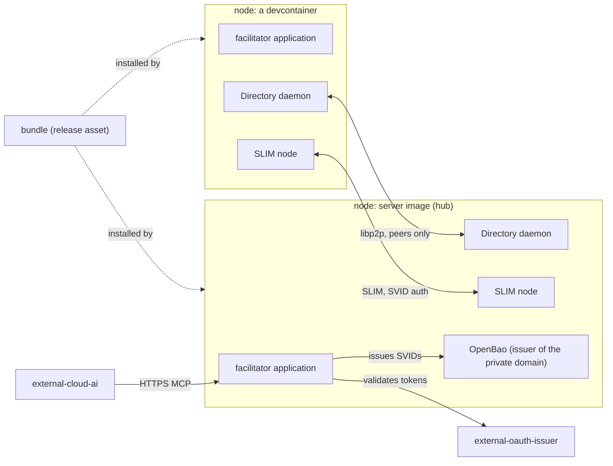
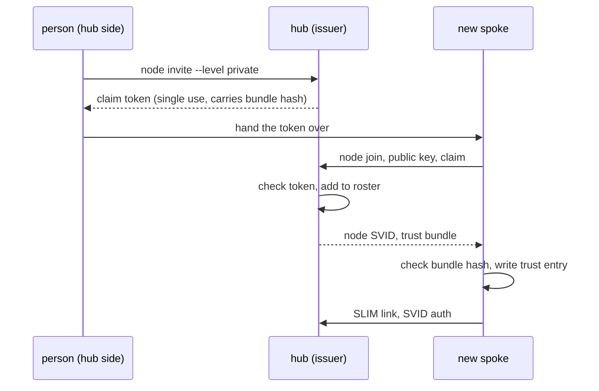
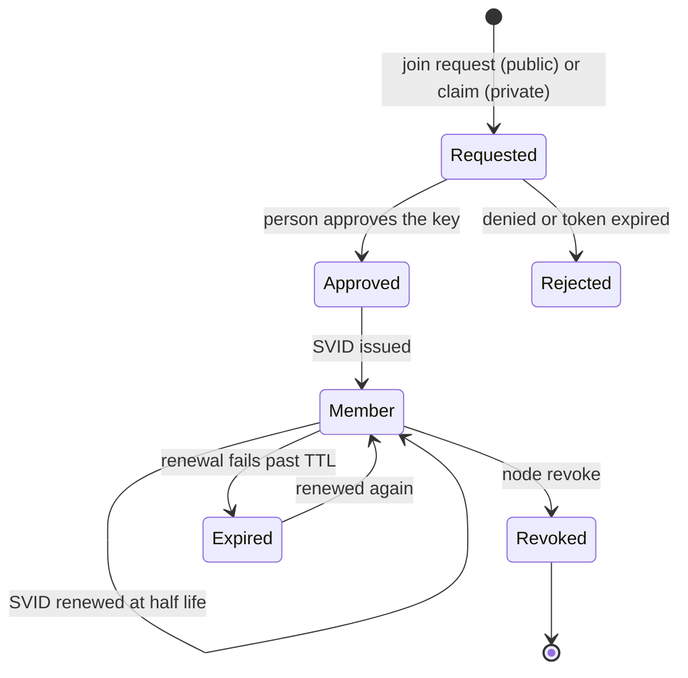

# Proposal: the facilitator as a node in a network of nodes, with trust levels

Ruled 2026-11-20

Status: ruled by the Operator on 2026-11-20 (section "Ruling", below); the design sections record
the design to build, and nothing is built. Backlog id: `facilitator-container`. It serves the
Operator, through the host, who ruled on every point; and the people who will run facilitator
nodes: an engineer's devcontainer, an organisation's intranet hub, a public node. It extends
[facilitator-agent](facilitator-agent.md) (ruled 2026-11-19; its "networking across containers is a
separate, later requirement" is this proposal) and [ADR-0061](../adr/0061-the-facilitator-is-built-on-agntcy-first-with-the-mcp-split-in-two-and-the-agents-feature-moves-into-a-shared-participant-component.md),
[ADR-0062](../adr/0062-sign-packet-register-engine-and-packet-relay-move-here-from-aof-and-each-carries-its-own-copy-of-the-signing-library.md)
and [ADR-0066](../adr/0066-the-facilitator-is-reached-only-through-mcp-and-only-a-person-s-continue-resets-the-hop-count.md)
stand. Facts are marked **(docs read)** when a page was read for an earlier note, **(spike)** when
run in [the first spike](../spikes/2026-11-19-agntcy.md), **(code read)** when read in `src/facilitator`
0.2.0 for this proposal, and **(not checked)** when none of those. This proposal ran nothing. A second
spike, [SLIM with SPIFFE and two linked containers](../spikes/2026-11-2x-slim-spiffe.md), is **in
progress** and settles most "not checked" marks in sections 5 and 6 (slice N1, section 13).
Slices here are named N1 to N5 so they are not confused with the slices 0 to 7 of facilitator-agent.

## 1. The ask

The Operator, 2026-11-20: the facilitator becomes "nodes in a network topology". "The devcontainer
feature is a node, and then there could be another devcontainer and they connect, either peer to
peer or hub spoke with an external 3rd node hosting as primary." Ideally "a mesh, with levels of
trust for different nodes ... treat a public node more strictly than a private node that's in the
intranet, and have an unrestricted node running in your local docker environment."

Also asked: a server image (a node that is a container of its own, not a devcontainer), and one
base package that both the Feature and the image install, so that nothing is built twice.

What exists today **(code read)**: `facilitator` 0.2.0 is one node with no network face. Every
daemon binds loopback: the Directory on 8888 (gRPC), 5555 (OCI), 8999 (libp2p, set to loopback in the
config template) and 8889 (HTTP gateway), the SLIM node on 46357. The guard, router, directory
client, signer and transport are modules of one Python application (`guard.py`, `router.py`,
`directory.py`, `signer.py`, `transport.py`). Participants reach it by stdio MCP in the same
container. Hop, budget and rate limits are global settings. There is no notion of another node, a
peer, a trust level or a remote client.

## 2. Ruling (2026-11-20), recorded in full

**Z1, the base package: C.** One built **bundle** per architecture: the facilitator application, its
venv, `dirctl` and `slimctl`, with its own `SHA256SUMS`. It is built in CI by **one portable install
script** (option B's script, which is today's `install.sh` freed of devcontainer assumptions). The
devcontainer Feature and the server image both download and verify that bundle. DSC v3 (the `dsc`
Feature, Microsoft DSC v3) may come later as an optional wrapper for Windows hosts. Options weighed:
A, a DSC v3 configuration; B, one portable script; C, the bundle built by B's script and used by both.

**Z2, how agents reach a node: both.**
- Local CLIs keep the thin client: stdio `facilitator mcp`, talking to the node's SLIM and Directory
  over the network, signed and encrypted. Keys stay with the agent's side.
- Cloud AIs, and any client that only speaks remote MCP, use MCP over HTTP from the node (MCP's
  Streamable HTTP, with OAuth). The node signs on their behalf, and the record states it ("via HTTP,
  authenticated by OAuth"). They get the public trust level by default.

**Z3, topology is configuration.** Every install is a node with `role: standalone | peer | spoke |
hub` and either a peers list or a primary. Hub-and-spoke comes first, then peer-to-peer, with no code
change to switch. A hub is just a well-known peer.

**Z4, a mesh with trust levels.**
- Three built-in levels as tunable policy profiles: **local** (unrestricted), **private** (trusted,
  intranet) and **public** (strict).
- Per-agent exposure: each agent has the widest level it may be reached from.
- Public is deny-by-default: visible only to agents marked public; first contact needs a person's
  approval; lower hops, budget and rate; only messages addressed to it are copied; it joins only by
  key plus explicit approval, and can be cut off.
- Private sees private and public agents and gets copies of the conversations it is in. Local is
  unrestricted, with full copies.
- Build order: local and private first, public last.

**Z5, configuration.**
- SPIFFE is the one identity standard: each trust level is a trust domain, nodes and agents have
  SPIFFE IDs, and trust domains federate. SLIM already supports SPIFFE.
- Permissions are the facilitator's own small rules, written in SPIFFE IDs, in one file, `mesh.yml`,
  with the sections `preset`, `trust` (SPIFFE trust domains mapped to levels), `expose` (agent mapped
  to its widest level) and `limits` (per level).
- Presets: **solo** (only this machine), **team** (plus your intranet domain), **open** (plus named
  public domains, strict).
- No other standard is added. WireGuard, Tailscale and libp2p were only examples of the pattern; the
  AGNTCY Directory (already chosen) uses libp2p for discovery.

**Why the three layers fit many nodes** (the Operator's reasoning): the Directory finds records across
peers; SLIM nodes route to each other with auth and group encryption; register-engine registers merge
without conflicts across machines, and every packet is signed so a node can check where a message
came from.

## 3. Concepts and names

| Term | Meaning |
|---|---|
| **Node** | One running facilitator: the application, its Directory daemon, its SLIM node, its register store, its identity. A devcontainer with the Feature is a node; so is a container of the server image. |
| **Role** | `standalone` (no peers), `peer` (a peers list, symmetric), `spoke` (one primary), `hub` (a well-known peer that accepts spokes). Only configuration (section 4). |
| **Bundle** | The built, checksummed package of one release and one architecture: application, venv, interpreter, `dirctl`, `slimctl` (section 6). |
| **Trust level** | `local`, `private` or `public`: a policy profile (section 8). |
| **Trust domain** | A SPIFFE trust domain: the namespace one issuer vouches for. Each trust level has one or more; a domain maps to exactly one level in `mesh.yml`. |
| **SVID** | A SPIFFE Verifiable Identity Document: here an X.509 certificate whose URI SAN is the SPIFFE ID, short-lived, issued per node and per agent. |
| **Exposure** | The widest level an agent may be reached from. |
| **First contact** | The first message from an agent the receiving node has not approved; held until a person approves. |
| **Preset** | `solo`, `team` or `open`: a ceiling on which levels `mesh.yml` may use, and the default limits. |
| **Leaf client** | A thin client (`facilitator mcp`) on a machine that runs no node, which connects to a node over the network and signs with its own key. |
| **HTTP client** | A cloud AI or any remote-MCP client that reaches a node over MCP Streamable HTTP; the node signs for it. |

Needed in the lexicon (the librarian): node, role, bundle, trust level, trust domain, SVID, exposure,
first contact, preset, leaf client, HTTP client, mesh. The word "adapter" stays as in facilitator-agent
section 3 (no reuse).

## 4. The node and its roles

```
 +----------------------------- node  (a devcontainer, or the server image) -----------------------------+
 |                                                                                                       |
 |  participants (stdio MCP, same container)          facilitator application                            |
 |   claude, copilot, local model, a person  ---->    intake -> guard -> router -> dispatcher -> collect  |
 |                                                     mesh (policy)   identity (SVIDs)   peers (sync)   |
 |   leaf clients (other machines) ---- SLIM -------->  http (MCP Streamable HTTP, OAuth)  [optional]     |
 |   cloud AIs ------------------------ HTTPS ------->  signer   record (register-engine)                |
 |                                                                                                       |
 |  infrastructure the Feature or image starts:  dirctl daemon   SLIM node   (OpenBao is the key store)  |
 +-------------------------------------------------------------------------------------------------------+
        |  SLIM (auth per level)        |  Directory (libp2p, peers only)
        v                               v
   other nodes (peers, a hub, spokes)
```

New modules beside the 0.2.0 ones, each small: `mesh` (reads `mesh.yml`, answers "may X do Y", the one
policy point), `identity` (gets, renews and checks SVIDs and trust bundles), `peers` (the peers list,
sync of registers and records, liveness) and `http` (the MCP endpoint and OAuth, slice N4). Everything
else keeps its name and gains a call to `mesh`.

### 4.1 Roles are configuration

`facilitator.yml` gains a `node:` section (the application's own settings stay there; policy is in
`mesh.yml`, section 7):

```yaml
node:
  id: laptop-nb              # a stable name, letters digits and -; default: the hostname
  role: spoke                # standalone | peer | spoke | hub
  primary: hub.corp.example:46357         # spoke only: the one hub it dials
  peers: []                  # peer or hub: the nodes it dials or accepts (hub: optional seed list)
  listen: null               # null = loopback only. hub or peer: an address for SLIM, e.g. 0.0.0.0:46357
```

| Role | Dials | Accepts | Sees |
|---|---|---|---|
| `standalone` | nobody | nobody (loopback only) | its own agents; today's behaviour |
| `spoke` | its `primary` | nobody | its own agents, plus what its primary's policy lets it reach through the hub |
| `hub` | its `peers`, if any | spokes and peers (needs `listen`) | everything it is entitled to under `mesh.yml`; relays between spokes |
| `peer` | each entry of `peers` | other peers (needs `listen` when it is to be dialled) | the same as a hub toward each of them, no relaying |

Hub-and-spoke and peer-to-peer are the same mechanism with different lists:

```
 hub and spoke (first)                       peer to peer (later, no code change)
        hub                                    A ----- B
       / | \                                   | \   / |
      s1 s2 s3     s1 reaches s2 via hub       |   C   |      every node lists the others
                                               +-- D --+      a hub is a peer everyone lists
```

A hub holds no more rights than its policy gives it: it routes SLIM traffic, whose group sessions are
end-to-end encrypted between their members **(spike: the node never saw the app secret; hub relaying
not run, not checked)**, and it holds replicas only of the conversations it is entitled to (section 10).
Changing a spoke into a peer is changing `role` and the lists; changing a mesh from one hub to
several is adding entries.

A hub is a single point of failure for spoke-to-spoke traffic (section 12). Recommended, as a later
refinement and not in the first build: `primary` may be a list, tried in order.

## 5. Identity: SPIFFE

### 5.1 Shape of the IDs

```
 spiffe://<trust-domain>/node/<node-id>                       a node
 spiffe://<trust-domain>/node/<node-id>/agent/<handle>        an agent or person on it
 spiffe://<trust-domain>/node/<node-id>/http/<client>         an HTTP client the node signs for (N4)
```

The trust domain is a DNS-like name; `mesh.yml` maps each one to a level. Examples (invented):
`laptop-nb.local` (local), `corp.example` (private), `open.example` (public).

- Every node has a **home domain** it issues for itself. When it is `standalone` or a `spoke` that has
  not joined anything, the home domain is `<node-id>.local`, self-issued, level local (always: the
  node's own domain cannot be mapped to another level).
- A node also holds one **SVID per domain it has joined**: a spoke of the corporate hub holds one in
  `corp.example`. Its agents get an SVID in each domain they are exposed to, issued by that domain's
  issuer.
- The level of a message is the level of the **domain of the signer**, taken from the verified SVID,
  never from anything the sender claims.
- A conversation's **origin level** is the strictest (widest) level of any packet in a message's
  lineage (`reply_to` chain); it is signed into the packet's `data`, so a public message that a
  private agent answers keeps the public limits down the chain (section 9).

### 5.2 Where keys and SVIDs come from

| Option | For | Against |
|---|---|---|
| **A. OpenBao's PKI engine as the issuer** (one CA per trust domain; X.509 with a URI SAN; short TTL) | already the repository's key store (ADR-0048); `openbao` has a server mode; a hub's image can run beside one; no new daemon | not SPIRE: no workload attestation and no Workload API; whether SLIM's SPIFFE mode can use plain certificate files is **not checked**; whether OpenBao issues ed25519 with a URI SAN is **not checked** |
| **B. A SPIRE server (and agent) per issuing node** | the reference implementation; the Workload API, rotation and federation are built; SLIM's SPIFFE mode very likely expects it | two more daemons and a database for every hub; heavy for a laptop; a new operational skill for the engineer |
| **C. Self-issued by the node for local only** | zero dependencies; offline | a self-signed domain cannot federate; fine for the local level only |

**Recommendation: A for private and public, C for the local domain, B as the named fallback if the
spike finds SLIM's SPIFFE mode needs the Workload API** (then a hub runs SPIRE as its issuer, and
nodes keep the same IDs and the same `mesh.yml`). One recommendation, with its trigger written down.
The local domain is the node's own CA key, kept in OpenBao when a vault exists and in the state volume
otherwise (the same fallback the 0.2.0 keys have).

- **Federation** is trust bundles: each domain's CA certificate set, as a file in the SPIFFE bundle
  format. A node holds the bundles of the domains in its `trust` section. Bundles are exchanged at join
  and refreshed from the peer over the authenticated link.
- **Lifetimes** (proposed, tunable per level in `limits`): local 24 h, private 24 h, public 1 h.
  Renewal at half the lifetime. Short lifetimes are the revocation mechanism (section 12).
- **The signing key.** The agent's sign-packet identity key and its SVID key are the same ed25519
  key, so a packet's signature is checkable against the SVID that names the signer. Whether
  sign-packet takes the key as it stands (it is read through an ssh-agent today, **code read**) is a
  slice N3 question; the fallback is a roster entry that binds the sign-packet key to the SPIFFE ID
  and is countersigned by the issuer.

### 5.3 Joining a domain

```
 hub (issuer of corp.example)                         new spoke
   facilitator node invite --level private  ------>  claim token (single use, 15 min, carries the
   (a person runs it; ADR-0052's claim-token          hash of the hub's trust bundle: no trust on
    pattern, not re-read here)                        first use)
                                                     facilitator node join <hub> --claim <token>
   issues node SVID, adds node to the roster  <----  presents its public key
   returns trust bundle, signed by the hub      ---> checks the hash; writes mesh.yml `trust` entry
```

Public: no claim token. The joining node sends a **join request** (its public key and node id, a file
or a URL); a person on the issuing side runs `facilitator node approve <request>`; only then is an SVID
issued (section 8.3). A leaf client joins the same way as a node, with a claim token the person made
for a handle.

## 6. The bundle pipeline and the server image

### 6.1 The bundle

```
 bundles/facilitator/install.sh   (one portable script: --prefix <dir> --arch <amd64|arm64>
        |                          --assets <dir> for offline builds; no devcontainer assumptions)
        v  CI, per architecture (matrix: amd64, arm64)
 /opt/facilitator/   bin/facilitator  bin/dirctl  bin/slimctl
                     python/  (python-build-standalone, pinned, checksummed)
                     venv/    (slim-bindings from its hashed wheel; the app; no index at install time)
                     lib/     registerengine/ signpacket/ types.d/ agntcy/ templates
                     MANIFEST.json  (component versions and the sha256 of each upstream download)
        |  tar + SHA256SUMS + build attestation
        v
 GitHub release asset  facilitator-<version>-linux-<arch>.tar.gz   +   SHA256SUMS
        |                                    |
        v                                    v
 devcontainer Feature install.sh        server image build (multi-stage)
 (downloads, verifies, extracts to /opt/facilitator, adds hooks, Taskfile, volume, symlinks)
```

What the script is: today's `src/facilitator/install.sh` with the devcontainer parts removed (the
`containerEnv`, the Taskfile registration, `facilitator-setup`, the apt calls for Python, the
`DESTDIR` test switches turn into `--prefix`). It keeps what is already right **(code read)**: the
pinned SHA-256 of `dirctl`, `slimctl` and the `slim-bindings` wheel per architecture, `pip
--require-hashes`, checks before use. Every build-time download goes through the vendored `dcf-curl`
(ADR-0034).

Choices recorded, for the Operator to confirm:

- **Bundle the interpreter** (python-build-standalone, pinned and checksummed). A venv is not
  relocatable, and 0.2.0 needs a system Python 3.11 and glibc **(code read)**. A bundled interpreter at
  the fixed prefix `/opt/facilitator` makes the bundle run on any glibc Linux with nothing installed.
  Cost: about 40 MB more **(not checked)**. musl stays unsupported (the pinned `slimctl` and wheel are
  the gnu and manylinux builds, **spike**).
- **Where the script lives:** a new top-level folder `bundles/facilitator/`, not `components/`
  (components are vendored into Features and never published) and not `src/facilitator/` (it would
  then not be portable to the image build without the Feature).
- **Size:** `dirctl` alone is 198 MB for amd64 **(spike)**; the bundle is large (compressed size
  **not checked**). The Feature's volume or a build cache must not download it on every rebuild; the
  Feature caches the tarball in its state volume by checksum.
- **Verification (NFR-3).** The Feature pins the bundle's SHA-256 in `digests.txt` (the pattern
  `src/dsc` uses) per version and architecture, and `SHA256SUMS` is checked against it. Upstream
  provenance is recorded in `MANIFEST.json` and in a GitHub build attestation on the asset, because
  `dirctl` publishes no checksum file (verified through the release API digest and its SLSA provenance,
  **spike**). The risk this creates is in section 14.
- **The release is the Operator's.** The bundle is published by the manual release workflow, before
  the Feature that pins it; an agent says a release is due and never runs it (CLAUDE.md).

What the Feature's `install.sh` keeps: the options, the `facilitator-setup` and `facilitator-start`
hooks, the Taskfile, the state volume (NFR-1), `dependsOn`/`installsAfter` on `sign-packet`,
`register-engine` and `ssh-agent` as today. DSC v3, later and optional: a `dsc` configuration that
runs the same install script on a Windows host (WSL) for people who do not use devcontainers; it
wraps the script and adds no logic **(not designed here; not checked whether `dsc` on Windows fits
a Linux bundle)**.

### 6.2 The server image

A node that is a container of its own, for an intranet hub or a public node.

```
 ghcr.io/<owner>/facilitator-node:<version>      (multi-arch manifest: amd64, arm64)
   FROM debian-slim (glibc)              non-root user `facilitator`, no shell login
   COPY bundle (verified in a build stage by SHA256SUMS, then discarded)
   ENTRYPOINT tini -- facilitator node run          (new: runs dirctl, slimctl and `serve` in the
                                                     foreground, stops all on a signal, exits non-zero
                                                     when one dies; the container is the supervisor)
   VOLUME /var/lib/devcontainer-features/facilitator      (NFR-1: the same path as the Feature)
   CONFIG /etc/facilitator/facilitator.yml  /etc/facilitator/mesh.yml   (mounted read-only)
   HEALTHCHECK facilitator status --format json
   EXPOSE nothing by default (the `listen` setting opens SLIM; `http.listen` opens MCP)
```

- Secrets reach it as files or an environment (an OpenBao AppRole, or the issuing CA key as a mounted
  secret); never baked in. A hub that issues SVIDs runs beside an OpenBao container; a sample
  `compose.yml` with the two ships in the Feature's NOTES (**not tested yet**).
- One process tree per container, one node per container. No docker socket, no privileged mode.
- The image is built and tagged by the release workflow from the already released bundle, by digest.
- The same `facilitator` command runs the Feature and the image; the Taskfile is for the Feature
  only (NFR-2 applies to Features, and the image has no Taskfile).

## 7. `mesh.yml`

One file, `.devcontainer/mesh.yml` (path `MESH_FILE`, NFR-6), committed in a devcontainer repo, mounted
in the image. Four sections and nothing else.

```yaml
preset: team                       # solo | team | open          default: solo
trust:                             # SPIFFE trust domain -> level
  corp.example: private
  open.example: public             # not allowed by `team`: `check` refuses it
expose:                            # agent -> the widest level it may be reached from
  domain-expert-one: private
  jester: public
  "spiffe://corp.example/node/hub-1/agent/triage": private      # a full ID also works
  "*": local                       # default for any agent not listed
limits:                            # per level; each key overrides the preset's value
  public:
    hops: 2
    rate: 3
```

| Section | Keys | Rules |
|---|---|---|
| `preset` | one of `solo`, `team`, `open` | a **ceiling and a set of defaults**: `solo` allows only the local level; `team` allows local and private; `open` allows all three. `check` refuses a `trust` entry above the ceiling, so lowering the preset cuts links on the next start |
| `trust` | `<trust-domain>: local\|private\|public` | the node's own home domain is implicitly local and cannot be remapped. A domain not listed is **refused, not public**: public is a named, strict level, not "everyone else". The domain `http.<home domain>` (the node's own HTTP clients, N4) is mapped to `public` by every preset unless the file says otherwise |
| `expose` | a handle, or a full SPIFFE ID, mapped to `local\|private\|public`; `"*"` is the default | the **widest** level an agent may be reached from. Levels order local (narrowest), private, public (widest). Default `"*"` is `local`: an agent opts outward, never inward |
| `limits` | per level, any of the keys below | each key overrides the preset's value for that level |

The reach rule, the one sentence the rest depends on: **a caller whose domain is at level L may see
and message an agent whose exposure is E only when E is at least as wide as L** (E >= L in the order
local < private < public). So a local caller reaches everything; a private caller reaches agents
exposed private or public; a public caller reaches only agents exposed public.

```
                      agent exposure:    local     private    public
   caller level  local                    yes        yes        yes
                 private                  no         yes        yes
                 public                   no         no         yes     (and, first contact: a person approves)
```

`limits` keys, with proposed defaults (design values, not measured):

| Key | local | private | public | Meaning |
|---|---|---|---|---|
| `hops` | 6 | 6 | 2 | participant-to-participant deliveries since the last person's `continue` (today's `hopLimit`) |
| `budget` | 40 | 40 | 10 | messages per conversation between two `continue` (today's `messageBudget`) |
| `rate` | 10 | 10 | 3 | messages a sender may write a minute (today's `rateLimit`) |
| `copy` | `full` | `member` | `addressed` | what replicates to a node at this level (section 10) |
| `approval` | `none` | `none` | `first-contact` | whether a person must approve a sender's first message |
| `approval_ttl` | none | none | `30d` | how long an approval lasts before it is asked again |
| `svid_ttl` | `24h` | `24h` | `1h` | lifetime of an SVID issued at this level |
| `max_packet` | `1MiB` | `256KiB` | `16KiB` | largest packet accepted |
| `http_receive_wait` | `300s` | `60s` | `25s` | the longest a `receive` over HTTP blocks (N4) |

Interpretation to confirm (section 15, D1): "local is unrestricted" means no trust restriction. The
loop guard (hops, budget, rate) still runs at local with today's defaults, because ADR-0066 and the
0.2.0 guard stand and removing them would let an agent chain run forever.

`check` (the command and the task) validates the file: known keys, domains with a bundle on disk,
levels within the preset's ceiling, every `expose` target a known agent or a pattern, the limits whole
numbers. It exits 0, 1 on findings, 2 on usage (NFR-11 shape), prints names and no secrets.

### 7.1 Presets

| Preset | Levels allowed | Domains in `trust` | Defaults |
|---|---|---|---|
| `solo` | local | none; no listener beyond loopback | no `listen`, no peers, no HTTP |
| `team` | local, private | exactly the intranet domain(s) the engineer lists, mapped private | private limits above; `listen` allowed on a hub or peer |
| `open` | local, private, public | as `team`, plus **named** public domains, which must each carry an explicit entry | public limits above; public listener separate (section 11) |

`solo` is what an engineer who installs the Feature and does nothing gets: today's behaviour, a node
with no network face. Nothing opens until a person writes `mesh.yml`, sets a role and gives it an
address.

## 8. The trust levels and how each rule is enforced

Principle: **the receiving node enforces everything; the sending node enforces the same rules as a
courtesy.** A peer's claim about its own level, limits or exposure is never believed; the level comes
from the verified SVID of the signer and the policy from the receiver's own `mesh.yml`.

```
  inbound packet / call
        |
   transport  (SLIM auth: is this peer's SVID in a domain I trust?  which listener?)
        |
   mesh.level_of(signer SVID)  ---> level L
        |
   guard      limits for origin-level; hops, budget, rate, size, approval state
        |
   router     reach rule (exposure >= L); first contact -> hold; mentions; who()
        |
   record     only then written, and signed by the receiving node as received
        |
   peers      replicate per `copy` of each peer's level
   directory client: publish and read records per exposure
```

### 8.1 Enforcement by module

| Rule | Module | Where and how |
|---|---|---|
| A peer or client is in a trusted domain, and its SVID is valid | `transport` (with `identity`) | SLIM listener auth in SPIFFE mode (**not checked**: the mode's exact inputs); an SVID outside a trusted bundle or expired is refused at the link; failure closes the link, never downgrades |
| Level of a message | `mesh`, called by `intake` | derived from the signer's verified SVID and the `trust` map; stored in the packet's `data.level` and `data.origin_level` |
| Per-level hops, budget, rate, packet size | `guard` | uses the **origin level** of the lineage (the strictest limits of any ancestor, so a public message cannot buy private limits by being answered by a private agent); a packet over a limit is written, flagged and not delivered, as today (4.5 of facilitator-agent) |
| Visibility: who an agent is shown to | `router` and the `who` tool | `who()` returns only agents whose exposure is at least as wide as the caller's level; a message to an agent the caller may not reach gets the same answer as an unknown handle (no oracle for existence) |
| Reachability of a handle | `router` | the reach rule of section 7; applied again at delivery on the receiving node |
| First contact approval (public) | `guard` holds, `router` refuses delivery | a packet from a sender with no unexpired approval is written to a **held** state; the addressed agent's person sees it through the `mail` tool, and approves with a new `approve` tool, `human` kind only (the ADR-0066 rule for `continue`); denied messages count against the sender's rate |
| What the directory publishes | `directory` client | a record is published to peers per its agent's exposure: a record goes to a peer whose level is no wider than the agent's exposure; reads are filtered the same way |
| What replicates | `peers` | by each peer's `copy` (section 10) |
| Joins | `identity` and `peers` | claim token for local and private; key plus person's approval for public (section 5.3); a node not in the roster is refused at transport |
| Cut-off | `identity`, `mesh`, `transport` | section 12 |
| Where a message came from | `signer` and `verify` | every packet is signed; `verify` walks the lineage and, new, checks each hop's SVID domain against `trust` |

### 8.2 The three levels

```
  LOCAL (unrestricted)                 PRIVATE (trusted, intranet)           PUBLIC (strict)
  your own docker, your machine        a hub and spokes in one organisation  a named node you do not run
  sees: every agent                    sees: private + public agents         sees: only agents exposed public
  copies: full                         copies: conversations it is in        copies: only messages addressed to it
  approval: none                       approval: none                        approval: a person, first contact
  hops/budget/rate: today's            hops/budget/rate: today's             hops 2, budget 10, rate 3/min
  joins: itself                        joins: claim token                    joins: key plus approval; can be cut off
  built: N3                            built: N3                             built: N4 (one node) and N5 (across nodes)
```

### 8.3 Joining and cutting off a public node

A public node joins only by **key plus explicit approval**: its join request carries its public key; a
person on the issuing side approves that key for that domain, and the approval is itself a packet from
`facilitator`, signed, so the record shows who approved what and when. Until then it can neither
connect nor be seen. Cutting it off is one command, `facilitator node revoke <node>`, whose effect
is in section 12.

## 9. The origin level

Without it a hop limit is a property of a link; with it, a property of the work. Every packet carries
`origin_level` in its signed `data`: the widest level among its own signer and the packet it answers
(`reply_to`) and the packets it `refs`. The receiving node's guard applies the limits of that level. A
private agent that answers a public message answers inside the public budget; a chain that began with a
person at the local level and never touched anything else keeps the local limits. A person's explicit
`continue` resets the hop count only (ADR-0066), never the origin level.

## 10. What replicates to which peer

Replication is **by register entry**, signed, and idempotent (register-engine merges without conflict,
the Operator's premise). Each node holds a replica of the registers it is entitled to; entries it is
not entitled to are never sent.

| Peer's level (`copy`) | Conversation registers | Agent records (Directory) | Keys and roster |
|---|---|---|---|
| `full` (local) | every register, every entry | every record | the full roster |
| `member` (private) | the registers of conversations in which at least one of that node's agents is a member, all entries | records of agents exposed private or public | roster entries of the agents in those conversations |
| `addressed` (public) | **only the entries addressed to that node's agents** (and their ancestors' ids, not bodies) | only records of agents exposed public | only the sender's own entry |

```
 node A  (private, holds conv c1: members a1, a2, b1)         node B (private spoke: has b1)
   c1: m1 a1->a2   m2 a2->b1   m3 b1->a1   m4 a1->a2
   to B, copy=member:  m1 m2 m3 m4 all, because b1 is a member   (B sees the whole conversation)

 node A to node P (public: has agent p1)
   c1: m2 a2->b1 ... only entries whose recipient is p1, e.g. m5 a1->p1
   to P, copy=addressed:  m5 only (its parent id, not its body). P cannot see m1-m4.
```

Consequences to keep honest:

- A **partial replica** has gaps in each writer's chain. `verify` must tell "gap, by policy" from "gap,
  tampered": a replica written under `addressed` is marked partial in its metadata, and `verify` checks
  every present packet's signature and its immediate parent link only, and says "partial" in its
  output (exit code 0 for a policy gap, 1 for a break). Whether register-engine's chain check can be
  told this is a slice N5 item (**not checked**; section 14).
- Replication is **pull on connect, then push on write**, so a peer that was away catches up from the
  register, not from SLIM; SLIM carries the live "new mail" signal. The existing `receive` reads the
  node's own register, so catch-up needs no new path. This is the design intent; whether 0.2.0's
  `receive` already reads the register rather than a SLIM queue only is **not checked** (**code read**
  covers the file mail store).
- What was copied cannot be recalled: revoking a node stops future copies only (section 12).

## 11. MCP over HTTP, for cloud AIs

### 11.1 The endpoint

```
 cloud AI (remote MCP client)                         the node
   POST https://node.example/mcp   (Streamable HTTP)  http module
   Authorization: Bearer <OAuth access token>   --->   1. TLS ends here (own cert, or a reverse proxy)
                                                       2. Origin and Host checked (DNS rebinding)
                                                       3. token: issuer in the allow list, signature,
                                                          exp, audience = this node's URL (RFC 8707),
                                                          scope `facilitator:participate`
                                                       4. (issuer, subject) -> an enrolled HTTP client?
                                                            no: park as a pending enrolment; a person
                                                                approves with `approve` (first contact)
                                                            yes: handle, level (public by default)
                                                       5. tool call goes through guard and router as
                                                          an ordinary participant of that level
                                                       6. signer signs with the client's key, held by
                                                          the node (OpenBao), with
                                                          data.via = {transport: http, auth: oauth,
                                                                      issuer, client}
   GET  /.well-known/oauth-protected-resource   (RFC 9728 metadata: names the authorisation server)
```

- **Tools offered:** the participant set (`who`, `say`, `reply`, `receive`, `mail`, `transcript`
  read-only). **Never `continue` or `approve`**: ADR-0066 says only a `human`-kind caller resets hops,
  and an HTTP client cannot be `human` (section 15, D2).
- **Receive over HTTP** blocks no longer than the level's `http_receive_wait` (25 s at public), since
  intermediaries and clients cut longer calls; the client calls again. `receive` over HTTP answers
  with the held-for-approval state when it applies.
- **OAuth.** The node is a **resource server only**: it validates tokens from issuers in an allow
  list in `facilitator.yml` (`http.issuers`), and publishes the protected-resource metadata. It does not
  host an authorisation server. Recommended issuers: the organisation's identity provider for an
  intranet node; for a personal node, any provider the engineer already uses. Dynamic client
  registration, if the cloud AI needs it, is the issuer's. The MCP authorization requirements
  (RFC 9728, RFC 8707, OAuth 2.1 with PKCE) are written from knowledge, not re-read for this
  proposal: **not checked**, and N4's first task is to read the current MCP authorization page and
  correct this section.
- **Enrolment.** The first valid token from an unknown (issuer, subject) creates a pending
  enrolment, announced to the node's people through `mail`. A person approves with `approve`, naming
  the handle. The approval and the client's SPIFFE ID (`.../http/<client>`) are signed packets from
  `facilitator`. The client's domain is `http.<home domain>`, which `mesh.yml` maps to `public` unless
  the engineer maps it otherwise (for a corporate node with a corporate identity provider the
  Operator may map it to `private`).
- **The record states it.** Every packet written for an HTTP client carries `data.via` as above, shown
  by `transcript` as "via HTTP, authenticated by OAuth (issuer, client)" and checked by `verify`.
  The packet is signed by the node's key for that client, not by the client: the proof is "this node
  vouches that this authenticated client wrote it".

### 11.2 Local clients and leaf clients: the thin client

Z2 keeps the thin client for local CLIs. Three arrangements, one command (`facilitator mcp`):

| Arrangement | Connects to | Signs with | Via recorded |
|---|---|---|---|
| Same container (today): a participant's stdio MCP in the node's own container | the node's app on loopback, with the participant token | the node's signer, key in OpenBao (0.2.0 behaviour) | `local-token` |
| Leaf client on another machine: `facilitator mcp --node <address>` | the node's **SLIM and Directory** over the network, SVID authenticated and encrypted | **its own key**, an SVID it enrolled for with a claim token; the node verifies and never holds it | `self` |
| HTTP client (cloud AI) | the node's HTTPS endpoint | the node, on its behalf | `http-oauth` |

"Keys stay with the agent's side" holds for the leaf client; for the same-container participant it is
today's rule (a participant process never sees a private key; the node signs after the token check),
unchanged. This is the one place where the ruling reads against the 0.2.0 design; section 15 records it.

### 11.3 Rate and abuse limits

- **Per client:** the level's `rate` and `budget` (public: 3 a minute, 10 a conversation), counted at
  the node regardless of how many connections the client opens.
- **Connections:** at most 2 concurrent `receive` waits per client; at most 20 open connections per
  source address; request body 64 KiB; the level's `max_packet`.
- **Failed authentication:** a per-address back-off after N failures (proposed 10 in a minute: 10
  minutes), counted before token parsing cost is spent, with no detail in the error.
- **Enrolment flooding:** pending enrolments capped per issuer (proposed 20); beyond it new subjects are
  refused until a person clears the list.
- **TLS is required beyond loopback.** The node refuses to bind `http.listen` to a non-loopback
  address without a certificate, or the explicit setting `http.behind_proxy: true` (the proxy ends TLS).
- **A kill switch:** `http.enabled: false` removes the listener; revoking an enrolment closes its
  future calls at once and discards its pending tokens.
- **Audit:** every enrolment, approval, denial and revocation is a packet from `facilitator`.

Until the public level is enforced (slice N4 ships the single-node half of it), HTTP stays off by
default and is refused when `preset` is `solo`.

## 12. Ports, and failure modes

### 12.1 Ports

```
 today (0.2.0), all 127.0.0.1             new, only when asked
   8888  Directory gRPC                    46357  SLIM dataplane      role hub or peer, `listen` set
   5555  Directory OCI registry           8999   Directory libp2p    same condition (discovery between nodes)
   8999  Directory libp2p (to loopback)   <set>  MCP over HTTPS      `http.listen` set, TLS present, N4
   8889  Directory HTTP gateway           a public node: a second SLIM listener on its own port (below)
   46357 SLIM dataplane                    never beyond loopback: 8888, 5555, 8889 (local use only)
```

- **What opens beyond loopback, and when.** Only the SLIM dataplane, the Directory's libp2p port, and
  the MCP HTTPS port, each only when the node's role and `mesh.yml` need them and `listen` or
  `http.listen` is set explicitly. A `spoke` opens nothing: it dials out. Installing does not open
  anything; `facilitator node run` and `infra up` refuse a non-loopback bind unless `mesh.yml` exists,
  its preset allows a level above local, and the listener's authentication mode is not "none" or basic
  over plain text.
- **One listener per level.** A node that faces both an intranet and a public network should not share a
  port: the private listener accepts only SVIDs of private domains and the public one only of public
  domains, so a mistake in one mapping cannot expose the other. Whether one SLIM node can have several
  dataplane listeners with different auth is **not checked** (the spike config had one); the fallback is
  one SLIM process per level.
- **The Directory daemon binds `0.0.0.0` for libp2p and the HTTP gateway by default (spike)**; the
  template already forces loopback and the node changes it only for libp2p. How the Directory's
  routing takes explicit peers instead of announcing to a public DHT is **not checked**: that decides
  whether a record for a private agent can leak by discovery. N1 settles it.
- **A devcontainer cannot publish a port by itself.** A Feature cannot declare published ports, so
  two devcontainers reach each other over a shared docker network or the host's forwarded ports; the
  server image declares its ports. How this works for the Windows-to-WSL case is **not checked**.
- **This revises two written rules**: facilitator-agent section 6 ("must not open a network port beyond
  the loopback ports of its own infrastructure") and its "networking is out of scope". An ADR must say
  so (section 16).

### 12.2 Failure modes

| Failure | What happens | Why that is safe |
|---|---|---|
| A peer goes away (crash, sleep, network) | its SLIM sessions drop (the node keeps no state, **spike**); sends to it become `failed` tasks after the existing timeout; entries it is owed stay in the register and replicate when it returns | the record is the source of truth; delivery is retried by replication, not by SLIM |
| A hub goes away | spokes keep working locally; spoke-to-spoke traffic stops; reconnect with backoff and catch up from registers | a spoke is a complete node; recommended later: `primary` as a list |
| A network split | both sides keep writing; registers merge on heal; conversations may exceed a budget counted per side | budgets are per node and honest limits, not global; after the merge `verify` reports the total |
| A node is revoked | `facilitator node revoke <node>`: removed from the roster and from `trust`'s bundle set; its SVID is not renewed and expires within the level's `svid_ttl` (public 1 h); the transport refuses it on its next handshake; the Directory peer is dropped | short lifetimes are the revocation, because a certificate revocation list is not available across all of SLIM's checks (**not checked**); until expiry a revoked node's existing link may live, so for an urgent cut-off the person also stops the listener or the peer entry |
| What it already had | not recalled | said plainly in the command's output |
| The issuer is down | SVIDs stay valid until their TTL, renewed at half life; a public SVID (1 h) fails first | public fails closed by design; private and local survive a day |
| Clock skew | an SVID not yet valid or expired is refused | `check` warns when the clock is more than 60 s from a peer's reported time |
| A signer's key rotated | `verify` accepts a packet signed by the key valid at its time | packet times are claims, so "valid at its time" is only as honest as the signer; stated in `verify`'s output |
| The Directory partitions | records are content-addressed (CID, **spike**); the same record is one record on both sides; a changed record is a new one | merge cannot conflict |
| `mesh.yml` is invalid | the node starts as `standalone` with a warning, never wider than it could prove | fail narrow |

## 13. Slices

```
 N1 spike -> N2 bundle + image -> N3 hub-and-spoke: local + private -> N4 MCP over HTTP (+ public, one node)
                                                                      -> N5 public across nodes + peer-to-peer
```

| Slice | Delivers | Exit test | Version (proposed) |
|---|---|---|---|
| **N1, spike** (a second spike; [`2026-11-2x-slim-spiffe`](../spikes/2026-11-2x-slim-spiffe.md), in progress) | by hand: SLIM in SPIFFE mode (what inputs: files or a Workload API?), two SLIM nodes linked in two containers, several listeners on one node, two Directory daemons peering with explicit peers (no public DHT), OpenBao PKI issuing an ed25519 SVID with a URI SAN, sign-packet with that key | each "not checked" mark in sections 5, 6, 10 and 12 changed to a result; the recommendation in 5.2 confirmed or replaced by B | none (a note in `docs/spikes/`) |
| **N2, bundle and server image** | `bundles/facilitator/install.sh`, the CI build and attestation, `SHA256SUMS`, the Feature installs from the bundle, `facilitator node run`, the image, the sample compose, the interpreter bundled | the existing Feature tests and the unit tests pass on the bundle; the image starts and `status` is healthy on amd64 and arm64; the Feature and the image show the same `MANIFEST.json`; the install runs twice (NFR-5) | `facilitator` 0.3.0, the image 0.3.0 |
| **N3, hub-and-spoke, local and private** | the `node:` section and roles; `mesh.yml` with `solo` and `team`; the `mesh`, `identity` and `peers` modules; SVIDs from OpenBao; claim-token join; SLIM auth by SVID; per-level limits and origin level; reach and `who` filtering; `copy` full and member; leaf clients; listeners and the refusal rules; `check` | two containers, a hub and a spoke, in the devhost's docker-in-docker: a spoke agent and a hub agent hold a conversation; a third spoke is refused without a claim token; a private caller never sees a local-only agent; a revoked spoke is refused within its TTL; unit tests for the policy over a table of cases | `facilitator` 0.4.0 |
| **N4, MCP over HTTP** | the `http` module and endpoint, OAuth resource server, enrolment, `approve`, signing on behalf, `via`, the abuse limits; and the **single-node half of the public level** (visibility, first-contact approval, public limits, the `http.<domain>` mapping), because HTTP clients are public by default | a fake remote client with a signed test token enrols, is held, is approved, converses with a public-exposed agent only, and is refused at the limits; `verify` shows `via` | `facilitator` 0.5.0 |
| **N5, public across nodes and peer-to-peer** | join by key plus approval for a public node, a separate public listener, `copy: addressed`, partial replicas in `verify`, revoke and cut-off, `role: peer` with a peers list, `preset: open` | three nodes in a mesh with no hub; a public node sees and replicates only what is addressed to it; a public agent not marked public is unreachable and unlisted; a revoked public node is cut off within an hour | `facilitator` 0.6.0 |

Every slice keeps the NFRs of the rest of the repository: a version bump and changelog entry, NOTES to
the standard (NFR-8: a section on every new setting), a test per option (NFR-10), the architecture
documents updated in the building pull request (ADR-0060). The Feature's published state moves only by
the Operator's release.

## 14. Risks and open questions, each with a recommendation

| # | Risk or question | Recommendation |
|---|---|---|
| R1 | SLIM's SPIFFE mode may need a SPIRE Workload API, not certificate files | decided by N1; if so, the hub runs SPIRE as the issuer (option B in 5.2), IDs and `mesh.yml` unchanged |
| R2 | Several listeners with different auth on one SLIM node: **not checked** | N1; fallback one SLIM process per level; one public listener never shares a process with a private one |
| R3 | The Directory's libp2p discovery may announce records beyond the explicit peers | N1; if so run Directory peering only between listed nodes, and for the public level publish by push to the named node and never into a shared DHT |
| R4 | A partial replica breaks register-engine's chain check | N5 adds a `partial` marker in the `conversation` type's metadata and teaches `verify`; failing that, the public copy is a separate register of addressed packets only |
| R5 | The bundle's checksum is known only after it is built, but the Feature that pins it is released with it | CI builds the bundle and writes `digests.txt` into the pull request (the build job prints it and the host commits it); the release workflow refuses a Feature whose pinned digest does not match the asset |
| R6 | `dirctl` (198 MB) makes the bundle large and slow to download per rebuild | cache by checksum in the state volume; measure compressed size in N2; ask upstream for a smaller build later, never strip it |
| R7 | sign-packet's key type and ssh-agent loading may not accept an SVID's key | N3 first task; fallback: the issuer-countersigned roster entry (5.2) |
| R8 | A hub that issues SVIDs holds the domain's CA key: a high-value secret on a networked machine | keep it in OpenBao and never in the image; an intermediate CA per domain with the root offline; the hub can be rebuilt from OpenBao; record in the NOTES |
| R9 | A public level, even strict, exposes the node to prompt injection by any approved public agent | the existing rule stands (messages are data, the router never lets a message redirect an explicit mention); the public limits and first-contact approval are the guard; say in NOTES that a public agent is untrusted input |
| R10 | Tokens are readable by every process of one Linux user (the standing gap) | unchanged by this proposal and still true; the HTTP client's key is held by the node's signer and never by the client; the per-agent user work stays the boundary (agent-linux-user) |
| R11 | MCP over HTTP and OAuth are written from knowledge, not read | N4's first task: read the MCP authorization page, correct section 11 |
| R12 | A cloud AI that only talks remote MCP is outside the Operator's machine: the transcript crosses to a third party | state it in NOTES; the engineer chooses what an HTTP client can reach by `expose`, and the default level for HTTP clients is public so they reach only public-exposed agents |
| R13 | Windows hosts: WSL, Docker Desktop and ports; DSC v3 as a wrapper | not designed here; confirm after N2 with a Windows run (**not checked**) |
| R14 | Many small policy knobs may confuse | four sections, presets as ceilings, and `check` plus `explain` (what level a given SVID gets, what it may see) |
| Q1 | `primary` as a list (hub redundancy) | add after N3 when asked |
| Q2 | A real revocation list instead of short TTL | not now; short TTL is the mechanism; revisit if a private domain wants longer TTLs |
| Q3 | Does `team` need its own intranet domain named in the preset? | no: the preset is a ceiling and the domain is in `trust`; written so in 7.1 |

## 15. Where the rulings are unclear, or conflict with a record

| # | Item | Reading taken | Needs |
|---|---|---|---|
| D1 | "Local is unrestricted" against ADR-0066's loop guard | no *trust* restriction; hops, budget and rate still apply at local with today's defaults | the Operator to confirm, or say the guard may be off at local |
| D2 | A cloud AI is "the person's own session" for some uses, but ADR-0066 says `continue` is human-only | an HTTP client is never `human`; a person continues from a local MCP session | confirm; the alternative (an approved HTTP client may be mapped to a person) widens the loop-guard hole ADR-0066 closed |
| D3 | Z2: keys stay with the agent's side, but 0.2.0 and the HTTP case sign at the node | three arrangements in 11.2: node signs for same-container and HTTP clients, a leaf client signs with its own SVID key | confirm the same-container case stays as in 0.2.0 |
| D4 | facilitator-agent section 6: no port beyond loopback; ADR-0061: networking out of scope | revised by this proposal; ports open only by explicit configuration (12.1) | an ADR that amends both |
| D5 | HTTP clients are public by default (ruled), but the public level is built last | N4 ships the single-node half of public with HTTP (visibility, approval, limits), N5 the cross-node half; or HTTP waits for N5 | the Operator to choose; recommended as written |
| D6 | NFR-3 and `dirctl` publishing no checksum file | the bundle's own `SHA256SUMS` and attestation satisfy NFR-3 for what the Feature downloads; the upstream pieces are checked in the build as today | none, noted |
| D7 | NFR-4 (augment, install only when absent) | the Feature installs its own tree (as today); no official Feature exists for it | none |
| D8 | NFR-13 (manage the environment, not the CLI) | a node manages the environment and never a vendor CLI; an HTTP client is outside any CLI | none |
| D9 | Z5 says permissions are written in SPIFFE IDs, but `expose` keys are handles | a handle is shorthand for the SPIFFE ID of that agent on this node; a full ID is accepted | confirm |
| D10 | The agent or person that approves a first contact is a `human`-kind participant, and a node with none (a pure hub) has no approver | the hub's own `humans:` list; a hub image must have at least one, or `check` refuses `approval: first-contact` | confirm |

## 16. Records this proposal needs

ADR-0067 ("the facilitator is a network node, built as a bundle, with topology as configuration and trust
levels over SPIFFE") is in the host's working tree as an uncommitted file; it should carry the bundle
decision, roles, levels and SPIFFE. Two more are needed, for the librarian: one for **MCP over HTTP**
(OAuth as a resource server, the node signs on behalf, the `via` record, never `continue`), and one
that **amends ADR-0061 and facilitator-agent section 6** on ports and networking. Lexicon: the terms in
section 3. The ontology (`docs/model/ontology.toml`, modified in the host's tree) needs the node, the
bundle and the server image as containers once built.

## 17. Deltas to the standing architecture documents (ADR-0060)

Updated in the pull request that builds each slice, not before.

### State of the Architecture

Add to "Proposals" and "Known gaps":

| Element | State | Builds on |
|---|---|---|
| [Facilitator node](facilitator-node.md) | ruled 2026-11-20; slices N1 to N5 not started; N1 in progress | `facilitator` 0.2.0, ADR-0061, ADR-0066 |

| Gap | Where it shows |
|---|---|
| The facilitator has no network face and no notion of another node | `src/facilitator`: every daemon on loopback; limits global |
| The bundle's interpreter, size and per-architecture digests are unmeasured | section 6.1 of this proposal |

Component table (when N2 is built): the bundle `bundles/facilitator` joins the Features and components
tables as a third kind of artifact (a release asset, not a Feature and not a component).

### C4 Models (the container view, `docs/model/c4-container.md`)



New ontology ids to add (names proposed): `facilitator-node`, `facilitator-bundle`, `facilitator-node-image`;
the OAuth issuer and the cloud AI are `external-`.

### Workflows (`docs/architecture/workflows.md`)

Three new sequences: join a node (claim token, section 5.3), first-contact approval, and enrolling an HTTP
client (section 11.1). The first:



### Lifecycles (`docs/architecture/lifecycles.md`)

Node membership in a domain, and an SVID:



A held first-contact message: `held` to `delivered` (approved) or `dropped` (denied or approval expired).

### Data Flows (`docs/architecture/data-flows.md`)

Add section "3b. A conversation across nodes" (the sender's guard, the receiver's `mesh` and `guard`, the
register replica per `copy`, the Directory publish per exposure), and the port table of section 12.1 as
the network edge. Add the HTTP path: cloud AI to `http` to guard to signer to register.

### Data Inventory (`docs/architecture/data-inventory.md`)

| Data | Where | Owner | Tier | Sensitivity |
|---|---|---|---|---|
| `mesh.yml` (policy) | `.devcontainer/mesh.yml`, committed; mounted in the image | the engineer | 1 git | internal (domains and handles, no secrets) |
| `node:` settings | `.devcontainer/facilitator.yml` | the engineer | 1 git | internal |
| Trust bundles (CA certificates) | volume `bundles/<domain>.pem` | facilitator Feature | 4 | public certificates |
| Node and agent SVIDs and keys | OpenBao `facilitator/svid/...` (fallback: volume, mode 600) | facilitator Feature | none (OpenBao); 4 for the fallback | secret |
| A domain's CA key (hub) | OpenBao PKI | the hub | none | secret, high value |
| Roster and join requests, approvals, enrolments | register entries in the volume, signed | facilitator Feature | 4 | internal |
| Replicas of other nodes' conversations | volume, per `copy` | facilitator Feature | 4 | confidential (may hold what people said) |
| OAuth issuer allow list, enrolled client map | `facilitator.yml` and the register | the engineer | 1 and 4 | internal |
| The bundle and its `SHA256SUMS` | release asset; the image layer; the Feature's cache in the volume | CI and the release | n/a | public |

## 18. Architecture review

Not yet run. The host runs the `architecture-review` skill before this proposal is built from.

## Architecture review (2026-11-20)

**Verdict:** fit with changes

Read cold against the NFRs, the ADRs to 0067, the capability matrix (agents-v2 section 14), the
lexicon, the standing set in `docs/architecture/` and `docs/model/`, and checked against `src/facilitator`
0.2.0, `.github/workflows/` and the first spike. The second spike (SLIM with SPIFFE, linked nodes) is
running and its note is not on this branch: every item marked **(spike N1)** below depends on it and is
not settled by this review. The design holds together; the changes are about where its pieces sit, a
release pipeline the workflows do not have yet, one contradiction with ADR-0067, and three ADRs that
section 16 does not list.

### Requirements checked

- **NFR-1 owns-its-state:** met. The image mounts the Feature's path (6.2); but the bundle cache "in the
  state volume" cannot work at install time (finding 6).
- **NFR-2 registered-taskfile:** met for the Feature (6.1, 6.2); the new `node` subcommands and `check`
  need tasks with a `desc` when built (finding 11).
- **NFR-3 verified-and-pinned:** met for the bundle by `digests.txt` (6.1); not met as written for the
  image's base layer and for the Feature's `dirVersion` and `slimVersion` options, which the bundle makes
  meaningless (finding 7).
- **NFR-4 augments-not-replaces:** does not apply; no official Feature (D7). Agreed.
- **NFR-5 idempotent-and-user-neutral:** met as planned; N2's exit test runs the install twice (13).
- **NFR-6 one-way-to-configure:** not met. Limits are in both the Feature options (`hopLimit`,
  `messageBudget`, `rateLimit`) and `mesh.yml` `limits`, with no stated order, and `MESH_FILE` breaks
  the `FACILITATOR_*` naming (finding 8).
- **NFR-7 agent-ready:** needs a line. `node invite` prints a join secret and `node approve` is a
  person's act: they must refuse inside an agent's job (finding 11).
- **NFR-8 documented-to-the-standard:** met as planned; every slice brings NOTES to the standard (13).
- **NFR-9 says-why-it-exists:** does not apply to the Feature; the server image should say in one
  paragraph why not AGNTCY's own SLIM and Directory images or Helm charts.
- **NFR-10 tested-on-base-images:** not met as planned. N2's exit test needs arm64, and every CI job
  runs on `ubuntu-latest` (amd64) (finding 5).
- **NFR-11 linter-cli-contract:** partly. `check` takes the exit codes (7) but not paths, `-`,
  `path:line: rule` or `--format json` (finding 11).
- **NFR-12 vendor-neutral-contracts:** met for the stdio route, which Claude Code and Copilot both use
  (facilitator NOTES); not shown for the HTTP route, and the matrix has no MCP rows (finding 9).
- **NFR-13 manages-the-environment-not-the-cli:** met (D8, 11). No vendor CLI is configured or
  re-implemented; placement is in the table below.

### Placement

| Element | Layer | Why |
|---|---|---|
| `install.sh` freed of devcontainer parts, the venv, bundled interpreter | the bundle | built once per architecture, used by both the Feature and the image (Z1) |
| `mesh`, `identity`, `peers`, `http` modules; `approve` tool; `node` subcommands | the bundle (the facilitator application) | the application's own logic; the Feature and the image only install it |
| Download, verify, hooks, Taskfile, volume | the facilitator Feature | as today |
| A machine that runs only a leaf client | a facilitator Feature option (missing; finding 4) | the stdio server is ADR-0061's heavy side and comes from the Feature, but `infra up` would start a node |
| `node:` settings, `mesh.yml`, TLS certificate, OAuth issuers | a consumer's own config | per repository and per node; committed in tier 1, secrets excluded |
| ENTRYPOINT, `tini`, non-root user, HEALTHCHECK | the server image | only the image needs a supervisor |
| PKI mount, roles per trust domain, issuing policy | the `openbao` Feature (`openbao:pki:*`, like ADR-0059's `openbao:ssh:*`) | OpenBao's configuration belongs to its Feature; finding 3 |
| Shared docker network or published ports between two devcontainers | a consumer's own config (`runArgs`, `forwardPorts`), a launcher opt-in later | a Feature cannot publish a port (12.1); the launcher owns how a container starts |
| MCP entry for a leaf client's CLI | the participant component and the CLI Features | ADR-0061's thin side, unchanged; `--node` is one more argument in the entry |
| CLI adapters | none | nothing here touches a CLI; correct |

### Findings

1. **Contradiction with ADR-0067 decision 2.** ADR-0067 (accepted) says local CLIs use the thin client
   plus SLIM "so the key stays with the agent"; 11.2 keeps node signing for same-container participants
   (D3). The lexicon's "Facilitator node" copies the ADR. An accepted ADR is not read against itself.
   Recommended change: a new ADR (or the MCP-over-HTTP ADR of section 16) amends decision 2 to the three
   arrangements of 11.2, and the lexicon entry follows.
2. **ADR-0061 does not say networking is out of scope.** D4 and section 16 say an ADR must amend
   ADR-0061 on ports. ADR-0061's text does not mention networking or loopback; the rule is in
   facilitator-agent sections 2 and 6 (lines "networking out of scope" and "open a network port beyond
   the loopback ports"). Recommended change: the ports ADR names facilitator-agent sections 2 and 6 and
   ADR-0067; ADR-0061 needs no amendment.
3. **The issuer collides with ADR-0048 and ADR-0050, and has no ADR.** Option A (OpenBao PKI) puts a CA
   on a hub that must renew SVIDs unattended (public every 30 min). ADR-0048 decision 4: a server-mode
   OpenBao is sealed until the Operator unseals it at every start, the login lasts 4 to 8 hours, and
   back AppRoles are loopback only; the 6.2 compose puts the facilitator in a second container.
   ADR-0050: creating a role or policy (the facilitator's AppRole, a PKI role per domain) needs a root
   token from the shares. ADR-0059's SSH CA "signs for the Operator only". The local-domain CA key in
   the volume when no vault exists widens the 0.1.0 ADR-0048 exception. Recommended change: a fourth ADR
   in section 16, "SVIDs are issued by an OpenBao PKI CA per trust domain", that states the hub's unseal
   (who, after a restart), the facilitator's AppRole over the compose network, the root-token step for
   the PKI roles, and the local CA fallback as a written exception. **(spike N1: may be replaced by
   SPIRE, R1.)**
4. **A leaf client has no install.** 3 and 11.2 say a leaf client runs "on a machine that runs no node",
   but `facilitator mcp` comes from the Feature, whose `autostart` starts the Directory and SLIM. `role`
   has no value for it. Recommended change: a Feature option (`role: leaf`, or `infra: false`) that
   installs the bundle and the stdio server and starts no daemon.
5. **The pipeline the bundle and the image need does not exist.** `release.yaml` only publishes
   Features (`devcontainers/action`, `contents: read`, `packages: write`); there is no release asset,
   no image build, no attestation (`id-token` and `attestations` permissions) and no arm64 runner. R5's
   order also fails: the bundle a PR's CI builds is not byte-identical to the one a later release builds
   unless the build is reproducible, so the pinned digest would not match. Recommended change: a
   separate manual workflow `release-bundle` that the Operator starts first and that uploads the asset
   with its attestation; then a PR pins its digest in `digests.txt`; then the Feature release; the image
   built from the released asset by digest. Add an arm64 runner (`ubuntu-24.04-arm`) or QEMU to the
   bundle job, and name the change in Workflows section 3 (finding 12).
6. **The bundle cache in the state volume cannot work.** 6.1 and R6 cache the tarball "in its state
   volume by checksum", but a Feature's `install.sh` runs during the image build, when no volume is
   mounted. Recommended change: rely on the Docker layer cache of the Feature's build step (and
   `FACILITATOR_ASSETS` for offline builds, which 0.2.0 already has), and drop the volume cache.
7. **Options the bundle makes meaningless, and the image's base.** `dirVersion` and `slimVersion`
   choose what `install.sh` downloads; with the bundle they are fixed by the bundle. NFR-3 also asks for
   a `version` option and what `latest` resolves to. `FROM debian-slim` is not pinned. Recommended
   change: deprecate `dirVersion` and `slimVersion` in 0.3.0 (the lexicon's deprecation rule), add
   `bundleVersion` (default: the version pinned for this Feature version, `latest` resolving to it), and
   pin the image's base by digest.
8. **Limits in two places, and a variable outside the naming (NFR-6).** `hopLimit`, `messageBudget`,
   `rateLimit` and `receiveWaitSeconds` stay Feature options while `mesh.yml` `limits` sets the same
   values per level; nothing says which wins. Recommended change: the options are the local and private
   defaults, `mesh.yml` overrides per level, `check` prints the effective value; rename `MESH_FILE` to
   `FACILITATOR_MESH_FILE`.
9. **No matrix rows for MCP (NFR-12).** The stdio route works on Claude Code and Copilot (facilitator
   NOTES), but section 14 of agents-v2 has no row for it, and the HTTP route names no client at all:
   "cloud AIs" are not CLIs, and which remote-MCP clients do OAuth with the RFC 9728 discovery is
   **not checked** (R11). Recommended change: add two matrix rows, "MCP client, stdio" and "MCP client,
   Streamable HTTP with OAuth", and make N4's exit test two named remote clients of different vendors,
   or name the fallback (a leaf client) for the one that fails.
10. **SPIFFE and AGNTCY Identity both say "identity".** The Feature already has `identity` (AGNTCY
    Identity, refused until slice 7 of facilitator-agent). The proposal adds an `identity` module and
    SPIFFE identities and does not say what becomes of slice 7. Recommended change: one line in section 5
    and in the SPIFFE-issuer ADR: AGNTCY Identity is dropped, or kept only for OASF badges; the option is
    deprecated or renamed accordingly.
11. **The new commands need their contracts.** `check` is a check tool (NFR-11): it needs paths, `-`,
    `path:line: rule` and `--format json`, not only the exit codes. `node invite` (prints a secret),
    `node approve` and `node revoke` need tasks with a `desc` (NFR-2), and the first two must refuse
    inside an agent's job, as every OpenBao share and token task does (ADR-0048 decision 4).
    Recommended change: one table in section 7 or 13 listing each new command, its task, `interactive`,
    and whether it refuses in an agent's job.
12. **Deltas missing or not in the ADR-0060 form.** A change without its delta, per document:
    - **C4:** the delta's Mermaid ids (`node1`, `app1`, `ext`, `cloud`) are not ontology ids, which the
      architecture README requires; `c4-context.md` gains two external systems (the cloud AI, the OAuth
      issuer) and is not named. The standing `c4-container.md` does not show the facilitator 0.2.0 at
      all: stale.
    - **Workflows:** first-contact approval and HTTP enrolment are named but not drawn; section 3 ("A
      Feature change to a release") changes with the bundle and image (finding 5) and has no delta.
    - **Lifecycles:** the held first-contact message is text only, with no state diagram.
    - **Data Flows:** "3b" and the HTTP path are text only, no Mermaid; the "Trust boundaries" section
      gains the network edge and section 6 (release) gains the asset and the image; neither has a delta.
    - **Data Inventory:** the delta table has five columns; the standing table has seven ("Survives
      rebuild", "Source" are missing). Missing rows: held messages and pending enrolments, the HTTP TLS
      certificate and key, the per-client signing keys for HTTP clients.
    - **State of the Architecture:** present and in form.
    Recommended change: complete each delta in section 17 before the N2 pull request, and file the
    stale `c4-container.md` as a backlog item.
13. **Lexicon collisions.** "Claim token" is defined as the OpenBao onboarding root token (ADR-0052);
    5.3 uses it for a single-use join token. "Bundle" is used for the release package and for SPIFFE
    trust bundles (`bundles/facilitator/` beside `bundles/<domain>.pem`). "Mesh" says "configured by one
    `mesh.yml`", but each node has its own. "Role" collides with agent roles and OpenBao roles.
    Recommended change: call the token a **join token**, the package the **node bundle** (always
    "trust bundle" for SPIFFE), "Mesh" to read "each node configured by its own `mesh.yml`", and "node
    role"; add "thin client" (stdio `facilitator mcp`), used in Z2 and 11.2 and defined nowhere.
14. **Feature dependencies stated wrongly.** 6.1 says the Feature keeps "`dependsOn`/`installsAfter` on
    `sign-packet`, `register-engine` and `ssh-agent` as today". 0.2.0 has no `dependsOn`; it installs
    after `go-task`, `python`, `common-utils`, `register-engine` and `openbao`, and carries its own
    copies of sign-packet's and register-engine's libraries (ADR-0062). The bundle's `lib/signpacket/`
    and `lib/registerengine/` are further copies outside `src/`, which `task signpacket:check` does not
    see. Recommended change: correct the sentence, and have the bundle script take its copies from
    `src/facilitator/` so the existing check covers them.
15. **Stale and dangling references.** Section 16 says ADR-0067 is "an uncommitted file"; it is
    committed and accepted. The link to `docs/spikes/2026-11-2x-slim-spiffe.md` points at a file that
    does not exist yet. "SLIM already supports SPIFFE" (Z5) is the Operator's premise, not in the first
    spike. Recommended change: update section 16, and keep the link with "(in progress, not yet
    written)" until N1 lands. **(spike N1)**
16. **A hub's roster is not rebuildable (ADR-0045).** The data inventory puts the roster, approvals and
    enrolments in tier 4, whose rule is "rebuildable only"; losing a hub loses every membership and
    approval, which R8 ("the hub can be rebuilt from OpenBao") does not cover. Recommended change: the
    roster register is backed up with the hub's OpenBao snapshot or mirrored to tier 2, stated in the
    inventory row.

### Open questions for the Operator

- **Same-container signing (finding 1, D3).** Keep 0.2.0's node signing for participants in the node's
  own container, against ADR-0067's "key stays with the agent"? Recommended: yes, while every token is
  readable by every process of one user (R10), recorded by an ADR that amends ADR-0067 decision 2.
- **A hub's issuer running unattended (finding 3).** ADR-0048 makes every server-mode OpenBao wait for
  the Operator's unseal at each start, which stops SVID renewal after a hub restart. Recommended: accept
  that for N3 (private SVIDs last 24 h) with the root CA offline and an intermediate in the hub's
  OpenBao, and decide auto-unseal for a public hub before N5, in the issuer ADR.
- **The bundle's release order (finding 5).** A separate `release-bundle` workflow the Operator starts
  before the Feature release, or a reproducible build so R5 works as written? Recommended: the separate
  workflow; reproducibility is not proven for a tree with a 198 MB third-party binary.
- **Limits in options and in `mesh.yml` (finding 8).** Recommended: options stay as the defaults and
  `mesh.yml` overrides per level; deprecate them only if the two prove confusing.
- **AGNTCY Identity (finding 10).** Drop slice 7 of facilitator-agent in favour of SPIFFE, or keep it for
  OASF badges? Recommended: drop it, and deprecate the `identity` option in 0.3.0.
- **D1 to D10.** The review agrees with each reading taken in section 15, except D4's attribution
  (finding 2).
