# Proposal: the facilitator as a node in a network of nodes, with trust levels

Ruled 2026-11-20

Status: ruled by the Operator on 2026-11-20 (section "Ruling", below), and again on that day on the
architecture review (section "Ruling on the review (2026-11-20)", at the end, rulings AA to AI); the
design sections record the design to build, and nothing is built. Backlog id: `facilitator-container`. It serves the
Operator, through the host, who ruled on every point; and the people who will run facilitator
nodes: an engineer's devcontainer, an organisation's intranet hub, a public node. It extends
[facilitator-agent](facilitator-agent.md) (ruled 2026-11-19; its "networking across containers is a
separate, later requirement" is this proposal) and [ADR-0061](../adr/0061-the-facilitator-is-built-on-agntcy-first-with-the-mcp-split-in-two-and-the-agents-feature-moves-into-a-shared-participant-component.md),
[ADR-0062](../adr/0062-sign-packet-register-engine-and-packet-relay-move-here-from-aof-and-each-carries-its-own-copy-of-the-signing-library.md)
and [ADR-0066](../adr/0066-the-facilitator-is-reached-only-through-mcp-and-only-a-person-s-continue-resets-the-hop-count.md)
stand. Facts are marked **(docs read)** when a page was read for an earlier note, **(spike)** when
run in [the first spike](../spikes/2026-11-19-agntcy.md), **(code read)** when read in `src/facilitator`
0.2.0 for this proposal, **(spike 2)** when run in the second spike, [SLIM with SPIFFE, two linked
nodes, two Directories and MCP over HTTP](../spikes/2026-11-21-slim-spiffe.md) (done; its note is in PR #210), and **(not checked)**
when none of those. This proposal ran nothing. The Operator ruled on the second spike's findings too
(SP1 to SP5, in the ruling section at the end). What the second spike did not run stays **(not checked)**
and is named as a first task of a slice.
Slices here are named N1 to N5 so they are not confused with the slices 0 to 7 of facilitator-agent.

## 1. The ask

The Operator, 2026-11-20: the facilitator becomes "nodes in a network topology". "The devcontainer
feature is a node, and then there could be another devcontainer and they connect, either peer to
peer or hub spoke with an external 3rd node hosting as primary." Ideally "a mesh, with levels of
trust for different nodes ... treat a public node more strictly than a private node that's in the
intranet, and have an unrestricted node running in your local docker environment."

Also asked: a server image (a node that is a container of its own, not a devcontainer), and one
base package that both the Feature and the image install, so that nothing is built twice.

What exists today **(code read)**: `facilitator` 0.2.0 is one node with no network face. Every
daemon binds loopback: the Directory on 8888 (gRPC), 5555 (OCI), 8999 (libp2p, set to loopback in the
config template) and 8889 (HTTP gateway), the SLIM node on 46357. The guard, router, directory
client, signer and transport are modules of one Python application (`guard.py`, `router.py`,
`directory.py`, `signer.py`, `transport.py`). Participants reach it by stdio MCP in the same
container. Hop, budget and rate limits are global settings. There is no notion of another node, a
peer, a trust level or a remote client.

## 2. Ruling (2026-11-20), recorded in full

**Z1, the base package: C.** One built **bundle** per architecture: the facilitator application, its
venv, `dirctl` and `slimctl`, with its own `SHA256SUMS`. It is built in CI by **one portable install
script** (option B's script, which is today's `install.sh` freed of devcontainer assumptions). The
devcontainer Feature and the server image both download and verify that bundle. DSC v3 (the `dsc`
Feature, Microsoft DSC v3) may come later as an optional wrapper for Windows hosts. Options weighed:
A, a DSC v3 configuration; B, one portable script; C, the bundle built by B's script and used by both.

**Z2, how agents reach a node: both.**
- Local CLIs keep the thin client: stdio `facilitator mcp`, talking to the node's SLIM and Directory
  over the network, signed and encrypted. Keys stay with the agent's side.
- Cloud AIs, and any client that only speaks remote MCP, use MCP over HTTP from the node (MCP's
  Streamable HTTP, with OAuth). The node signs on their behalf, and the record states it ("via HTTP,
  authenticated by OAuth"). They get the public trust level by default.

*Amended by ruling AA (see the end): inside the node's own container the node signs for the agent, as in
0.2.0; "keys stay with the agent's side" holds for a leaf client only.*

**Z3, topology is configuration.** Every install is a node with `role: standalone | peer | spoke |
hub` and either a peers list or a primary. Hub-and-spoke comes first, then peer-to-peer, with no code
change to switch. A hub is just a well-known peer.

**Z4, a mesh with trust levels.**
- Three built-in levels as tunable policy profiles: **local** (unrestricted), **private** (trusted,
  intranet) and **public** (strict).
- Per-agent exposure: each agent has the widest level it may be reached from.
- Public is deny-by-default: visible only to agents marked public; first contact needs a person's
  approval; lower hops, budget and rate; only messages addressed to it are copied; it joins only by
  key plus explicit approval, and can be cut off.
- Private sees private and public agents and gets copies of the conversations it is in. Local is
  unrestricted, with full copies.
- Build order: local and private first, public last.

**Z5, configuration.**
- SPIFFE is the one identity standard: each trust level is a trust domain, nodes and agents have
  SPIFFE IDs, and trust domains federate. SLIM already supports SPIFFE.
- Permissions are the facilitator's own small rules, written in SPIFFE IDs, in one file, `mesh.yml`,
  with the sections `preset`, `trust` (SPIFFE trust domains mapped to levels), `expose` (agent mapped
  to its widest level) and `limits` (per level).
- Presets: **solo** (only this machine), **team** (plus your intranet domain), **open** (plus named
  public domains, strict).
- *Amended by ruling AE: SPIFFE is the identity standard for nodes and the links between them; AGNTCY
  Identity (DIDs and verifiable credentials) is the opt-in layer for agent badges, from the public level.
  Both are kept, each at its own layer (section 5).*
- No other standard is added for nodes. WireGuard, Tailscale and libp2p were only examples of the pattern; the
  AGNTCY Directory (already chosen) uses libp2p for discovery.

**Why the three layers fit many nodes** (the Operator's reasoning): the Directory finds records across
peers; SLIM nodes route to each other with auth and group encryption; register-engine registers merge
without conflicts across machines, and every packet is signed so a node can check where a message
came from.

## 3. Concepts and names

| Term | Meaning |
|---|---|
| **Node** | One running facilitator: the application, its Directory daemon, its SLIM node, its register store, its identity. A devcontainer with the Feature is a node; so is a container of the server image. |
| **Node role** ("role" in this document) | `standalone` (no peers), `peer` (a peers list, symmetric), `spoke` (one primary), `hub` (a well-known peer that accepts spokes). Only configuration (section 4). Not an agent's role and not an OpenBao role. |
| **Node bundle** ("the bundle" in this document) | The built, checksummed package of one release and one architecture: application, venv, interpreter, `dirctl`, `slimctl` (section 6). Never called a "bundle" when a SPIFFE **trust bundle** (a domain's CA certificates, section 5) is meant. |
| **Trust level** | `local`, `private` or `public`: a policy profile (section 8). |
| **Trust domain** | A SPIFFE trust domain (its CA certificates are its **trust bundle**): the namespace one issuer vouches for. Each trust level has one or more; a domain maps to exactly one level in `mesh.yml`. |
| **SVID** | A SPIFFE Verifiable Identity Document: here an X.509 certificate whose URI SAN is the SPIFFE ID, short-lived, issued per node and per agent. |
| **Exposure** | The widest level an agent may be reached from. |
| **First contact** | The first message from an agent the receiving node has not approved; held until a person approves. |
| **Mesh** | The nodes that trust each other. There is no mesh-wide file: **each node is configured by its own `mesh.yml`**, and the files of two nodes agree only by what a person wrote in each. |
| **Preset** | `solo`, `team` or `open`: a ceiling on which levels `mesh.yml` may use, and the default limits. |
| **Thin client** | The stdio MCP server `facilitator mcp`: it holds no daemons and talks to a node (the same container's, or another machine's) and nothing else. |
| **Leaf client** | A thin client on a machine that runs no node, which connects to a node over the network and signs with its own key. Installed by the Feature's `mode: leaf` (11.2). |
| **Join token** | The single-use, 15-minute token a person makes on the issuing side to let a node or leaf client join a private domain (5.3). Not the lexicon's "claim token" (the OpenBao onboarding root token, ADR-0052). |
| **HTTP client** | A cloud AI or any remote-MCP client that reaches a node over MCP Streamable HTTP; the node signs for it. |

Needed in the lexicon (the librarian): node, role, bundle, trust level, trust domain, SVID, exposure,
first contact, preset, leaf client, thin client, HTTP client, join token, mesh (section 16 lists the two entries that change). The word "adapter" stays as in facilitator-agent
section 3 (no reuse).

## 4. The node and its roles

```
 +----------------------------- node  (a devcontainer, or the server image) -----------------------------+
 |                                                                                                       |
 |  participants (stdio MCP, same container)          facilitator application                            |
 |   claude, copilot, local model, a person  ---->    intake -> guard -> router -> dispatcher -> collect  |
 |                                                     mesh (policy)   identity (SVIDs)   peers (sync)   |
 |   leaf clients (other machines) ---- SLIM -------->  http (MCP Streamable HTTP, OAuth)  [optional]     |
 |   cloud AIs ------------------------ HTTPS ------->  signer   record (register-engine)                |
 |                                                                                                       |
 |  infrastructure the Feature or image starts:  dirctl daemon   SLIM node   (OpenBao is the key store)  |
 +-------------------------------------------------------------------------------------------------------+
        |  SLIM (auth per level)        |  Directory (libp2p, peers only)
        v                               v
   other nodes (peers, a hub, spokes)
```

New modules beside the 0.2.0 ones, each small: `mesh` (reads `mesh.yml`, answers "may X do Y", the one
policy point), `identity` (gets, renews and checks SVIDs and trust bundles; SPIFFE only, the AGNTCY Identity badges of ruling AE are a later, separate piece), `peers` (the peers list,
sync of registers and records, liveness) and `http` (the MCP endpoint and OAuth, slice N4). Everything
else keeps its name and gains a call to `mesh`.

### 4.1 Roles are configuration

`mesh.yml` is per node (section 7): two nodes of one mesh each have their own file.

`facilitator.yml` gains a `node:` section (the application's own settings stay there; policy is in
`mesh.yml`, section 7):

```yaml
node:
  id: laptop-nb              # a stable name, letters digits and -; default: the hostname
  role: spoke                # standalone | peer | spoke | hub
  primary: hub.corp.example:46357         # spoke only: the one hub it dials
  peers: []                  # peer or hub: the nodes it dials or accepts (hub: optional seed list)
  listen: null               # null = loopback only. hub or peer: an address for SLIM, e.g. 0.0.0.0:46357
```

| Role | Dials | Accepts | Sees |
|---|---|---|---|
| `standalone` | nobody | nobody (loopback only) | its own agents; today's behaviour |
| `spoke` | its `primary` | nobody | its own agents, plus what its primary's policy lets it reach through the hub |
| `hub` | its `peers`, if any | spokes and peers (needs `listen`) | everything it is entitled to under `mesh.yml`; relays between spokes |
| `peer` | each entry of `peers` | other peers (needs `listen` when it is to be dialled) | the same as a hub toward each of them, no relaying |

Hub-and-spoke and peer-to-peer are the same mechanism with different lists:

```
 hub and spoke (first)                       peer to peer (later, no code change)
        hub                                    A ----- B
       / | \                                   | \   / |
      s1 s2 s3     s1 reaches s2 via hub       |   C   |      every node lists the others
                                               +-- D --+      a hub is a peer everyone lists
```

**Links (SP3).** A spoke's link to its hub is a SLIM `clients` entry with `connection_type: peer`; the default
`edge` carries no routes and spoke-to-spoke traffic then fails (spike 2, run). The spoke dials out, so it needs
no inbound port. Static links are version one; the SLIM Controller (domains, `star` topology, a gateway per
domain with failover) comes later if meshes grow; it was not run.

A hub holds no more rights than its policy gives it: it routes SLIM traffic, whose group sessions are
end-to-end encrypted between their members **(spike: the node never saw the app secret; spike 2: a client on one spoke reached a client on another through
a hub, over mTLS on both links and across two trust domains, session set up in 118 ms, MLS on and off both
worked, [section 2](../spikes/2026-11-21-slim-spiffe.md))**, and it holds replicas only of the conversations it is entitled to (section 10).
Changing a spoke into a peer is changing `role` and the lists; changing a mesh from one hub to
several is adding entries.

A hub is a single point of failure for spoke-to-spoke traffic (section 12). Recommended, as a later
refinement and not in the first build: `primary` may be a list, tried in order.

## 5. Identity: SPIFFE for nodes, AGNTCY Identity for agent badges

Two identities, each at its own layer (ruling AE). **SPIFFE** names nodes and the links between them, now,
because SLIM speaks it. **AGNTCY Identity** (W3C DIDs and verifiable credentials, bring-your-own identity
provider; v0.0.26; needs Docker) is for **agent badges**: opt-in, arriving with the public level (slice
N5), after a short spike of its own. The Feature's `identity` option stays and is **refused until that
slice**. The rest of this section is SPIFFE.

### 5.1 Shape of the IDs

```
 spiffe://<trust-domain>/node/<node-id>                       a node
 spiffe://<trust-domain>/node/<node-id>/agent/<handle>        an agent or person on it
 spiffe://<trust-domain>/node/<node-id>/http/<client>         an HTTP client the node signs for (N4)
```

The trust domain is a DNS-like name; `mesh.yml` maps each one to a level. Examples (invented):
`laptop-nb.local` (local), `corp.example` (private), `open.example` (public).

- Every node has a **home domain** it issues for itself. When it is `standalone` or a `spoke` that has
  not joined anything, the home domain is `<node-id>.local`, self-issued, level local (always: the
  node's own domain cannot be mapped to another level).
- A node also holds one **SVID per domain it has joined**: a spoke of the corporate hub holds one in
  `corp.example`. Its agents get an SVID in each domain they are exposed to, issued by that domain's
  issuer.
- The level of a message is the level of the **domain of the signer**, taken from the verified SVID,
  never from anything the sender claims.
- A conversation's **origin level** is the strictest (widest) level of any packet in a message's
  lineage (`reply_to` chain); it is signed into the packet's `data`, so a public message that a
  private agent answers keeps the public limits down the chain (section 9).

### 5.2 Where keys and SVIDs come from

| Option | For | Against |
|---|---|---|
| **A. OpenBao's PKI engine as the issuer** (one CA per trust domain; X.509 with a URI SAN; short TTL) | already the repository's key store (ADR-0048); `openbao` has a server mode; a hub's image can run beside one; no new daemon | not SPIRE: no workload attestation and no Workload API; SLIM accepts SVID-shaped certificates from plain files (**spike 2**, run), so the missing Workload API does not matter; whether OpenBao issues ed25519 with a URI and a DNS SAN is **not checked** (the spike used `openssl`, EC P-256) |
| **B. A SPIRE server (and agent) per issuing node** | the reference implementation; the Workload API, rotation and federation are built; not needed: SLIM's `spire` mode asks a Workload API socket but files work (**spike 2**); idle cost 65 MB (agent) and 98 MB (server) RSS, against about 20 MB for a SLIM node | two more daemons and a database for every hub; heavy for a laptop; a new operational skill for the engineer |
| **C. Self-issued by the node for local only** | zero dependencies; offline | a self-signed domain cannot federate; fine for the local level only |

**Ruled (AB, SP2): A, OpenBao PKI, issues certificate files that are a node's identity, with C for the local
domain.** SPIRE (B) is optional and later, taken only when per-workload attestation or automatic federation
is wanted. Spike 2 settled the question that decided this: SLIM does not need a Workload API, and a CA that
signs SPIFFE-shaped certificates from files works the same ([section 1](../spikes/2026-11-21-slim-spiffe.md)). The certificate
shape that works: a URI SAN `spiffe://<domain>/...`, **and a DNS SAN equal to the `server_name` the dialer
uses** (a pure URI SAN fails the client's hostname check), `CA:false`, `digitalSignature`, extended key usage
server and client; rotation by `reload_interval`. Federation of trust domains is the union of CA files in a
listener's bundle; the roots are read once at start, so a federated CA's rotation reaching a running node is
unverified (plan a restart or test it). For intranet use:

- the hub's OpenBao is **unsealed by hand** after each start (ADR-0048), so after a restart no
  certificate is renewed until the Operator unseals;
- certificates last **24 h**, which is why that is tolerable;
- the **root CA is kept offline**; the hub's OpenBao holds an intermediate only;
- **automatic unsealing is decided before the public level** (slice N5), because a public certificate of
  1 h cannot wait for a person.

The issuer ADR (section 16) carries this.

The local domain is the node's own CA key, kept in OpenBao when a vault exists and in the state volume
otherwise (the same fallback the 0.2.0 keys have).

- **Federation** is trust bundles: each domain's CA certificate set, as a file in the SPIFFE bundle
  format. A node holds the bundles of the domains in its `trust` section. Bundles are exchanged at join
  and refreshed from the peer over the authenticated link.
- **Lifetimes** (tunable per level in `limits`): local 24 h and private 24 h (ruled, AB); public 1 h is
  proposed and is decided with automatic unsealing before N5. Renewal at half the lifetime. Short lifetimes are the revocation mechanism (section 12).
- **The signing key.** The agent's sign-packet identity key and its SVID key are the same ed25519
  key, so a packet's signature is checkable against the SVID that names the signer. For an agent inside
  the node's container the node holds that key and signs (ruling AA); a leaf client holds its own. Whether
  sign-packet takes the key as it stands (it is read through an ssh-agent today, **code read**) is a
  slice N3 question; the fallback is a roster entry that binds the sign-packet key to the SPIFFE ID
  and is countersigned by the issuer.

### 5.3 Joining a domain

```
 hub (issuer of corp.example)                         new spoke
   facilitator node invite --level private  ------>  join token (single use, 15 min, carries the
   (a person runs it; the pattern is ADR-0052's,      hash of the hub's trust bundle: no trust on
    the word is not: that is the claim token)         first use)
                                                     facilitator node join <hub> --token <token>
   issues node SVID, adds node to the roster  <----  presents its public key
   returns trust bundle, signed by the hub      ---> checks the hash; writes mesh.yml `trust` entry
```

Public: no join token. The joining node sends a **join request** (its public key and node id, a file
or a URL); a person on the issuing side runs `facilitator node approve <request>`; only then is an SVID
issued (section 8.3). A leaf client joins the same way as a node, with a join token the person made
for a handle.

## 6. The bundle pipeline and the server image

### 6.1 The bundle

```
 bundles/facilitator/install.sh   (one portable script: --prefix <dir> --arch <amd64|arm64>
        |                          --assets <dir> for offline builds; no devcontainer assumptions)
        v  the `release-bundle` workflow (manual, the Operator starts it), per architecture
        |  (matrix: amd64 on ubuntu-latest, arm64 on ubuntu-24.04-arm)
 /opt/facilitator/   bin/facilitator  bin/dirctl  bin/slimctl
                     python/  (python-build-standalone, pinned, checksummed)
                     venv/    (slim-bindings from its hashed wheel; the app; no index at install time)
                     lib/     registerengine/ signpacket/ types.d/ agntcy/ templates
                              (copies of the libraries in src/facilitator/, taken by the script, see below)
                     MANIFEST.json  (component versions and the sha256 of each upstream download)
        |  tar + SHA256SUMS + build attestation
        v
 GitHub release asset  facilitator-<version>-linux-<arch>.tar.gz   +   SHA256SUMS
        |                                    |
        v                                    v
 devcontainer Feature install.sh        server image build (multi-stage)
 (downloads, verifies, extracts to /opt/facilitator, adds hooks, Taskfile, volume, symlinks;
 the layer is cached by Docker, see below)
```

What the script is: today's `src/facilitator/install.sh` with the devcontainer parts removed (the
`containerEnv`, the Taskfile registration, `facilitator-setup`, the apt calls for Python, the
`DESTDIR` test switches turn into `--prefix`). It keeps what is already right **(code read)**: the
pinned SHA-256 of `dirctl`, `slimctl` and the `slim-bindings` wheel per architecture, `pip
--require-hashes`, checks before use. Every build-time download goes through the vendored `dcf-curl`
(ADR-0034).

Choices recorded (the first two are ruled, the rest follow from the review):

- **Bundle the interpreter (ruled, AG)** (python-build-standalone, pinned and checksummed). A venv is not
  relocatable, and 0.2.0 needs a system Python 3.11 and glibc **(code read)**. A bundled interpreter at
  the fixed prefix `/opt/facilitator` makes the bundle run on any glibc Linux with nothing installed.
  Cost: about 40 MB more **(not checked)**. musl stays unsupported (the pinned `slimctl` and wheel are
  the gnu and manylinux builds, **spike**).
- **Where the script lives:** a new top-level folder `bundles/facilitator/`, not `components/`
  (components are vendored into Features and never published) and not `src/facilitator/` (it would
  then not be portable to the image build without the Feature).
- **Size and cache:** `dirctl` alone is 198 MB for amd64 **(spike)**; the bundle is large (compressed size
  **not checked**). The Feature's `install.sh` runs while the image is built, when no state volume is
  mounted, so the bundle is **not cached in the volume**: the cache is the Docker layer cache of the
  Feature's build step, and `FACILITATOR_ASSETS` (which 0.2.0 already has) serves offline builds from a
  directory. The state volume holds state only (NFR-1).
- **`facilitator-start` removes a stale `daemon.pid`** (a removed container leaves one and the Directory then
  refuses to start; spike 2).
- **Library copies stay under the copy checks.** `lib/signpacket/` and `lib/registerengine/` are
  copies of the libraries that `src/facilitator/` already carries (ADR-0062). The bundle script **takes
  them from `src/facilitator/`** and does not carry a third copy, so `task signpacket:check` and its
  register-engine twin cover them.
- **Verification (NFR-3).** The Feature pins the bundle's SHA-256 in `digests.txt` (the pattern
  `src/dsc` uses) per version and architecture, and `SHA256SUMS` is checked against it. Upstream
  provenance is recorded in `MANIFEST.json` and in a GitHub build attestation on the asset, because
  `dirctl` publishes no checksum file (verified through the release API digest and its SLSA provenance,
  **spike**). The risk this creates is in section 14.
- **The release is the Operator's (ruled, AC).** The bundle has its **own manual `release-bundle`
  workflow** (it needs `id-token`, `attestations`, `contents: write` and `packages: write`, and an arm64
  runner, none of which `release.yaml` has). Order: the Operator starts `release-bundle`; a pull request
  pins the asset's digest in `digests.txt`; the Operator merges it; the Operator starts the Feature
  release; the image is built from the released asset by digest. An agent says a release is due and what
  it would publish, and never runs one (CLAUDE.md). The bundle is not reproducible byte for byte (a
  198 MB third-party binary inside), which is why the order is a separate workflow and not a CI build.

What the Feature's `install.sh` keeps: the options, the `facilitator-setup` and `facilitator-start`
hooks, the Taskfile, the state volume (NFR-1), and the `installsAfter` of 0.2.0: `go-task`, `python`,
`common-utils`, `register-engine` and `openbao` (0.2.0 has no `dependsOn`, and it carries its own copies of
sign-packet's and register-engine's libraries, ADR-0062). It does not need Python from the system any
more (AG).

**Options** (ruled, AD, AF, AE): `bundleVersion` replaces `dirVersion` and `slimVersion`, which are
**deprecated** in 0.3.0 by CONTRIBUTING's convention (`deprecated: use bundleVersion` on stderr from
`check`, removed only at the next major; bug fixes only until then). `bundleVersion`'s default is the
version pinned for this Feature version, and `latest` resolves to it (NFR-3). `hopLimit`, `messageBudget`,
`rateLimit` and `receiveWaitSeconds` stay and are the **defaults** that `mesh.yml` `limits` override per
level (section 7). `identity` stays and is refused until the badge slice (AE). A new option `mode`
(`node`, the default, or `leaf`, section 11.2) installs the bundle and the thin client without daemons. DSC v3, later and optional: a `dsc` configuration that
runs the same install script on a Windows host (WSL) for people who do not use devcontainers; it
wraps the script and adds no logic **(not designed here; not checked whether `dsc` on Windows fits
a Linux bundle)**.

### 6.2 The server image

A node that is a container of its own, for an intranet hub or a public node.

```
 ghcr.io/<owner>/facilitator-node:<version>      (multi-arch manifest: amd64, arm64)
   FROM debian-slim (glibc), by digest   non-root user `facilitator`, no shell login
   COPY bundle (verified in a build stage by SHA256SUMS, then discarded)
   ENTRYPOINT tini -- facilitator node run          (new: runs dirctl, slimctl and `serve` in the
                                                     foreground, stops all on a signal, exits non-zero
                                                     when one dies; the container is the supervisor)
   VOLUME /var/lib/devcontainer-features/facilitator      (NFR-1: the same path as the Feature)
   CONFIG /etc/facilitator/facilitator.yml  /etc/facilitator/mesh.yml   (mounted read-only)
   HEALTHCHECK facilitator status --format json
   EXPOSE nothing by default (the `listen` setting opens SLIM; `http.listen` opens MCP)
```

- Secrets reach it as files or an environment (an OpenBao AppRole); never baked in. A hub that issues
  SVIDs runs beside an OpenBao container, and **the sample `compose.yml` ships an OpenBao beside the hub**
  (ruled, AI): the hub reaches it over the compose network with an AppRole, the Operator unseals it by hand
  after each start (AB), and the root CA is not in it (offline; only an intermediate is). The sample is in
  the Feature's NOTES and is tested in N2 (**not tested yet**).
- **Why not AGNTCY's own images or Helm charts (NFR-9):** they run one daemon each, with no supervisor for
  the three processes the application needs, no `mesh.yml`, and no pinned, checksummed bundle shared with
  the Feature; one image of ours keeps the Feature and the image on the same bytes (Z1). (**not checked**
  against the current upstream images.)
- One process tree per container, one node per container. No docker socket, no privileged mode.
- The image is built and tagged by the release workflow from the already released bundle, by digest.
- The same `facilitator` command runs the Feature and the image; the Taskfile is for the Feature
  only (NFR-2 applies to Features, and the image has no Taskfile).

## 7. `mesh.yml`

One file **per node**, `.devcontainer/mesh.yml` (path `FACILITATOR_MESH_FILE`, NFR-6; renamed from
`MESH_FILE`, ruled AD), committed in a devcontainer repo, mounted in the image. Four sections and nothing
else. There is no file for the mesh as a whole.

```yaml
preset: team                       # solo | team | open          default: solo
trust:                             # SPIFFE trust domain -> level
  corp.example: private
  open.example: public             # not allowed by `team`: `check` refuses it
expose:                            # agent -> the widest level it may be reached from
  domain-expert-one: private
  jester: public
  "spiffe://corp.example/node/hub-1/agent/triage": private      # a full ID also works
  "*": local                       # default for any agent not listed
limits:                            # per level; each key overrides the preset's value
  public:
    hops: 2
    rate: 3
```

| Section | Keys | Rules |
|---|---|---|
| `preset` | one of `solo`, `team`, `open` | a **ceiling and a set of defaults**: `solo` allows only the local level; `team` allows local and private; `open` allows all three. `check` refuses a `trust` entry above the ceiling, so lowering the preset cuts links on the next start |
| `trust` | `<trust-domain>: local\|private\|public` | the node's own home domain is implicitly local and cannot be remapped. A domain not listed is **refused, not public**: public is a named, strict level, not "everyone else". The domain `http.<home domain>` (the node's own HTTP clients, N4) is mapped to `public` by every preset unless the file says otherwise |
| `expose` | a handle, or a full SPIFFE ID, mapped to `local\|private\|public`; `"*"` is the default | the **widest** level an agent may be reached from. Levels order local (narrowest), private, public (widest). Default `"*"` is `local`: an agent opts outward, never inward |
| `limits` | per level, any of the keys below | the order of precedence (ruled, AD): the preset's value, then the **Feature option** (`hopLimit`, `messageBudget`, `rateLimit`, `receiveWaitSeconds`), which is the default for local and private, then `mesh.yml` `limits` for that level. `check` and `explain` print the effective value and where it came from |

The reach rule, the one sentence the rest depends on: **a caller whose domain is at level L may see
and message an agent whose exposure is E only when E is at least as wide as L** (E >= L in the order
local < private < public). So a local caller reaches everything; a private caller reaches agents
exposed private or public; a public caller reaches only agents exposed public.

```
                      agent exposure:    local     private    public
   caller level  local                    yes        yes        yes
                 private                  no         yes        yes
                 public                   no         no         yes     (and, first contact: a person approves)
```

`limits` keys, with proposed defaults (design values, not measured):

| Key | local | private | public | Meaning |
|---|---|---|---|---|
| `hops` | 6 | 6 | 2 | participant-to-participant deliveries since the last person's `continue` (today's `hopLimit`) |
| `budget` | 40 | 40 | 10 | messages per conversation between two `continue` (today's `messageBudget`) |
| `rate` | 10 | 10 | 3 | messages a sender may write a minute (today's `rateLimit`) |
| `copy` | `full` | `member` | `addressed` | what replicates to a node at this level (section 10) |
| `approval` | `none` | `none` | `first-contact` | whether a person must approve a sender's first message |
| `approval_ttl` | none | none | `30d` | how long an approval lasts before it is asked again |
| `svid_ttl` | `24h` | `24h` | `1h` | lifetime of an SVID issued at this level |
| `max_packet` | `1MiB` | `256KiB` | `16KiB` | largest packet accepted |
| `http_receive_wait` | `300s` | `60s` | `25s` | the longest a `receive` over HTTP blocks (N4) |

Interpretation to confirm (section 15, D1): "local is unrestricted" means no trust restriction. The
loop guard (hops, budget, rate) still runs at local with today's defaults, because ADR-0066 and the
0.2.0 guard stand and removing them would let an agent chain run forever.

`check` (the command and the task) validates the file: known keys, domains with a trust bundle on disk,
levels within the preset's ceiling, every `expose` target a known agent or a pattern, the limits whole
numbers. Its contract is NFR-11's (7.2). It prints names and no secrets.

### 7.1 Presets

| Preset | Levels allowed | Domains in `trust` | Defaults |
|---|---|---|---|
| `solo` | local | none; no listener beyond loopback | no `listen`, no peers, no HTTP |
| `team` | local, private | exactly the intranet domain(s) the engineer lists, mapped private | private limits above; `listen` allowed on a hub or peer |
| `open` | local, private, public | as `team`, plus **named** public domains, which must each carry an explicit entry | public limits above; public listener separate (section 11) |

`solo` is what an engineer who installs the Feature and does nothing gets: today's behaviour, a node
with no network face. Nothing opens until a person writes `mesh.yml`, sets a role and gives it an
address.

### 7.2 The new commands and their contracts

`check` is a check tool and takes the linter CLI contract (NFR-11): paths as arguments (default
`$FACILITATOR_MESH_FILE`), `-` for standard input, findings on standard output as `path:line: rule:
message`, `--format json` for machines, exit 0 (clean), 1 (findings), 2 (usage), no secrets in any output.
`check` also reads the node's logs for TLS refusals and names them, because a refused client sees only a
timeout (`UnknownIssuer`, `CertificateRequired`, certificate-name mismatches; spike 2). The other commands,
each with a Taskfile task and a `desc` (NFR-2):

| Command | Task | Interactive | Refuses inside an agent's job |
|---|---|---|---|
| `facilitator check [paths]` | `facilitator:check` | no | no (read-only) |
| `facilitator explain <svid or handle>` | `facilitator:explain` | no | no (read-only) |
| `facilitator node invite` | `facilitator:node-invite` | yes (prints a join token) | **yes**, as every OpenBao share and token task does (ADR-0048 decision 4) |
| `facilitator node approve <request>` | `facilitator:node-approve` | yes | **yes**: approval is a person's act |
| `facilitator node join <hub> --token` | `facilitator:node-join` | no (the token is an argument or a file) | no |
| `facilitator node revoke <node>` | `facilitator:node-revoke` | yes (asks to confirm) | **yes** |
| `facilitator node token <handle>` | `facilitator:node-token` | yes (prints a bearer token once; stored hashed) | **yes** |
| `facilitator node run` | none (the image's ENTRYPOINT) | no | not applicable |

## 8. The trust levels and how each rule is enforced

Principle: **the receiving node enforces everything; the sending node enforces the same rules as a
courtesy.** A peer's claim about its own level, limits or exposure is never believed; the level comes
from the verified SVID of the signer and the policy from the receiver's own `mesh.yml`.

**Two locks (ruled, SP1).** Spike 2 found that SLIM checks only that a certificate chains to the CA bundle a
listener holds, and **never the SPIFFE ID or the trust domain**: an impostor ID signed by a trusted CA was
accepted ([section 1](../spikes/2026-11-21-slim-spiffe.md)). So there are two locks, and both must hold. **Lock one, the listener:**
each trust level has its own SLIM listener with its own CA bundle, so a client of another level cannot even
connect. **Lock two, the application:** the facilitator checks every signed message's SPIFFE ID against
`mesh.yml`, with the domain the ID names equal to the domain whose CA signed it.

```
  inbound packet / call
        |
   transport  (SLIM auth: is this peer's SVID in a domain I trust?  which listener?)
        |
   mesh.level_of(signer SVID)  ---> level L
        |
   guard      limits for origin-level; hops, budget, rate, size, approval state
        |
   router     reach rule (exposure >= L); first contact -> hold; mentions; who()
        |
   record     only then written, and signed by the receiving node as received
        |
   peers      replicate per `copy` of each peer's level
   directory client: publish and read records per exposure
```

### 8.1 Enforcement by module

| Rule | Module | Where and how |
|---|---|---|
| A peer or client is in a trusted domain, and its SVID is valid | `transport` (with `identity`) | **lock one (SP1):** mTLS from files, `client_ca` is that level's CA bundle; a certificate that does not chain to it, or is expired, is refused at the link (**spike 2**, run); SLIM checks nothing else; failure closes the link, never downgrades; the reason is only in the node's log (`UnknownIssuer`, `CertificateRequired`, name mismatch), which `check` reads |
| Level of a message | `mesh`, called by `intake` | **lock two (SP1):** derived by the application from the signer's verified SVID and checked against the `trust` map (the ID's domain must be the domain whose CA signed it); stored in the packet's `data.level` and `data.origin_level` |
| Per-level hops, budget, rate, packet size | `guard` | uses the **origin level** of the lineage (the strictest limits of any ancestor, so a public message cannot buy private limits by being answered by a private agent); a packet over a limit is written, flagged and not delivered, as today (4.5 of facilitator-agent) |
| Visibility: who an agent is shown to | `router` and the `who` tool | `who()` returns only agents whose exposure is at least as wide as the caller's level; a message to an agent the caller may not reach gets the same answer as an unknown handle (no oracle for existence) |
| Reachability of a handle | `router` | the reach rule of section 7; applied again at delivery on the receiving node |
| First contact approval (public) | `guard` holds, `router` refuses delivery | a packet from a sender with no unexpired approval is written to a **held** state; the addressed agent's person sees it through the `mail` tool, and approves with a new `approve` tool, `human` kind only (the ADR-0066 rule for `continue`); denied messages count against the sender's rate |
| What the directory publishes | `directory` client | a record is published to peers per its agent's exposure: a record goes to a peer whose level is no wider than the agent's exposure; reads are filtered the same way |
| What replicates | `peers` | by each peer's `copy` (section 10) |
| Joins | `identity` and `peers` | join token for local and private; key plus person's approval for public (section 5.3); a node not in the roster is refused at transport |
| Cut-off | `identity`, `mesh`, `transport` | section 12 |
| Where a message came from | `signer` and `verify` | every packet is signed; `verify` walks the lineage and, new, checks each hop's SVID domain against `trust` |

### 8.2 The three levels

```
  LOCAL (unrestricted)                 PRIVATE (trusted, intranet)           PUBLIC (strict)
  your own docker, your machine        a hub and spokes in one organisation  a named node you do not run
  sees: every agent                    sees: private + public agents         sees: only agents exposed public
  copies: full                         copies: conversations it is in        copies: only messages addressed to it
  approval: none                       approval: none                        approval: a person, first contact
  hops/budget/rate: today's            hops/budget/rate: today's             hops 2, budget 10, rate 3/min
  joins: itself                        joins: join token                     joins: key plus approval; can be cut off
  built: N3                            built: N3                             built: N4 (one node) and N5 (across nodes)
```

### 8.3 Joining and cutting off a public node

A public node joins only by **key plus explicit approval**: its join request carries its public key; a
person on the issuing side approves that key for that domain, and the approval is itself a packet from
`facilitator`, signed, so the record shows who approved what and when. Until then it can neither
connect nor be seen. Cutting it off is one command, `facilitator node revoke <node>`, whose effect
is in section 12.

## 9. The origin level

Without it a hop limit is a property of a link; with it, a property of the work. Every packet carries
`origin_level` in its signed `data`: the widest level among its own signer and the packet it answers
(`reply_to`) and the packets it `refs`. The receiving node's guard applies the limits of that level. A
private agent that answers a public message answers inside the public budget; a chain that began with a
person at the local level and never touched anything else keeps the local limits. A person's explicit
`continue` resets the hop count only (ADR-0066), never the origin level.

## 10. What replicates to which peer

Replication is **by register entry**, signed, and idempotent (register-engine merges without conflict,
the Operator's premise). Each node holds a replica of the registers it is entitled to; entries it is
not entitled to are never sent.

| Peer's level (`copy`) | Conversation registers | Agent records (Directory) | Keys and roster |
|---|---|---|---|
| `full` (local) | every register, every entry | every record | the full roster |
| `member` (private) | the registers of conversations in which at least one of that node's agents is a member, all entries | records of agents exposed private or public | roster entries of the agents in those conversations |
| `addressed` (public) | **only the entries addressed to that node's agents** (and their ancestors' ids, not bodies) | only records of agents exposed public | only the sender's own entry |

```
 node A  (private, holds conv c1: members a1, a2, b1)         node B (private spoke: has b1)
   c1: m1 a1->a2   m2 a2->b1   m3 b1->a1   m4 a1->a2
   to B, copy=member:  m1 m2 m3 m4 all, because b1 is a member   (B sees the whole conversation)

 node A to node P (public: has agent p1)
   c1: m2 a2->b1 ... only entries whose recipient is p1, e.g. m5 a1->p1
   to P, copy=addressed:  m5 only (its parent id, not its body). P cannot see m1-m4.
```

Consequences to keep honest:

- A **partial replica** has gaps in each writer's chain. `verify` must tell "gap, by policy" from "gap,
  tampered": a replica written under `addressed` is marked partial in its metadata, and `verify` checks
  every present packet's signature and its immediate parent link only, and says "partial" in its
  output (exit code 0 for a policy gap, 1 for a break). Whether register-engine's chain check can be
  told this is a slice N5 item (**not checked**; section 14).
- Replication is **pull on connect, then push on write**, so a peer that was away catches up from the
  register, not from SLIM; SLIM carries the live "new mail" signal. The existing `receive` reads the
  node's own register, so catch-up needs no new path. This is the design intent; whether 0.2.0's
  `receive` already reads the register rather than a SLIM queue only is **not checked** (**code read**
  covers the file mail store).
- What was copied cannot be recalled: revoking a node stops future copies only (section 12).

## 11. MCP over HTTP, for CLIs and cloud AIs

**What ships when (ruled, SP4).** The first remote version, **slice N4, serves CLIs on the intranet with
static bearer tokens**: Claude Code ran this in spike 2 and Copilot CLI is from its docs
([section 4](../spikes/2026-11-21-slim-spiffe.md)). **Cloud AIs come with the public slice (N5)**: they need an OAuth 2.1 authorization
server and an HTTPS address reachable from the vendor's cloud, and a node on a laptop behind NAT has neither
(so, for cloud AIs, such a node is local only). The OAuth design below is built in N5; N4 builds the same
endpoint with a token check against the node's token table. The server side is the `mcp` Python library
2.3.0 (MIT; 28 wheels, all hash-pinned), an OAuth resource server on a Starlette app, run in spike 2: `401`
with `resource_metadata`, `403 insufficient_scope`, the protected-resource metadata, the audience check and
the `Origin` check all behaved as specified; it serves the 2026-07-28 shape and the 2025 one. Under the
2026-07-28 spec there are no sessions and no GET stream, a blocking `receive` is one long POST answered by an
SSE stream, and closing it cancels it; the required headers are `MCP-Protocol-Version`, `Mcp-Method` and
`Mcp-Name`.

### 11.1 The endpoint

```
 cloud AI (remote MCP client)                         the node
   POST https://node.example/mcp   (Streamable HTTP)  http module
   Authorization: Bearer <OAuth access token>   --->   1. TLS ends here (own cert, or a reverse proxy)
                                                       2. Origin and Host checked (DNS rebinding)
                                                       3. token: issuer in the allow list, signature,
                                                          exp, audience = this node's URL (RFC 8707),
                                                          scope `facilitator:participate`
                                                       4. (issuer, subject) -> an enrolled HTTP client?
                                                            no: park as a pending enrolment; a person
                                                                approves with `approve` (first contact)
                                                            yes: handle, level (public by default)
                                                       5. tool call goes through guard and router as
                                                          an ordinary participant of that level
                                                       6. signer signs with the client's key, held by
                                                          the node (OpenBao), with
                                                          data.via = {transport: http, auth: oauth,
                                                                      issuer, client}
   GET  /.well-known/oauth-protected-resource   (RFC 9728 metadata: names the authorisation server)
```

- **Tools offered:** the participant set (`who`, `say`, `reply`, `receive`, `mail`, `transcript`
  read-only). **Never `continue` or `approve`**: ADR-0066 says only a `human`-kind caller resets hops,
  and an HTTP client cannot be `human` (section 15, D2).
- **Clients (NFR-12).** N4: **Claude Code** (`claude mcp add --transport http <name> <url>` with an
  `Authorization: Bearer` header; **run** in spike 2, it called a tool on a loopback server) and **GitHub
  Copilot CLI** (`copilot mcp add --transport http`, with headers; from docs, not run here). N4's exit test
  runs both, or names the fallback (a leaf client) for the one that fails. Cloud AI products (claude.ai
  connectors, ChatGPT and others) are N5 and **not checked**. The capability matrix (agents-v2 section 14) has
  no MCP rows: two are added, "MCP client, stdio" (Claude Code and Copilot, as in the facilitator NOTES) and
  "MCP client, Streamable HTTP with a bearer token or OAuth".
- **Receive over HTTP** blocks no longer than the level's `http_receive_wait` (25 s at public), since
  intermediaries and clients cut longer calls; the client calls again. `receive` over HTTP answers
  with the held-for-approval state when it applies.
- **OAuth.** The node is a **resource server only**: it validates tokens from issuers in an allow
  list in `facilitator.yml` (`http.issuers`), and publishes the protected-resource metadata. It does not
  host an authorisation server. Recommended issuers: the organisation's identity provider for an
  intranet node; for a personal node, any provider the engineer already uses. Dynamic client
  registration, if the cloud AI needs it, is the issuer's. The MCP authorization requirements
  (RFC 9728 metadata, `401` with `WWW-Authenticate: Bearer resource_metadata`, `403 insufficient_scope`,
  the audience by RFC 8707, the token in the header only and never passed through, OAuth 2.1 with PKCE at
  the authorization server) were read from the 2026-07-28 spec and the library run (spike 2). An
  authorization server is not optional for cloud AIs: an external identity provider, or static bearer tokens
  (N4, which Claude Code and Copilot CLI accept and a cloud AI that wants OAuth does not).
- **Enrolment.** The first valid token from an unknown (issuer, subject) creates a pending
  enrolment, announced to the node's people through `mail`. A person approves with `approve`, naming
  the handle. The approval and the client's SPIFFE ID (`.../http/<client>`) are signed packets from
  `facilitator`. The client's domain is `http.<home domain>`, which `mesh.yml` maps to `public` unless
  the engineer maps it otherwise (for a corporate node with a corporate identity provider the
  Operator may map it to `private`).
- **The record states it.** Every packet written for an HTTP client carries `data.via` as above, shown
  by `transcript` as "via HTTP, authenticated by OAuth (issuer, client)" and checked by `verify`.
  The packet is signed by the node's key for that client, not by the client: the proof is "this node
  vouches that this authenticated client wrote it".

### 11.2 Local clients and leaf clients: the thin client

Z2 keeps the thin client for local CLIs. Three arrangements, one command (`facilitator mcp`); ruling AA
fixes which one signs where:

| Arrangement | Connects to | Signs with | Via recorded |
|---|---|---|---|
| Same container (today): a participant's stdio MCP in the node's own container | the node's app on loopback, with the participant token | the node's signer, key in OpenBao (0.2.0 behaviour) | `local-token` |
| Leaf client on another machine: `facilitator mcp --node <address>` | the node's **SLIM and Directory** over the network, SVID authenticated and encrypted | **its own key**, an SVID it enrolled for with a claim token; the node verifies and never holds it | `self` |
| HTTP client (cloud AI) | the node's HTTPS endpoint | the node, on its behalf | `http-oauth` |

"Keys stay with the agent's side" holds for the leaf client. **For the same-container participant the
node signs, as in 0.2.0 (ruled, AA)**: a participant process never sees a private key, and the node signs
after the token check. This amends ADR-0067 decision 2; the amending ADR is section 16, record 1.

**Installing a leaf client.** A machine that runs only a thin client sets the Feature option
`mode: leaf` (default `node`): it installs the bundle and `facilitator mcp` and starts **no** daemon
(`autostart` and `infra up` do nothing, `node run` is refused). The MCP entry for the CLI carries
`--node <address>`; the entry is the participant component's and the CLI Features' (ADR-0061), unchanged
but for that argument. The option name is proposed (section 15, "Open after the rulings").

### 11.3 Rate and abuse limits

- **Per client:** the level's `rate` and `budget` (public: 3 a minute, 10 a conversation), counted at
  the node regardless of how many connections the client opens.
- **Connections:** at most 2 concurrent `receive` waits per client; at most 20 open connections per
  source address; request body 64 KiB; the level's `max_packet`.
- **Failed authentication:** a per-address back-off after N failures (proposed 10 in a minute: 10
  minutes), counted before token parsing cost is spent, with no detail in the error.
- **Enrolment flooding:** pending enrolments capped per issuer (proposed 20); beyond it new subjects are
  refused until a person clears the list.
- **TLS is required beyond loopback.** The node refuses to bind `http.listen` to a non-loopback
  address without a certificate, or the explicit setting `http.behind_proxy: true` (the proxy ends TLS).
- **A kill switch:** `http.enabled: false` removes the listener; revoking an enrolment closes its
  future calls at once and discards its pending tokens.
- **Audit:** every enrolment, approval, denial and revocation is a packet from `facilitator`.

Until the public level is enforced (slice N4 ships its single-node half, ruled AH), HTTP stays off by
default and is refused when `preset` is `solo`.

## 12. Ports, and failure modes

### 12.1 Ports

```
 today (0.2.0), all 127.0.0.1             new, only when asked
   8888  Directory gRPC                    46357  SLIM dataplane      role hub or peer, `listen` set
   5555  Directory OCI registry           8999   Directory libp2p    same condition (discovery between nodes)
   8999  Directory libp2p (to loopback)   <set>  MCP over HTTPS      `http.listen` set, TLS present, N4
   8889  Directory HTTP gateway           a public node: a second SLIM listener on its own port (below)
   46357 SLIM dataplane                    never beyond loopback: 8888, 5555, 8889 (local use only)
```

- **What opens beyond loopback, and when.** Only the SLIM dataplane, the Directory's libp2p port, and
  the MCP HTTPS port, each only when the node's role and `mesh.yml` need them and `listen` or
  `http.listen` is set explicitly. A `spoke` opens nothing: it dials out. Installing does not open
  anything; `facilitator node run` and `infra up` refuse a non-loopback bind unless `mesh.yml` exists,
  its preset allows a level above local, and the listener's authentication mode is not "none" or basic
  over plain text.
- **One listener per level.** A node that faces both an intranet and a public network should not share a
  port: the private listener accepts only SVIDs of private domains and the public one only of public
  domains, so a mistake in one mapping cannot expose the other. Ruled (SP1): each level has its own SLIM listener with its own CA
  bundle. The config allows several `servers` entries; two with different bundles on one node were not
  tried in spike 2, so that is a first task of N3, and the fallback is one SLIM process per level.
- **The Directory (ruled, SP5; [spike 2, section 3](../spikes/2026-11-21-slim-spiffe.md)).** The config the facilitator uses today, everything
  on loopback, **cannot sync**: `registry_address` is both the listen address and the address a peer is told
  to pull from. A node that peers needs routable names for `registry_address`, `directory_api_address` and
  `directory_oci_address`, `bootstrap_peers` (with the other node's peer id) and a shorter
  `publication.scheduler_interval`; the OCI and libp2p ports are then open to the network. **No
  auto-discovery on the LAN:** the daemon finds peers by mDNS with no configuration, and any peer that dials the
  bootstrap address joins the gossip and sees labels; that is not acceptable by default. N3's first task is
  to find a switch that turns mDNS off; failing that, the two ports are firewalled to the listed peers only.
  **Sync is one way:** a record is visible to peers after `routing publish`, and its content moves only
  when a peer runs `dirctl sync create`, pulling from the sender. So the receiving node syncs from the
  publishing one: a spoke syncs from its hub; the hub syncs from a spoke only if that spoke opens its OCI port to the
  hub, and otherwise a spoke's agent reaches the mesh through the register (section 10). Allow about a
  minute to sync and another to index. The node's start removes a stale `daemon.pid`.
- **A devcontainer cannot publish a port by itself.** A Feature cannot declare published ports, so
  two devcontainers reach each other over a shared docker network or the host's forwarded ports; the
  server image declares its ports. How this works for the Windows-to-WSL case is **not checked**.
- **This revises two written rules**, both in facilitator-agent: section 6 ("must not open a network port
  beyond the loopback ports of its own infrastructure") and section 2 ("networking is out of scope").
  ADR-0061 does not state them and is not amended. The ports ADR says so (section 16, record 4).

### 12.2 Failure modes

| Failure | What happens | Why that is safe |
|---|---|---|
| A peer goes away (crash, sleep, network) | the surviving node's clients log a reconnect within a second and retry about every 5 s; **open sessions survive**, and messages sent during the outage arrive in order about 3 s after the node returns (**spike 2**, run); a **new** session to a name behind a stopped node fails after about 8 s (3 retries at 2 s) and the application gets no "peer down" event, only timeouts or exhausted retries, so the tools say "peer unreachable" with a retry hint; sends that time out become `failed` tasks after the existing timeout; entries it is owed stay in the register and replicate when it returns | the record is the source of truth; delivery is retried by replication, not by SLIM |
| A hub goes away | spokes keep working locally; spoke-to-spoke traffic stops; reconnect with backoff and catch up from registers | a spoke is a complete node; recommended later: `primary` as a list |
| A network split | both sides keep writing; registers merge on heal; conversations may exceed a budget counted per side | budgets are per node and honest limits, not global; after the merge `verify` reports the total |
| A node is revoked | `facilitator node revoke <node>`: removed from the roster and from `trust`'s bundle set; its SVID is not renewed and expires within the level's `svid_ttl` (public 1 h); the transport refuses it on its next handshake; the Directory peer is dropped | short lifetimes are the revocation, because a certificate revocation list is not available across all of SLIM's checks (**not checked**); until expiry a revoked node's existing link may live, so for an urgent cut-off the person also stops the listener or the peer entry |
| What it already had | not recalled | said plainly in the command's output |
| The issuer is down, or the hub's OpenBao is sealed after a restart (unsealed by hand, AB) | SVIDs stay valid until their TTL, renewed at half life; a public SVID (1 h, proposed) fails first | public fails closed by design; private and local survive a day, so the Operator has a day to unseal; automatic unsealing is decided before N5 |
| Clock skew | an SVID not yet valid or expired is refused | `check` warns when the clock is more than 60 s from a peer's reported time |
| A client is refused at the link | it sees a timeout, not a reason; the node's log has it (`UnknownIssuer`, `CertificateRequired`, `not valid for name`) | `check` reads the log and names the cause (spike 2) |
| A federated CA rotates | the roots are read once at start, so a running node does not see it (unverified, not tested in spike 2) | plan a node restart on a rotation, or test it in N3 |
| A stale `daemon.pid` after a container is removed | the Directory says "daemon already running" and does not start | `up` removes a stale file (spike 2) |
| A signer's key rotated | `verify` accepts a packet signed by the key valid at its time | packet times are claims, so "valid at its time" is only as honest as the signer; stated in `verify`'s output |
| The Directory partitions | records are content-addressed (CID, **spike**); the same record is one record on both sides; a changed record is a new one | merge cannot conflict |
| `mesh.yml` is invalid | the node starts as `standalone` with a warning, never wider than it could prove | fail narrow |

## 13. Slices

```
 N1 spike -> N2 bundle + image -> N3 hub-and-spoke: local + private -> N4 MCP over HTTP for CLIs (+ public rules, one node)
                                                                      -> N5 public across nodes + peer-to-peer + OAuth and cloud AIs
```

| Slice | Delivers | Exit test | Version (proposed) |
|---|---|---|---|
| **N1, spike** ([`2026-11-21-slim-spiffe`](../spikes/2026-11-21-slim-spiffe.md), **done**, PR #210) | run by hand: SLIM with SVID-shaped certificates from files and with SPIRE, two SLIM nodes linked (also spoke to spoke through a hub, two trust domains), two Directory daemons peering, MCP over HTTP with `mcp` 2.3.0 and Claude Code | the marks settled and the Operator's rulings SP1 to SP5 taken; **still to run, now first tasks of N3**: OpenBao PKI issuing the certificates (ed25519, both SANs), sign-packet with that key, two listeners with different bundles on one node, Directory peering with mDNS off | none (a note in `docs/spikes/`) |
| **N2, bundle and server image** | `bundles/facilitator/install.sh`, the manual `release-bundle` workflow (amd64 and arm64 runners, attestation, `SHA256SUMS`), the Feature installs from the bundle (`bundleVersion`; `dirVersion` and `slimVersion` deprecated; `mode: leaf`), `facilitator node run`, the image, the sample compose with an OpenBao, the interpreter bundled, the libraries taken from `src/facilitator/`, `facilitator-start` removing a stale `daemon.pid` | the existing Feature tests and the unit tests pass on the bundle; `release-bundle` runs on both architectures and the pinned digest matches; the image starts and `status` is healthy on amd64 and arm64; the Feature and the image show the same `MANIFEST.json`; the install runs twice (NFR-5) | `facilitator` 0.3.0, the image 0.3.0 |
| **N3, hub-and-spoke, local and private** | the `node:` section and roles; `mesh.yml` with `solo` and `team`; the `mesh`, `identity` and `peers` modules; SVIDs (certificate files) from OpenBao; join-token join; **two locks** (a SLIM listener and CA bundle per level, and the application's SPIFFE ID check, SP1); static `peer` links (SP3); the Directory's routable config and no LAN auto-discovery (SP5); `check` reading the node logs; per-level limits and origin level; reach and `who` filtering; `copy` full and member; leaf clients; listeners and the refusal rules; `check` | two containers, a hub and a spoke, in the devhost's docker-in-docker: a spoke agent and a hub agent hold a conversation; a third spoke is refused without a join token; a client with an impostor ID signed by a trusted CA is refused by the application check; a private caller never sees a local-only agent; a revoked spoke is refused within its TTL; unit tests for the policy over a table of cases | `facilitator` 0.4.0 |
| **N4, MCP over HTTP for CLIs** | the `http` module and endpoint (`mcp` 2.3.0), **static bearer tokens** per client (a person creates them, stored hashed; SP4), enrolment, `approve`, signing on behalf, `via`, the abuse limits; and the **single-node public rules** (visibility, first-contact approval, public limits, the `http.<domain>` mapping; ruled AH), because a bearer client is mapped through `http.<home domain>`, public by default | Claude Code (run) and Copilot CLI (or the leaf-client fallback, 11.1) call tools with a bearer token, are held, are approved, converse with a public-exposed agent only, and are refused at the limits; `verify` shows `via` | `facilitator` 0.5.0 |
| **N5, public across nodes and peer-to-peer** | the **cross-node public rules** (ruled AH): join by key plus approval for a public node, a separate public listener, `copy: addressed`, partial replicas in `verify`, revoke and cut-off, `role: peer` with a peers list, `preset: open`; **OAuth 2.1 resource server and cloud AIs (SP4): protected-resource metadata, issuer allow list, a named authorization server and a public HTTPS address**; **before it: the automatic-unseal decision (AB) and the short AGNTCY Identity spike, after which the opt-in badge layer and the `identity` option's acceptance are scheduled (AE)** | three nodes in a mesh with no hub; a public node sees and replicates only what is addressed to it; a public agent not marked public is unreachable and unlisted; a revoked public node is cut off within an hour | `facilitator` 0.6.0 |

Every slice keeps the NFRs of the rest of the repository: a version bump and changelog entry, NOTES to
the standard (NFR-8: a section on every new setting), a test per option (NFR-10), the architecture
documents updated in the building pull request (ADR-0060). The Feature's published state moves only by
the Operator's release.

## 14. Risks and open questions, each with a recommendation

| # | Risk or question | Recommendation |
|---|---|---|
| R1 | SLIM's SPIFFE mode may need a SPIRE Workload API, not certificate files | **answered (spike 2):** it does not; files work; SPIRE is optional and later (SP2) |
| R2 | Two listeners with different CA bundles on one SLIM node: allowed by the config, **not tried** (spike 2) | N3's first task; fallback one SLIM process per level; one public listener never shares a process with a private one |
| R3 | The Directory's libp2p discovery announces records beyond the explicit peers | **found (spike 2):** mDNS peers with no configuration and the open port admits any dialer; ruled (SP5): no auto-discovery; find the mDNS switch, else firewall to the listed peers; for the public level publish by push to the named node and never into a shared DHT |
| R4 | A partial replica breaks register-engine's chain check | N5 adds a `partial` marker in the `conversation` type's metadata and teaches `verify`; failing that, the public copy is a separate register of addressed packets only |
| R5 | The bundle's checksum is known only after it is built, and a later rebuild is not byte-identical | **ruled (AC):** the manual `release-bundle` workflow first; then a pull request pins the asset's digest in `digests.txt`; then the Feature release, which refuses a Feature whose pinned digest does not match the asset |
| R6 | `dirctl` (198 MB) makes the bundle large and slow to download per rebuild | the Docker layer cache of the Feature's build step (a state volume is not mounted at build time) and `FACILITATOR_ASSETS` for offline builds; measure compressed size in N2; ask upstream for a smaller build later, never strip it |
| R7 | sign-packet's key type and ssh-agent loading may not accept an SVID's key | N3 first task; fallback: the issuer-countersigned roster entry (5.2) |
| R8 | A hub that issues SVIDs holds a CA key: a high-value secret on a networked machine | ruled (AB): the root CA offline, only an intermediate in the hub's OpenBao, never in the image; the hub's OpenBao is unsealed by hand. The hub's CA and issuing state are rebuilt from OpenBao, but **its roster and approvals are not** (they are register entries): they are backed up with the hub's OpenBao snapshot (section 17, Data Inventory); record in the NOTES |
| R9 | A public level, even strict, exposes the node to prompt injection by any approved public agent | the existing rule stands (messages are data, the router never lets a message redirect an explicit mention); the public limits and first-contact approval are the guard; say in NOTES that a public agent is untrusted input |
| R10 | Tokens are readable by every process of one Linux user (the standing gap) | unchanged by this proposal and still true; the HTTP client's key is held by the node's signer and never by the client; the per-agent user work stays the boundary (agent-linux-user) |
| R11 | MCP over HTTP and OAuth are written from knowledge, not read | **answered (spike 2):** the 2026-07-28 spec read and the `mcp` library run; section 11 corrected; cloud AIs and OAuth move to N5 (SP4) |
| R16 | SLIM ignores the SPIFFE ID, so one trusted CA can mint any ID | **found and ruled (SP1):** two locks, a listener and CA bundle per level, and the application's check (section 8) |
| R17 | A sequential round trip over SLIM costs about 90 ms with or without a hop; pipelined messages are fast | do not design a chatty protocol on one session (spike 2) |
| R12 | A cloud AI that only talks remote MCP is outside the Operator's machine: the transcript crosses to a third party | state it in NOTES; the engineer chooses what an HTTP client can reach by `expose`, and the default level for HTTP clients is public so they reach only public-exposed agents |
| R13 | Windows hosts: WSL, Docker Desktop and ports; DSC v3 as a wrapper | not designed here; confirm after N2 with a Windows run (**not checked**) |
| R15 | AGNTCY Identity v0.0.26 is early and needs Docker | opt-in only, after its own spike (AE); the `identity` option is refused until then, so nothing depends on it |
| R14 | Many small policy knobs may confuse | four sections, presets as ceilings, and `check` plus `explain` (what level a given SVID gets, what it may see) |
| Q1 | `primary` as a list (hub redundancy) | add after N3 when asked |
| Q2 | A real revocation list instead of short TTL | not now; short TTL is the mechanism; revisit if a private domain wants longer TTLs |
| Q3 | Does `team` need its own intranet domain named in the preset? | no: the preset is a ceiling and the domain is in `trust`; written so in 7.1 |

## 15. Where the rulings are unclear, or conflict with a record

| # | Item | Reading taken | Needs |
|---|---|---|---|
| D1 | "Local is unrestricted" against ADR-0066's loop guard | no *trust* restriction; hops, budget and rate still apply at local with today's defaults | the Operator to confirm, or say the guard may be off at local |
| D2 | A cloud AI is "the person's own session" for some uses, but ADR-0066 says `continue` is human-only | an HTTP client is never `human`; a person continues from a local MCP session | confirm; the alternative (an approved HTTP client may be mapped to a person) widens the loop-guard hole ADR-0066 closed |
| D3 | Z2: keys stay with the agent's side, but 0.2.0 and the HTTP case sign at the node | **settled (AA):** three arrangements in 11.2: the node signs for same-container and HTTP clients, a leaf client signs with its own SVID key; amends ADR-0067 decision 2 | the amending ADR (section 16) |
| D4 | facilitator-agent section 6: no port beyond loopback; section 2: networking out of scope (not ADR-0061, which does not state either) | revised by this proposal; ports open only by explicit configuration (12.1) | an ADR that amends both sections |
| D5 | HTTP clients are public by default (ruled), but the public level is built last | **settled (AH):** N4 ships the single-node public rules with HTTP (visibility, approval, limits), N5 the cross-node rules and peer-to-peer | none |
| D6 | NFR-3 and `dirctl` publishing no checksum file | the bundle's own `SHA256SUMS` and attestation satisfy NFR-3 for what the Feature downloads; the upstream pieces are checked in the build as today | none, noted |
| D7 | NFR-4 (augment, install only when absent) | the Feature installs its own tree (as today); no official Feature exists for it | none |
| D8 | NFR-13 (manage the environment, not the CLI) | a node manages the environment and never a vendor CLI; an HTTP client is outside any CLI | none |
| D9 | Z5 says permissions are written in SPIFFE IDs, but `expose` keys are handles | a handle is shorthand for the SPIFFE ID of that agent on this node; a full ID is accepted | confirm |
| D11 | AH (the single-node public rules in N4) against SP4 (N4 serves CLIs on the intranet with bearer tokens; cloud AIs in N5) | N4 ships the public rules because a bearer client is mapped through `http.<home domain>`, public by default, which an engineer may map to `private` for an intranet CLI; cloud AIs and OAuth are N5 | confirm |
| D10 | The agent or person that approves a first contact is a `human`-kind participant, and a node with none (a pure hub) has no approver | the hub's own `humans:` list; a hub image must have at least one, or `check` refuses `approval: first-contact` | confirm |

### Open after the rulings

Not ruled in this round, so still the proposal's reading: D1, D2, D9 and D10 above. Newly proposed by the
rulings' edits, for the Operator to confirm:

- **The leaf option's name.** `mode: node | leaf` (11.2); `infra: false` was the other candidate.
- **The hold time** for a first-contact message nobody answers: 7 days (Lifecycles, section 17).
- **The public SVID lifetime** (1 h) against hand unsealing: decided with automatic unsealing before N5.
- **Where a hub's roster is backed up:** with its OpenBao snapshot to tier 3 (Data Inventory, section 17).
- **The two clients** of N4's exit test: Claude Code (run) and Copilot CLI (from docs, 11.1).
- **Who syncs the Directory** (12.1): a spoke from its hub is settled; the hub from a spoke needs the spoke to open its OCI port to the hub, which breaks "a spoke opens nothing".

## 16. Records this proposal needs

All of these are the librarian's to write; this proposal writes none. ADR-0067 ("the facilitator is a
network node, built as a bundle, with topology as configuration and trust levels over SPIFFE") is
committed and accepted; it carries the bundle decision, roles, levels and SPIFFE, and the first record
below amends it.

| # | Record | Says | Ruling |
|---|---|---|---|
| 1 | ADR: **the node signs for agents in its own container** (amends ADR-0067 decision 2) | the three arrangements of 11.2: the node signs for same-container participants (as in 0.2.0) and for HTTP clients; a leaf client signs with its own key; the lexicon's "Facilitator node" entry follows | AA |
| 2 | ADR: **SVIDs are issued by an OpenBao PKI CA per trust domain** | the hub's OpenBao is unsealed by hand after each start (who, and what stops meanwhile); 24 h certificates; the root CA offline, an intermediate in the hub's OpenBao; the facilitator's AppRole over the compose network; the root-token step that creates the PKI roles (ADR-0050); the local-domain CA fallback as a written exception to ADR-0048; automatic unsealing decided before slice N5. **(spike 2: SLIM needs no SPIRE; certificate files from OpenBao PKI, SP2.)** The ADR also records the two locks (SP1, section 8) The `openbao` Feature gains the PKI configuration (`openbao:pki:*`, like ADR-0059's `openbao:ssh:*`) | AB |
| 3 | ADR: **MCP over HTTP** | OAuth with the node as resource server only, the node signs on behalf, the `via` record, never `continue` or `approve`, HTTP clients public by default, the single-node public rules in slice N4, bearer tokens for CLIs in N4 and OAuth for cloud AIs in N5 (SP4) | Z2, AH |
| 4 | ADR: **ports and networking** | no auto-discovery on the LAN (SP5); amends facilitator-agent section 2 ("networking out of scope") and section 6 ("must not open a network port beyond the loopback ports of its own infrastructure") and extends ADR-0067: ports open only by explicit configuration (12.1). ADR-0061 needs no amendment (it does not state the rule) | review finding 2 |

Later, not now: an ADR for AGNTCY Identity as the agent-badge layer, written after its own spike (AE).

**Lexicon** (the librarian; the terms of section 3): node, node role, node bundle (kept apart from the
existing "trust bundle" sense), trust level, trust domain, SVID, exposure, first contact, preset, leaf
client, thin client, HTTP client, join token, mesh. Two existing entries change: "Facilitator node"
(follows record 1) and "Mesh" (each node is configured by its own `mesh.yml`, not one file for the
mesh). "Claim token" stays as ADR-0052 defines it.

**Ontology** (`docs/model/ontology.toml`): `facilitator-node` and `mesh` exist; add `facilitator-bundle`,
`facilitator-node-image`, `facilitator-thin-client` and `openbao-issuer` (names proposed) once built.

**Backlog** (the secretary): the standing `c4-container.md` does not show the facilitator 0.2.0 at all
(stale); the capability matrix (agents-v2 section 14) needs the MCP rows (11.1); the AGNTCY Identity
spike (AE); the `release-bundle` workflow with an arm64 runner (AC).

## 17. Deltas to the standing architecture documents (ADR-0060)

Updated in the pull request that builds each slice, not before. The `c4-container.md` delta below is
drawn on the container view as it will be, not on the stale standing file.

### State of the Architecture

Add to "Proposals" and "Known gaps":

| Element | State | Builds on |
|---|---|---|
| [Facilitator node](facilitator-node.md) | ruled 2026-11-20, rulings on its review recorded; N1 (the second spike) done, slices N2 to N5 not started | `facilitator` 0.2.0, ADR-0061, ADR-0066, ADR-0067 |

| Gap | Where it shows |
|---|---|
| The facilitator has no network face and no notion of another node | `src/facilitator`: every daemon on loopback; limits global |
| The bundle's size and per-architecture digests are unmeasured | section 6.1 of this proposal |
| There is no release workflow for a bundle or an image, and no arm64 runner | `.github/workflows/`: `release.yaml` publishes Features only |
| The capability matrix has no MCP rows | `agents-v2` section 14 |

Component table (when N2 is built): the bundle `bundles/facilitator` joins the Features and components
tables as a third kind of artifact (a release asset, not a Feature and not a component).

### C4 Models

**`c4-context.md`** gains two external systems, the cloud AI and the OAuth issuer, and the Operator's
unseal of the hub:

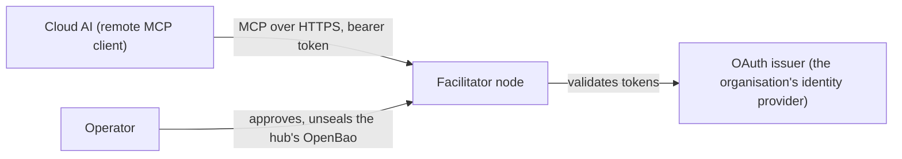

**`c4-container.md`** (ids are ontology ids; ids marked "proposed" are added with the build):

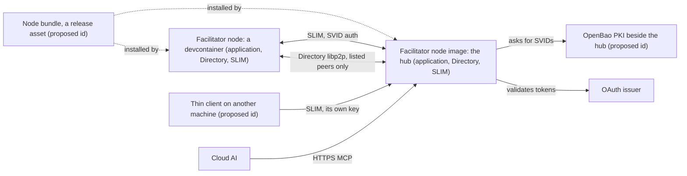

New ontology ids: `facilitator-bundle`, `facilitator-node-image`, `facilitator-thin-client`,
`openbao-issuer` (names proposed); the OAuth issuer and the cloud AI are `external-`.

### Workflows (`docs/architecture/workflows.md`)

Section 3, "A Feature change to a release", changes with the bundle and the image (AC); three new
sequences are added: join a node, first-contact approval, and enrolling an HTTP client.

Section 3 delta. The Operator starts both workflows; an agent starts neither:

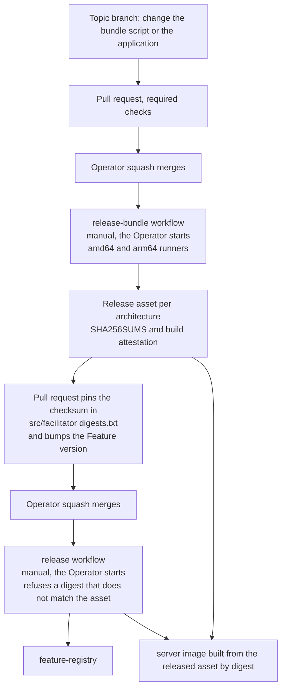

New workflow, join a node (a join token, section 5.3):

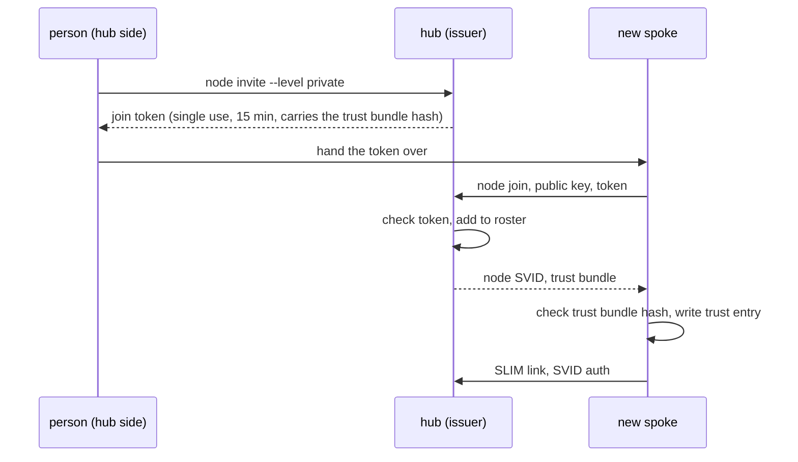

New workflow, first-contact approval (a public sender, slice N4):

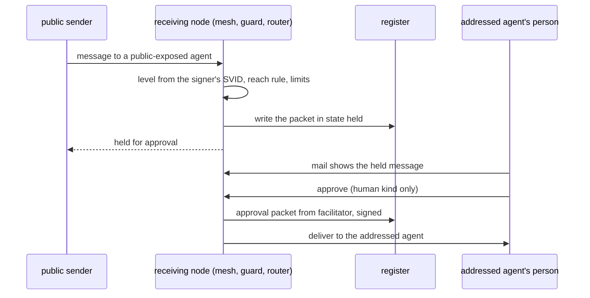

New workflow, enrolling an HTTP client (section 11.1, slice N4):

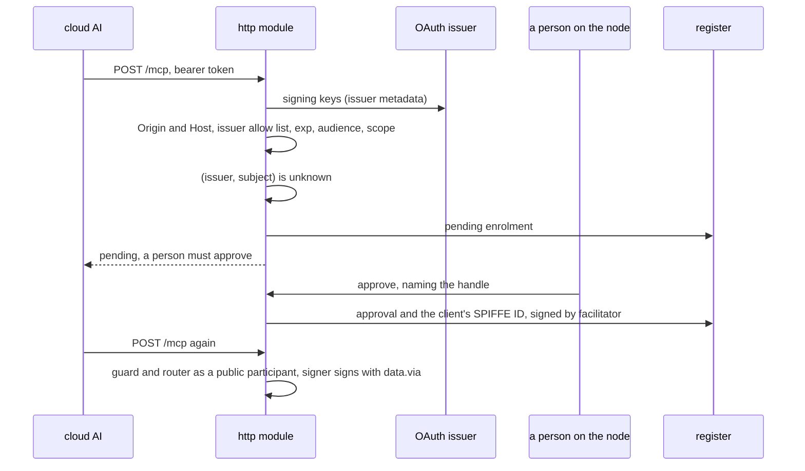

### Lifecycles (`docs/architecture/lifecycles.md`)

Node membership in a domain, and an SVID:

```mermaid
stateDiagram-v2
  [*] --> Requested: join request (public) or join token (private)
  Requested --> Approved: person approves the key
  Requested --> Rejected: denied or token expired
  Approved --> Member: SVID issued
  Member --> Member: SVID renewed at half life
  Member --> Revoked: node revoke
  Member --> Expired: renewal fails past TTL
  Revoked --> [*]
  Rejected --> [*]
  Expired --> Member: renewed again
```

A first-contact message held for approval (the hold time is proposed, not ruled):

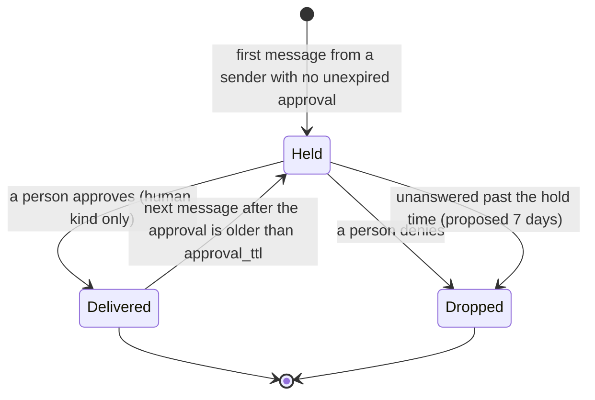

### Data Flows (`docs/architecture/data-flows.md`)

Add section "3b. A conversation across nodes", the HTTP path, the network edge in "Trust boundaries", and
the bundle and image in section 6.

3b, a conversation across nodes (slice N3):

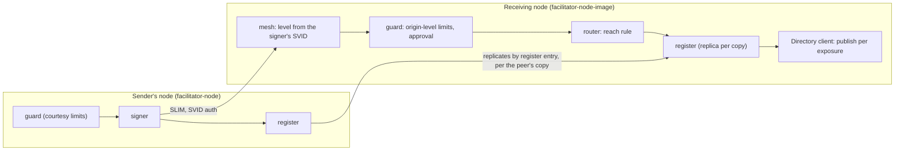

The HTTP path (slice N4):

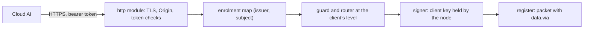

Trust boundaries gain the network edge (zones 6 and 7 are added to the five already drawn):

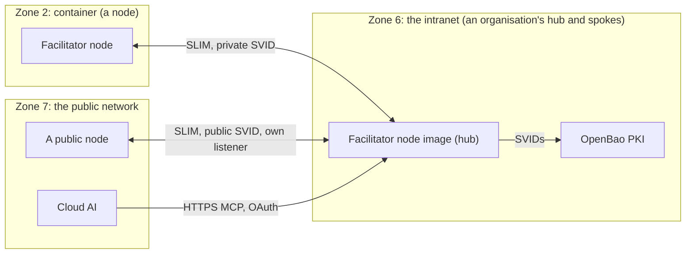

The port table of section 12.1 is the edge's detail; the Directory's 8888, 5555 and 8889 never cross it.

Section 6 (code to GitHub, release to the registry) gains the bundle asset and the image:

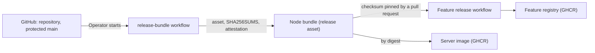

The release-bundle job needs `id-token`, `attestations`, `contents: write` and `packages: write`
permissions, which `release.yaml` does not have.

### Data Inventory (`docs/architecture/data-inventory.md`)

Seven columns, as the standing table. The classification is mine, "to verify" with the Operator.

| What | Path or volume | Owner | Tier | Sensitivity | Survives rebuild | Source |
|---|---|---|---|---|---|---|
| `mesh.yml` (policy) | `.devcontainer/mesh.yml` (`FACILITATOR_MESH_FILE`), committed; mounted read-only in the image | the engineer | 1 | internal (domains and handles, no secrets) | yes | this proposal, section 7 |
| `node:` settings | `.devcontainer/facilitator.yml` | the engineer | 1 | internal | yes | this proposal, 4.1 |
| Trust bundles (CA certificates, SPIFFE format) | volume `bundles/<domain>.pem` | facilitator Feature | 4 | public (certificates) | yes | this proposal, 5.2 |
| Node and agent SVIDs and keys | OpenBao `facilitator/svid/...`; fallback in the volume, mode 600 | facilitator Feature | none (OpenBao); 4 for the fallback | secret | yes | this proposal, 5.2; ADR-0048 |
| A domain's intermediate CA key (hub) | OpenBao PKI in the hub's volume | the hub | 4, bounded-loss exception (ADR-0048) | secret, high value | yes | ruling AB |
| A domain's root CA key | offline, outside the hub | the Operator | custody | secret, high value | not applicable | ruling AB |
| Roster, join requests, approvals (a hub's are not rebuildable) | register entries in the volume, signed; backed up with the hub's OpenBao snapshot to tier 3 (proposed) | facilitator Feature | 4 with a backup (ADR-0045: not rebuildable, so tier 4 alone is not enough) | internal | yes | review finding 16 |
| Held messages and pending enrolments | register entries in the volume | facilitator Feature | 4 | confidential (a held message holds what a stranger said) | yes | this proposal, 8.1 and 11.1 |
| Replicas of other nodes' conversations | volume, per `copy` | facilitator Feature | 4 | confidential (may hold what people said) | yes | this proposal, section 10 |
| OAuth issuer allow list, enrolled client map | `facilitator.yml` (allow list) and the register (map) | the engineer | 1 and 4 | internal | yes | this proposal, 11.1 |
| The HTTP endpoint's TLS certificate and key | a mounted file, or the proxy's; never in the image | the engineer | none (a mount) | secret (key), public (certificate) | not applicable | this proposal, 11.3 |
| Bearer tokens of HTTP clients (N4) | a hashed table in the volume (the token is printed once) | facilitator Feature | 4 | secret (hashed) | yes | ruling SP4; 11.1 |
| Per-client signing keys for HTTP clients | OpenBao `facilitator/http/...` | facilitator Feature | none (OpenBao) | secret | yes | this proposal, 11.1 |
| The bundle and its `SHA256SUMS` | release asset; the image layer; the Feature's build layer (Docker layer cache, not the state volume) | CI, the release | n/a | public | yes (layer cache) | ruling AC; this proposal, 6.1 |

## Ruling on the review (2026-11-20)

The Operator ruled on the architecture review below, point by point, on 2026-11-20. The design
sections above were changed to match; the review sections below were left as written, so they describe
the proposal as it stood when it was reviewed and some of their recommendations are replaced by these
rulings (each row says which). Records the rulings call for are in section 16, and the librarian writes
them.

| # | Ruling | Replaces or settles | Where it lands |
|---|---|---|---|
| **AA** | **The node signs for agents inside its own container**, as in 0.2.0. A leaf client signs with its own key; an HTTP client is signed for by the node. This **amends ADR-0067 decision 2** ("so the key stays with the agent"). The ADR amending it is the librarian's to write (section 16). | review finding 1, open question 1; D3 | 2 (Z2), 11.2, 15 (D3), 16 |
| **AB** | **The hub's certificate issuer is OpenBao PKI.** For intranet use it is **unsealed by hand**, with **24 h certificates** and the **root CA kept offline** (an intermediate in the hub's OpenBao). **Automatic unsealing is decided before the public level** (slice N5). An ADR for the issuer is needed (the librarian's). SLIM accepts SVID-shaped certificates from files, so no SPIRE is needed (SP2, [spike 2, section 1](../spikes/2026-11-21-slim-spiffe.md)); that OpenBao PKI itself issues them with the right SANs was not run and is a first task of N3. | review finding 3, open question 2; R1, R8 | 5.2, 6.2, 12.2, 13, 14, 16 |
| **AC** | **The bundle gets its own manual `release-bundle` workflow** that the Operator starts; then a pull request pins its checksum in `digests.txt`; then the Feature is released; then the image is built from the released asset by digest. | review finding 5, open question 3; R5 | 6.1, 13, 14, 17 (Workflows 3, Data Flows 6) |
| **AD** | **The Feature options are the defaults, and `mesh.yml` `limits` override them per trust level.** `MESH_FILE` is renamed **`FACILITATOR_MESH_FILE`**. | review finding 8, open question 4 | 7, 14 |
| **AE** | **Keep both identities, each at its own layer (revised by the Operator).** SPIFFE is for **nodes and the links between them**, now, because SLIM speaks it. **AGNTCY Identity** (W3C DIDs and verifiable credentials, bring-your-own identity provider; v0.0.26; needs Docker) is for **agent badges**, **opt-in**, arriving with the **public level**, after **a short spike of its own**. The `identity` option therefore **stays and is refused until that slice**; it is not dropped or deprecated. | review finding 10, open question 5; Z5 "SPIFFE is the one identity standard" | 2 (Z5), 5, 13 (N5), 14 |
| **AF** | **One `bundleVersion` option replaces `dirVersion` and `slimVersion`**, which are **deprecated** by CONTRIBUTING's convention (a minor release, removed only in the next major). | review finding 7 | 6.1, 13 (N2) |
| **AG** | **The bundle carries its own Python** (python-build-standalone), so it runs on any glibc Linux. The "for the Operator to confirm" mark in 6.1 is settled. | 6.1 | 6.1 |
| **AH** | **Slice N4 (MCP over HTTP) ships the single-node public rules** (visibility, first-contact approval, public limits). **Slice N5 ships the cross-node public rules and peer-to-peer.** | D5 | 13, 15 (D5) |
| **AI** | **The sample compose file ships an OpenBao beside the hub.** | 6.2 ("not tested yet") | 6.2, 13 (N2) |

### Rulings on the second spike's findings (2026-11-20)

The spike ([SLIM with SPIFFE, two linked nodes, two Directories, MCP over HTTP](../spikes/2026-11-21-slim-spiffe.md)) is done. The
Operator ruled on its findings, all as recommended. The "(spike N1)" marks in the design sections were replaced by
what it found.

| # | Ruling | Where it lands |
|---|---|---|
| **SP1** | **Two locks.** SLIM checks only that a certificate chains to the CA bundle it holds, never the SPIFFE ID or trust domain (an impostor ID passed). So each trust level has **its own SLIM listener with its own CA bundle**, **and** the facilitator **checks every signed message's SPIFFE ID against `mesh.yml`** (the application check). | 8, 8.1, 12.1, 13 (N3), 14 (R2, R16) |
| **SP2** | **Node identity is certificate files**, issued by OpenBao PKI (as AB). SPIRE is optional, later. | 5.2, 14 (R1) |
| **SP3** | **Hub and spoke use static SLIM links** with `connection_type: peer` (the default `edge` carries no routes). The SLIM Controller comes later, if meshes grow. | 4.1, 13 (N3) |
| **SP4** | **The first remote version (slice N4) serves CLIs on the intranet with bearer tokens** (Claude Code ran this; Copilot CLI is from docs). **Cloud AIs come with the public slice (N5)**: they need an OAuth 2.1 authorization server and a public HTTPS address. The server side uses the `mcp` Python library 2.3.0 (MIT) as an OAuth resource server. The MCP spec of 2026-07-28 has no sessions, and a blocking `receive` is one long POST with an SSE reply. | 11, 13 (N4, N5), 15 (D11) |
| **SP5** | **No Directory auto-discovery on the LAN.** mDNS auto-peering and the open libp2p port are not acceptable by default: find a switch that turns mDNS off, otherwise firewall the port to the listed peers only. | 12.1, 14 (R3), 13 (N3) |

Also taken from the spike into the design: the loopback-only Directory config cannot sync, so a node needs
routable addresses, `bootstrap_peers` and `publication.scheduler_interval`; content moves only after a one-way
`dirctl sync create` (which side syncs from which is stated in 12.1); clients reconnect after about 5 s and a new
session behind a stopped node fails after about 8 s (12.2); `check` reads the node logs for TLS errors (7.2);
the node's certificate carries a DNS name equal to the client's `server_name` (5.2); `up` removes a stale
`daemon.pid` (6.1, 12.2).

Review findings that are fixable without a ruling were applied (findings 2, 4, 6, 9, 11 to 16 in
substance): the loopback rule is cited from facilitator-agent sections 2 and 6 (D4); an install path for
the leaf (thin) client (11.2); the bundle cache is not the state volume (6.1); the remote-MCP clients are
named and the capability matrix needs MCP rows (11.1, 13); the contract of `check` and the refusals of
`node invite` and `node approve` inside an agent's job (7.2); the lexicon collisions (3); 6.1's
dependency statement and the copy checks; section 16's stale statement; where a hub's roster is kept
and backed up (17, Data Inventory); and the ADR-0060 deltas in section 17.

Decisions still open for the Operator are in "Open after the rulings" at the end of section 15.

### Ruling on the last readings (2026-11-20)

The Operator ruled on the readings left open (section 15), all as recommended:

| Call | Reading | Ruling |
|---|---|---|
| BA (D1) | "Local is unrestricted" | no trust restriction; hops, budget and rate still apply at local |
| BB (D2) | Can an HTTP client continue? | no: an HTTP client is never `human`; a person continues from a local MCP session |
| BC (D9) | `expose` keys | a handle is shorthand for that agent's SPIFFE ID on this node; full IDs are accepted |
| BD (D10) | First-contact approver on a pure hub | the hub's own `humans:` list; a hub must name at least one, or `check` refuses `approval: first-contact` |
| BE (D11) | Bearer-token clients in N4 | mapped through `http.<home domain>`, public by default; an engineer may mark an intranet CLI private |
| BF | The thin-client-only install | the option `mode: node \| leaf` |
| BG | An unanswered first-contact message | held 7 days |
| BH | A hub's roster and approvals | backed up with its OpenBao snapshot, to the personal folder (tier 3) |
| BI | Directory copies | spokes `sync` from the hub; the hub syncs from a spoke only if that spoke opens its OCI port to the hub |
| BJ | N4's exit test | Claude Code (run in the spike) and Copilot CLI, run for real before 1.0 |

## 18. Architecture review

Run on 2026-11-20; the review is in the next section, and the Operator's rulings on it are in "Ruling on the review (2026-11-20)", just above it.

## Architecture review (2026-11-20)

**Verdict:** fit with changes

Read cold against the NFRs, the ADRs to 0067, the capability matrix (agents-v2 section 14), the
lexicon, the standing set in `docs/architecture/` and `docs/model/`, and checked against `src/facilitator`
0.2.0, `.github/workflows/` and the first spike. The second spike (SLIM with SPIFFE, linked nodes) is
running and its note is not on this branch: every item marked **(spike N1)** below depends on it and is
not settled by this review. The design holds together; the changes are about where its pieces sit, a
release pipeline the workflows do not have yet, one contradiction with ADR-0067, and three ADRs that
section 16 does not list.

### Requirements checked

- **NFR-1 owns-its-state:** met. The image mounts the Feature's path (6.2); but the bundle cache "in the
  state volume" cannot work at install time (finding 6).
- **NFR-2 registered-taskfile:** met for the Feature (6.1, 6.2); the new `node` subcommands and `check`
  need tasks with a `desc` when built (finding 11).
- **NFR-3 verified-and-pinned:** met for the bundle by `digests.txt` (6.1); not met as written for the
  image's base layer and for the Feature's `dirVersion` and `slimVersion` options, which the bundle makes
  meaningless (finding 7).
- **NFR-4 augments-not-replaces:** does not apply; no official Feature (D7). Agreed.
- **NFR-5 idempotent-and-user-neutral:** met as planned; N2's exit test runs the install twice (13).
- **NFR-6 one-way-to-configure:** not met. Limits are in both the Feature options (`hopLimit`,
  `messageBudget`, `rateLimit`) and `mesh.yml` `limits`, with no stated order, and `MESH_FILE` breaks
  the `FACILITATOR_*` naming (finding 8).
- **NFR-7 agent-ready:** needs a line. `node invite` prints a join secret and `node approve` is a
  person's act: they must refuse inside an agent's job (finding 11).
- **NFR-8 documented-to-the-standard:** met as planned; every slice brings NOTES to the standard (13).
- **NFR-9 says-why-it-exists:** does not apply to the Feature; the server image should say in one
  paragraph why not AGNTCY's own SLIM and Directory images or Helm charts.
- **NFR-10 tested-on-base-images:** not met as planned. N2's exit test needs arm64, and every CI job
  runs on `ubuntu-latest` (amd64) (finding 5).
- **NFR-11 linter-cli-contract:** partly. `check` takes the exit codes (7) but not paths, `-`,
  `path:line: rule` or `--format json` (finding 11).
- **NFR-12 vendor-neutral-contracts:** met for the stdio route, which Claude Code and Copilot both use
  (facilitator NOTES); not shown for the HTTP route, and the matrix has no MCP rows (finding 9).
- **NFR-13 manages-the-environment-not-the-cli:** met (D8, 11). No vendor CLI is configured or
  re-implemented; placement is in the table below.

### Placement

| Element | Layer | Why |
|---|---|---|
| `install.sh` freed of devcontainer parts, the venv, bundled interpreter | the bundle | built once per architecture, used by both the Feature and the image (Z1) |
| `mesh`, `identity`, `peers`, `http` modules; `approve` tool; `node` subcommands | the bundle (the facilitator application) | the application's own logic; the Feature and the image only install it |
| Download, verify, hooks, Taskfile, volume | the facilitator Feature | as today |
| A machine that runs only a leaf client | a facilitator Feature option (missing; finding 4) | the stdio server is ADR-0061's heavy side and comes from the Feature, but `infra up` would start a node |
| `node:` settings, `mesh.yml`, TLS certificate, OAuth issuers | a consumer's own config | per repository and per node; committed in tier 1, secrets excluded |
| ENTRYPOINT, `tini`, non-root user, HEALTHCHECK | the server image | only the image needs a supervisor |
| PKI mount, roles per trust domain, issuing policy | the `openbao` Feature (`openbao:pki:*`, like ADR-0059's `openbao:ssh:*`) | OpenBao's configuration belongs to its Feature; finding 3 |
| Shared docker network or published ports between two devcontainers | a consumer's own config (`runArgs`, `forwardPorts`), a launcher opt-in later | a Feature cannot publish a port (12.1); the launcher owns how a container starts |
| MCP entry for a leaf client's CLI | the participant component and the CLI Features | ADR-0061's thin side, unchanged; `--node` is one more argument in the entry |
| CLI adapters | none | nothing here touches a CLI; correct |

### Findings

1. **Contradiction with ADR-0067 decision 2.** ADR-0067 (accepted) says local CLIs use the thin client
   plus SLIM "so the key stays with the agent"; 11.2 keeps node signing for same-container participants
   (D3). The lexicon's "Facilitator node" copies the ADR. An accepted ADR is not read against itself.
   Recommended change: a new ADR (or the MCP-over-HTTP ADR of section 16) amends decision 2 to the three
   arrangements of 11.2, and the lexicon entry follows.
2. **ADR-0061 does not say networking is out of scope.** D4 and section 16 say an ADR must amend
   ADR-0061 on ports. ADR-0061's text does not mention networking or loopback; the rule is in
   facilitator-agent sections 2 and 6 (lines "networking out of scope" and "open a network port beyond
   the loopback ports"). Recommended change: the ports ADR names facilitator-agent sections 2 and 6 and
   ADR-0067; ADR-0061 needs no amendment.
3. **The issuer collides with ADR-0048 and ADR-0050, and has no ADR.** Option A (OpenBao PKI) puts a CA
   on a hub that must renew SVIDs unattended (public every 30 min). ADR-0048 decision 4: a server-mode
   OpenBao is sealed until the Operator unseals it at every start, the login lasts 4 to 8 hours, and
   back AppRoles are loopback only; the 6.2 compose puts the facilitator in a second container.
   ADR-0050: creating a role or policy (the facilitator's AppRole, a PKI role per domain) needs a root
   token from the shares. ADR-0059's SSH CA "signs for the Operator only". The local-domain CA key in
   the volume when no vault exists widens the 0.1.0 ADR-0048 exception. Recommended change: a fourth ADR
   in section 16, "SVIDs are issued by an OpenBao PKI CA per trust domain", that states the hub's unseal
   (who, after a restart), the facilitator's AppRole over the compose network, the root-token step for
   the PKI roles, and the local CA fallback as a written exception. **(spike N1: may be replaced by
   SPIRE, R1.)**
4. **A leaf client has no install.** 3 and 11.2 say a leaf client runs "on a machine that runs no node",
   but `facilitator mcp` comes from the Feature, whose `autostart` starts the Directory and SLIM. `role`
   has no value for it. Recommended change: a Feature option (`role: leaf`, or `infra: false`) that
   installs the bundle and the stdio server and starts no daemon.
5. **The pipeline the bundle and the image need does not exist.** `release.yaml` only publishes
   Features (`devcontainers/action`, `contents: read`, `packages: write`); there is no release asset,
   no image build, no attestation (`id-token` and `attestations` permissions) and no arm64 runner. R5's
   order also fails: the bundle a PR's CI builds is not byte-identical to the one a later release builds
   unless the build is reproducible, so the pinned digest would not match. Recommended change: a
   separate manual workflow `release-bundle` that the Operator starts first and that uploads the asset
   with its attestation; then a PR pins its digest in `digests.txt`; then the Feature release; the image
   built from the released asset by digest. Add an arm64 runner (`ubuntu-24.04-arm`) or QEMU to the
   bundle job, and name the change in Workflows section 3 (finding 12).
6. **The bundle cache in the state volume cannot work.** 6.1 and R6 cache the tarball "in its state
   volume by checksum", but a Feature's `install.sh` runs during the image build, when no volume is
   mounted. Recommended change: rely on the Docker layer cache of the Feature's build step (and
   `FACILITATOR_ASSETS` for offline builds, which 0.2.0 already has), and drop the volume cache.
7. **Options the bundle makes meaningless, and the image's base.** `dirVersion` and `slimVersion`
   choose what `install.sh` downloads; with the bundle they are fixed by the bundle. NFR-3 also asks for
   a `version` option and what `latest` resolves to. `FROM debian-slim` is not pinned. Recommended
   change: deprecate `dirVersion` and `slimVersion` in 0.3.0 (the lexicon's deprecation rule), add
   `bundleVersion` (default: the version pinned for this Feature version, `latest` resolving to it), and
   pin the image's base by digest.
8. **Limits in two places, and a variable outside the naming (NFR-6).** `hopLimit`, `messageBudget`,
   `rateLimit` and `receiveWaitSeconds` stay Feature options while `mesh.yml` `limits` sets the same
   values per level; nothing says which wins. Recommended change: the options are the local and private
   defaults, `mesh.yml` overrides per level, `check` prints the effective value; rename `MESH_FILE` to
   `FACILITATOR_MESH_FILE`.
9. **No matrix rows for MCP (NFR-12).** The stdio route works on Claude Code and Copilot (facilitator
   NOTES), but section 14 of agents-v2 has no row for it, and the HTTP route names no client at all:
   "cloud AIs" are not CLIs, and which remote-MCP clients do OAuth with the RFC 9728 discovery is
   **not checked** (R11). Recommended change: add two matrix rows, "MCP client, stdio" and "MCP client,
   Streamable HTTP with OAuth", and make N4's exit test two named remote clients of different vendors,
   or name the fallback (a leaf client) for the one that fails.
10. **SPIFFE and AGNTCY Identity both say "identity".** The Feature already has `identity` (AGNTCY
    Identity, refused until slice 7 of facilitator-agent). The proposal adds an `identity` module and
    SPIFFE identities and does not say what becomes of slice 7. Recommended change: one line in section 5
    and in the SPIFFE-issuer ADR: AGNTCY Identity is dropped, or kept only for OASF badges; the option is
    deprecated or renamed accordingly.
11. **The new commands need their contracts.** `check` is a check tool (NFR-11): it needs paths, `-`,
    `path:line: rule` and `--format json`, not only the exit codes. `node invite` (prints a secret),
    `node approve` and `node revoke` need tasks with a `desc` (NFR-2), and the first two must refuse
    inside an agent's job, as every OpenBao share and token task does (ADR-0048 decision 4).
    Recommended change: one table in section 7 or 13 listing each new command, its task, `interactive`,
    and whether it refuses in an agent's job.
12. **Deltas missing or not in the ADR-0060 form.** A change without its delta, per document:
    - **C4:** the delta's Mermaid ids (`node1`, `app1`, `ext`, `cloud`) are not ontology ids, which the
      architecture README requires; `c4-context.md` gains two external systems (the cloud AI, the OAuth
      issuer) and is not named. The standing `c4-container.md` does not show the facilitator 0.2.0 at
      all: stale.
    - **Workflows:** first-contact approval and HTTP enrolment are named but not drawn; section 3 ("A
      Feature change to a release") changes with the bundle and image (finding 5) and has no delta.
    - **Lifecycles:** the held first-contact message is text only, with no state diagram.
    - **Data Flows:** "3b" and the HTTP path are text only, no Mermaid; the "Trust boundaries" section
      gains the network edge and section 6 (release) gains the asset and the image; neither has a delta.
    - **Data Inventory:** the delta table has five columns; the standing table has seven ("Survives
      rebuild", "Source" are missing). Missing rows: held messages and pending enrolments, the HTTP TLS
      certificate and key, the per-client signing keys for HTTP clients.
    - **State of the Architecture:** present and in form.
    Recommended change: complete each delta in section 17 before the N2 pull request, and file the
    stale `c4-container.md` as a backlog item.
13. **Lexicon collisions.** "Claim token" is defined as the OpenBao onboarding root token (ADR-0052);
    5.3 uses it for a single-use join token. "Bundle" is used for the release package and for SPIFFE
    trust bundles (`bundles/facilitator/` beside `bundles/<domain>.pem`). "Mesh" says "configured by one
    `mesh.yml`", but each node has its own. "Role" collides with agent roles and OpenBao roles.
    Recommended change: call the token a **join token**, the package the **node bundle** (always
    "trust bundle" for SPIFFE), "Mesh" to read "each node configured by its own `mesh.yml`", and "node
    role"; add "thin client" (stdio `facilitator mcp`), used in Z2 and 11.2 and defined nowhere.
14. **Feature dependencies stated wrongly.** 6.1 says the Feature keeps "`dependsOn`/`installsAfter` on
    `sign-packet`, `register-engine` and `ssh-agent` as today". 0.2.0 has no `dependsOn`; it installs
    after `go-task`, `python`, `common-utils`, `register-engine` and `openbao`, and carries its own
    copies of sign-packet's and register-engine's libraries (ADR-0062). The bundle's `lib/signpacket/`
    and `lib/registerengine/` are further copies outside `src/`, which `task signpacket:check` does not
    see. Recommended change: correct the sentence, and have the bundle script take its copies from
    `src/facilitator/` so the existing check covers them.
15. **Stale and dangling references.** Section 16 says ADR-0067 is "an uncommitted file"; it is
    committed and accepted. The link to `docs/spikes/2026-11-2x-slim-spiffe.md` points at a file that
    does not exist yet. "SLIM already supports SPIFFE" (Z5) is the Operator's premise, not in the first
    spike. Recommended change: update section 16, and keep the link with "(in progress, not yet
    written)" until N1 lands. **(spike N1)**
16. **A hub's roster is not rebuildable (ADR-0045).** The data inventory puts the roster, approvals and
    enrolments in tier 4, whose rule is "rebuildable only"; losing a hub loses every membership and
    approval, which R8 ("the hub can be rebuilt from OpenBao") does not cover. Recommended change: the
    roster register is backed up with the hub's OpenBao snapshot or mirrored to tier 2, stated in the
    inventory row.

### Open questions for the Operator

- **Same-container signing (finding 1, D3).** Keep 0.2.0's node signing for participants in the node's
  own container, against ADR-0067's "key stays with the agent"? Recommended: yes, while every token is
  readable by every process of one user (R10), recorded by an ADR that amends ADR-0067 decision 2.
- **A hub's issuer running unattended (finding 3).** ADR-0048 makes every server-mode OpenBao wait for
  the Operator's unseal at each start, which stops SVID renewal after a hub restart. Recommended: accept
  that for N3 (private SVIDs last 24 h) with the root CA offline and an intermediate in the hub's
  OpenBao, and decide auto-unseal for a public hub before N5, in the issuer ADR.
- **The bundle's release order (finding 5).** A separate `release-bundle` workflow the Operator starts
  before the Feature release, or a reproducible build so R5 works as written? Recommended: the separate
  workflow; reproducibility is not proven for a tree with a 198 MB third-party binary.
- **Limits in options and in `mesh.yml` (finding 8).** Recommended: options stay as the defaults and
  `mesh.yml` overrides per level; deprecate them only if the two prove confusing.
- **AGNTCY Identity (finding 10).** Drop slice 7 of facilitator-agent in favour of SPIFFE, or keep it for
  OASF badges? Recommended: drop it, and deprecate the `identity` option in 0.3.0.
- **D1 to D10.** The review agrees with each reading taken in section 15, except D4's attribution
  (finding 2).

## Rulings on slice N3 (2026-11-21)

What slice N3 found where a ruling could not be built as written, and the Operator's ruling on each.

- **H1, a new spoke's first certificate: option A, ruled 2026-11-21.** A spoke has no certificate before it
  joins, so lock one keeps it off SLIM. The hub opens an HTTPS join endpoint (`node.join`) only while a join
  token is live, and closes it 30 s after the last token is used or expires; the token (single use, 15 minutes)
  protects the hub, and the trust bundle's hash in it protects the spoke. Rejected: carrying the certificate by
  hand (B: no port, but `bao` and key files copied to every spoke) and a SLIM listener without client
  certificates (C: weakens lock one for every node). It adds the join endpoint to ADR-0071's list of ports.
  After the join, the certificate (24 h, renewed at half life) and the two locks carry the trust, and each node
  restricts the other only through its own `mesh.yml` (`trust`, `expose`, `limits`) and, on a hub, `node revoke`.
- **H2, Directory peering: option A, ruled 2026-11-21.** dirctl 1.9.1 has no switch for mDNS, and in the tests
  three daemons found each other on one network segment (ruling SP5 could not be built as written). Directory
  peering is off by default (`node.directory.peering: false`): nothing of the Directory leaves loopback, and nodes
  learn each other's agents from the signed cards. Peering on needs `node.directory.firewall` (`auto` drops UDP
  5353 with iptables, `external` when a person firewalls it); a hub then opens OCI and libp2p, a spoke syncs the
  hub's records by registry. An upstream issue asks for an mDNS switch (and notes the anonymous OCI push).
  Rejected: peering on by default (B). It amends ADR-0071 decision 4.
- **H3, binding agents' keys to their node: option A, ruled 2026-11-23.** OpenSSH cannot export an ed25519 key
  to PKCS8, so the node's certificate key and the packet keys stay separate (section 5.2's fallback). Each node
  signs a card with its certificate key: its certificate, its facilitator key and the keys of the participants it
  exposes; the hub passes every admitted card on in the roster. Lock two takes a packet's SPIFFE ID
  (`spiffe://<domain>/node/<id>/agent/<handle>`) from its signer's key looked up in the admitted cards. Agents get
  no certificates of their own; revoking a node cuts off all its agents. Rejected: a certificate per agent (B:
  more issuing and renewing, and SLIM checks only the node's certificate). Per-agent identity comes with AGNTCY
  Identity (slice N5). It refines ADR-0069 decision 5; the node's certificate key is a file on every node
  (SLIM reads it from a file), which widens ADR-0069 decision 4.
- **H4, a revoked node's TLS link: option A, ruled 2026-11-23.** SLIM 3.4.6 checks no revocation list and
  reloads no certificate, so a revoked node's TLS link can still form until its certificate expires (24 h); lock
  two refuses everything it sends, and it gets no renewal. Kept for N3; rotating the mesh's SLIM app secret on
  every revoke is a backlog item, done before slice N5 (public trust). Rejected: rotating it in N3 (B: every
  remaining node needs the new secret, and it delays the slice).
- **H5, the same handle on two nodes: option B, ruled 2026-11-23.** Qualified handles are built in slice N3:
  an agent on another node can be named with its node (for example `@b1.spoke-b`), so two nodes may expose the
  same handle and both stay reachable. A bare handle still works when it names one agent; when it names several,
  the facilitator refuses it and lists the qualified names. Rejected: refusing the second claim, so that neither
  is reachable until one is renamed (A, as first built).

## Rulings on slice N4 (2026-11-23)

What slice N4 found where a ruling could not be built as written, and the Operator's ruling on each.

- **HC1, an HTTP client starting a conversation: option A, ruled 2026-11-23 ("let's start with A": the
  starting point, to revisit with use).** An HTTP client's `say` begins a chain (hop 0) that no person wrote;
  the node signs it on the client's behalf and marks it `via` http, and `verify` accepts such a root. It is
  bounded by first-contact approval by a person, the public limits (rate 3 a minute across the client's
  conversations, 2 hops, budget 10), and the reach rule (only agents exposed `public`); `continue` stays a
  person's. Rejected: the client may only reply (B: it could never begin, so it could not talk at all) and a
  person approves every conversation it starts (C: a person in every loop). It refines ADR-0066 and ADR-0070
  decision 4.
- **HC2, public under the `team` preset: option A, ruled 2026-11-23.** `team`'s ceiling is private, but an HTTP
  client is public until `mesh.yml` trusts `http.<home domain>` as private. Under `team`, `expose: public` marks
  the agents this node's own HTTP clients may reach; public from other nodes stays slice N5, and `trust` may map
  `http.<home domain>` only to private or public. Refused under `solo`. Rejected: a new preset between `team`
  and `open` (B; the names are revisited when N5 defines `open`) and no public under `team`, HTTP clients mapped
  to private (C: any token holder would get private reach).
- **HC3, the audit of tokens and approvals: option A, ruled 2026-11-23.** There is no register for enrolment
  outside a conversation, so `token`, `approve`, `deny` and `revoke` are lines in `http/audit.jsonl`, each
  carrying the hash of the one before (a cut or an edit shows; a whole rewrite would not); the approval and
  denial are also signed `notice` packets in the conversations they concern. Slice N5 adds a signed audit
  register type and replays the log into it. Rejected: the signed register in N4 (B: delays the slice).
- **HC4, how long an approval lasts: option A, ruled 2026-11-23.** A person approves a client (its token) once;
  the approval lasts `approval_ttl` (30 days at public), across every conversation the client starts, until it
  expires or the token is revoked. Rejected: an approval per conversation (B: a person in every new
  conversation).
- **HC5, the `mcp` wheels in the bundle: option A, ruled 2026-11-23.** The bundle grows by about 40 MB; its
  `install.sh` keeps the 28 `mcp` wheels per architecture pinned by SHA-256 and URL (`--require-hashes`), and a
  task refreshes that table before the next `mcp` upgrade. Rejected: refreshing it by hand (B).

## Rulings before slice N5 (2026-11-23)

- **PB1, the AGNTCY Identity spike comes first.** The short hands-on spike (backlog `agntcy-identity-spike`)
  runs before slice N5, as section 13 schedules it; its findings decide the badge layer and whether public
  nodes need agent badges.
- **PB2, the hub's OpenBao stays unsealed by hand** (ruling AB stands). After a restart, public certificates (1 h)
  lapse within the hour, so public links fail closed until a person unseals; private and local survive a day.
  Revisited when a hub runs unattended.
- **PB3, slice N5 is split.** **N5a** (`facilitator` 0.6.0): peer-to-peer (`role: peer`, a peers list), the
  cross-node public rules (join by key plus approval, a separate public listener, `copy: addressed`, partial
  replicas in `verify`, revoke and cut-off, `preset: open`), rotating the mesh's SLIM secret on revoke (H4),
  and the signed audit register (HC3). **N5b** (`facilitator` 0.7.0): the OAuth 2.1 resource server and cloud
  AIs (protected-resource metadata, the issuer allow list, a named authorization server, a public HTTPS
  address).

## Rulings on the hub's issuer and the hub on Kubernetes (2026-11-23)

- **K3, a built-in issuer by default: yes.** With no `node.issuer.openbao`, a hub issues its domain's
  certificates itself (the local issuer N5a built for peers: a CA name-constrained to the domain's SPIFFE IDs),
  backs its roster up to its own volume, and needs no unseal; naming an OpenBao server ("use my server") makes
  it today's OpenBao PKI. `facilitator node issuer migrate` moves a built-in hub onto OpenBao without re-joining
  spokes. Amends ADR-0069 decision 1 (an OpenBao PKI per trust domain).
- **K5, an ssh-agent tier: yes, after a test.** The issuer's CA key is taken, in order, from OpenBao (when
  configured), from an ssh-agent (`node.issuer.ssh_agent`: socket and key fingerprint; an ed25519 agent signs
  the certificate's bytes as they are, so the key is never a readable file), and only as a last resort from a
  file in the volume (mode 600; `check` warns). Only the CA key moves; SLIM still reads a node's own TLS key from
  a file. A short test proves an agent-signed certificate is accepted by SLIM before it is built.
- **K4, the built-in root: option A.** The hub (or its agent) generates the root, and
  `facilitator node issuer export-root` lets a person take it offline later. Rejected: always bringing your own (B).
- **K2, when: straight after N5a.** The slice "hub on Kubernetes" (backlog `hub-on-kubernetes`): **a kustomize base
  now, a Helm chart later** (the Operator, 2026-11-23: a chart was asked for, then deferred with the `helm`
  Feature it needs; option A: the slice goes ahead as kustomize, with the `kustomize` and `kubeconform`
  Features): a StatefulSet with a volume, `mesh.yml` in a ConfigMap, a Service for SLIM and the join endpoint,
  the issuer tier chosen in the config; an overlay for Rancher Desktop, the `openbao:pki:*` tasks for when OpenBao is used, and a test in a throwaway cluster.
  K1 (where the hub's OpenBao comes from) is moot under K3: the built-in issuer by default.
- **The ssh-agent test (2026-11-23, [spike](../spikes/2026-11-23-ssh-agent-ca.md)):** an ed25519 key in an
  ssh-agent signs the certificate's bytes as they are, and SLIM accepts the result; RSA and ECDSA keys hash
  first and FIDO keys cannot sign. It also found that SLIM refuses every certificate from a CA carrying a URI
  name constraint, so the built-in issuer keeps only the DNS constraint (lock two still checks the domain).

## Rulings on slice N5a (2026-11-24)

What slice N5a found where a ruling could not be built as written, and the Operator's ruling on each, all as recommended.

- **PP1, addressed copy at conversation level.** A public node gets only the conversations it is a member of, and in
  those only messages addressed to it (other writes are refused); `verify` reports "partial (copy addressed)".
  Rejected: true partial replicas (they need a register-engine change).
- **PP2, a peer is its own issuer.** A CA (DNS-only name constraint) whose key is a file in its volume, mode 600, or in
  OpenBao or an ssh-agent per K5. Widens ADR-0069 decision 4, as ADR 0078 does for a hub (ADR 0080).
- **PP3, a node away during a secret rotation** gets the new secret by hand (`node secret`); an automatic re-fetch is a
  later backlog item.
- **PP4, a revoke stays per node.** One peer's revoke is not shared; each node revokes for itself.

## Findings of slice hub-on-kubernetes (2026-11-24, facilitator 0.7.0), for the Operator's ruling

What the slice found where a ruling could not be built as written. Each is built as the closest thing, with a recommendation.

- **HK1, the built-in CA is two-level, not the single CA of N5a.** K4 asks for an export of the root "so a person can take it
  offline"; with one CA that signs leaves, taking its key offline stops the hub issuing. The hub keeps a root and an issuing CA
  (the root signs the issuing CA once); `export-root` removes the root key from the volume and the hub keeps issuing. A hub
  made by 0.6.0 keeps its one CA and cannot export. Recommendation: keep (it is the OpenBao pattern, the root offline).
- **HK2, `migrate` keeps the same CA.** The ruling says "without re-joining spokes"; ADR 0078 decision 4 said "until renewal".
  `migrate` imports the issuing CA (key and certificate) into the OpenBao mount, so the bundle every spoke holds stays valid
  and nothing is re-issued. It needs the Operator's own token (the hub's AppRole may only sign) and, for an ssh-agent hub, is
  impossible (an agent never gives the key up: that hub starts a new CA and every node joins again). Recommendation: keep.
- **HK3, the built-in hub's roster backup is a file in its own volume** (as K3 says), which guards a torn write and not the
  loss of the volume. Recommendation: back up the volume claim (a snapshot); revisit if a hub should write a second copy to
  the shared folder.
- **HK4, the `openbao:pki:*` tasks were not built** (backlog `openbao-pki-tasks`): the openbao Feature's tasks are the
  server-mode, root-token-from-shares kind, which is more than "small"; `node issuer migrate` makes the mount, the import and the
  role itself (the role is the one the NOTES list). Recommendation: build the tasks when a hub needs an OpenBao made from
  nothing.
- **HK5, Rancher Desktop was not available**, so the overlay is rendered, schema-checked and run through a kind cluster whose
  published ports stand in for Rancher Desktop's LoadBalancer forwarding. The one open question is whether that forwarding is
  reachable through `host-gateway` or binds the machine's loopback only. Recommendation: the Operator runs the overlay once on
  the workstation; `hub-workstation-networking` stays open until then, with the specification (the hub's name in the
  certificate, `--add-host`, LoadBalancer) written in the NOTES.

## Rulings on slice hub-on-kubernetes (2026-11-24)

The Operator ruled HK1 to HK5 as recommended (the findings are in "Findings of slice hub-on-kubernetes"):

- **HK1, a two-level built-in CA.** A root signs the issuing CA once; `node issuer export-root` removes only the
  root key, so the hub keeps issuing and the spokes' bundle does not change (OpenBao's own pattern).
- **HK2, `migrate` keeps the same CA.** `node issuer migrate` imports the issuing CA into an OpenBao mount, so no
  spoke re-joins. A hub whose CA key is in an ssh-agent cannot migrate (an agent never gives its key up): moving
  it to OpenBao means a new CA and every node re-joining.
- **HK3, the roster backup without OpenBao is a file in the same volume.** It guards a torn write, not the loss
  of the volume: snapshot the volume; a copy to the shared folder later if wanted.
- **HK4, the `openbao:pki:*` tasks wait** until a hub must start on OpenBao from nothing; `migrate` already makes
  the mount, the import and the role.
- **HK5, the Rancher Desktop overlay is run once on the Operator's workstation** before `hub-workstation-networking`
  closes; if its LoadBalancer binds loopback only, publish on all interfaces or name the hub `host.docker.internal`.

## Rulings on slice N5b (2026-11-24)

- **OA1, who an OAuth client is: option A, ruled 2026-11-24.** An OAuth client is an issuer and a subject (one
  person's login), not the connector's `client_id`: one connector (one `client_id`) is shared by everyone who adds
  it and may register a new `client_id` each time, so each person is enrolled and approved on their own (per
  client, ruling HC4) and the record names who it was; `client_id` is kept as a label. Rejected: approving the
  connector (B: one approval would let in everyone who uses it).
- **OA2, the login's subject in the record: option A, ruled 2026-11-24.** `via` carries the issuer's subject as
  given, so the record names exactly who it was; it is kept and replicated like every entry. NOTES warns that a
  login server whose subjects are emails puts those emails in the record: prefer one with opaque subjects where
  that matters. Rejected: a fingerprint of the subject (B: the record could no longer say who it was without the
  login server).
- **OA3, letting a refused client back: option B, ruled 2026-11-24.** `facilitator http forget <client>` is built
  in N5b: a person's act (refused inside an agent's job) that drops a revoked or denied client's entry, so the
  same login (issuer and subject) is treated as new next time and held for a person's approval; a live client is
  refused (revoke it first). The forget is written to the audit register; past records keep naming the client.
  Rejected: leaving it to a later slice (A).
- **OA4, the issuer's keys unreadable: option A, ruled 2026-11-24.** When the node cannot fetch or read an
  issuer's key set, it answers 503 and stays closed: no OAuth client gets in until the keys can be read, the
  refusal is not counted against the caller's address (so an issuer outage cannot block a caller), and the
  node's log says why. Rejected: answering 401 like a bad token (B: it would count against the caller).
- **OA5, a real cloud AI before N5b is done: option A, ruled 2026-11-25.** The Operator connects a claude.ai custom
  connector once by hand (NOTES, "Connect a cloud AI"), and N5b counts as done only after that run.
- **OA6, https for `http.url`: kept, with an opt-out flag, ruled 2026-11-25.** With issuers, `http.url` must be https,
  except when `http.insecure: true` is set, for a local machine or a test environment: then plain http is accepted
  on any address, `check` and the node's log warn on every start, and the flag is refused under `preset: open`
  (a node reachable by strangers never runs OAuth over plain http).
- **OA5, revised 2026-11-25.** The Operator has no public https address for now, so N5b counts as done after a
  local end-to-end run: Keycloak in Docker as the login server and Claude Code as the OAuth client
  (`claude mcp add --transport http`), against a node on localhost (`task facilitator:oauth-local`). A claude.ai
  connector run waits in the backlog until a public address exists. (OpenBao was weighed as the login server and
  set aside: its OIDC provider is not believed to issue JWT access tokens with an audience, nor to let clients
  register themselves.)
- **OA5 met, 2026-11-25.** The Operator ran Claude Code on Windows against the OAuth test on Rancher Desktop's
  cluster (Keycloak and a 0.8.0 hub in the namespace `facilitator-oauth-test`): it discovered Keycloak, registered
  itself, the Operator logged in, the first message was held and approved by the Operator, jester answered, and
  `verify` showed `via http (oauth, ..., issuer http://localhost:8080/realms/facilitator-test, subject ...)` with
  every chain verifying back to a human. The test realm had to grant `offline_access`, since Claude Code asks for a
  refresh token. The same run answers HK5: Rancher Desktop's LoadBalancer services answer at Windows `localhost`.
