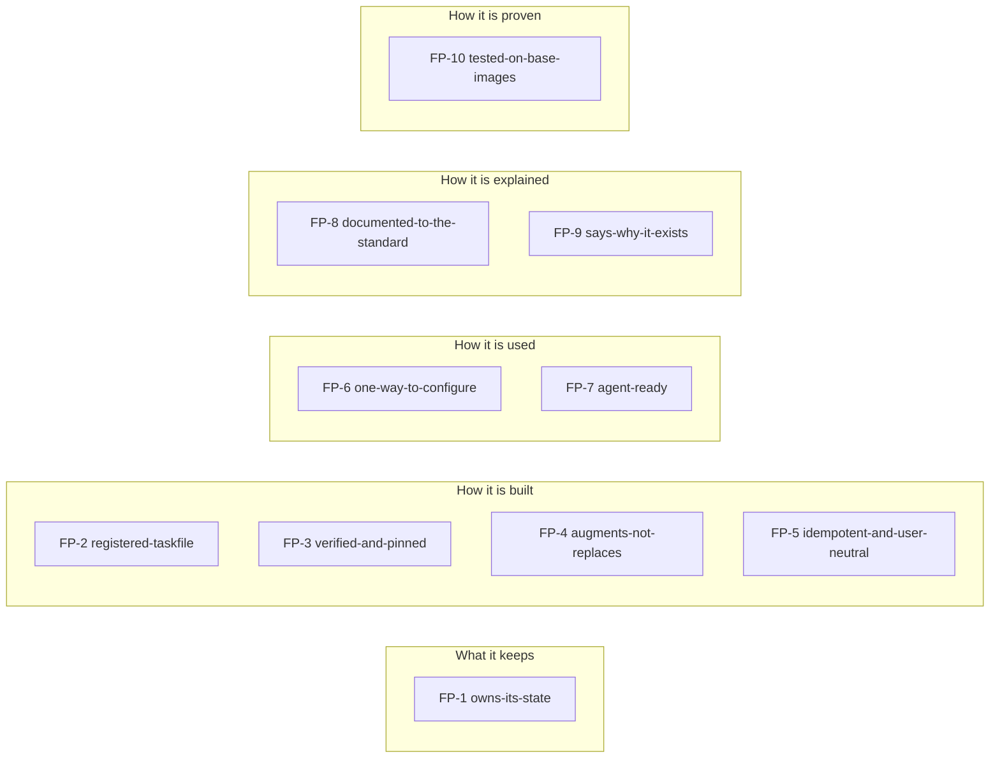
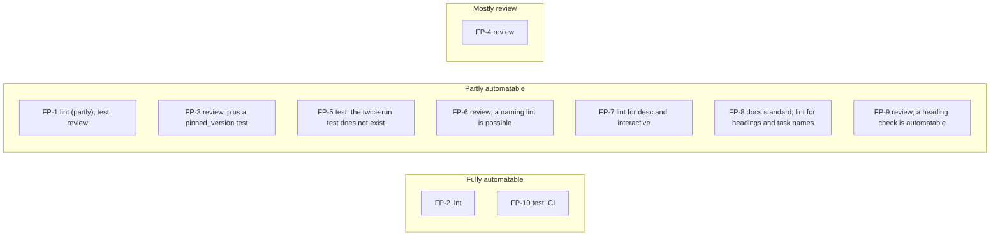
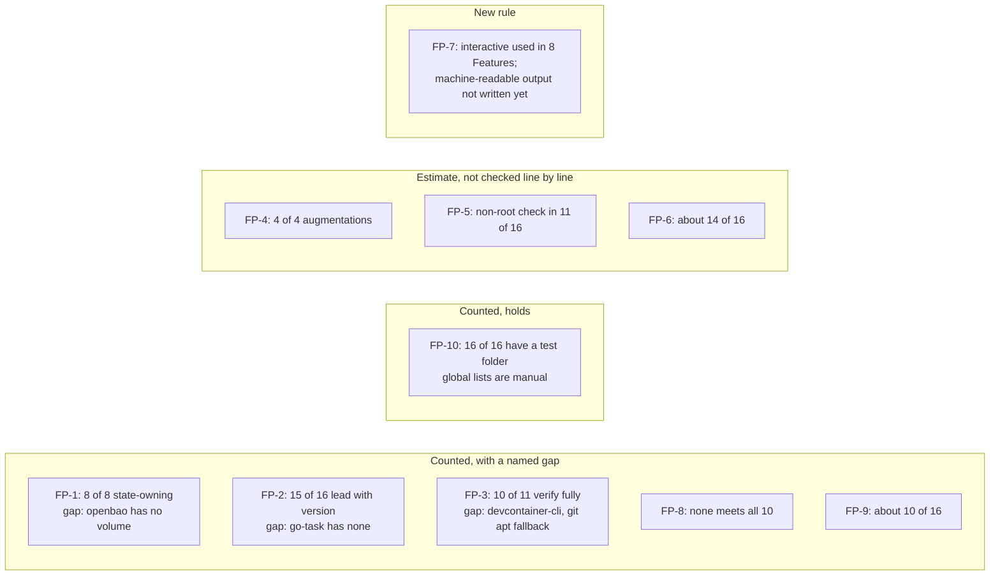

# Feature principles

Status: accepted by the Operator 2026-10-19; the binding text is `docs/principles/non-functional-requirements.md` (ADR 0011), where the ids were renamed from FP-n to NFR-n on 2026-10-20. This proposal keeps the old FP ids as history.

These are the non-functional requirements every Feature in this collection meets. Today they are implicit, spread over README, CONTRIBUTING and the code. They are what sets these Features apart from other Features for the same tool: this collection has its own Claude Code Feature because the others do not meet them.

They are checked, not aspirational. Each rule names how it is checked and whether that can be automated. "Today" counts the 16 Features, from a read of the repo.

## The principles at a glance

Ten principles, grouped by the question each one answers.

## The principles

### FP-1 owns-its-state
A Feature whose tool keeps state MUST own it in a named volume at `/var/lib/devcontainer-features/<id>`, set through `containerEnv`, made usable by `<id>-setup` via `dcf-persist`.

- **Why:** a rebuild must not log you out; a repo can still bind-mount the host disk.
- **Source:** CONTRIBUTING "Proposing a new Feature"; README "Feature state".
- **Checked by:** lint (partly), test, review. A JSON check for the mount and variable is automatable; "has state" is a judgement.
- **Today:** 8 of 8 state-owning Features. Gap: openbao has a login (`~/.vault-token`) and no volume (docs audit).

### FP-2 registered-taskfile
A Feature MUST ship `taskfile.yml`, registered by the verbatim install block and switched by `installTaskfile`; every task MUST have a `desc`, and the first task MUST be `version`.

- **Why:** Task is the API; documents name tasks, not scripts.
- **Source:** CONTRIBUTING "taskfile.yml"; README "Feature Taskfiles".
- **Checked by:** lint. Fully automatable.
- **Today:** 16 of 16 ship one with a `desc` on every task. 15 of 16 lead with `version`; go-task has none.

### FP-3 verified-and-pinned
A Feature that downloads MUST verify it against the publisher's checksum, take a `version` option, and say what `latest` resolves to.

- **Why:** a build must be reproducible and a download provable.
- **Source:** CONTRIBUTING "install.sh" step 6; README under the table.
- **Checked by:** review, plus a test that `pinned_version` installs exactly that version. The test is automatable; "uses a checksum" can be grepped.
- **Today:** 10 of 11 installers verify fully. devcontainer-cli verifies Node.js but not the npm CLI. git's apt fallback is unverified (audit).

### FP-4 augments-not-replaces
Where an official Feature exists, this one MUST order after it with `installsAfter`, never `dependsOn`, and MUST install the tool only when absent.

- **Why:** adopters keep the official install method.
- **Source:** README "Augment, don't duplicate"; CONTRIBUTING.
- **Checked by:** review. Mostly not automatable.
- **Today:** claude-code, git, gh, az follow it (4 of 4 augmentations). The other 12 have no official counterpart in play. Estimate: not every Feature was checked line by line.

### FP-5 idempotent-and-user-neutral
`install.sh` MUST run twice with the same result, MUST run as root without assuming a `remoteUser`, and `<id>-setup` MUST be idempotent and never fatal.

- **Why:** images rebuild; users differ per repo.
- **Source:** CONTRIBUTING "install.sh" step 10, "devcontainer-feature.json".
- **Checked by:** test (run twice, run as non-root). Automatable, but the twice-run test does not exist.
- **Today:** estimate only. The non-root check is in the `pinned_version` scenarios (11 of 16). Idempotence is stated, and I did not verify it per Feature.

### FP-6 one-way-to-configure
Settings MUST be options or plain variables, resolved CLI, then `.env`, then environment, with the same names in tasks and scripts.

- **Why:** the same name works in every repo and every shell.
- **Source:** README "Settings are plain variables, three ways".
- **Checked by:** review; a lint for naming (`<ID>_SETUP_*`) is possible.
- **Today:** estimate, about 14 of 16. Host-side tooling follows it; I did not diff every Feature's variable names.

### FP-7 agent-ready
Every task an agent may run MUST be non-interactive unless marked `interactive: true`, and MUST accept extra flags through `CLI_ARGS`.

- **Why:** agents and humans use one entry point, `task --list`.
- **Source:** CONTRIBUTING "taskfile.yml"; README "Task is the API".
- **Checked by:** lint for `desc` and `interactive` on login tasks; machine-readable output is review only.
- **Today:** the `interactive` marking is used in 8 Features (login tasks). Machine-readable output is not a written rule yet: this one is new.

### FP-8 documented-to-the-standard
`NOTES.md` MUST cover the audit's 10 items, or say in one line that an item does not apply.

- **Why:** absence then always means "forgotten".
- **Source:** the docs audit, section 1; CONTRIBUTING "NOTES.md" (today only four short topics).
- **Checked by:** the docs standard. Lint can check headings and that every task is named.
- **Today:** none meets all 10. The five with state or an official counterpart come close; the seven plain installers are thin.

### FP-9 says-why-it-exists
A Feature with a published alternative MUST say, in one paragraph, which and what differs.

- **Why:** the trust question; it is the Feature's reason to exist.
- **Source:** audit item 9; CONTRIBUTING "NOTES.md".
- **Checked by:** review. A heading check is automatable.
- **Today:** about 10 of 16 have one (audit, item 9 column).

### FP-10 tested-on-base-images
A Feature MUST have `test.sh`, a `pinned_version` scenario if it installs a binary, a scenario per option, and a place in the global scenario.

- **Why:** CI proves it on the listed images.
- **Source:** CONTRIBUTING "Tests"; `.github/workflows/test.yaml`.
- **Checked by:** test, CI. Automatable.
- **Today:** 16 of 16 have a test folder. The matrix runs debian, ubuntu and the Microsoft base image. The global lists are manual (CONTRIBUTING step 9).

Where each principle is checked, from each "Checked by" line: how far the check can be automated.

How the "Today" counts read: where a count shows a gap, where a rule holds, and where the number is only an estimate.

## Open question: MCP

Nothing in the repo offers an MCP server today. A grep of `src/`, `.devhost/` and `.claude/` finds no hit; only `TODO.md` names it. claude-code installs the CLI and a launcher, and devhost ships hooks and `devhost-*` commands, neither with MCP.

"Offer MCP" would concretely mean an optional `mcp` option. It would install a pinned, verified server binary and register it for Claude Code, with its credentials in the Feature's own state volume.

- **Every Feature.** Uniform, but most tools (kustomize, kubeconform, dsc) gain nothing. Costs 16 servers to pin, verify, test and keep current.
- **Only where an agent benefits** (argocd, gh, az, kube-state, openbao). Costs 4 to 5 servers, and a rule for "benefits". Risk: a server that wraps a login also widens the agent's reach.
- **None for now.** Zero cost. Tasks already are the agent API (FP-7).

**Recommendation:** none for now, and write FP-7 so tasks are good enough. Revisit per tool when an agent shows friction a task cannot fix. Evidence here is thin: I found no ledger record of such friction, and I did not search the ledger.

## The audit's four decisions

- **git:** fix the doc. The apt fallback keeps the wrapper working on a bare base image. The doc then says it installs git only when absent, unverified, from the distribution. Revisit if FP-3 should be strict.
- **openbao:** add the state volume. It is the one CLI with a login and no volume, and FP-1 would fail it. Until then, document the gap and the `BAO_TOKEN` route.
- **devhost "Where it comes from":** cut it. It describes private repositories and tells an adopter nothing to act on. Move the story to `docs/iterations.md`.
- **"Why this exists":** mandatory only where a published alternative exists (FP-9). One line "none" is enough elsewhere.

## Adoption

1. **`docs/principles/non-functional-requirements.md`**: the accepted text of FP-1 to FP-10. The proposal stays here with its status.
2. **An ADR**: records that the principles bind, and that a Feature failing one needs a written exception in its NOTES.
3. **Lint rules** for the automatable ones: FP-2, FP-3's `pinned_version`, FP-8's headings and task names, FP-10. First FP-2, as it already holds for 15 of 16.
4. **A conformance table per Feature**: backlog item `feature-conformance`, one list per Feature with pass, fail or not applicable, and the audit's fixes folded in.
5. **Order:** accept, write the file, add the lint rules, then the table. Failing Features get a backlog item each, not a blocked release.
