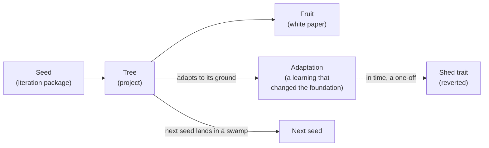
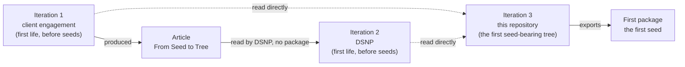
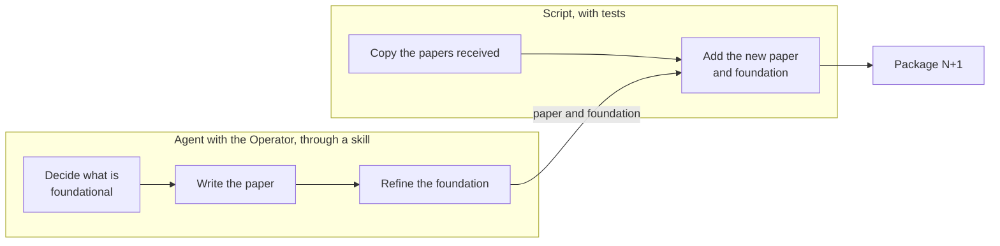

# Proposal: the iteration package

Status: accepted by the Operator (2026-10-16). The flow, its rule, the honest-accounts rules, the life theme and the no-true-up account are agreed, and so are the location and format proposed under Open. What is foundational is decided when the Operator calls the iteration. This repository will export the first package, but is not ready yet.

Each iteration of the Agentic Delivery OS (`docs/iterations.md`) ends by exporting a package, and the next project starts from it. In the life theme (ADR-0007) the package is the seed.

## What it is, and what it is not

The package holds what the iteration considers **foundational**: what the next project needs to start its own iteration. So far that means the ledger, the lexicon, the process, the principles, and now the ontology: the parts that have shown their worth. It is **not** the Agentic Delivery OS. The OS will also contain tooling, and that is not what an iteration produces. An iteration refines the foundation.

The rule replaces a list: each iteration decides what is foundational, on the evidence of its frictions, learnings and measures. That evidence is why the records have to be complete.

## Honest accounts

A seed is source material for the final white paper on building the Agentic Delivery OS. The Operator drafts that paper from the seeds and trims its content and wording. So a seed's paper errs on the side of completeness and truth, not polish:
- **What went wrong is told with what went right:** the failures, the corrections, the false starts, the ideas dropped, and what each cost.
- **Every fact is traceable** to a record: the ledger, a review, a report, an ADR, a commit. A number comes from the cost report, never from memory.
- **Guesses are marked as guesses,** and gaps as gaps. Example: the records do not show how iteration 3 got its context beyond the porting commit.
- **Nothing is smoothed for the reader.** Trimming is the Operator's job, at the end.
- **Detail over summary, on the spine of the story.** The narrative is the spine: what happened, in order, and why it mattered. Detail hangs on it, so the narrative is never lost to missing information and never buried under it. Detail can be trimmed later but not recovered: the records fade, and a summary hides what it left out. So a seed's paper gives:
  - dates, and the order things happened in;
  - the numbers: costs, counts, before and after;
  - the friction as it was recorded, with the entry it came from;
  - each decision with the alternatives weighed and the reason;
  - the commands, guards and rules by their real names;
  - what each change made better or worse, measured where it can be.

## The flow

```
package N                      iteration N+1                 package N+1
┌────────────────────┐         ┌──────────────────┐          ┌──────────────────────┐
│ white papers 1..N  │──kept──►│ ingest, adopt,   │──kept───►│ white papers 1..N    │
│                    │         │ grow, adapt,     │  added──►│ white paper N+1      │
│ foundation (N)     │──read──►│ measure          │──merged─►│ foundation (N+1)     │
└────────────────────┘         └──────────────────┘          └──────────────────────┘
```

- **White papers carry over unchanged.** Each one is rich enough to stand alone, because it is the only thing from its iteration that travels.
- **The foundation is merged, never nested.** The next iteration folds in what it learned. A trait that turns out to be a one-off is dropped again. Only the newest foundation travels.
- **The package received is saved in the repository** as it arrived. One of its parts tells the agent that the file is the source of the next export and must not be deleted.
- **Adoption is conversational.** The package says what to ingest and what it is for. It does not prescribe the transformation, because each project adapts to its own environment.
- **Producing the package is a conversation too,** between the Operator and the session, iterated until it reads right.

## The theme: life

Life is the theme of the whole series, shared by every project, not by one repository (the Operator, 2026-10-16). The white papers tell the journey through it, starting with "From Seed to Tree":
- a seed lands, grows into a tree and bears fruit;
- the tree adapts to its ground (an arid one, say);
- its next seed lands in a swamp, so the generation after has to handle both;
- in time one adaptation proves to be a one-off and falls away.

That is the frictions and learnings in another dress: organic growth, measured.

The theme as a picture, from the first seed to a trait that falls away:



The theme is a label layer, as ADR 0004 sets for themes. The analogy shapes the story, the sentences stay plain words, and the machinery keeps its plain names. It sits above a repository's own conversation theme, such as this repository's Arthurian one, and does not replace it.

| Plain name | Life label |
|---|---|
| iteration (a project's turn in the series) | generation |
| project | tree |
| project context (its constraints and environment) | ground |
| iteration package | seed |
| white paper | fruit |
| a learning that changed the foundation | adaptation |
| a change that proved to be a one-off and was reverted | shed trait |
| the series of iterations | lineage |
| iterations 1 and 2, before any package existed | first life, before seeds |
| iteration 3, which grew from reading its ancestors and exports the first seed | the first seed-bearing tree |

**Syncing it:** the next alignment prompt to the other projects carries the theme and this table, as information only. Each project adopts the labels in conversation. Nothing they commit is renamed.

## No true-up: the story as it happened

The earlier iterations are not reconstructed (the Operator, 2026-10-16). The series tells what happened:

- **Iteration 1 (client engagement)** produced one document, the article "From Seed to Tree". It is kept exactly as it was used, never rewritten.
- **Iteration 2 (DSNP)** was bootstrapped from that article almost at once, before any package existed: DSNP read it. The first package carries the article as DSNP received it.
- **Iteration 3 (this repository)** was bootstrapped after DSNP's success. It started from no package and no article. Its way of working was ported by reading the two earlier repositories directly (commit `ff21f35`, 2026-10-15; `src/devhost/NOTES.md`, "Where it comes from"). No record shows the article was read here.
- **This repository exports the first package:** the first foundation, the first seed. Its white paper names the concepts that came over from iterations 1 and 2, so the lineage is recorded once, in the paper, not in rebuilt payloads.
- The other projects are only aligned on the story. They produce nothing for it.

The lineage as it happened, with the life label beside each plain name:



The dotted lines are the porting by reading the two repositories; no record shows the article was read here.

## How it is built (AP-14)

- **Assembling the package is a script.** It copies the papers received and adds the new paper and foundation. The rule can be written down, so it is a script with tests.
- **Deciding what is foundational, writing the paper and refining the foundation is agent work,** done in conversation with the Operator, through a skill. Perhaps the skill is enough, with no separate journalist back.

Who does what: the script does the rule-based copying, the agent and the Operator do the judging and writing together.



## Open

- What this repository will consider foundational when it exports: decided when the Operator calls the iteration.
- Where a received package lives: `docs/iterations/package/` (accepted with the proposal).
- **Format (accepted with the proposal):** Markdown, which people and agents both read without tools, with a short front matter per file (iteration, date, sources). The docs site renders it for people. The journey's raw material is released with V1 of the Agentic Delivery OS, so it must stay readable outside any tool.
- The journalist is a skill, not a back (the Operator, 2026-10-17); it ships with the package and its instructions.
