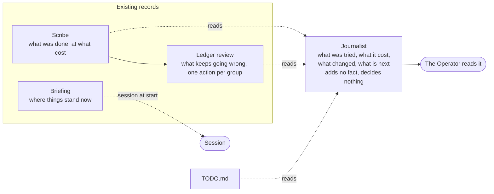
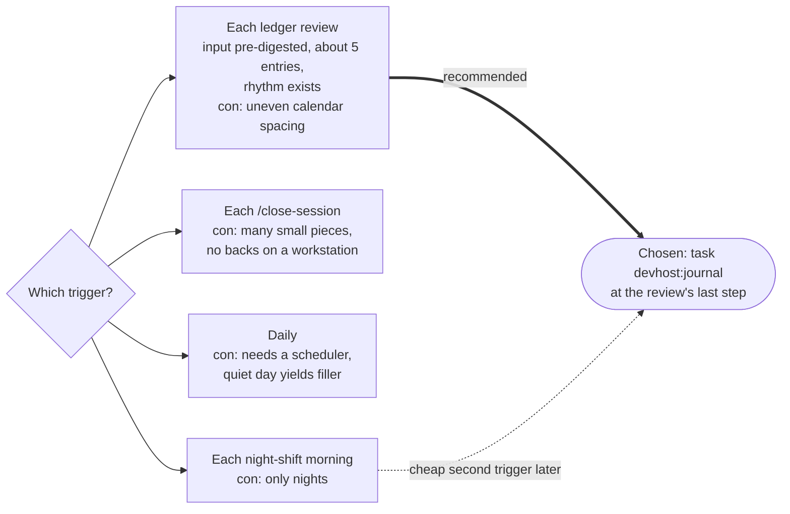
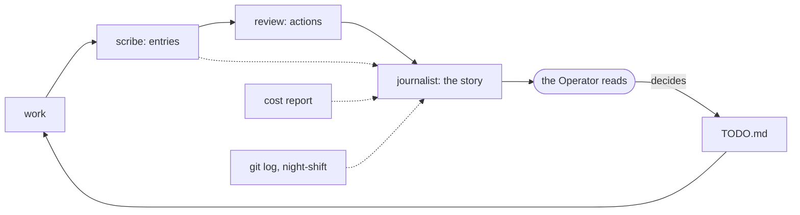

# Proposal: a journalist back

Status: decided 2026-10-17 by the Operator: the journalist is a skill, not a back. It is part of
the iteration package and its instructions, and writes the white paper in conversation with the
Operator when the iteration is called. Earlier, accepted 2026-10-16 with a changed purpose: the back writes the iteration's white paper
(docs/iterations.md), in plain words, when the Operator calls the iteration, not a journal piece
per ledger review. What follows is the original draft; its sources, guard and cost still apply.

## 1. Its job, and how it differs

The records are complete and unreadable as a story: the ledger is 39 KB for one day. The
journalist writes the story of the iterations for a person to follow in about five minutes.

| Record | Answers | Reader | Shape |
|---|---|---|---|
| Scribe (ledger) | What was done in this unit, at what cost | The review, the backs | One entry per unit, 8 to 12 lines |
| Ledger review | What keeps going wrong; which one action fixes each group | The Operator, as decisions | One section per review, one action per group |
| Briefing | Where things stand now | The session at start | Ephemeral, state only |
| **Journalist** | **What was tried, what it cost, what changed in how we work, what is next** | **The Operator, as a read** | **One short piece per period, diagrams, add-only** |

It adds no fact the records lack. It selects, orders and connects them (cause to change to
result), and says plainly when a change did not pay off. It decides nothing and proposes nothing
new: "what is next" is only what `TODO.md` and the review already say.

Where the journalist sits among the records: the others each keep or use one record; it only reads them and tells the story.

## 2. Trigger options

| Trigger | Pros | Cons |
|---|---|---|
| Each ledger review | Natural iteration boundary: the review has already grouped friction and named actions, so the input is pre-digested; about 5 entries per piece; one rhythm already exists | Uneven calendar spacing (about 4 on a busy day, none on a quiet one) |
| Each `/close-session` | Fresh context; the host is present | Many small pieces; the host spends a turn; no backs on a workstation |
| Daily | Predictable, easy to skim | Needs a scheduler the devhost does not have (hooks are session events only); a quiet day yields filler |
| Each night-shift morning | The report already exists and the Operator is reading anyway | Only nights; the interactive iterations (most of the work) are missed |

**Recommendation: each ledger review.** The review is the point where the team already stops
and asks what changed; the journalist reports that stop. The review skill's last step runs
`task devhost:journal` (no hook change needed to try it; a hook is a later decision). A
night-shift morning piece is a cheap second trigger later: same job, different input.

The four triggers weighed, and the one chosen with the one kept for later.

## 3. Input, output, guard

**Reads** (all already on disk, none needs the network):

| Input | Source | Approx size |
|---|---|---|
| Ledger entries since its last piece | `docs/ledger/YYYY-MM.md`, from the date of the last journal piece | 2 KB per entry, about 10 KB for 5 |
| The review section just written | the `## Review` section of the ledger | 2 to 3 KB |
| Cost report | `docs/ledger/costs-YYYY-MM-<engineer>.md` | 3.3 KB |
| Git log since the last piece | `git log --oneline --since` (subjects only) | 1 to 2 KB |
| Night-shift reports since | `docs/night-shift/*.md` | 0 to 3 KB |
| Its previous piece and the brief | `docs/journal/`, `brief.md` | 3 KB |

Budget: **at most 30 KB (about 8k tokens) of input**, trimmed by `condense.py`-style rules
(oldest entries first drop to their title and Outcome line). Paths and ids, never content; the
name guard runs over its output like the other backs.

**Writes** `docs/journal/YYYY-MM-DD.md` (a second piece the same day gets `-2`). Add-only.

| Part | Content | Length |
|---|---|---|
| Headline | One sentence: the iteration in plain words | 1 line |
| The period in numbers | Entries, runs, cost by tier, change from last piece | 1 small table |
| What we tried | Each attempt and what happened; the failures first-class | 4 to 8 bullets |
| What changed in how we work | Rule, tool, model or skill changes, each with the entry or commit id | 3 to 6 bullets |
| Picture | One diagram of the loop or the change (mermaid), when it earns its place | 1 |
| What is next | From `TODO.md` and the review; each with its id by description | 3 to 5 bullets |

Whole piece: 250 to 450 words plus the table and one diagram. Dated, with the ledger range and
the commit it covers, so each claim is checkable. Plus `docs/journal/README.md` as the index
(the journalist appends one line per piece).

**Guard** (a new `journal_guard` in `guards.py`, same shape as `docs_guard`): the run may add
files under `docs/journal/` and one line to its index; any edit or deletion of an existing piece
or any change outside `docs/journal/` is undone. `devhost-verify` gets two checks: pieces carry
the date and ledger range lines, and no piece names a person or a redact-list word.

## 4. Model and cost

Real per-run costs today (`runs.jsonl`, list price):

| Back | Model | Runs | Total | Per run | Changed | Avg input tokens (incl. cache) | Avg output tokens |
|---|---|---|---|---|---|---|---|
| scribe | Haiku | 31 | $1.78 | $0.057 | 19 | 29,000 | 5,200 |
| secretary | Haiku | 27 | $1.75 | $0.065 | 12 | 104,000 | 4,000 |
| librarian | Sonnet | 22 | $2.66 | $0.121 | 4 | 79,000 | 800 |
| tester | none | 38 | $0 | $0 | 3 | 0 | 0 |

The journalist's input is about 8k tokens of material, plus the CLI's fixed overhead the backs
already show (the secretary and librarian carry 70k+ cached tokens), and about 1.5 to 2k tokens
of output. Estimate per piece:

| Model | Fresh-input basis | Output | Estimate per piece | Per day at 4 reviews | Per month (20 days) |
|---|---|---|---|---|---|
| Haiku | 8k at $1/M ≈ $0.01 | 2k at $5/M ≈ $0.01 | **$0.04 to $0.07** (scribe is $0.057 with 5k out) | $0.16 to $0.28 | $3 to $6 |
| Sonnet | 8k at $3/M ≈ $0.02 | 2k at $15/M ≈ $0.03 | **$0.12 to $0.20** (librarian is $0.121 with 79k in) | $0.48 to $0.80 | $10 to $16 |

For scale: all backs cost $5.16 today and the month so far $27.74; a Sonnet journalist adds
roughly 10 percent at a busy day's rhythm, a Haiku one about 3 percent.

**Recommendation: Sonnet.** The work is the opposite of the scribe's: few tokens out, but the
quality is the whole product (choosing what matters, saying what failed, no padding), and a
weak piece is worse than none because a person reads it. Its blast radius is low (add-only,
guarded, nothing else reads it), so no larger tier is justified. The trial below decides it on
evidence; if Haiku reads as well, it moves down at the next review by the usual rule.

## 5. Its name

In the King Arthur theme, a suggestion only: **the Bard** (tells the deeds of the round table
for people to hear; fits a read-aloud story). Alternative: **the Chronicler**, which is closer
to a record and so blurs with the scribe. The Bard keeps the roles apart: the scribe records,
the Bard tells.

## 6. A trial before building

PROCESS.md says a new mechanism is trialled once before it is described. Run it by hand, no
back, no hook, no guard:

1. Pick the span of the first ledger review (2026-10-16): ledger entries from that day, its
   `## Review` section, the cost report, `git log --oneline` for the day, the night-shift report.
2. Write a short `brief.md` from section 3's shape; give it to a con (not a back) with the
   inputs pasted or by path, twice: once on Haiku, once on Sonnet, same input.
3. Save both outputs outside the repository (scratchpad). The Operator reads both; nothing is
   committed under `docs/journal/` until they choose.
4. Measure:

| Measure | How | Pass |
|---|---|---|
| Cost per piece | The con's measured cost, per model | Within the estimate above |
| Input size actually needed | Characters the con read | Under the 30 KB budget |
| Read time | Operator's own | About 5 minutes or less |
| Accuracy | Every claim traced to an entry id or commit by the Operator or a second con | No claim without a source; none wrong |
| Usefulness | The Operator: did it show something the review and briefing did not | Yes, in the Operator's words |
| Haiku against Sonnet | Same checks side by side | Pick the cheaper one that passes all |
| Voice | Plain, no padding, failures stated | The Operator's call |

If it passes, the next steps are a backlog item for the Operator to accept, the brief and
`job.sh`, the guard with its test, and a first week of pieces measured at the following review.
If the Operator finds nothing new in it, the proposal ends here and the cost was one con run.

## Decisions for the Operator

| Decision | Recommendation |
|---|---|
| Is a journalist wanted at all | Yes, trial first |
| Trigger | Each ledger review |
| Model | Sonnet, confirmed by the trial |
| Name | The Bard (theme still to be settled) |
| Output home | `docs/journal/YYYY-MM-DD.md` with an index |
