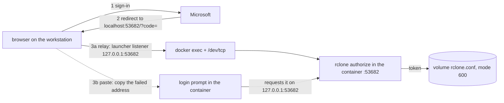

## Changes in 1.3.0

- **One sign-in command, wherever it runs.** `task cloud-folder:login` now runs rclone's own browser
  sign-in (`rclone authorize "onedrive" --auth-no-open-browser`) in the container instead of
  asking for a token from another machine with the same rclone version. Sign in in any browser and
  paste back the address it fails to open (`http://localhost:53682/?code=...`), or, from the
  workstation with `devcontainer-cli` 1.16.0, let the launcher relay the browser into the container.
  A pasted token is still accepted at the same prompt, and `-- --token` asks for nothing else. See
  "Signing in". `login` takes `-- --relay` (the launcher's) and `-- --token`;
  `CLOUD_FOLDER_LOGIN_TIMEOUT` bounds the wait (default 600 s). The token is still written only into
  the volume's `rclone.conf`.

## What it gives you

One fixed path in the container, `/mnt/cloud-folder` by default (option `mountPoint`), for a
shared document folder that must never go in git: recordings, raw transcripts, unsummarised
documents kept in a SharePoint or OneDrive folder. Agents and people read and write it as a
normal directory, and `task cloud-folder:status` says whether it is really there before anyone
writes into it.

This version (1.3.0) fills it in one of three ways:

- **host mode**: the folder a sync client (OneDrive) keeps on the host is bind-mounted by the
  launcher (the `devcontainer-cli` Feature and its bootstrap) at one fixed path, the host mount
  `/mnt/cloud-folder-host`, and the mount point links to it. No rclone, no sign-in.
- **sync mode**: [rclone](https://rclone.org) runs `bisync` between the remote (a SharePoint
  document library, or a person's OneDrive) and the folder, on a timer and on demand. It needs
  nothing privileged, so it works where there is no Windows host, such as a Kubernetes cluster.
  The sign-in, the rclone config and the sync state live in the Feature's own volume.
- **mount mode**: `rclone mount` of the remote on the folder, a live view, with a VFS cache in the
  Feature's volume. It needs FUSE, which the launcher grants per machine only when the project
  asks (`DCF_HOST_FUSE=1`); where it is not granted (a cluster that refuses FUSE), `auto` uses
  sync instead.

`auto` (the default) takes host when a host folder is mounted, else mount when FUSE is usable and a
remote is signed in, else sync when a remote is signed in.

What it installs:

- `rclone` in `/usr/local/bin`, for sync (not in mode `host`, and not when the image already has
  one: that one is kept). Downloaded from the publisher (`downloads.rclone.org`) as the release
  zip, never piped into a shell, and verified with `sha256sum` against the digest pinned in this
  Feature (`rclone-checksums.txt`, amd64 and arm64) for the default version, or against the
  release's `SHA256SUMS` for another version. The `SHA256SUMS` file is also PGP-signed by the
  publisher; the signature is not checked. `curl` and `unzip` are installed with apt when missing.
- `fuse3` (for `fusermount3`, which `rclone mount` calls), with apt, in modes `auto` and `mount`
  only, and only when the image has neither `fusermount3` nor `fusermount`. `auto` needs it too
  because whether FUSE is granted is known only at each start, per machine, long after the build;
  without the launcher's grant the setuid `fusermount3` can mount nothing. In `auto` a failed
  install is a warning (auto then never picks mount); in `mount` it fails the build.
- `cloud-folder-setup` (the `postStartCommand`, also behind the tasks) and `dcf-persist` (the
  collection's state-folder helper) in `/usr/local/bin`, its option defaults in
  `/usr/local/share/cloud-folder-feature/options.env`, and the Feature Taskfile.
- The mount point: in `auto` and `host`, a symbolic link from `mountPoint` to the host mount (none
  when `mountPoint` is `/mnt/cloud-folder-host` itself); no folder is created at either path, so
  when nothing is mounted the status fails and no one writes into a bare folder by mistake. In
  `sync` and `mount`, `mountPoint` is a plain folder of the image, filled by the sync or with the
  rclone mount on it; no link.

## How the folder gets there

```
 HOST (launcher: devcontainer-cli)            DEVCONTAINER
 .devcontainer/.env:
   DCF_HOST_CLOUD_FOLDER=<synced folder>
   DCF_HOST_FUSE=1 (only where mount is wanted)
 task devcontainer:up
   --mount type=bind,source=<folder>, ---->  /mnt/cloud-folder-host        host mode
     target=/mnt/cloud-folder-host             ^ link made at build (auto, host)
   DCF_HOST_FUSE_* -> runArgs: /dev/fuse,    /mnt/cloud-folder  (mountPoint)
     SYS_ADMIN, apparmor=unconfined            ^ sync mode: filled by rclone bisync
                                               ^ mount mode: rclone mount on it (FUSE)
                                               | (auto, no host folder: the folder the link leads to)
 SharePoint / OneDrive  <---- rclone bisync --+  timer (every syncInterval) and task cloud-folder:sync
                        <---- rclone mount ---+  VFS cache (writes); rc on 127.0.0.1:5572 (vfs/stats)
                                             volume cloud-folder-<id> at /var/lib/devcontainer-features/cloud-folder:
                                               rclone.conf (600: the token), bisync/ (listings), cache/,
                                               run/ (PID files), last-sync, sync.log, timer.log, mount.log
```

### Host mode

1. On the host, set `DCF_HOST_CLOUD_FOLDER` to the folder's path, in `.devcontainer/.env` (or
   the environment, or `task devcontainer:up DCF_HOST_CLOUD_FOLDER=...`): for example
   `C:\Users\<you>\<synced library>\<folder>` on Windows. Unset means "no host folder", and the
   launcher mounts nothing.
2. `task devcontainer:up` (devcontainer-cli 1.12.0 or later) adds the bind mount at
   `/mnt/cloud-folder-host`, always: the path in the container is named once, in the Feature's
   `mountPoint` option, which links there. The launcher never creates the host folder: when the path does not exist on this host it skips
   the mount and says so, and the container starts without it (the status then fails). A path
   with a comma cannot be passed to `--mount` and is skipped the same way. `HOST_MOUNTS=false`
   turns this mount off with the others. `task devcontainer:host` shows what `up` would add. A
   repository that bind-mounted the folder by hand drops that line from its `devcontainer.json`.
3. Map the variable with `containerEnv` so the report can name the source (the bootstrap's
   `devcontainer.json` template does): `"DCF_HOST_CLOUD_FOLDER": "${localEnv:DCF_HOST_CLOUD_FOLDER}"`.

The Feature decides nothing from the variable: "mounted" means the path the mount point leads to
(through the link, so the host mount) is the target of a mount in the container's mount table.
The variable only names the source in the report.

### Mount mode

1. On each machine that should have it, set `DCF_HOST_FUSE=1` in `.devcontainer/.env` on the
   host and keep the bootstrap template's three `runArgs` lines in `devcontainer.json`; then
   `task devcontainer:rebuild` (devcontainer-cli 1.15.0 or later). The launcher fills the lines
   with `--device=/dev/fuse`, `--cap-add=SYS_ADMIN` and `--security-opt=apparmor=unconfined`;
   unasked, each is a harmless label and the container gets no privilege (ADR 0031). Map
   `DCF_HOST_FUSE` with `containerEnv` so a report can name it.
2. Set `mode` `mount` (or leave `auto`), `siteUrl` and `remotePath` as for sync, and run
   `task cloud-folder:login` once. The post-start hook then mounts the remote at each start
   (`task cloud-folder:start` mounts it now, `stop` or `unmount` unmounts it).

The mount runs `rclone mount <remote> <folder> --vfs-cache-mode writes --cache-dir <volume>/cache
--rc --rc-addr 127.0.0.1:5572`, detached, with its PID file in the volume and its log in
`mount.log`. Cache mode `writes` keeps written files in the volume's cache until they are uploaded,
so the upload queue can be read; rclone uploads what is left in the cache at the next mount after
a stop. The remote control listens on localhost only and has no credentials, so only its
read-only methods answer (`vfs/stats`, which `status` reads; a method such as `core/quit` is
refused). rclone does not mount over a folder with files: a folder that holds a sync copy (`auto`
moving from sync to mount) stays with sync until it is synced and emptied.

`cloud-folder-setup fuse-check` says whether FUSE is usable and, if not, which part is missing:
no `/dev/fuse`, a device the engine's rules do not open, no `CAP_SYS_ADMIN` in the capability
bounding set, an AppArmor profile that denies mount (Docker's `docker-default`), or no
`fusermount3`. `auto` reads the same check; `status` and `version` print it.

### Sync mode

1. Set the options: `mode` `sync` (or leave `auto`), `siteUrl` (the SharePoint site) and
   `remotePath` (the folder inside its document library; it must exist), and rebuild.
2. Sign in once: `task cloud-folder:login`, in the container or on the workstation (see
   "Signing in").
3. Login then finds the drive: for `sharepoint`, the site's document library from `siteUrl`
   (through rclone's own non-interactive config); when the site has more than one library it
   lists them and asks which (or set `CLOUD_FOLDER_DRIVE_ID` to the drive id and log in again);
   for `onedrive`, your own drive. It checks the remote answers and starts the timer, whose first
   round is the first sync.
4. From then on the timer syncs every `syncInterval` (default 15 minutes); `task cloud-folder:sync`
   syncs now.

### Signing in

One command, `task cloud-folder:login`, in the container or (with `devcontainer-cli` 1.16.0 or
later and the bootstrap's `cloud-folder` include in the root Taskfile) on the workstation, from the
repository's checkout. It picks the route itself; the workstation's operating system does not
matter.

Why it needs a route at all: rclone signs in with the browser flow of its own app registration,
which lets Microsoft send the browser back only to `http://localhost:53682/`. rclone listens there,
inside the container; the container has no browser, and the workstation's `localhost:53682` is not
the container's.



1. **From the workstation (the relay, the default there).** The launcher finds the running
   devcontainer, opens a listener on the workstation's `127.0.0.1:53682` for the sign-in only,
   starts this login in the container (`cloud-folder-setup login --relay`), and opens your default
   browser at the sign-in. Each request the browser makes to `localhost:53682` (the start page, then
   Microsoft's redirect with the code) is relayed into the container through `<engine> exec -i` and
   bash's `/dev/tcp` to rclone's listener: no port mapping, no socat, nothing in
   `devcontainer.json`. The listener closes when the login ends, fails, or after
   `CLOUD_FOLDER_LOGIN_TIMEOUT` seconds. When `53682` is already taken on the workstation (another
   sign-in, a local rclone), or on Linux and macOS there is no `python3` for the listener, it says
   so and continues with the paste route on the same terminal. `task cloud-folder:login -- --paste`
   chooses that route.
2. **In the container (paste back).** `task cloud-folder:login` there prints Microsoft's sign-in
   address. Open it in a browser on any machine and sign in. The browser then fails to open
   `http://localhost:53682/?code=...` ("cannot be reached"): that is expected. Copy that whole
   address from the address bar and paste it at the prompt (with or without `http://`); the login
   requests it on rclone's listener in the container, so rclone receives the code as if the browser
   had reached it, gets the token and the login carries on. An address from an earlier attempt is
   refused (rclone checks it belongs to this sign-in); start again with the new address.
3. **A token from rclone elsewhere.** The same prompt accepts the one-line token that
   `rclone authorize "onedrive"` prints between `Paste the following into your remote machine --->`
   and `<---End paste` on a machine with a browser (use the version login prints).
   `task cloud-folder:login -- --token` asks only for that. From the workstation,
   `task cloud-folder:login -- --workstation-rclone` does it for you: the launcher downloads the
   pinned rclone (the repository's `rcloneVersion` in `devcontainer.json`, else this Feature's
   default) once into its cache, verifies the zip against the release's `SHA256SUMS`, runs
   `rclone authorize "onedrive"` there (it opens the browser itself) and hands the token to the
   container's login on stdin, never as an argument.

Whatever the route, the token is read without echo on a terminal, never put on a command line, and
written only into the volume's `rclone.conf` (mode 600); rclone's output while signing in goes to a
private folder in the volume that is removed at once. Both `remoteType`s use rclone's `onedrive`
backend, so `authorize` always gets `"onedrive"`.

The workstation command needs the root Taskfile to include the launcher's `cloud-folder.yml`
(the bootstrap's template does; the bootstrap prints the lines for an existing Taskfile). Inside
the container that include is left out, because this Feature sets `RCLONE_CONFIG` there, so its own
`cloud-folder:login` is the only one (two tasks of one name would stop every task of the
repository). Without the include, `task devcontainer:cloud-folder-login` is the same command on the
workstation.

**How a sync works.** One `rclone bisync <remote> <folder>` with:

- `--resync` on the first sync of a folder, chosen on its own: when the folder lacks the hidden
  marker `.cloud-folder-bisync` (a new folder, as after a rebuild) or the remote or folder changed.
  A resync copies each side to the other and deletes nothing; on a difference the remote's
  version wins (bisync's `--resync-mode path1`).
- `--workdir` in the volume (the listings survive a rebuild), `--log-file` the volume's `sync.log`.
- `--max-lock 5m`: a lock left by a run that was killed expires after 5 minutes (bisync renews its
  lock while it runs, so a long sync is not taken for a stale one).
- `--resilient --recover`: what the bisync page recommends for unattended runs, so a less serious
  error or an interruption is retried on the next run instead of locking the folder out until a
  manual `--resync`.
- `--max-delete 50`: bisync's own default, written out: a run that would delete more than half the
  files of one side stops and changes nothing. bisync also refuses to sync from an empty side
  ("Empty current Path2 listing"), which protects the remote when the folder is emptied.
- Conflicts (a file changed on both sides): bisync's default, which in rclone 1.75.2 is
  `--conflict-resolve none`: **both versions are kept**, renamed `<name>.conflict1` (the remote's)
  and `<name>.conflict2` (the folder's), and both copied to each side. Nothing picks a winner.
- Default comparison (size and modification time); no `--compare` or `--create-empty-src-dirs`
  (an empty folder is not synced).
- The marker is excluded (`--exclude /.cloud-folder-bisync`); it never reaches the remote.

Exit codes of `cloud-folder:sync`: `0` ok; `1` failed (the next run may succeed); `7` critical
(bisync wants `-- --resync`); `2` a wrong argument; `3` cannot sync here (not sync mode, no
sign-in, no rclone, the folder not writable); `4` another sync is running. The result goes into
the record `last-sync` (time, result, rclone's exit code, the first error line), which the status
reads.

**The timer** is one loop (`cloud-folder-setup run`) started detached by the post-start hook in
sync mode, with its PID in `run/loop.pid` in the volume; a second start sees it running and leaves
it, so there is never a second loop. It syncs, waits `syncInterval`, and again; a round that finds
a sync already running (a manual one) skips. `syncInterval` `0` starts no timer: syncs happen only
on demand. `task cloud-folder:stop` stops it cleanly: a sync that is running gets bisync's
graceful shutdown (SIGINT; bisync finishes what it started, saves its state, at most about 90 s),
then SIGTERM; `task cloud-folder:start` starts it again. No container `entrypoint` is declared
(ADR 0031). A sync never runs twice at once: each holds `run/sync.pid`.

**The shutdown check.** `cloud-folder-setup shutdown-check [SECONDS]` (task
`cloud-folder:shutdown-check WAIT=<seconds>`) is for a repository's own `shutdown:check`
([bootstrap/SHUTDOWN.md](https://github.com/nabil-becker/devcontainer-features/blob/main/bootstrap/SHUTDOWN.md)).
In sync mode it exits `1` (refusing the stop) while a sync runs, after waiting up to SECONDS
(default 60, or `CLOUD_FOLDER_SHUTDOWN_WAIT`) for it to end, and while files in the folder
changed since the last successful sync started, saying to run `task cloud-folder:sync` first. In
mount mode it exits `1` while uploads are pending (`vfs/stats`: in progress plus queued) after
waiting up to SECONDS for them, and when the queue cannot be read (the remote control does not
answer); nothing mounted passes. In host mode, or when nothing is in flight, it exits `0`. Add it to the repository's check, for
example in `.devcontainer/shutdown-check.sh` at its TODO:

```sh
if command -v cloud-folder-setup >/dev/null 2>&1; then
  cloud-folder-setup shutdown-check 60 || problems=$((problems + 1))
fi
```

or, in a `shutdown:check` task, `- cloud-folder-setup shutdown-check 60`. `FORCE=1` on
`task devcontainer:stop` skips every check, this one included.

## Options

- `mode` (default `auto`): `host` expects a host folder mounted at the mount point. `sync` syncs
  with rclone. `mount` mounts the remote with rclone (needs FUSE, see "Mount mode"). `auto` uses
  `host` when something other than rclone is mounted there, else `mount` when FUSE is usable and a
  remote is signed in (a `[cloud-folder]` remote with a token or client credentials in the
  volume's config), else `sync` when a remote is signed in, else it reports "no source" and fails
  the status, and never pretends. Override without a rebuild with `CLOUD_FOLDER_MODE`
  in `containerEnv`, or for one call with `task cloud-folder:status CLOUD_FOLDER_MODE=sync`. The
  layout is fixed at build: with `mode` `sync` or `mount` the mount point is a folder; with `auto`
  it stays the link, and a sync or the mount fills the folder the link leads to
  (`/mnt/cloud-folder-host`, created at start).
- `mountPoint` (default `/mnt/cloud-folder`): where the folder appears, an absolute path, and the
  only place you name it. In `auto` and `host` the install makes it a symbolic link to the host
  mount and refuses, failing the build with the reason, when it already exists in the image as a
  folder with content or as a file (an empty folder or an old link is replaced). In `sync` it is a
  folder (a file there is refused). `CLOUD_FOLDER_MOUNT_POINT` in `containerEnv` makes the
  scripts look at another path without a rebuild (no link or folder is made then).
- `remoteType` (default `sharepoint`): `sharepoint` syncs a document library of the site
  `siteUrl`; it is the only kind the client-credentials sign-in of a cluster can use (ADR 0031).
  `onedrive` syncs the signed-in person's own OneDrive. Both use rclone's `onedrive` backend.
- `driveType` (default `documentLibrary`): rclone's `drive_type`, written at login; the drive
  lookup replaces it with what the drive reports. Change it only for `onedrive` (`personal` or
  `business`) when the lookup is skipped (`CLOUD_FOLDER_DRIVE_ID`).
- `siteUrl` (default empty): the SharePoint site, for example
  `https://<tenant>.sharepoint.com/sites/<site>`. Needed for `sharepoint` unless
  `CLOUD_FOLDER_DRIVE_ID` names the drive.
- `remotePath` (default empty: the whole drive): the folder inside the library to sync, for
  example `Shared/Recordings`. It must exist on the remote. Changing it gives the next sync a
  `--resync`.
- `syncInterval` (default `15m`): how often the timer syncs: seconds, or a number with `s`, `m`
  or `h`. `0`: no timer, sync on demand only.
- `rcloneVersion` (default `1.75.2`, the stable release on 2026-10-27, pinned with its sha256 per
  architecture): another version, with or without a leading `v`, is verified against its
  release's `SHA256SUMS`; `latest` resolves through `downloads.rclone.org/version.txt` (1.75.2 on
  2026-10-27) and the build log says what it resolved to.
- `installTaskfile` (default `true`): install the Taskfile into the go-task registry.

Every option but `rcloneVersion` and `installTaskfile` has a `CLOUD_FOLDER_*` variable that
overrides it without a rebuild (`CLOUD_FOLDER_MODE`, `CLOUD_FOLDER_MOUNT_POINT`,
`CLOUD_FOLDER_REMOTE_TYPE`, `CLOUD_FOLDER_DRIVE_TYPE`, `CLOUD_FOLDER_SITE_URL`,
`CLOUD_FOLDER_REMOTE_PATH`, `CLOUD_FOLDER_SYNC_INTERVAL`), from the task's command line, a `.env`
file or the environment, in that order. Login also reads `CLOUD_FOLDER_DRIVE_ID` (skip the drive
lookup) and the client-credentials variables below.

```json
"features": {
  "ghcr.io/nabil-becker/devcontainer-features/go-task:1": {},
  "ghcr.io/nabil-becker/devcontainer-features/cloud-folder:1": {
    "mountPoint": "/mnt/cloud-folder",
    "siteUrl": "https://<tenant>.sharepoint.com/sites/<site>",
    "remotePath": "<folder in the library>"
  }
},
"containerEnv": {
  "DCF_HOST_CLOUD_FOLDER": "${localEnv:DCF_HOST_CLOUD_FOLDER}"
}
```

With `mode` left at `auto`, this one block serves both: a workstation with a synced host folder
gets `host`; a cluster (or any host without one) gets `sync` once someone has run
`task cloud-folder:login`.

## State

The Feature's volume `cloud-folder-${devcontainerId}` at `/var/lib/devcontainer-features/cloud-folder`
(NFR-1), handed to the remote user by the post-start hook (`dcf-persist`) and made private (mode
700), holds:

- `rclone.conf` (mode 600): the `[cloud-folder]` remote with its token or client secret.
  `containerEnv` sets `RCLONE_CONFIG` to it, so a plain `rclone` in the container uses it too.
  rclone rewrites it when it refreshes the token, so it must stay writable.
- `bisync/`: bisync's listings and lock files; `cache/`: rclone's cache.
- `run/loop.pid` (the timer), `run/sync.pid` (a running sync), `run/sync.started`.
- `last-sync` (the record of the last sync), `last-ok` (its time stamp when it succeeded),
  `bisync-pair` (which remote and folder the listings are for).
- `sync.log` (the last sync's rclone log at INFO level: file names, no token; the one before is
  `sync.log.1`) and `timer.log` (the timer's own lines, rotated at 1 MiB).

The token is never put on a command line, in the workspace, in an image layer or in a log: login
reads it from stdin and writes it with shell builtins; rclone reads it from the config file; the
status reads only whether the key exists. A volume survives a rebuild and is deleted by a
container-engine storage reset; then `task cloud-folder:login` again.

The synced folder itself (sync mode) is in the container's filesystem, not in the volume: a rebuild
empties it, and the next sync (a resync, since the marker is gone) fetches it again from the
remote. To keep the local copy across rebuilds, mount a named volume at `mountPoint` in
`devcontainer.json` and set `mode` `sync` explicitly (with `auto`, a mount there would be taken
for a host folder). In host mode the content lives on the host.

## Check it works

```sh
task cloud-folder:status            # cloud-folder: ok: the folder is synced and writable (sync)
                                    # cloud-folder: ok: the folder is mounted and writable (host)
task cloud-folder:status -- --json  # one JSON object for agents
task cloud-folder:sync              # cloud-folder: sync ok in 3s
```

`status` prints the mode in use and why, and then:

- host mode: whether the mount point is mounted, present but not mounted, or missing, whether it
  is empty and writable, and what to do when it is not;
- sync mode: the remote and whether it is configured (and how: token or client credentials, never
  the token itself) and reachable (one `rclone lsjson --stat`, at most 30 s); the local folder,
  whether it is empty and writable, and the number of files changed since the last sync; the last
  sync's time and result; whether a sync and the timer are running;
- mount mode: the remote as above, whether FUSE is usable (and why not), whether rclone is mounted
  (and its PID), and the VFS upload queue from `vfs/stats` (in progress, queued, failed; "unknown"
  when the remote control does not answer).

It exits:

- `0` when the folder is usable: mounted and writable (host), or synced and writable (sync); an
  empty folder passes with a warning;
- `1` when it is not: nothing mounted at the host mount (no source, or mode `host` with no mount),
  a bare folder of the container, not a folder, not writable by this user; in sync mode no remote
  signed in (`not-configured`), never synced in this folder (`never-synced`, or `syncing` while the
  first sync runs), the last sync failed (`sync-failed`, with the first error line and what to do
  about bisync's delete guard or an emptied folder), or bisync set its listings aside
  (`needs-resync`); in mount mode no remote signed in, no FUSE (`no-fuse`, naming what is missing
  and `DCF_HOST_FUSE=1`), not mounted (`not-mounted`, or `mounting` while rclone starts), or files
  that failed to upload (`upload-errors`); or the mode is not one this version knows. So a repository's start-up check
  (`task cloud-folder:status` in its own check) can stop before agents write into the wrong
  place. An unreachable remote is reported but does not fail the status on its own: the local
  copy is still there;
- `2` on an unknown argument.

The `--json` object has `mode`, `mount_point`, `real_path`, `linked`, `mounted`, `empty`,
`writable`, `verdict`, `ok`, `hint`, and in sync mode also `remote`, `remote_type`, `configured`,
`auth`, `remote_reachable`, `last_sync`, `last_result`, `last_rc`, `sync_running`, `sync_pid`,
`timer_running`, `timer_pid`, `interval` and `pending`; in mount mode `remote`, `remote_type`,
`configured`, `auth`, `remote_reachable`, `rclone_mounted`, `mount_pid`, `rc_addr`, `rc_answers`,
`cache_mode`, `uploads_in_progress`, `uploads_queued`, `uploads_pending` and `errored_files`
(`null` when unknown); in every mode `fuse` and `fuse_why`.

A status writes nothing into the folder: writability is the access check (`test -w`). The sync
writes the one hidden marker.

## Pairs with

`devcontainer-cli` (the launcher that adds the host-mode bind mount from `DCF_HOST_CLOUD_FOLDER`;
its bootstrap's `devcontainer.json` template maps the variable with `containerEnv`) and `go-task`
(for the tasks). A repository's `shutdown:check` calls `cloud-folder-setup shutdown-check` (see
above). `installsAfter` orders it behind `go-task`, `common-utils` and the two community rclone
Features (`ghcr.io/devcontainers-extra/features/rclone`,
`ghcr.io/devcontainer-community/devcontainer-features/rclone.org`), so when a consumer uses one of
those, its rclone is installed first and kept.

## Tasks

All in `cloud-folder`:

- `version`: the Feature version, the mode option and the mode in use, the mount point, the state
  folder and rclone's version.
- `status`: the report above; `-- --json` for agents.
- `setup`: re-run the post-start hook (the volume handed to this user, the report, the timer
  started in sync mode); never fails.
- `login` (interactive): sign in, see "Signing in" (`-- --token`: a token only; `-- --relay`: the
  launcher's). Without a prompt when the client-credentials variables are set.
- `sync`: one bisync now; `-- --resync` forces a resync, `-- --force` lets a sync through bisync's
  delete guard when the deletion is meant.
- `start`, `stop`: the timer (sync mode), or the rclone mount (mount mode; `stop` unmounts as
  `unmount` does).
- `unmount`: mount mode: unmount once the upload queue is empty (waiting up to
  `CLOUD_FOLDER_STOP_WAIT` seconds, default 120); `-- --force` unmounts anyway.
- `shutdown-check`: for a repository's `shutdown:check`; `WAIT=<seconds>`.

`CLOUD_FOLDER_*` on the command line, in a `.env` file or in the environment (in that order)
override the options for one call.

## Limits and troubleshooting

- **Host mode needs a host with a sync client.** It ties the container to one machine's synced
  folder and path; use sync mode where there is no such host.
- **"no source" or "not-mounted"** with `DCF_HOST_CLOUD_FOLDER` set: the host folder did not
  exist when `up` ran (the launcher said so and skipped it), `HOST_MOUNTS=false`, or the
  container was started without the launcher (opened straight in VS Code). When the host mount
  is mounted but `mountPoint` does not lead there, the report says so. Fix the cause and
  `task devcontainer:rebuild`: mounts are fixed when the container is created.
- **"unwritable"**: in host mode the host folder's permissions, or the engine maps the mount
  read-only; in sync mode `task cloud-folder:setup` hands the folder to the remote user.
- **Files on demand** (host mode): a sync client that keeps files online-only shows them in the
  folder but may fetch them only when opened; mark the folder "always keep on this device".
- **No device-code sign-in.** rclone documents only the browser flow and, headless, `rclone
  authorize` on another machine (proposal finding 1); login runs the browser flow in the container
  and gets the browser's redirect to it by the relay or by pasting the address.
- **The relay and the browser.** Microsoft sends the browser to `localhost`; a browser that tries
  `::1` first falls back to `127.0.0.1`, where the launcher listens. A sign-in left half done keeps
  rclone's listener in the container until the timeout; a second login meanwhile says rclone cannot
  listen (`address already in use`).
- **"Couldn't decode" or "not the token"** when pasting a token: the two rclone versions differ. Use the
  version login prints on both sides. Login accepts the one-line JSON token that
  `rclone authorize "onedrive"` prints (one argument); the base64 blob printed when `authorize`
  gets a second argument is refused.
- **Sync is a copy, not a live view.** Changes on either side appear at the next sync (at most
  `syncInterval` later). Two people changing the same file between syncs get both versions back
  as `.conflict1` and `.conflict2`; merge them by hand and delete the extra.
- **What counts as pending** for the status and the shutdown check: files in the folder whose
  modification time is after the start of the last successful sync. A deletion, a rename, or a
  file copied in with its old time kept (`cp -p`) is not seen, so the check does not refuse a stop
  for those; they are still synced by the next sync, which bisync's listings catch. A remote file
  changed after the last sync started may be counted too (a false refusal, on the safe side).
- **The delete guard and an emptied folder.** A sync that would delete more than half the files of
  one side, or sync from an empty side, stops and changes nothing; the status says `sync-failed`
  with the reason. Restore the files, or when the deletion is meant, `task cloud-folder:sync --
  --force`; an emptied folder by mistake comes back with `-- --resync`.
- **A hard kill** (a stop with `FORCE=1`, a crash) during a sync leaves bisync's lock (it expires
  after 5 minutes) and possibly a half-done run; `--recover` picks it up on the next sync. When
  bisync still sets its listings aside (`.lst-err`), the status says `needs-resync`: read
  `sync.log`, then `task cloud-folder:sync -- --resync`.
- **The timer and a stop.** The shutdown check refuses while a sync runs, but does not pause the
  timer: a round can start between a passing check and the stop; it is then interrupted as above.
- **The timer's processes** are children of the container's first process once their starter
  exits; a container without an init that reaps them keeps the ended ones as zombies until it
  stops (harmless; `init: true` in `devcontainer.json` avoids it).
- **Mount mode needs the launcher's grant.** Opened straight in VS Code, or on a machine without
  `DCF_HOST_FUSE=1`, there is no FUSE and `auto` uses sync. A cluster that refuses FUSE gets sync
  the same way. `--cap-add=SYS_ADMIN` and an unconfined AppArmor profile widen what the container
  may do; ask for them only where a live view is worth it.
- **What counts as pending in mount mode**: rclone's `uploadsInProgress` plus `uploadsQueued`.
  rclone documents them as counters only (proposal "Still open" 4); a file still open for writing
  is not in the queue until it is closed, so close editors before a stop.
- **Unverified (no SharePoint was available when this was built; the tests use a local remote):**
  - the browser sign-in end to end (1.3.0): rclone 1.75.2's `--auth-no-open-browser` link, its
    `/auth` redirect and the code taken from a pasted address, the relay from Windows (PowerShell,
    Docker Desktop and `wslc exec -i`), macOS and Linux, and `--workstation-rclone` on each; the
    tests play rclone's flow with a fake on a local port and the container with stubs;
  - the drive lookup against a real site (rclone's non-interactive config with `config_type=url`;
    exercised here only up to the Graph call, which a fake token got refused);
  - **the client-credentials sign-in** for a cluster: `CLOUD_FOLDER_CLIENT_ID`,
    `CLOUD_FOLDER_TENANT` and `CLOUD_FOLDER_CLIENT_SECRET_FILE` (a file the platform mounts) or
    `CLOUD_FOLDER_CLIENT_SECRET`, written into the config without being printed; whether
    `Sites.Selected` works end to end and which `drive_id` it needs (proposal "Still open" 1, 2).
    Login runs it on request only; the post-start hook does not sign in on its own;
  - bisync with SharePoint's QuickXorHash and 1-second modification times (proposal "Still open"
    3): whether the default comparison gives false conflicts;
  - rclone with a read-only config (a secret mounted read-only): not supported; the config must
    be in the writable volume (proposal "Still open" 5);
  - the graceful stop of a real bisync by SIGINT from the timer (bisync's documented "Graceful
    Shutdown"; the tests use a fake);
  - the FUSE grant on Docker Desktop, wslc and a cluster (proposal "Still open" 6): the unit tests
    fake the device and the mount, and the `mount_fuse` scenario runs the real mount only where the
    test's engine has `/dev/fuse`.

## Why it exists

The two Features for rclone published on containers.dev (checked 2026-10-27:
`ghcr.io/devcontainers-extra/features/rclone` and
`ghcr.io/devcontainer-community/devcontainer-features/rclone.org`) install the binary only: none
configures a remote, signs in, mounts or syncs, and none covers OneDrive, SharePoint, FUSE or a
host folder. This Feature gives the folder one fixed path, fills it from a host folder, with rclone
bisync or with an rclone mount, keeps the sign-in in its own volume, and has a status and a shutdown check a repository
can trust. It installs rclone only when absent and orders itself after those Features.

## Version and upgrade

- `1.3.0`: `login` signs in with rclone's browser flow in the container (paste back the address, or
  the launcher's relay from the workstation with `devcontainer-cli` 1.16.0); a token is still
  accepted, `-- --token` asks only for it. No option change.
- `1.2.0`: mount mode (`rclone mount` with a VFS cache of mode `writes` in the volume, the remote
  control on localhost), `auto` taking host, then mount, then sync, `fuse-check`, `unmount`,
  `status` reading `vfs/stats`, and the shutdown check refusing pending uploads; `fuse3` in modes
  `auto` and `mount`. The host side is `devcontainer-cli` 1.15.0 (`DCF_HOST_FUSE`). Host and sync
  mode are unchanged; `status --json` gains `fuse` and `fuse_why`.
- `1.1.2`: the rclone downloads go through `dcf_curl`, the collection's download helper vendored
  from `common`, instead of this Feature's own retry flags; it also retries a refused connection
  (`--retry-connrefused`). No option or behavior change.
- `1.1.1`: fix: the install no longer stops (exit 141, intermittently) right after it prints the rclone
  version; the version line is read without closing the pipe early. The rclone downloads (the
  version file, the checksums, the zip) retry every error, a TLS reset included, as far as curl
  supports it (7.71+; an older curl keeps plain `--retry`). No option or behavior change.
- `1.1.0`: sync mode (rclone pinned and verified, `login`, `sync`, the timer, `start`, `stop`,
  `shutdown-check`), the options `remoteType`, `driveType`, `siteUrl`, `remotePath`,
  `syncInterval` and `rcloneVersion`, the Feature volume, and `auto` choosing sync when a remote
  is signed in. Host mode and the mount point are unchanged. An image built with `1.0.0` gains
  rclone (unless `mode` is `host`) and the volume at the next rebuild.
- `1.0.0`: host mode only.

The host side lives in `devcontainer-cli` 1.12.0 or later (`DCF_HOST_CLOUD_FOLDER`). Pin the
Feature with `:1`. Mount mode needs `devcontainer-cli` 1.15.0 or later (`DCF_HOST_FUSE`).

To pin another rclone version without a network lookup at build, add its two digests to
`rclone-checksums.txt` (check them against both the publisher's and the GitHub release's
`SHA256SUMS`):

```sh
v=1.75.2; curl -fsSL https://downloads.rclone.org/v$v/SHA256SUMS | grep -E "rclone-v$v-linux-(amd64|arm64)\.zip$"
```
