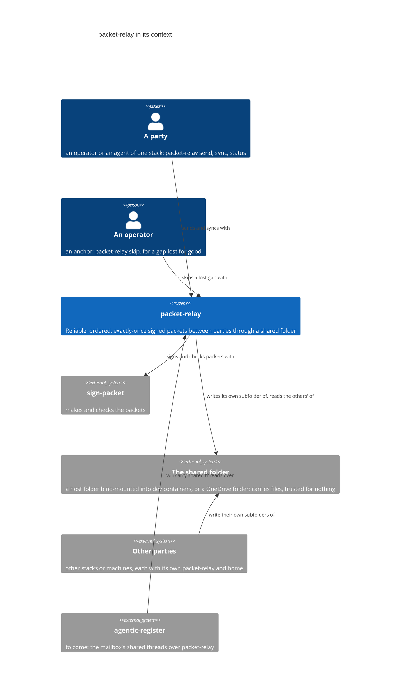
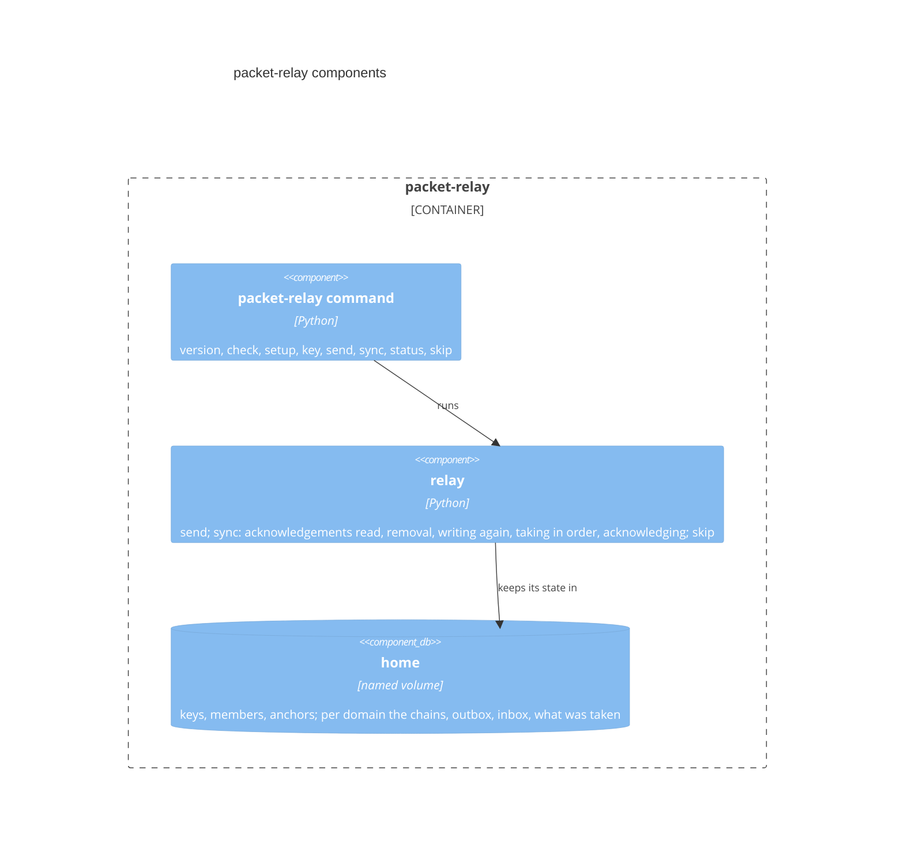

# packet-relay: components

The Feature's own C4 views (AOF ADR 0007: a Feature may draw itself). Each element names the file it
comes from, so the drawing can be checked against the source.

## Context

## Components

| Element | Source |
|---|---|
| `packet-relay` | `src/packet-relay/devcontainer-feature.json` |
| `cli` | `src/packet-relay/packetrelay/cli.py` |
| `relay` | `src/packet-relay/packetrelay/relay.py` |
| `home` | `devcontainer-feature.json`, `mounts` (`packet-relay-state-${devcontainerId}`) |
| `sign_packet` | `relay.py` (imports `signpacket`); `src/sign-packet/` |
| `shared_folder` | the `root` option; `SPEC.md`, "The folder" |
| `other_parties` | `SPEC.md`, "Terms" (a party, the members file) |
| `agentic_register` | AOF ADR 0024, decision 5; backlog item `mailbox-federation` |
| `party`, `operator` | `SPEC.md`, "Terms" |
