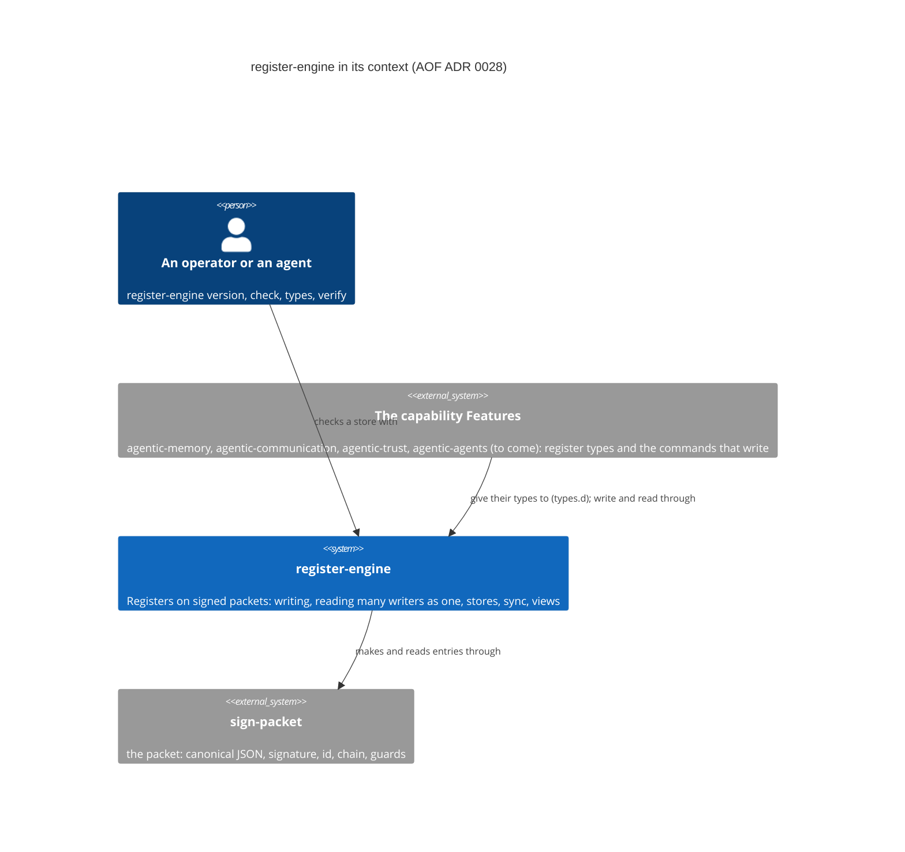
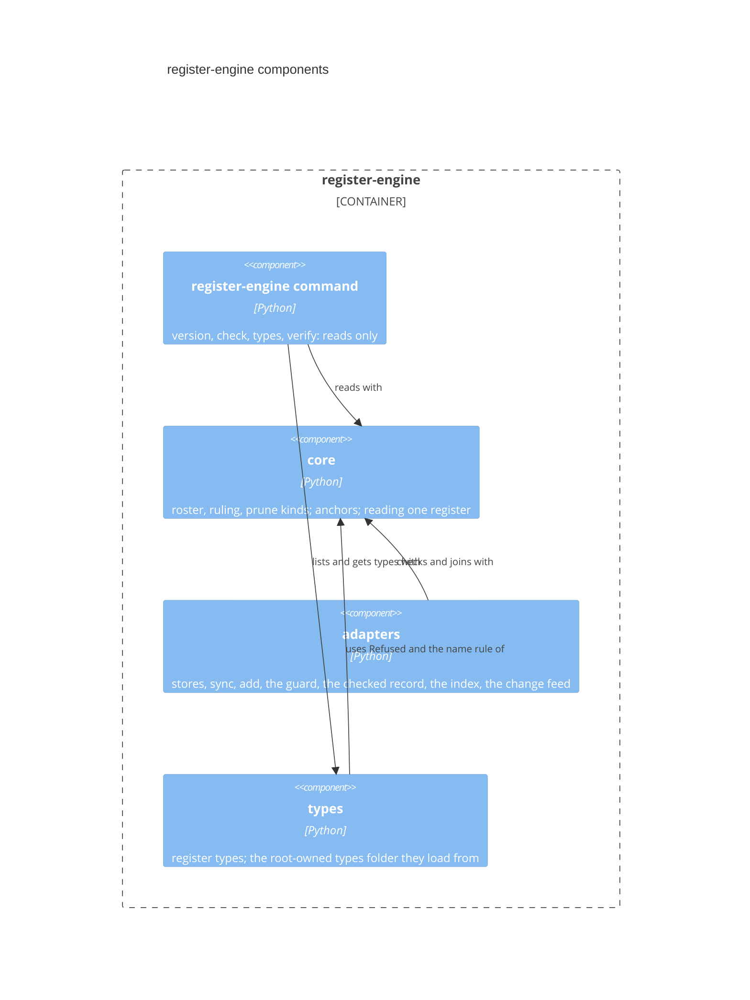

# register-engine: components

The Feature's own C4 views (AOF ADR 0007: a Feature may draw itself). Each element names the file it
comes from, so the drawing can be checked against the source. register-engine keeps no state.

## Context

## Components

| Element | Source |
|---|---|
| `register-engine` | `src/register-engine/devcontainer-feature.json` |
| `cli` | `src/register-engine/registerengine/cli.py` |
| `core` | `src/register-engine/registerengine/core.py` |
| `adapters` | `src/register-engine/registerengine/adapters.py` |
| `types` | `src/register-engine/registerengine/registertypes.py` |
| `capabilities` | AOF ADR 0028; `AOF's aof/tooling/design/feature-domains.md` |
| `sign_packet` | `src/sign-packet/` (imported as `signpacket`) |
