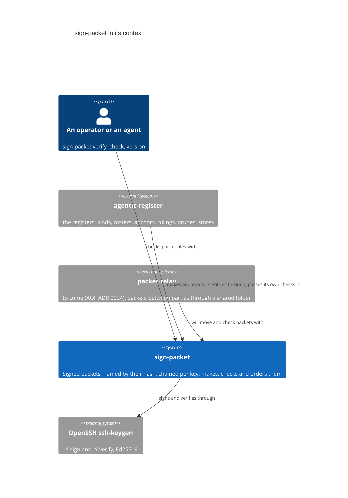
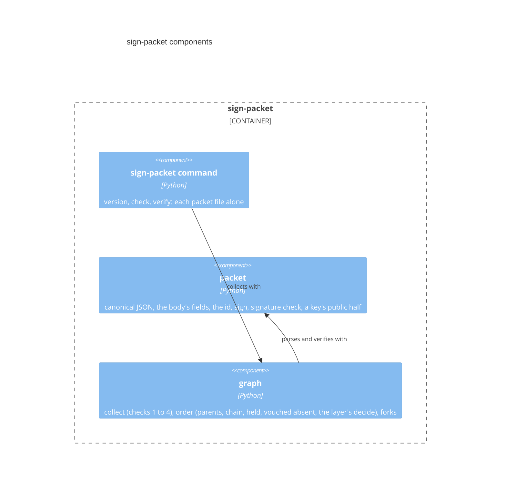

# sign-packet: components

The Feature's own C4 views (AOF ADR 0007: a Feature may draw itself). Each element names the file it
comes from, so the drawing can be checked against the source. sign-packet keeps no state.

## Context

## Components

| Element | Source |
|---|---|
| `sign-packet` | `src/sign-packet/devcontainer-feature.json` |
| `cli` | `src/sign-packet/signpacket/cli.py` |
| `packet` | `src/sign-packet/signpacket/packet.py` |
| `graph` | `src/sign-packet/signpacket/graph.py` |
| `agentic_register` | `src/agentic-register/register/core.py` (imports `signpacket`) |
| `packet_relay` | AOF ADR 0024, decision 3; backlog item `packet-relay-feature` |
| `openssh` | `signpacket/packet.py`, `sign()` and `signature_ok()` |
